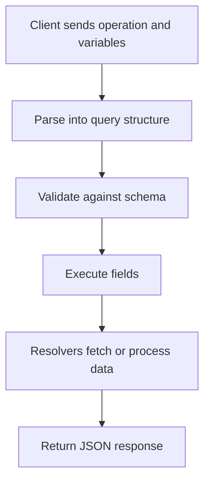

# What is GraphQL?

GraphQL is a **query language for APIs** and also an **execution model** for the server to process those queries. Instead of requiring the server to return a fixed data structure for each endpoint, the client describes the fields it needs; the GraphQL server validates the request against a schema and returns the result in the selected structure.

GraphQL represents data as a graph of types and relationships. A client can traverse from one object to related objects within a single operation. For example, starting from a product, it can fetch its seller and reviews.

GraphQL is not a database, not an ORM, and not a framework specific to Java or Spring. It defines how to describe an API, how clients request data, and how the server executes requests. The server can fetch data from a relational database, NoSQL, other REST services, a search engine, or multiple sources at once.

## Why was GraphQL created?

As an application grows, many screens and many types of clients share the API. A product detail screen on the web might need the name, price, description, seller, and reviews. A mobile app might only need the name, price, and thumbnail image. An admin page might also need inventory status and internal details.

With traditional REST APIs, the server usually designs the endpoints and response structures upfront. This approach is straightforward, but two issues can arise as client requirements change.

### Over-fetching: receiving more data than needed

Suppose the `GET /products/42` endpoint always returns the full product details, inventory history, long description, and metadata. A list screen only needs the name and price, yet it still has to receive the entire response. The unused data increases payload size and processing work on the client.

### Under-fetching: a single screen must call multiple APIs

Suppose the product endpoint only returns basic information. To display the detail page, the client also has to call the seller endpoint, the reviews endpoint, and the inventory endpoint. Multiple requests increase client complexity and can force the screen to wait for multiple round trips to the server.

This is not an inherent flaw of REST. REST can solve this with composite endpoints, field selection parameters, or screen-specific response designs. However, as the number of clients and data combinations grows, maintaining many specialized endpoints can become difficult.

GraphQL puts field selection into the client's operation. The client sends a single request describing both the root data and related fields, while the server is responsible for executing that request according to the schema. As a result, the client can fetch a dataset tailored to its screen without requiring the server to create a new endpoint for every field combination.

## What components make up GraphQL?

A GraphQL API is organized around three main components:

- **Schema** describes the data types, fields, arguments, and operations that the API allows.
- **Operation** is the specific request sent by the client. Common operations are Query, Mutation, and Subscription.
- **Resolver** is the server-side logic used to fetch or compute the value for a field in the result.

The schema is the contract between the client and the server. The client can only request fields declared in the schema; the server also needs to provide logic to execute those fields.

### Schema and the type system

GraphQL typically describes the schema using the **Schema Definition Language (SDL)**. The example below describes part of a store API:

```graphql
enum ProductStatus {
  ACTIVE
  OUT_OF_STOCK
  ARCHIVED
}

type Product {
  id: ID!
  name: String!
  price: Float!
  status: ProductStatus!
  seller: Seller!
  reviews(first: Int = 5): [Review!]!
}

type Seller {
  id: ID!
  displayName: String!
}

type User {
  id: ID!
  displayName: String!
}

type Review {
  id: ID!
  rating: Int!
  comment: String
  author: User!
}

type Query {
  product(id: ID!): Product
  products(status: ProductStatus, first: Int = 20): [Product!]!
}

input CreateProductInput {
  name: String!
  price: Float!
}

type Mutation {
  createProduct(input: CreateProductInput!): Product!
}

type Subscription {
  productChanged(productId: ID!): Product!
}
```

This example contains several important elements:

- `type` declares an object type. `Product` has fields such as `id`, `name`, `price`, `seller`, and `reviews`.
- `enum` restricts a field's value to a predefined set of values. `ProductStatus` only accepts one of the three declared states.
- `input` declares an input data structure. Input objects are commonly used as arguments for mutations.
- `Query`, `Mutation`, and `Subscription` are the root operation types. They define the operations clients can invoke.
- Arguments such as `id`, `first`, and `input` allow clients to pass parameters when requesting a field.

GraphQL has built-in scalar types including `Int`, `Float`, `String`, `Boolean`, and `ID`. An API can also declare enums, object types, input object types, interfaces, and unions to model richer data.

### Lists and nullability

GraphQL uses `!` to indicate a non-nullable value. Square brackets indicate a list. These two can be combined to describe nullability precisely:

| Declaration | Meaning |
| --- | --- |
| `Product` | Can be a Product or `null`. |
| `Product!` | Must be a Product, cannot be `null`. |
| `[Product]` | The list can be `null`; each element can also be `null`. |
| `[Product!]` | The list can be `null`; each element must be a Product. |
| `[Product]!` | The list cannot be `null`; elements can be `null`. |
| `[Product!]!` | Both the list and all elements cannot be `null`. |

For example, `reviews(first: Int = 5): [Review!]!` means the `reviews` field always returns a list; the list cannot be null, and every element must be a Review. If the server has no reviews, the appropriate result is an empty list.

Output types and input types have their own rules. Object types like `Product` describe data returned by the server. Input objects like `CreateProductInput` receive data from the client; a regular object type cannot be used in place of an input object.

## Three operation types: Query, Mutation, and Subscription

GraphQL distinguishes operations by purpose. Operation names can also be specified to make logging, tracing, and reading code easier.

### Query: reading data

Queries are used to request data. The client selects the fields to fetch and can pass arguments to each field.

```graphql
query ProductDetail($productId: ID!) {
  product(id: $productId) {
    id
    name
    price
    seller {
      id
      displayName
    }
    reviews(first: 3) {
      rating
      comment
    }
  }
}
```

The `$productId` variable is declared at the top of the operation. The variable's value is sent separately in the `variables` section of the request:

```json
{
  "productId": "42"
}
```

The client can receive a result with the corresponding structure:

```json
{
  "data": {
    "product": {
      "id": "42",
      "name": "Mechanical keyboard",
      "price": 1250000,
      "seller": {
        "id": "seller-7",
        "displayName": "Minh An Store"
      },
      "reviews": [
        { "rating": 5, "comment": "Great typing feel" },
        { "rating": 4, "comment": "Carefully packaged" }
      ]
    }
  }
}
```

The example shows the client selecting both top-level fields (`product`) and nested fields (`seller`, `reviews`). The server only returns the fields requested in the selection set, matching the operation's structure.

### Mutation: modifying data

Mutations are used for creating, updating, or deleting data. The client sends input data and selects the fields it wants returned after the operation completes.

```graphql
mutation CreateProduct($input: CreateProductInput!) {
  createProduct(input: $input) {
    id
    name
    price
  }
}
```

The input variables can be sent as follows:

```json
{
  "input": {
    "name": "Mechanical keyboard",
    "price": 1250000
  }
}
```

Mutations clearly describe write operations and input data types. According to GraphQL execution rules, top-level fields in the same mutation operation are executed sequentially. This does not automatically replace system transactions or data consistency rules; the server must still implement those guarantees.

### Subscription: receiving update events

Subscriptions are used when the client needs to receive new data over time, such as order statuses, notifications, or changing product prices.

```graphql
subscription WatchProduct($productId: ID!) {
  productChanged(productId: $productId) {
    id
    name
    price
    status
  }
}
```

Unlike Query and Mutation, which typically follow a request/response model, Subscription maintains a stream so the server can push events to the client. GraphQL defines the semantics of the operation; the specific transport mechanism depends on the implementation. In real-world applications, the server may use WebSocket or another supported streaming mechanism.

## Common query syntax features

Beyond selecting fields and passing variables, GraphQL provides syntax features that make operations easier to read and reuse.

**Alias** gives a different name to a field in the response. Aliases are useful when you need to call the same field multiple times with different arguments:

```graphql
query CompareProducts {
  keyboard: product(id: "42") {
    id
    name
    price
  }
  mouse: product(id: "57") {
    id
    name
    price
  }
}
```

The response will contain two branches, `keyboard` and `mouse`, even though both are fetched from the `product` field.

**Fragment** groups a set of fields for reuse across multiple selection sets:

```graphql
fragment ProductSummary on Product {
  id
  name
  price
}

query ProductLists {
  products(first: 10) {
    ...ProductSummary
  }
}
```

Fragments help reduce repetition in large operations. They do not create new endpoints or new data types; a fragment simply reuses part of a selection set.

## How does the server process a GraphQL request?

A GraphQL request typically goes through the following steps:



1. **Receive request:** the server receives the operation content along with variables and context information such as authentication details.
2. **Parse:** GraphQL converts the query string into a structure that the engine can analyze.
3. **Validate:** the engine checks field names, argument types, return types, and operation rules against the schema. Invalid queries are rejected before execution.
4. **Execute:** the engine traverses the requested fields and invokes the corresponding handler logic.
5. **Resolve data:** resolvers can query repositories, call other services, or compute values. For nested fields, resolvers continue fetching the related values.
6. **Serialize response:** the server returns data matching the selection set structure, usually as JSON.

Resolvers typically operate at the field level. For instance, the `product` resolver finds a product by ID; the `seller` resolver fetches the related seller; the `reviews` resolver fetches the list of reviews. A field can also extract data from an already available parent object without querying the database.

This explains why the schema does not provide data on its own. The schema describes what the API allows; resolvers and server-side components determine how data is fetched and processed.

## Response structure and error handling

A GraphQL response usually contains a `data` field, an `errors` field, or both. When execution succeeds, `data` contains the result matching the operation:

```json
{
  "data": {
    "product": {
      "id": "42",
      "name": "Mechanical keyboard"
    }
  }
}
```

When a field encounters an error during execution, the response can contain both the retrieved data and a list of errors:

```json
{
  "data": {
    "product": {
      "id": "42",
      "name": "Mechanical keyboard",
      "seller": null
    }
  },
  "errors": [
    {
      "message": "Unable to load seller information",
      "path": ["product", "seller"],
      "extensions": {
        "code": "SELLER_UNAVAILABLE"
      }
    }
  ]
}
```

Common parts of an error:

- `message` describes the error.
- `locations` can point to the position in the operation that caused the error.
- `path` indicates which field or list element in the response encountered the error.
- `extensions` is where the server can place error codes or additional metadata according to the application's conventions.

GraphQL can return partial data when one field fails while other fields still succeed. However, nullability rules affect the outcome: if a non-nullable field returns null due to an error, the null can bubble up to the nearest nullable parent field. Therefore, choosing `!` in the schema is a decision about both the data contract and how errors are represented.

Syntax errors or validation errors usually prevent the operation from executing. Errors thrown in resolvers occur during execution and may be accompanied by partial data. Clients should inspect both `data` and `errors`, rather than relying solely on HTTP-level success or failure.

## How does GraphQL differ from REST?

Both GraphQL and REST can be used to build APIs for applications. The main differences lie in how data is described and fetched.

| Aspect | REST | GraphQL |
| --- | --- | --- |
| Organization | Usually centers around resources and multiple endpoints. | Usually centers around a schema and a single GraphQL endpoint. |
| Field selection | Response structure is usually determined by the endpoint. | Client selects fields in the operation. |
| Related data | May require calling multiple endpoints or a composite endpoint. | Can request relationships within the same operation. |
| Contract | Can be described with OpenAPI or other documentation. | Schema is a strongly typed, introspectable contract. |
| HTTP caching | Caching by URL, method, and headers is fairly natural. | Caching by operation content and variables usually needs a dedicated strategy. |
| API evolution | Can version endpoints or extend responses. | Can add fields and mark old fields as deprecated through a compatible workflow. |

GraphQL does not replace REST in every scenario. REST is often a good fit for simple resource APIs, clear HTTP semantics, and leveraging HTTP/CDN caching effectively. GraphQL is useful when many clients need different combinations of data or when data has rich relationships that need flexible querying.

A system can also use both: REST for certain resources or external integrations, and GraphQL as an API layer serving screens that need data aggregation. The choice should be based on client needs, backend organization, operational capabilities, and development cost.

## How is GraphQL used with Spring for GraphQL?

Spring for GraphQL brings GraphQL into the Spring ecosystem. The application declares a schema using SDL, then provides handler components so the GraphQL engine can fetch data for the corresponding fields. In a Spring Boot application, schemas are typically placed in the application's resources directory, and controllers or handler components handle field execution.

Example schema declaring a simple Query:

```graphql
type Query {
  greeting(name: String): String!
}
```

A Java controller can provide the logic for that field:

```java
@Controller
public class GreetingController {

    @QueryMapping
    public String greeting(@Argument String name) {
        String recipient = name == null ? "friend" : name;
        return "Hello, " + recipient;
    }
}
```

`@QueryMapping` binds the method to a field on the Query root type; `@Argument` extracts the argument value from the operation. This example illustrates how the schema and Java logic work together. Subsequent lessons will dive deeper into SDL, Query, Mutation, Subscription, `@SchemaMapping`, `@BatchMapping`, DataLoader, error handling, security, and testing.

With data relationships, a single GraphQL operation can cause the server to load many nested fields. If each resolver queries the database individually for each object, the system can run into the N+1 problem. GraphQL does not automatically batch these queries. In Spring for GraphQL, DataLoader and `@BatchMapping` are key tools for batching the loading of related data.

## What does GraphQL solve and what should you watch out for?

GraphQL can help:

- Let clients select the exact fields they need, reducing over-fetching.
- Combine related data in a single operation, reducing the number of requests the client has to coordinate.
- Provide a strongly typed schema, supporting operation validation and API documentation.
- Serve multiple types of clients with different data requirements over the same API contract.
- Evolve the schema by adding fields, while marking old fields as deprecated to guide client migration.

However, GraphQL does not automatically solve every backend challenge:

- **Performance:** a single request can still trigger many database queries. You need to design resolvers, batching, DataLoader, pagination, and query complexity limits.
- **Security:** you need user authentication, operation- or field-level authorization, protection of sensitive data, and resource limits. Just because a client requests a field does not mean it is permitted to access that field.
- **Caching:** traditional HTTP/CDN caching does not always apply directly because many operations may be sent to the same URL. You need an appropriate caching strategy for queries, variables, and data.
- **Operations:** you need to monitor operations, resolver execution times, field-level errors, and resource-intensive queries.
- **Subscription:** requires additional infrastructure to maintain connections and publish events, along with handling authentication, disconnections, and scalability.

GraphQL gives clients the ability to describe the data they need. In return, the server must tightly manage the schema, resolvers, access control, and execution cost so the API remains flexible yet safe and stable.

## When should you consider GraphQL?

GraphQL is often worth considering when:

- The product has web, mobile, and other clients that require different sets of data fields.
- A single screen needs to combine multiple types of interrelated data.
- Clients change frequently and creating dedicated endpoints per screen becomes costly to maintain.
- The team wants a strongly typed schema as a shared contract between frontend and backend.

REST or a simpler API may be a better fit when resources have few relationships, data reading needs are stable, HTTP caching is a key requirement, or the team does not yet need to operate a GraphQL engine and query-control tooling.

## Takeaways

GraphQL is a query language and execution model for APIs. The schema defines the types and fields permitted for access; the operation describes the data the client needs; resolvers provide the logic to fetch data for each field. Query is for reading, Mutation is for modifying data, and Subscription is for receiving update events.

GraphQL helps clients fetch data tailored to their needs and combine relationships in a single operation. Performance, security, caching, and consistency still depend on how the server is implemented. When using Spring for GraphQL, the SDL schema works alongside mappings and resolvers in Spring to form the application's GraphQL API.
