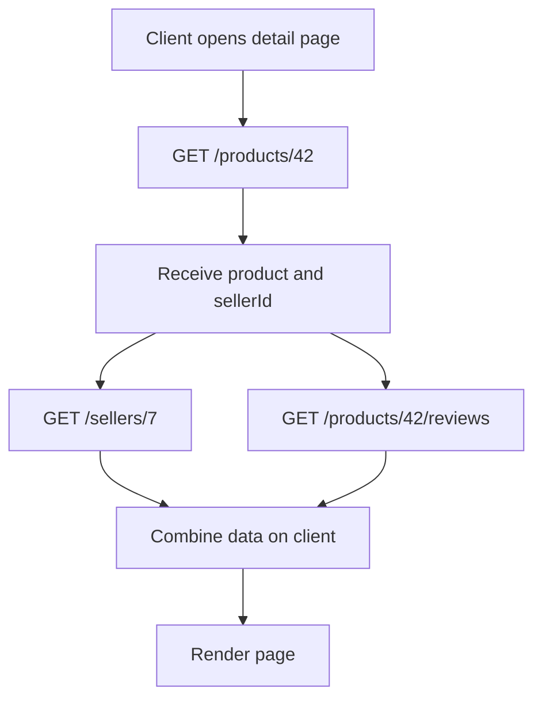
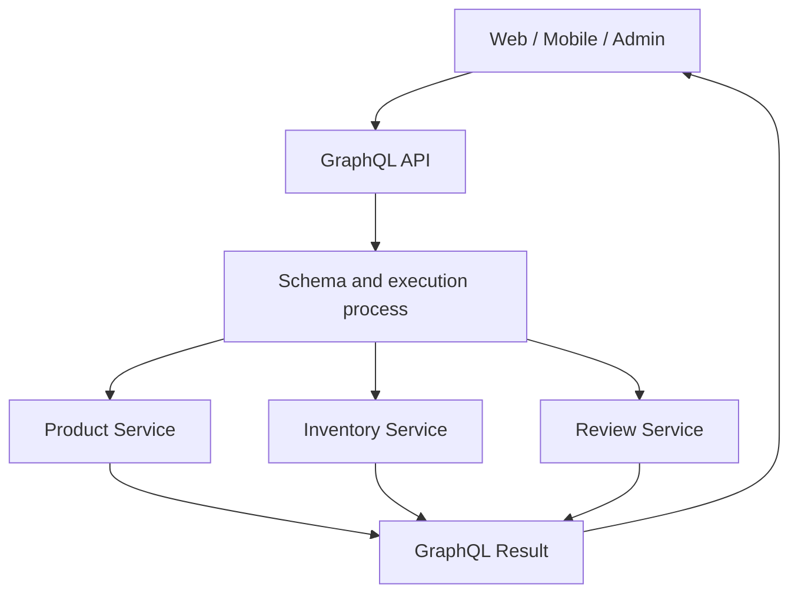

# What Problems Does GraphQL Solve?

## Objectives

After this lesson, you will be able to:

- Explain why an API designed around fixed endpoints sometimes fails to serve the needs of multiple interfaces well.
- Distinguish between *overfetching* and *underfetching*.
- Describe how GraphQL lets clients declare the data they need to receive through a typed schema.
- Identify which problems GraphQL helps solve and which problems the backend still needs to handle.
- Connect those foundational concepts to Spring for GraphQL.

## Context: one system, many data needs

An e-commerce system may serve a website, a mobile app, an admin portal, and a partner application. These applications share product, seller, inventory, and review data, yet each screen needs a different subset of data.

For example, a product listing page only needs the name, image, and price. A detail page also needs the description, seller information, and several reviews. An admin screen may need inventory counts, update history, and internal metadata.

With traditional REST APIs, the backend usually publishes endpoints with pre-designed response structures, such as:

- `GET /api/products`: fetch the list of products.
- `GET /api/products/42`: fetch information for a single product.
- `GET /api/products/42/reviews`: fetch reviews for a product.
- `GET /api/sellers/7`: fetch seller information.

This design works well for many systems. Difficulties arise when client requirements change rapidly or when there are many different types of clients. Clients may receive too much data, receive too little data, have to call multiple endpoints, or become coupled to how the backend organizes resources.

GraphQL was created to address the set of problems around how clients request and combine data from an API. Instead of picking an endpoint with a fixed response, the client sends a query describing the fields it needs. The server validates the query against the schema and executes the corresponding parts to return appropriately structured data.

## 1. Overfetching: the API returns more data than needed

*Overfetching* happens when the client only needs a few fields, yet the endpoint returns a much larger object.

Suppose a listing screen only displays the product's name and price. The REST endpoint `GET /api/products/42` might return:

```json
{
  "id": 42,
  "name": "Mechanical Keyboard",
  "price": 1250000,
  "description": "A full description...",
  "weight": 850,
  "dimensions": {
    "width": 440,
    "height": 40,
    "depth": 135
  },
  "inventory": {
    "warehouse": "HCM-01",
    "available": 28
  },
  "seller": {
    "id": 7,
    "name": "Example Store",
    "phone": "..."
  }
}
```

The client only uses `name` and `price`, yet it still has to receive and process the rest. With large payloads or lists of many records, redundant data can increase network transfer volume and client-side processing cost.

GraphQL allows the client to specify only the required fields:

```graphql
query {
  product(id: "42") {
    name
    price
  }
}
```

The server can return:

```json
{
  "data": {
    "product": {
      "name": "Mechanical Keyboard",
      "price": 1250000
    }
  }
}
```

The response is structured according to the query. The client does not need to download fields that the current screen does not use.

## 2. Underfetching: a single endpoint does not provide enough data for a screen

*Underfetching* happens when an endpoint returns only part of the required data, forcing the client to call additional endpoints to complete the screen.

For example, a product detail page needs:

- Product name and price.
- Seller name.
- Three most recent reviews.

If the product API only returns product details, the client may also have to call the seller API and the reviews API. A single screen therefore generates multiple dependent requests.



Dependent requests can increase overall latency, especially when the client must wait for the result of a prior request to obtain parameters for the next request. The client also has to merge data from multiple responses itself.

GraphQL lets you express related data in a single query:

```graphql
query ProductDetail {
  product(id: "42") {
    name
    price
    seller {
      name
    }
    reviews(first: 3) {
      rating
      comment
    }
  }
}
```

The client receives a data tree matching the query structure:

```json
{
  "data": {
    "product": {
      "name": "Mechanical Keyboard",
      "price": 1250000,
      "seller": {
        "name": "Example Store"
      },
      "reviews": [
        {
          "rating": 5,
          "comment": "Good quality"
        }
      ]
    }
  }
}
```

The server is responsible for resolving the fields and combining data from the appropriate sources. The client does not have to orchestrate individual endpoints for this data structure.

A GraphQL query is usually sent to a single endpoint, but that does not mean the server performs only one read operation or one SQL query. During execution, resolvers can still call multiple backend services, repositories, or APIs.

## 3. Clients need a data shape tailored to each screen

A fixed endpoint usually reflects a data view chosen by the backend. When multiple clients have different needs, the backend may have to add extra endpoints or parameters to accommodate each case.

GraphQL shifts part of the choice over the response shape to the client. The client selects fields within the boundaries of the published schema. The website can fetch `name`, `price`, and `imageUrl`; the mobile app fetches `name` and `price`; the admin page additionally fetches `inventory`.

For example, the following queries both use the `product` field but request different data:

```graphql
# Product card
query ProductCard {
  product(id: "42") {
    name
    price
    imageUrl
  }
}
```

```graphql
# Admin screen
query ProductAdmin {
  product(id: "42") {
    name
    price
    inventory {
      available
      warehouse
    }
  }
}
```

This is useful when multiple applications share a data domain but have different presentation needs. The backend can provide one unified schema, while each client fetches the subset of data suited to its functionality.

However, clients can only query the fields permitted by the schema. GraphQL is not a mechanism for clients to arbitrarily access the database or bypass business rules.

## 4. A typed schema creates a clear contract between client and server

An API needs to describe accessible data, input parameters, and returned results. If the contract is unclear, clients can easily send incorrect data types or depend on fields that the backend does not commit to supporting.

GraphQL uses a typed schema. The schema describes data types, fields, arguments, and entry points such as `Query`, `Mutation`, and `Subscription`.

SDL (Schema Definition Language) example:

```graphql
type Query {
  product(id: ID!): Product
}

type Product {
  id: ID!
  name: String!
  price: Int!
  seller: Seller
}

type Seller {
  id: ID!
  name: String!
}
```

Some important notations:

| Syntax | Meaning |
|---|---|
| `ID` | Identifier type |
| `String` | String |
| `Int` | Integer |
| `Product` | Object type defined by the schema |
| `ID!` | Required value, cannot be null |
| `[Product]` | List of Products; the list itself can be null |
| `[Product!]!` | Required list and each element also cannot be null |

Before execution, GraphQL validates the query against the schema. For instance, a query requesting a non-existent field or passing an argument of the wrong type will be rejected during the validation step.

The schema also enables developer tools to support autocomplete, documentation, and client type generation. With GraphQL, the schema is the central technical contract between the API provider and the API consumer.

## 5. Evolving the API while reducing the need for new versions

In an API with fixed responses, structural changes can break existing clients. A common approach is to maintain multiple endpoint versions, such as `/v1` and `/v2`.

GraphQL supports schema evolution by adding new fields without forcing older clients to use them. Clients only request the fields they need. When a field needs to be retired, the schema can mark that field as deprecated and provide a reason or replacement guidance.

Example:

```graphql
type Product {
  id: ID!
  name: String!
  oldPrice: Int @deprecated(reason: "Use price instead")
  price: Int!
}
```

Older clients can continue using `oldPrice` during the transition period; newer clients switch to `price`. The backend team monitors usage of the old field before removing it according to the system's compatibility policy.

GraphQL does not automatically make every change safe. Changing a type, changing semantics, or removing a field that is still in use can still break clients. Schema lifecycle management and usage tracking still need to be performed.

## 6. Combining data from multiple sources into a single data graph

Data for a business domain often resides across multiple components: product details in the primary database, stock levels from an inventory service, shipping information from a logistics service, and reviews from another system.

If clients have to call each source directly, they must understand how the backend is organized and handle multiple protocols or response formats. GraphQL lets the server expose a single unified schema and resolve each field from its corresponding data source.



For example, the `product.inventory` field can be resolved from the Inventory Service, while `product.name` comes from the Product Service. Clients still query them through the same schema.

This approach hides backend integration details behind the API and creates a unified data access point. It also places additional responsibility on the GraphQL server: handling errors from upstream sources, timeouts, access control, consistency, and performance when combining data.

## 7. GraphQL does not automatically solve every backend problem

GraphQL improves how clients request and combine data. Actual quality still depends on how the server implements resolvers, data access, and API protection.

### The N+1 problem

Suppose a client queries 20 orders and the customer name for each order:

```graphql
query {
  orders {
    id
    customer {
      name
    }
  }
}
```

If the `customer` resolver runs a separate query for each order, the backend may execute one query to fetch the order list plus 20 additional queries for customers. This is the N+1 problem.

GraphQL does not automatically merge these data accesses. With Spring for GraphQL, you can use DataLoader or `@BatchMapping` to collect customer keys and load data in batches. Then, instead of querying each customer individually, the backend can fetch multiple customers in a single appropriate call.

### Field-level security

Just because a field appears in the schema does not mean every user is allowed to read it. The server must authenticate users and check permissions at appropriate points, even when clients nest multiple fields within one query.

With Spring for GraphQL, you can combine Spring Security with authorization checks in the appropriate handler layer. Access permissions should reflect business rules, such as a user only being able to view their own order information.

### Overly deep or expensive queries

A query can nest many levels deep or request large lists. If the server executes without limits, a single request can generate an enormous amount of work.

The API should limit page size, query depth, or query complexity where appropriate, enforce timeouts, and monitor resources. Resolvers also need to control how they access databases and downstream services.

### Caching and performance

GraphQL does not automatically provide a caching strategy suitable for every case. Since many queries can hit the same endpoint while requesting different sets of fields, the system needs to evaluate caching at the client, server, or data layer based on business characteristics.

Additionally, a short GraphQL query can still trigger many backend calls. You need to measure resolver execution times, data access counts, and latency for each source to pinpoint bottlenecks.

## 8. When should you consider GraphQL?

| Need | GraphQL may fit when | Considerations |
|---|---|---|
| Multiple client types | Web, mobile, and admin need different sets of fields | Design the schema and access permissions clearly enough |
| Linked data | A screen needs to combine multiple objects or services | Resolvers, batching, and error handling |
| Frequently changing clients | Clients need to select fields without waiting for custom endpoints | Change management and schema lifecycle |
| Typed API contract | You want validation, introspection, and schema tooling support | Schema design discipline |
| Simple API, few variants | REST may already meet the needs well | No need to add operational complexity |
| File downloads or HTTP resource caching | REST or dedicated endpoints may be more convenient | Multiple API styles can be combined in the same system |

GraphQL and REST can coexist. A system can use GraphQL for screens that require flexible data querying, while keeping REST for simple flows, file downloads, or already-stable integrations.

## 9. How does GraphQL process a query in Spring for GraphQL?

At a high level, a GraphQL request goes through the following steps:

1. The client sends a query, mutation, or subscription to the GraphQL endpoint.
2. The server parses and validates the query against the schema.
3. GraphQL executes the requested fields.
4. Resolvers fetch data from services, repositories, or external sources.
5. The server assembles the result into a response structured according to the query.

In Spring for GraphQL, the SDL schema defines the API contract. Methods annotated with annotations such as `@QueryMapping` or `@SchemaMapping` handle field resolution. When related data needs to be loaded in batches, `@BatchMapping` and DataLoader help mitigate N+1.

Subsequent lessons in the `SPRING_GRAPHQL` module will dive deeper into SDL schemas, Query, Mutation, Subscription, `@SchemaMapping`, `@BatchMapping`, DataLoader, error handling, field-level security, testing, and server-side query optimization.

## Conclusion

GraphQL primarily solves the mismatch between the data clients need and fixed API responses: clients might receive too much data (*overfetching*), have to call multiple endpoints to gather enough data (*underfetching*), or have to combine information from multiple sources themselves.

With a typed schema and client-declared queries, GraphQL establishes a clear contract and allows the server to deliver data in the structure the client requests. To be effective in practice, the backend still needs to handle batching, N+1, security, query limits, caching, and performance properly.
