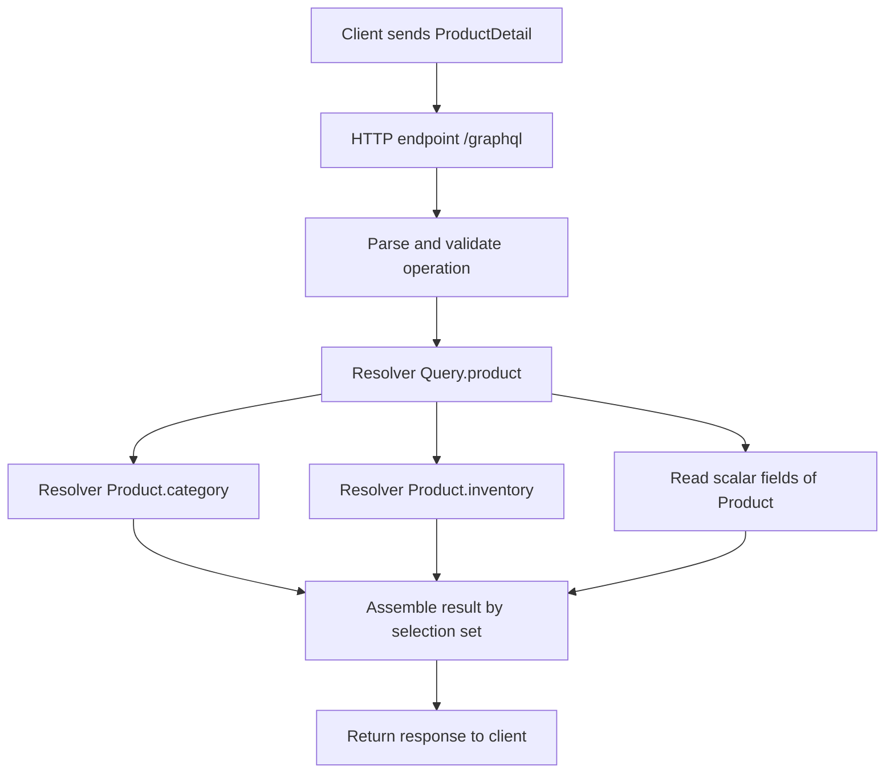

# One Endpoint for Multiple Use Cases

## Objectives

After this lesson, you will be able to:

- Explain why a GraphQL API typically uses a single HTTP endpoint to serve multiple screens and applications.
- Distinguish between endpoint, operation, field, and selection set in a GraphQL request.
- Design different queries on the same schema without creating dedicated endpoints per screen.
- Recognize the responsibilities that remain with the server: authorization, performance, complexity control, and resolver organization.
- Connect this model to `@QueryMapping` and `@SchemaMapping` in Spring for GraphQL.

## The problem: one endpoint per screen

Imagine an online store that needs to display product information in several places:

- The listing page only needs the name, image, and price to render a product card.
- The detail page also needs the description, category, and stock status.
- The admin screen needs the SKU, price, and stock quantity for staff inspection.
- The mobile app may only need the name, price, and a few short details to save bandwidth.

With a screen-by-screen REST design, development teams sometimes create URLs such as `/api/product-cards`, `/api/product-details/{id}`, and `/api/admin/products/{id}`. These endpoints may work well, but as the number of screens and applications grows, the server easily accumulates many endpoints with overlapping data. Every change to display requirements can lead to adding new endpoints or modifying dedicated responses.

GraphQL solves this problem by exposing a schema that describes the data clients can query. Clients send an operation to the GraphQL endpoint and specify the exact fields they need. Different clients can send different operations to the same endpoint, as long as the operation is valid against the schema and the caller has permission to access that data.

The core idea is that **the endpoint determines where requests are received; the operation and selection set determine what the client is asking for**.

## Distinguishing endpoint, operation, and field

These concepts serve different roles:

| Concept | Meaning | Example |
| --- | --- | --- |
| Endpoint | Address that receives GraphQL requests | `POST /graphql` |
| Operation | A request to read, write, or watch data | `query ProductDetail { ... }` |
| Root field | Starting point of the operation in the schema | `product(id: $id)` |
| Selection set | List of fields the client wants to receive | `{ id name price { amount currency } }` |
| Resolver | Server logic used to supply a value for a field | `@QueryMapping`, `@SchemaMapping` |

In a Spring Boot application using Spring for GraphQL, the default HTTP endpoint is usually `/graphql` and can be reconfigured. Many clients can call this address. The server does not need a new URL for each type of screen; it reads the operation in the request to know which part of the schema to execute.

A GraphQL document can contain one or more operations. If the document has multiple operations, the request can pass `operationName` to choose which operation to run. `operationName` is not an endpoint name and does not create a new route on its own.

## One schema, many ways to fetch data

Suppose a retail API exposes the following simplified schema:

```graphql
type Query {
  product(id: ID!): Product
  products(categoryId: ID, first: Int = 20): [Product!]!
}

type Product {
  id: ID!
  name: String!
  description: String
  sku: String!
  price: Money!
  category: Category
  inventory: Inventory
}

type Money {
  amount: Float!
  currency: String!
}

type Category {
  id: ID!
  name: String!
}

type Inventory {
  availableQuantity: Int!
  status: String!
}
```

The schema describes the API's capabilities. It does not force every client to receive all fields of `Product`. Clients pick a subset suited to their use case.

### Use case 1: product card

The listing page only needs the identifier, name, and price:

```graphql
query ProductCard($id: ID!) {
  product(id: $id) {
    id
    name
    price {
      amount
      currency
    }
  }
}
```

The server returns only the selected fields. The client does not have to receive `description`, `sku`, `category`, or `inventory` if the screen does not use them.

### Use case 2: detail page

The detail page can additionally request the description, category, and stock status:

```graphql
query ProductDetail($id: ID!) {
  product(id: $id) {
    id
    name
    description
    price {
      amount
      currency
    }
    category {
      id
      name
    }
    inventory {
      availableQuantity
      status
    }
  }
}
```

This operation still calls the root field `product` on the same schema. The difference lies in the selection set: the client requests additional nested fields.

### Use case 3: admin screen

Admin staff may need the SKU and stock quantity:

```graphql
query ProductAdminView($id: ID!) {
  product(id: $id) {
    id
    sku
    name
    price {
      amount
      currency
    }
    inventory {
      availableQuantity
      status
    }
  }
}
```

The three operations above query the same kind of data, yet each serves a different need. They do not require three separate endpoints. The server must still verify the caller's permissions: having a field appear in the schema does not mean every account is allowed to read it.

## Actual requests to a GraphQL endpoint

Over HTTP, clients usually send a `POST` request to `/graphql`. The body can contain `query`, `operationName`, and `variables`:

```http
POST /graphql
Content-Type: application/json
```

```json
{
  "operationName": "ProductCard",
  "query": "query ProductCard($id: ID!) { product(id: $id) { id name price { amount currency } } }",
  "variables": {
    "id": "p-101"
  }
}
```

The three parts of the body have distinct meanings:

- `query` contains the GraphQL document, including the operation and selected fields.
- `operationName` specifies which operation to execute when the document has multiple operations. When the document has only one operation, this field can usually be omitted.
- `variables` passes input values such as the product ID. Using variables separates input data from the query structure, making reuse and type checking convenient.

A detail-page client can send a different body, yet still call `POST /graphql`. The server parses the request, selects the operation, validates the operation against the schema, and executes the corresponding fields.

## How does Spring for GraphQL process the request?

In Spring for GraphQL, annotated methods serve to provide data for schema fields. For example, `@QueryMapping` binds a method to a root field on `Query`:

```java
@Controller
public class ProductController {

    private final ProductService productService;

    public ProductController(ProductService productService) {
        this.productService = productService;
    }

    @QueryMapping
    public Product product(@Argument String id) {
        return productService.findById(id).orElse(null);
    }
}
```

This method provides data for the `product(id: ID!): Product` field in the schema. It does not need to know whether the request came from the listing page, the detail page, or the mobile app. Clients decide which fields to fetch via the selection set.

Nested fields can be handled with `@SchemaMapping`:

```java
@Controller
public class ProductFieldController {

    private final ProductService productService;

    public ProductFieldController(ProductService productService) {
        this.productService = productService;
    }

    @SchemaMapping(typeName = "Product", field = "category")
    public Category category(Product product) {
        return productService.findCategory(product.categoryId());
    }

    @SchemaMapping(typeName = "Product", field = "inventory")
    public Inventory inventory(Product product) {
        return productService.findInventory(product.id());
    }
}
```

When a client requests `product { name }`, the server only needs to supply fields on the selected branch. When a client also requests `category` or `inventory`, the corresponding resolvers can be called to fetch data for those fields. Spring for GraphQL combines the schema with these mappings to execute the operation.

The example above is simplified to illustrate how fields are bound. In a real application, `Product`, `Category`, `Inventory`, and the services must be defined to match the domain model; handling missing products must also be consistent with the API's error conventions.

## One endpoint does not mean one resolver

A single GraphQL request can pass through multiple resolvers. For the detail page query, the processing flow can look like:



The endpoint is the entry point for the request. Resolvers are the components that supply data for each field. One query can invoke multiple resolvers, and one resolver can be reused across multiple operations. As a result, data-access logic can be organized by field or business domain rather than duplicated per screen.

This also means the server must pay attention to execution cost. If a page requests a list of 100 products and each product queries its category or inventory individually, the system can run into the N+1 problem. Spring for GraphQL supports mechanisms like `@BatchMapping` and DataLoader integration to load data in batches. Having a single endpoint does not automatically eliminate N+1; how resolvers are written still determines real-world performance.

## Query, Mutation, and Subscription belong to the same API model

GraphQL defines the root operation types:

- `Query` is used to read data.
- `Mutation` is used to perform data modifications.
- `Subscription` is used to receive update events over time.

Queries and mutations are typically sent over the same GraphQL HTTP endpoint. For example, the schema can declare:

```graphql
input AddToCartInput {
  productId: ID!
  quantity: Int!
}

type Cart {
  id: ID!
  itemCount: Int!
}

type Mutation {
  addToCart(input: AddToCartInput!): Cart!
}
```

The client adds a product to the cart with an operation:

```graphql
mutation AddProductToCart($input: AddToCartInput!) {
  addToCart(input: $input) {
    id
    itemCount
  }
}
```

This operation is still sent to the GraphQL endpoint. The server recognizes it as a mutation based on the operation type and executes the `addToCart` root field.

Subscriptions differ further in transport because they must keep a connection open to receive subsequent data. Spring for GraphQL can deliver subscriptions over transports such as WebSocket or Server-Sent Events depending on configuration. Therefore, the concept of "one endpoint" should be understood as a unified GraphQL API entry point for standard operations; transports for subscriptions may require configuring a separate path or connection.

## Benefits when multiple use cases share a schema

**Fewer endpoints to maintain.** Adding a new screen usually only requires designing an operation against the existing schema. The development team does not necessarily need to add a dedicated URL and response model for that screen.

**Clients proactively choose data.** A compact screen can fetch few fields; a detail screen can fetch nested fields. This reduces redundant data over the wire, especially when interfaces have varied requirements.

**Reusable data-access logic.** Multiple operations can share root fields and resolvers. Business logic should live in the service/domain layer so resolvers can coordinate without depending on a specific UI type.

**Compatible schema evolution.** New fields can be added without forcing all clients to adopt them immediately. When an old field needs replacement, GraphQL supports marking it as deprecated to give clients time to migrate:

```graphql
type Product {
  oldPrice: Float @deprecated(reason: "Use price instead")
  price: Money!
}
```

This benefit relies on schema design discipline and client-tracking practices. A single endpoint does not automatically make an API backwards-compatible.

## Responsibilities that remain with the server

Letting clients select fields does not mean the server can trust every request. A GraphQL API shared across many use cases needs to address the following concerns.

### User- and field-level authorization

The server must authenticate requests and enforce permissions on sensitive data, actions, and fields. For example, customers can view public selling prices, but must not see internal data such as cost price or staff notes. Hiding a field in the UI is not a security measure.

In Spring, you can combine Spring Security with authorization checks in the controller, service, or resolver layer depending on architecture. Ensure authorization checks are applied to every access path to the data, even when a field is reached nested inside another operation.

### Controlling query complexity

A query can nest many levels deep and request large lists. Without limits, a syntactically valid request can still consume excessive CPU, memory, or database queries. Production APIs should consider:

- Capping page sizes and requiring pagination for large collections.
- Setting query depth or complexity limits when appropriate.
- Applying rate limits and timeouts according to system policies.
- Monitoring operations, execution durations, and expensive resolvers.

### Avoiding N+1 and unnecessary data loading

GraphQL helps clients request the exact fields they need, but the server must still implement resolvers efficiently. For one-to-many or many-to-one relationships, consider `@BatchMapping`, DataLoader, appropriate join queries, or batch loading strategies. Only access data sources for fields that are requested and needed to produce the response.

### Designing schemas in domain language

Do not turn the schema into a mechanical mirror of every database table. Fields and types should represent concepts clients need to work with. If the schema merely mirrors storage structure, database changes can unnecessarily couple and constrain the API.

## When should you create a separate API or endpoint?

A shared GraphQL endpoint works well when multiple clients need access to the same data domain and can share a schema, security rules, and API lifecycle. However, do not force every requirement into a single schema if they belong to different business boundaries or operational needs.

Cases that may call for a separate API or continuing to use REST include:

- Uploading or downloading large files with specialized transfer mechanisms.
- Webhooks requiring a callback URL following an integrator's protocol.
- Public APIs and internal APIs with clearly separate security, operational, or lifecycle policies.
- An independent business domain with its own owner and data model.
- Simple, stable tasks better suited to a standard REST resource.

GraphQL and REST can coexist. The goal is to choose the interface that fits the requirements and system boundaries, not to force every interaction through one URL at all costs.

## Practice: choosing operations for each screen

Given the `Product` schema above, identify the fields needed for three screens:

1. A product listing displaying only the name and price.
2. A detail page displaying the name, description, category, and stock status.
3. An admin page displaying the SKU and stock quantity.

You can write three operations with different selection sets. All three can call the `product` or `products` field on the same endpoint. Next, verify that the resolvers and services return the right data, while users without admin permissions cannot read admin-only data.

You can test operations using `GraphQlTester` in Spring for GraphQL. The example below illustrates sending a query with a variable and asserting a field in the response:

```java
graphQlTester.document("""
        query ProductCard($id: ID!) {
            product(id: $id) {
                id
                name
            }
        }
        """)
    .variable("id", "p-101")
    .execute()
    .path("product.name")
    .entity(String.class)
    .isEqualTo("Mechanical keyboard");
```

You should verify at least the following aspects:

- The operation is valid against the schema and binds the input variables properly.
- Requested fields appear with accurate data.
- Unrequested fields do not trigger unnecessary data-loading work.
- Users lacking permissions cannot read or modify restricted data.
- Queries with large lists or deep nesting are handled within configured limits.

## Takeaways

GraphQL typically uses one endpoint to receive multiple operations. The schema defines accessible data and actions; each operation chooses the root field and selection set matching its use case. In Spring for GraphQL, `@QueryMapping` handles query root fields, while `@SchemaMapping` provides data for fields on object types. This organization enables multiple clients to share an API, while the server remains responsible for authorization, performance, query limits, and schema design.
