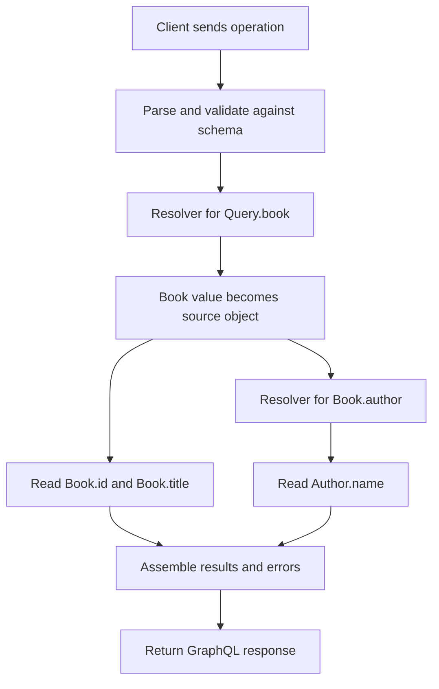

# Resolvers and Data Fetchers in Spring for GraphQL

A GraphQL schema describes the data types and operations clients are allowed to call. To turn that contract into a working API, the server needs to fetch data for each field. The component responsible for this in GraphQL is called a **data fetcher**; in common parlance, it is often referred to as a **resolver**.

Spring for GraphQL connects resolvers to the GraphQL Java schema and provides annotations to declare them directly inside Spring beans. When you understand which fields need custom resolvers, which can be read directly from an object, and when to batch queries, you can build a maintainable API while keeping data access counts under control.

After this lesson, you will be able to:

- Distinguish between schema, resolver, and data fetcher during the execution of an operation.
- Write resolvers for `Query`, `Mutation`, `Subscription`, and nested fields using Spring for GraphQL annotations.
- Receive arguments, source objects, and context data in resolver methods.
- Recognize the N+1 problem and solve it with `@BatchMapping` or `DataLoader`.
- Choose appropriate error handling, authorization, and testing approaches for each field.

## 1. The schema declares fields; resolvers supply values

Consider a simple library API. A book has an author; clients can look up a single book, fetch the list of books, and create a new book.

```graphql
type Query {
    book(id: ID!): Book
    books: [Book!]!
}

type Mutation {
    createBook(input: CreateBookInput!): Book!
}

type Book {
    id: ID!
    title: String!
    author: Author
}

type Author {
    id: ID!
    name: String!
}

input CreateBookInput {
    title: String!
    authorId: ID!
}
```

The schema states that `book` takes an `id` and returns `Book`; `Book`'s `author` field returns `Author` or `null`. The schema does not prescribe whether data must be read from a database, a REST service, or a cache. That is the resolver's responsibility.

In GraphQL Java, a data fetcher is an object that executes the logic to retrieve the value for a field. It receives a `DataFetchingEnvironment`, from which it can read arguments, the parent object, context, selected fields, and a `DataLoader`. A data fetcher can return a value directly or an asynchronous result like `CompletionStage`; for subscriptions, the root field can emit a `Publisher`.

Spring for GraphQL registers annotated methods as data fetchers. Therefore, most Spring applications do not need to manually instantiate a `DataFetcher` for every field. You simply write methods with the appropriate parameters and return types.

## 2. How is an operation resolved?

When a client sends a query like:

```graphql
query {
    book(id: "book-42") {
        id
        title
        author {
            name
        }
    }
}
```

GraphQL executes fields according to the schema structure and selection set. The general sequence is:



The `Query.book` resolver fetches the `Book` object. When executing the nested `author` field, GraphQL passes that `Book` object to the `Book.author` resolver. Simple fields like `id` and `title` are typically read directly from the object's properties without requiring separate resolver methods.

This is a key point: a resolver does not need to exist for every field in the schema. You only need to declare a resolver when a field requires querying, transformation, authorization checks, or custom logic. For fields matching an existing property on the object, GraphQL Java's default property data fetcher is usually sufficient.

## 3. Resolvers for Query and nested fields

Suppose the domain model stores `authorId` in `Book`, rather than embedding the full `Author` object:

```java
public record Book(String id, String title, String authorId) {}

public record Author(String id, String name) {}
```

Resolvers can be declared in a Spring controller as follows:

```java
@Controller
public class BookGraphQlController {

    private final BookService bookService;
    private final AuthorService authorService;

    public BookGraphQlController(
            BookService bookService,
            AuthorService authorService) {
        this.bookService = bookService;
        this.authorService = authorService;
    }

    @QueryMapping
    public Book book(@Argument("id") String id) {
        return bookService.findById(id).orElse(null);
    }

    @QueryMapping
    public List<Book> books() {
        return bookService.findAll();
    }

    @SchemaMapping(typeName = "Book", field = "author")
    public Author author(Book book) {
        return authorService.findById(book.authorId()).orElse(null);
    }
}
```

`@QueryMapping` binds the method to the field of the same name on the `Query` root type. The `book` method receives the `id` argument via `@Argument`; the argument name is specified explicitly to avoid relying on compiler parameter-name retention.

`@SchemaMapping` binds a method to a field on a specific type. In the example above, `typeName = "Book"` and `field = "author"` specify the exact field to handle. The `Book book` parameter is the **source object** (source or parent): the object GraphQL is currently using to resolve the nested field. If `typeName` is omitted, Spring for GraphQL can infer the source type from the method's source parameter; if `field` is omitted, the method name is used as the field name.

For the `id` and `title` fields, GraphQL Java can read the record accessors or corresponding getters. You do not need to write two extra `@SchemaMapping` methods just to return `book.id()` and `book.title()`. Reserve explicit resolvers for fields that genuinely need logic.

If the application uses regular Java classes instead of records, the property data fetcher can read getters such as `getId()` or `getTitle()`. For a `Map` object, it can also read values by key. If a property name does not match the schema field or requires custom transformation rules, declare `@SchemaMapping` explicitly.

## 4. Common mapping annotations

Spring for GraphQL provides annotations corresponding to each position in the schema:

| Annotation | Bound field | Common usage |
| --- | --- | --- |
| `@QueryMapping` | Field on root type `Query` | Reading data, searching, filtering lists |
| `@MutationMapping` | Field on root type `Mutation` | Creating, updating, or deleting data |
| `@SubscriptionMapping` | Field on root type `Subscription` | Emitting real-time events |
| `@SchemaMapping` | Field on an object type | Resolving nested fields or fields needing custom logic |
| `@BatchMapping` | Field on an object type in batches | Fetching related data for multiple source objects |

The shorthand mapping annotations can be viewed as specialized forms of `@SchemaMapping` for root types. For example, `@QueryMapping` is equivalent to registering a field on the `Query` type.

### Receiving arguments and input objects

Schema arguments are bound to parameters annotated with `@Argument`:

```java
public record CreateBookInput(String title, String authorId) {}

@MutationMapping
public Book createBook(@Argument("input") CreateBookInput input) {
    return bookService.create(input.title(), input.authorId());
}
```

GraphQL input objects fit operations that take multiple related fields. Using a dedicated input type lets the schema express input data clearly and avoids creating mutations with too many loose arguments. Validate data at the appropriate layer before persisting to storage; GraphQL types only check structure and the scalar constraints declared in the schema.

### Mutation and Subscription

Mutations are used for operations that modify state:

```java
@MutationMapping
public Book createBook(@Argument("input") CreateBookInput input) {
    return bookService.create(input);
}
```

The method can return the newly created object so the client receives fresh data in the same response. Business rules, transactions, and authorization checks should still reside in the service layer or dedicated components.

Subscriptions represent an event stream. For example, if a service emits newly created books:

```java
@SubscriptionMapping
public Flux<Book> bookCreated() {
    return bookEventService.bookCreated();
}
```

A subscription root field must provide a data stream (`Publisher`); each emitted event is turned into a GraphQL result. The application also needs a subscription-capable transport configured, such as WebSocket or RSocket. Simply declaring `@SubscriptionMapping` does not configure client connectivity by itself.

## 5. Choosing the right return type

Resolvers can return several forms of results depending on how the application accesses data:

- **Synchronous values** such as `Book`, `List<Book>`, or `Optional<Book>` fit synchronous processing.
- **`CompletableFuture<T>`** represents an asynchronous result using the standard Java API.
- **`Mono<T>` and `Flux<T>`** fit applications built with Spring WebFlux and Reactor.
- **`Publisher<T>`** is the Reactive Streams abstraction commonly used for subscription streams.

Example reactive resolver:

```java
@QueryMapping
public Mono<Book> book(@Argument("id") String id) {
    return bookService.findById(id);
}
```

Keep data access consistent with the application runtime. In a WebFlux application, avoid calling blocking I/O operations directly on reactive threads. If a service already returns `Mono` or `Flux`, pass that publisher through instead of blocking for the result. In a Spring MVC application using blocking services, synchronous methods can be a simpler and fitting choice.

## 6. N+1 and batching queries with `@BatchMapping`

A nested field resolver may work correctly yet generate far too many queries. Suppose a client requests 100 books along with their authors:

```graphql
query {
    books {
        id
        title
        author {
            name
        }
    }
}
```

If the `Book.author` resolver calls `authorService.findById(...)` once per book, the server may execute:

1. One query to fetch the list of 100 books.
2. One hundred separate queries to fetch the author of each book.

This is the **N+1** problem. Response time and database load grow with the number of parent objects, even though the client sent only one operation.

`@BatchMapping` lets Spring for GraphQL group multiple source objects for the same field into a single method invocation. Example:

```java
@BatchMapping(typeName = "Book", field = "author")
public Mono<Map<Book, Author>> authors(List<Book> books) {
    Set<String> authorIds = books.stream()
            .map(Book::authorId)
            .collect(Collectors.toSet());

    return authorService.findAllByIds(authorIds)
            .collectMap(Author::id)
            .map(authorsById -> {
                Map<Book, Author> result = new HashMap<>();
                for (Book book : books) {
                    result.put(book, authorsById.get(book.authorId()));
                }
                return result;
            });
}
```

The method receives the list of `Book` objects, extracts the unique `authorId` set, and calls the service once to query in a batch. The return value is a map pairing each source object with the value for its `author` field. If an author is not found, the map can hold a `null` value; the schema must allow `author` to be nullable, as in the opening example. If the schema declares `author: Author!`, a null value triggers an execution error and may propagate null up to the parent field according to GraphQL rules.

`@BatchMapping` automatically registers a batch loader for the declared field. Do not simultaneously register another regular resolver for the same field unless you have intentionally configured clear mapping behavior. For straightforward cases, this is often the most concise way to resolve N+1.

## 7. Using DataLoader when you need control over the batch loader

When data loading is more complex than a direct mapping from source objects to a field, you can register a `DataLoader` via `BatchLoaderRegistry`. Spring for GraphQL manages the registry per GraphQL request, allowing resolvers within the same request to share key-based batching and caching.

Example registering a mapped batch loader to look up authors by ID:

```java
@Configuration
public class GraphQlBatchConfiguration {

    public GraphQlBatchConfiguration(
            BatchLoaderRegistry registry,
            AuthorService authorService) {

        registry.forTypePair(String.class, Author.class)
                .registerMappedBatchLoader((authorIds, environment) ->
                        authorService.findAllByIds(authorIds)
                                .collectMap(Author::id));
    }
}
```

Resolver using the loader by key:

```java
@SchemaMapping(typeName = "Book", field = "author")
public CompletableFuture<Author> author(
        Book book,
        DataLoader<String, Author> authorLoader) {

    return authorLoader.load(book.authorId());
}
```

`load` calls issued during request execution are batched by `DataLoader` so the batch loader queries multiple IDs at once. Results are mapped back to each caller by key. `DataLoader`'s default caching also prevents repeatedly loading the same key within the scope of that request's loader.

`@BatchMapping` and `DataLoader` solve the same class of problems at different abstraction levels:

| Criterion | `@BatchMapping` | `DataLoader` with `BatchLoaderRegistry` |
| --- | --- | --- |
| Input | List of source objects for the field | Keys requested by resolvers |
| Result mapping | Map from source object to field value | Map or list of results by key |
| Declaration | A single annotated method | Register a batch loader and call `load` in the resolver |
| Best suited when | Direct, simple field relationships | Multiple resolvers share key-based data or need batch loader control |

Choose an appropriate implementation for each field. Regardless of which approach you use, the batch loader must actually query data in a batch; iterating over the list and calling a repository per item merely moves N+1 inside the batch method.

## 8. DataFetchingEnvironment and custom data fetchers

Annotation mappings cover most common scenarios. When you need direct access to GraphQL Java APIs, you can accept `DataFetchingEnvironment` as a resolver parameter:

```java
@QueryMapping
public Book book(DataFetchingEnvironment environment) {
    String id = environment.getArgument("id");
    GraphQLContext context = environment.getGraphQlContext();
    return bookService.findById(id).orElse(null);
}
```

`DataFetchingEnvironment` provides rich details about the current resolution step, including arguments, source object, context, selection set, and `DataLoader`. Only use the low-level API when the method needs details that specialized parameters like `@Argument`, `DataLoader`, or context values cannot express clearly enough.

You can also register a data fetcher directly using `RuntimeWiringConfigurer`:

```java
@Bean
RuntimeWiringConfigurer customBookFetcher(BookService bookService) {
    return wiringBuilder -> wiringBuilder.type(
            "Query",
            typeBuilder -> typeBuilder.dataFetcher(
                    "book",
                    environment -> bookService.findById(
                            environment.getArgument("id")).orElse(null)));
}
```

This is useful when integrating GraphQL Java libraries or configuring wiring in one centralized place. For standard Spring controllers, annotation mappings are usually easier to read and test. Do not register two competing data fetchers for the same field without clearly determining which wiring mechanism will take effect.

## 9. Error handling and field-level security

Resolvers can encounter cases such as missing records, invalid input, unauthorized users, or failing downstream dependencies. How errors are represented directly affects the GraphQL response.

If a nullable field returns `null`, GraphQL can return `null` for that field without breaking the entire object. If a resolver throws an exception, GraphQL returns an error in the `errors` array; the `data` section can still contain results for independent fields that succeeded. For non-null fields, an error or null value can propagate up to the nearest nullable parent field. Therefore, choose nullable/non-null in the schema according to the actual business contract.

In Spring for GraphQL, exceptions can be mapped to GraphQL errors using `@GraphQlExceptionHandler` inside a controller or `@ControllerAdvice`, or by implementing `DataFetcherExceptionResolver` when centralized handling is needed. Return safe, meaningful messages to clients and log full details on the server; avoid exposing stack traces or sensitive internal data in responses.

Authorization also needs to be considered per field. Securing the GraphQL endpoint merely to authenticate callers is insufficient if a single query can request multiple fields with varying sensitivity levels. You can apply method security to resolvers or services, for example:

```java
@PreAuthorize("hasAuthority('BOOK_READ')")
@SchemaMapping(typeName = "Book", field = "internalNotes")
public String internalNotes(Book book) {
    return bookService.findInternalNotes(book.id());
}
```

For method security annotations to take effect, the application must enable method security configuration and ensure the method is invoked through a Spring proxy. For data dependent on ownership, tenant, or per-record permissions, the service still needs to verify permissions on the specific accessed object. Do not rely on the client hiding fields in the UI to protect data.

## 10. Testing resolvers with GraphQlTester

Test starting from GraphQL operations to verify the schema, argument mapping, and returned data together. `GraphQlTester` lets you send documents and assert paths in the response:

```java
graphQlTester.document("""
        query {
            book(id: "book-42") {
                id
                title
            }
        }
        """)
    .execute()
    .path("book.title")
    .entity(String.class)
    .isEqualTo("Spring GraphQL in Practice");
```

In slice tests, you can use `@GraphQlTest` to load only the necessary GraphQL configuration and replace services with test doubles. Integration tests can run with full application configuration and a test database. For batch resolvers, also verify that multiple source objects produce a single call to the batch service while results are still matched accurately to each object. For protected fields, test both authorized and unauthorized cases.

## 11. Common design mistakes

- **Writing resolvers for every property:** increases method count and boilerplate even though the property data fetcher already reads getters. Add explicit mappings only when logic is needed.
- **Querying the database inside each child field resolver:** easily causes N+1 when clients request large lists. Use `@BatchMapping` or DataLoader and measure actual query counts.
- **Putting all business logic inside resolvers:** makes GraphQL controllers hard to test and reuse. Keep resolvers thin and move business rules into services.
- **Mixing blocking I/O into reactive flows:** can degrade WebFlux concurrency. Use non-blocking APIs end-to-end along the data path.
- **Ignoring schema nullability:** returning null for a non-null field triggers errors and propagates null to parent objects. Design return types and the schema together.
- **Storing request data in singleton controller fields:** risks data leakage across concurrent requests. Use method parameters, GraphQL context, or appropriate scoping.
- **Checking permissions only in the UI:** clients can craft custom operations requesting sensitive fields. Protect resolvers or services on the server.

## 12. Workflow for choosing and implementing resolvers

When adding a field to the schema, you can follow this sequence:

1. Determine whether the field belongs to a root type or object type, its return type, and its nullability.
2. Check whether the source object already has a matching property. If so, the property data fetcher can handle it.
3. If data fetching or argument handling is needed, create the appropriate `@QueryMapping`, `@MutationMapping`, or `@SchemaMapping` method.
4. Delegate business logic and data access to services; choose synchronous or reactive return types according to the application stack.
5. If a child field resolver is invoked repeatedly, check for N+1 risks and apply batch loading.
6. Add error handling, authorization, and tests using real operations.

A good resolver has a clear responsibility: accept input from GraphQL, invoke the necessary application logic, and return a result matching the schema type. When you combine explicit mappings for fields needing logic, property data fetchers for simple fields, and batch loading for repeated relationships, a Spring for GraphQL API stays both easy to understand and scalable.
