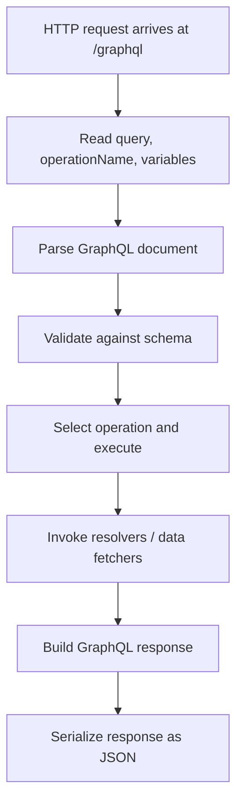

# GraphQL Request and Response

GraphQL defines how clients describe the data they want to fetch or modify, while the server executes that description against a schema. A GraphQL request therefore has two separate parts to understand: the **operation document** written in the GraphQL language and the **request envelope** that the transport—typically HTTP—uses to deliver the document and variables to the server. The response also has its own structure, with `data`, `errors`, and sometimes `extensions`.

In Spring for GraphQL, clients send requests to the GraphQL endpoint. Spring turns the request into a GraphQL execution call, wires schema fields to handler methods such as `@QueryMapping`, and returns results following GraphQL's response structure.

## 1. What does a GraphQL request contain?

An operation document describes the operation to run and the fields the client wants to receive. GraphQL has three primary operation types:

- `query`: read data.
- `mutation`: create, update, or delete data.
- `subscription`: subscribe to receive results emitted over time.

Example schema with a `book` field:

```graphql
type Query {
  book(id: ID!): Book
}

type Book {
  id: ID!
  title: String!
  author: Author
}

type Author {
  id: ID!
  name: String!
}
```

A client can send the following operation:

```graphql
query BookDetail {
  book(id: "book-42") {
    id
    title
    author {
      id
      name
    }
  }
}
```

`BookDetail` is the operation name. The part inside curly braces is the selection set: the client requests `id`, `title`, and two fields of `author`. Because `author` is an object, the request must specify which subfields to fetch. For scalars like `id` or `title`, no nested selection set is needed.

The response matches the selection set structure. If the client does not request a field, the server does not return that field. This is an important point: the schema describes which fields can be queried, while the selection set describes which fields are chosen in a specific request.

### Operation name

A document can contain multiple operations:

```graphql
query BookDetail($id: ID!) {
  book(id: $id) {
    id
    title
  }
}

query RecentBooks {
  recentBooks {
    id
    title
  }
}
```

When a document contains multiple operations, the client must send `operationName` so the server knows which operation to execute. Even when a document has only one operation, naming it is still good practice to make logging, tracing, and reading requests easier.

### Variables

Values can be written directly inside the document, but for data that changes per call, you should declare variables. Example:

```graphql
query BookDetail($id: ID!) {
  book(id: $id) {
    id
    title
    author {
      name
    }
  }
}
```

`$id` is a variable. `($id: ID!)` declares the variable's type; the `!` means the variable is required and must be non-`null`. Its concrete value is passed separately in the request envelope:

```json
{
  "id": "book-42"
}
```

Separating variables from the document lets you reuse the same operation with different values, avoids string concatenation to build queries, and enables input values to be checked against schema types.

## 2. The request envelope over HTTP

Over HTTP, requests are usually sent via `POST` to the GraphQL endpoint. Spring Boot with Spring for GraphQL configures the default endpoint at `/graphql`; the path can be changed using the `spring.graphql.path` property.

A complete JSON request looks like:

```http
POST /graphql HTTP/1.1
Content-Type: application/json
Accept: application/json
```

```json
{
  "query": "query BookDetail($id: ID!) { book(id: $id) { id title author { id name } } }",
  "operationName": "BookDetail",
  "variables": {
    "id": "book-42"
  }
}
```

Common properties in the envelope:

| Property | Meaning |
| --- | --- |
| `query` | String containing the GraphQL document, including operations and optionally fragments. |
| `operationName` | Name of the operation to run when the document has multiple operations; can be omitted if there is only one operation. |
| `variables` | JSON object holding values for variables declared in the document. |
| `extensions` | Object for metadata or extensions agreed upon between client and server. |

`query` in the envelope is a JSON string, while the contents inside that string use GraphQL syntax. Thus, keep the two layers distinct: JSON is the transport format for the request; the GraphQL document is the language describing the operation.

Example sending a request with cURL:

```bash
curl http://localhost:8080/graphql \
  -H "Content-Type: application/json" \
  -H "Accept: application/json" \
  --data '{
    "query": "query BookDetail($id: ID!) { book(id: $id) { id title } }",
    "operationName": "BookDetail",
    "variables": { "id": "book-42" }
  }'
```

In a Spring Boot environment, the example above assumes the application includes Spring for GraphQL and an appropriate HTTP transport, with the endpoint still using the default path.

### GET and POST

Some GraphQL HTTP endpoints also accept `GET` for read operations. In that case, the document, operation name, and variables are passed via URL query parameters. Clients must properly encode JSON and GraphQL values.

`GET` is only suitable for `query`. Never send a `mutation` via `GET`, because mutations can modify server state whereas GET is expected to be a safe method. For complex requests or requests with variables, `POST` is usually easier to use and inspect. Which HTTP methods an endpoint supports depends on the application's configuration and transport.

## 3. How does Spring for GraphQL process the request?

On the server side, Spring for GraphQL receives the envelope from the transport and passes the operation to GraphQL Java to parse, validate, and execute against the schema. Handler methods supplied by the application are invoked when execution reaches the corresponding fields.

High-level flow:



Example schema:

```graphql
type Query {
  book(id: ID!): Book
}
```

A controller can map the `Query.book` field using `@QueryMapping`:

```java
import org.springframework.graphql.data.method.annotation.Argument;
import org.springframework.graphql.data.method.annotation.QueryMapping;
import org.springframework.stereotype.Controller;

@Controller
class BookGraphQlController {

    private final BookService bookService;

    BookGraphQlController(BookService bookService) {
        this.bookService = bookService;
    }

    @QueryMapping
    Book book(@Argument String id) {
        return bookService.findById(id);
    }
}
```

The method name `book` maps by default to the `book` field on the `Query` root type. `@Argument` extracts the `id` argument value from the GraphQL field. When GraphQL Java executes this field, Spring calls the method and uses its return value to continue fulfilling the selection set.

If the request also selects `author`, GraphQL needs to resolve that nested field. Spring can read properties from the returned object via property access; when custom logic is needed, a method can be declared with `@SchemaMapping`. Thus, a single request can trigger multiple field resolutions during execution, even though the client sent only one HTTP request.

## 4. Structure of a GraphQL response

A successful response typically looks like:

```json
{
  "data": {
    "book": {
      "id": "book-42",
      "title": "Spring in Action",
      "author": {
        "id": "author-7",
        "name": "Craig"
      }
    }
  }
}
```

### The `data` field

`data` holds the result of executing the operation. Its internal structure mirrors the request's selection set:

- Selected fields become keys in the result object.
- Nested objects follow the nested selection set structure.
- Lists are returned as JSON arrays.
- Nullable values can be `null`.
- Scalars are serialized according to their scalar rules; for example, `ID` is typically represented as a string.

GraphQL does not require the server to return every field present on a type. The server returns the fields selected by the operation along with their corresponding child values. If an alias is used, the key in the response is the alias. Example:

```graphql
query {
  featured: book(id: "book-42") {
    title
  }
}
```

The result will have the `featured` key:

```json
{
  "data": {
    "featured": {
      "title": "Spring in Action"
    }
  }
}
```

### The `errors` field

If an error occurs, the response may contain an `errors` array. Each entry describes one error and typically includes these properties:

| Property | Meaning |
| --- | --- |
| `message` | Brief description of the error. |
| `locations` | Position in the GraphQL document, usually line and column numbers. |
| `path` | Path to the field that caused the error in the execution result. |
| `extensions` | Additional metadata, such as application-defined error codes. |

Example:

```json
{
  "data": {
    "book": {
      "id": "book-42",
      "title": "Spring in Action",
      "author": null
    }
  },
  "errors": [
    {
      "message": "Unable to load author information",
      "locations": [
        { "line": 5, "column": 5 }
      ],
      "path": ["book", "author"],
      "extensions": {
        "code": "AUTHOR_SERVICE_UNAVAILABLE"
      }
    }
  ]
}
```

In this example, the server still retrieved the book, yet failed to retrieve the author. Because the `author` field allows `null` in the schema, GraphQL can return the remaining data and set just the failed field to `null`. Clients must check both `data` and `errors`, rather than only checking whether the response contains data.

### The `extensions` field

At the response level, `extensions` can hold additional metadata provided by the server or integrations, such as tracing details. It is not the place for primary business data. Its structure and meaning depend on the agreement between server and client.

## 5. Request errors and execution errors

Not all errors produce the same result.

**Request errors** occur before the operation executes, such as a syntax error in the GraphQL document, a field not present in the schema, a missing required variable, or an invalid operation name. In this case, the server has no execution result; the response contains `errors` and no `data` key.

Example of a client calling a non-existent field:

```graphql
query {
  unknownBookField
}
```

If the schema does not declare that field, validation fails before any resolver runs.

**Execution errors** occur once the operation has started executing, for example when a resolver calls another service and that service fails. The response can contain both `data` and `errors`, because other fields may still complete successfully.

### Nullability and error propagation

Nullability in the schema directly affects the response. For a nullable field, an error while resolving the field usually causes that field to receive `null`, while other independent fields can still be returned.

If a field is declared non-null with `!`, GraphQL cannot contain the error on that field by returning `null`. The `null` value propagates up to the nearest nullable parent field. This continues until a nullable boundary is reached. If the error propagates all the way to the root, `data` may become `null`.

Example:

```graphql
type Book {
  id: ID!
  title: String!
  author: Author!
}

type Author {
  name: String!
}
```

If `author` cannot be resolved, the `author` field cannot become `null` because it is declared `Author!`. The error bubbles up to the `Book` object; if the parent field holding `Book` is nullable, that parent field becomes `null`. If every field along the propagation path is non-null, the error can make root `data` become `null`.

Therefore, `!` is both a data guarantee and a rule governing error propagation scope. Only declare non-null when the application genuinely guarantees the field will always have a valid value.

## 6. Reading HTTP status alongside the GraphQL response

HTTP status and the GraphQL response answer two different questions. HTTP status describes the outcome at the transport and protocol layer; `data` and `errors` describe the outcome of the GraphQL operation.

A request can reach the GraphQL endpoint and receive a valid GraphQL response while still containing execution errors. Hence, clients should not rely solely on HTTP status to conclude an operation succeeded. Read the body and handle `errors` according to the application's needs.

Exact status code mapping also depends on the GraphQL over HTTP media type, library version, and server configuration. With Spring for GraphQL, verify the behavior of the transport in use rather than assuming all GraphQL errors map to a single HTTP status.

Conversely, HTTP-layer failures such as endpoint not found, request rejected by the transport, or server unresponsive may not produce a properly structured GraphQL response at all. Clients should distinguish receiving no GraphQL response from receiving a response containing `errors`.

## 7. Query, mutation, and subscription in request/response

Both `query` and `mutation` are described in a GraphQL document and can usually be sent over HTTP POST using the same request envelope. The difference lies in the operation's semantics and how the server executes it:

```graphql
mutation RenameBook($id: ID!, $title: String!) {
  renameBook(id: $id, title: $title) {
    id
    title
  }
}
```

Mutation variables are sent in the envelope just like query variables. The response also has `data` and `errors`, where `data` holds the result of the selected mutation fields.

`subscription` represents a stream of results over time. It typically uses a streaming-capable transport, such as WebSocket or RSocket depending on the application. Because a subscription can emit multiple results, how data is received and the connection lifecycle differ from a standard HTTP request/response. Never assume a subscription always returns a single JSON response and closes the connection.

## 8. Practice and common pitfalls

When inspecting a GraphQL request, verify these points in order:

1. **Right endpoint and transport:** which endpoint is the Spring for GraphQL application serving, and does it support the HTTP method the client is using?
2. **Valid document:** operation, fields, arguments, and selection sets must match the schema.
3. **Correct operation name:** if the document contains multiple operations, select the operation via `operationName`.
4. **Properly structured variables:** variable names in the document must match keys in the `variables` object; values must match declared types and non-null variables must be provided.
5. **Read the complete response:** check `data` and `errors`; if needed, inspect `path`, `locations`, and `extensions` to locate the error.
6. **Check nullability:** a `null` field may be a valid schema outcome or the starting point of error propagation.

Common mistakes:

| Symptom | Common cause | How to check |
| --- | --- | --- |
| Field not found error | Field does not exist in the schema or wrong name/case. | Cross-check the field in the document against the SDL schema. |
| Missing variable error | Required variable omitted or key name in `variables` is misspelled. | Compare `$variable` declarations with JSON variables. |
| Cannot select object field | Field has an object type but lacks a nested selection set. | Add the desired subfields inside curly braces. |
| `data` is present alongside errors | One or more resolvers failed while other fields succeeded. | Read each entry in `errors` and trace `path`. |
| A parent object becomes `null` | Error occurred on a non-null field and propagated up to the parent. | Check `!` markers along the field path. |
| HTTP status succeeds yet action partially failed | GraphQL response can contain `errors` even when transport returns a response. | Read the GraphQL body rather than checking only the status code. |

When debugging in Spring, match the schema field with the method mapped via `@QueryMapping`, `@MutationMapping`, or `@SchemaMapping`. If the document is valid yet a field returns `null` or raises an error, inspect the corresponding resolver, returned data, and exceptions thrown during processing.

## 9. Principles to remember

- The GraphQL document defines the operation and selection set; the request envelope transports the document, operation name, and variables.
- The selection set dictates the shape of data the client requests, including nested fields.
- Variables enable operation reuse and keep input data separate from query syntax.
- A GraphQL response may contain `data`, `errors`, and `extensions`; `data` and `errors` can appear together.
- Request errors generally prevent execution; execution errors may affect only part of the result.
- Nullability in the schema dictates how errors propagate through the response.
- In Spring for GraphQL, mappings like `@QueryMapping` connect schema fields to application logic; the GraphQL engine coordinates executing the selection set.

Understanding request and response structure helps you design predictable APIs, handle errors properly, and debug issues across the client, schema, resolvers, and transport.
