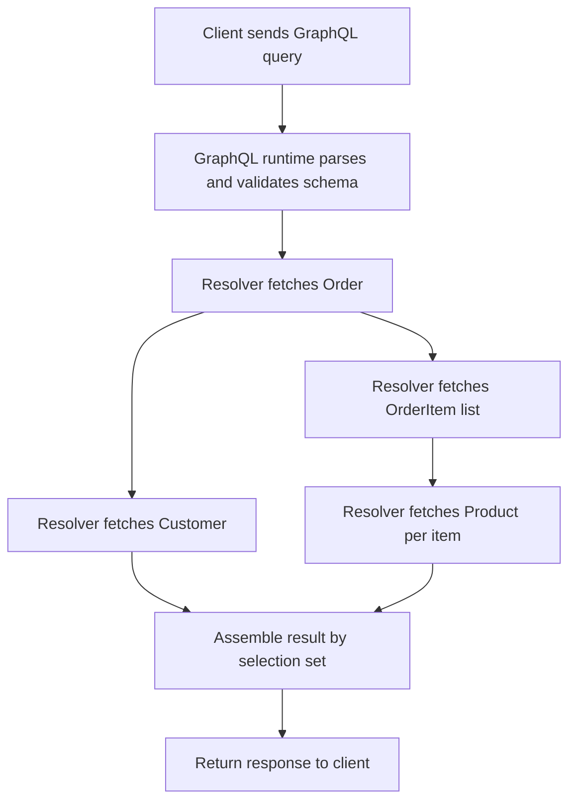

# When to Use GraphQL Instead of REST

When designing an API, the important question is not whether GraphQL is newer than REST or which technology has more features. The question is which communication style fits the system's data, usage patterns, and operational requirements.

REST usually fits well when an API centers around resources with stable structures, predictable access patterns, and strong use of HTTP semantics. GraphQL shines when multiple types of clients need different views of the data, especially when a single screen must combine data from multiple relationships or sources.

GraphQL is not a default replacement for every REST API. Both approaches can coexist in one system, each serving the kinds of interactions it handles best.

## 1. Start from the client's problem

Consider an order detail screen. The screen needs the order ID, status, customer name, product list, quantities, and total amount. With a resource-split REST API, the client might have to call multiple endpoints:

```http
GET /api/orders/42
GET /api/orders/42/items
GET /api/customers/7
```

If the order endpoint only returns the customer ID instead of customer details, the client must call the customer endpoint next. On high-latency networks, multiple sequential calls slow down screen rendering. Conversely, if the endpoint always returns every possible detail of an order, another client that only needs the ID and status ends up receiving lots of unused data.

These two situations are commonly called:

- **Over-fetching**: the response contains more data than the client needs.
- **Under-fetching**: a single response does not provide enough data for a screen or action, forcing the client to call additional endpoints.

REST does not inherently have to suffer from these two problems. You can design use-case composite endpoints, add field selection parameters, or build a Backend for Frontend (BFF). However, as the number of clients and screen variants grows, maintaining many specialized responses can become expensive.

GraphQL addresses this by letting clients describe the data structure they need in each operation. The server publishes a typed schema; the client sends a query selecting fields from that schema.

## 2. GraphQL changes how responses are described

Simplified schema example for orders:

```graphql
type Query {
    order(id: ID!): Order
}

type Order {
    id: ID!
    status: String!
    customer: Customer!
    items: [OrderItem!]!
    total: Money!
}

type Customer {
    id: ID!
    name: String!
}

type OrderItem {
    quantity: Int!
    product: Product!
}

type Product {
    id: ID!
    name: String!
}

scalar Money
```

The client can request only the fields needed for display:

```graphql
query OrderDetail($id: ID!) {
    order(id: $id) {
        id
        status
        total
        customer {
            name
        }
        items {
            quantity
            product {
                name
            }
        }
    }
}
```

The server returns a structure matching the query's selection set. Another client can request just `id` and `status` without needing a new endpoint. The schema also specifies which fields exist, their data types, and the relationships between types.

The core difference lies in the API contract:

- With REST, clients access resources via URLs and receive representations defined by the endpoint. The server usually dictates the endpoint's response structure.
- With GraphQL, clients send operations to a GraphQL endpoint and choose valid fields from the schema. The server is responsible for executing the operation and returning the selected structure.

GraphQL is not a database query language. Fields in the schema are the API contract; data retrieval can come from a database, another REST service, a cache, or any other source. A single GraphQL query also does not equate to a single SQL statement or a single data access call.

## 3. When is GraphQL usually a better fit?

### 3.1. Multiple clients with different data needs

A product may have a web app, a mobile app, an admin portal, and a partner application. Within the same business domain, each client needs a different set of fields.

For example:

- Mobile only needs the product name, price, and thumbnail image to reduce network transfer.
- Web also needs the description, variants, and reviews.
- Admin needs stock status, moderation details, and operational metadata.

With GraphQL, clients can select fields from the same schema. When adding backwards-compatible fields, the server can extend the schema without creating a separate endpoint response for each client.

This is helpful when frontend teams move at different paces and the server wants to provide a clearly typed data contract.

### 3.2. One screen needs to join multiple data relationships

Dashboard screens, profile pages, or detail pages often combine data from multiple entities. GraphQL lets clients describe a data tree in a single operation rather than orchestrating multiple requests themselves.

For example, a profile page might need the user, groups, visibility permissions, and recent activities. If the schema models these relationships sensibly, clients can request them in a single query.

The benefit here is fewer round trips between client and API. That benefit only turns into a real performance improvement when the server executes queries efficiently. A single GraphQL request can still trigger dozens of database queries or calls to other services.

### 3.3. Clients need flexibility to select fields and nest data

When UIs change frequently, data requirements change along with them. With GraphQL, the frontend can add or remove a field in a selection set without necessarily asking the backend to create a new endpoint, as long as the field already exists in the schema.

Data types, arguments, nullability, and relationships declared in the schema help tools catch many errors during development. Schema documentation can also power autocomplete and client type generation.

### 3.4. Need an aggregation API layer over multiple data sources

GraphQL can act as an API layer sitting in front of several backends or specialized services. GraphQL resolvers coordinate data fetching and map results into schema types. Clients do not need to know which service each piece of data came from.

This pattern suits a BFF or API composition layer when there is a genuine aggregation need. Design clear boundaries so the GraphQL layer does not become a dumping ground for all business logic or a gateway forced to understand too many internal details.

## 4. When is REST usually the better choice?

### 4.1. Simple APIs centered around stable resources

If the system primarily offers familiar operations like creating, reading, updating, and deleting resources, REST is usually clear enough and easy to operate. Examples include APIs managing catalogs, job statuses, or internal configurations whose response structures rarely change.

In such cases, adding a GraphQL schema, query execution engine, resolvers, complexity limits, and observability mechanisms can cost more than the benefits gained.

### 4.2. Need to leverage HTTP caching and semantics

REST can directly leverage URLs, methods, status codes, `ETag`, `Last-Modified`, `Cache-Control`, and familiar HTTP caching mechanisms. A resource with a stable URL is easy to cache in browsers, reverse proxies, or CDNs.

GraphQL typically uses a single shared endpoint, such as `/graphql`, and queries are usually sent in the request body. As a result, URL-based HTTP caching is not as natural as in REST. You can build persisted queries, cache by operation content and variables, or use a normalized client cache, but these require extra design and operational effort.

If an API mainly serves public resources with few variants and relies heavily on CDN caching, REST can be simpler.

### 4.3. Uploading/downloading files and streaming data

HTTP already has solid mechanisms for uploads, downloads, range requests, and streaming. GraphQL can work alongside these mechanisms, yet file uploads through GraphQL typically rely on community extensions rather than core GraphQL. For large files, a common pattern is to use REST or pre-signed upload/download URLs, and use GraphQL to exchange metadata and status.

### 4.4. Fixed service-to-service contracts

When two internal services share a small set of clear, stable operations, REST or RPC can be easier to reason about. Exposing a GraphQL endpoint open to many query shapes increases requirements for access control, resource limits, and operation observability. Do not introduce GraphQL just to reduce endpoint count.

### 4.5. The team needs a familiar HTTP interface

REST builds on HTTP concepts that many proxies, gateways, monitoring tools, and operations teams already support out of the box. For a public API with many consumers, standard URL, method, status code, and caching conventions can make integration more predictable.

## 5. Comparison by practical criteria

| Criterion | GraphQL | REST |
| --- | --- | --- |
| Returned data structure | Client selects fields from schema | Endpoint usually defines representation |
| Multiple client types | Convenient when each client needs different fields | May need composite endpoints, parameters, or BFF |
| Related data | Can be described as a selection tree | Client may need multiple requests or composite endpoints |
| Request count from client | Can be reduced when one operation fetches multiple parts | Depends on endpoint partitioning and design |
| HTTP caching | Needs dedicated caching strategy or persisted queries | Directly leverages URL and cache semantics |
| File upload/download | Usually paired with HTTP endpoints or pre-signed URLs | Has native HTTP support |
| Query control | Must limit depth, complexity, and field cost | Endpoints generally have more fixed operation scope |
| Contract evolution | Typically adds fields and marks old fields deprecated | Can add fields, endpoints, or manage versions |
| Tooling and operations | Must understand schemas, resolvers, operations, and query cost | Widespread HTTP ecosystem and resource monitoring |

Neither column wins unconditionally. The outcome depends on how endpoints, schemas, caches, backends, and clients are designed.

## 6. One GraphQL request does not guarantee one backend access

This is an easy point to misunderstand when comparing request counts. The order query above is just one HTTP request from the client, yet the server might execute it along this path:



If there are 20 items and the resolver loads the product individually for each item, the server can issue one query for the order, one query for the customer, one query for the items, and 20 queries for products. This is the server-side N+1 problem.

GraphQL does not automatically eliminate N+1. In Spring for GraphQL, `@BatchMapping` or `DataLoader` can group requests for the same kind of data into a single batch call. Batching logic must preserve accurate result mapping, scope caches per request, and avoid sharing sensitive data across users.

Therefore, when evaluating GraphQL, measure client request count, resolver invocation count, database query count, downstream service calls, and end-to-end latency together.

## 7. Costs to weigh before choosing GraphQL

### 7.1. Query depth and complexity limits

Giving clients flexible field selection also means the server must handle diverse query shapes. A deeply nested query or one requesting large lists across multiple levels can consume substantial CPU, memory, and database connections.

The server should enforce appropriate limits on depth, complexity, page sizes, and execution timeouts. For expensive fields, consider dedicated cost weights, rate limiting, or mandatory pagination. Never allow an arbitrary query to load entire datasets just because the schema permits access to that field.

### 7.2. Field- and data-level authorization

A single query can combine many fields within one operation. Therefore, checking permissions only at the endpoint or root resolver is insufficient if nested fields have different access rules.

Access permissions must be enforced at the appropriate business or data-access boundary, including cases where a user may view an order but not certain private customer details. Never treat hiding fields in the schema or disabling introspection as an authorization mechanism.

### 7.3. Caching and consistency

REST can often cache a resource by URL. With GraphQL, the same endpoint receives many different queries and variables. Caches need to key off the relevant operation and inputs while determining what data is safe to share across users.

On the client side, a normalized cache can store entities by ID and update received fields. However, client caching does not replace server caching, nor does it automatically solve consistency when data is updated from multiple sources.

### 7.4. Errors and partial responses

GraphQL can return `data` alongside an `errors` list. One failing field does not necessarily fail the entire operation; the outcome depends on where the error occurred and the schema's nullability rules. Clients must inspect both data and errors, while the server must standardize error payloads so stack traces or internal details are never leaked.

REST typically expresses errors at the HTTP response level using status codes and body conventions. That is familiar to middleware and proxies. When choosing GraphQL, the team needs to agree on how business errors, authentication errors, authorization errors, and system errors are represented.

### 7.5. Observability and tracing

With REST, the URL and HTTP method naturally help categorize requests. With GraphQL, many different operations travel through the same endpoint. Logs showing only `POST /graphql` will not tell you what a request is doing.

Log operation names, execution durations, errors, expensive resolvers or fields, and correlation IDs. Avoid logging full queries or variables containing sensitive information. For anonymous operations, you can require clients to name operations or use persisted queries to simplify monitoring and control.

### 7.6. Schema evolution

GraphQL schemas commonly evolve by adding fields and marking old fields with `@deprecated` before removal. This lets different clients upgrade at their own pace, though it only works well when the server tracks which clients still use deprecated fields.

REST can also evolve backwards-compatibly by adding fields or endpoints. Both approaches require communication processes, usage tracking, and transition windows before retiring old contracts.

## 8. GraphQL and REST can coexist

A system does not need to pick a single API style for every scenario. For example:

- REST provides login endpoints, file transfers, webhooks, and cacheable public resources.
- GraphQL serves web and mobile clients needing screen-specific data aggregation.
- Internal services continue using REST or RPC for fixed operations.
- GraphQL resolvers call existing services instead of forcing the entire backend to migrate to GraphQL.

In this model, GraphQL acts as a client-friendly interface layer, while underlying services keep their own contracts. Avoid creating two independent sets of business rules: REST and GraphQL should share service/domain logic when implementing the same business capability.

## 9. Decision checklist

Before choosing GraphQL, answer these questions:

1. Do multiple clients need different sets of fields over the same data domain?
2. Do screens frequently have to call multiple sequential endpoints to assemble data?
3. Has creating and maintaining many screen-specific response endpoints become a burden?
4. Can the team operate schemas, resolvers, DataLoader, query limits, field authorization, and operation observability?
5. Do the benefits of fewer requests or greater flexibility outweigh the caching and operational costs?

If most answers are yes, GraphQL is worth piloting on a concrete use case. Measure request counts, end-to-end latency, backend query counts, response sizes, and development cost before and after switching.

If the API has few clients, stable responses, strong HTTP caching requirements, and primarily resource CRUD operations, REST is usually the sensible choice. If only a few screens need data aggregation, you can start with a BFF or composite endpoint before introducing a full GraphQL layer.

## 10. Applying this with Spring for GraphQL

Spring for GraphQL helps implement GraphQL APIs inside Spring applications, yet the framework does not make architectural decisions for you. A basic implementation usually declares an SDL schema, maps root queries with `@QueryMapping`, maps fields with `@SchemaMapping`, and handles relationships needing batching with `@BatchMapping` or `DataLoader`.

When piloting GraphQL for a real screen, start from the use case and the selection sets clients need. Then design the schema, identify the data source for each field, define authorization rules, set query limits, and measure performance. Working from client needs to the schema helps avoid building an overly broad schema that does not reflect actual usage.

Choose GraphQL over REST when it solves a concrete problem: multiple clients needing different views of data, or clients frequently aggregating data across multiple relationships. When the core need is straightforward CRUD, HTTP caching, file transfer, or fixed service communication, REST remains a clear and effective choice. Good API design starts from the system's requirements and operational costs, not from how new a technology is.
