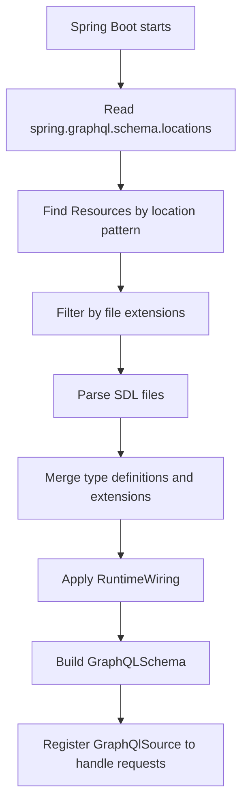

# Schema location pattern in Spring for GraphQL

Spring for GraphQL must load the GraphQL schema before it can execute queries, mutations, or subscriptions. The schema is usually written in `.graphqls` or `.gqls` SDL files and packaged with the application. Spring Boot discovers these files automatically from a default location; when a project splits the schema across multiple directories, multiple modules, or stores schemas outside the JAR, you can configure schema location patterns to specify where to scan.

Understanding schema locations properly helps applications start reliably in both development and production environments. It also helps avoid issues where an SDL file exists on the developer's machine but is not packaged, a module containing schemas is not scanned, or multiple files define the same type and cause errors when merging the schema.

After this lesson, you can:

- Identify the default location Spring Boot uses to search for GraphQL schemas.
- Configure `spring.graphql.schema.locations` and `spring.graphql.schema.file-extensions`.
- Distinguish `classpath:`, `classpath*:`, and `file:` in resource locations.
- Use wildcard patterns to scan schemas across nested directories or multiple modules.
- Organize multiple SDL files into a unified schema using `extend type`.
- Understand how schema resources are parsed, merged, and turned into an executable schema.
- Troubleshoot common errors and test schema loading.

## 1. What is a schema location?

A schema location is the resource location that Spring for GraphQL uses to find schema definition files. This is a server-side setting, not the HTTP endpoint URL where clients send GraphQL requests.

These two settings serve different purposes:

| Configuration | Meaning |
| --- | --- |
| `spring.graphql.schema.locations` | Where Spring Boot searches for SDL files to build the GraphQL schema |
| `spring.graphql.http.path` | HTTP path receiving GraphQL requests, usually `/graphql` by default |

For example, an application can accept requests at `/api/graphql` while SDL files are still loaded from `classpath:graphql/**/`. Changing the endpoint does not alter the schema location, and changing the schema location does not alter the endpoint.

Spring for GraphQL uses `GraphQlSource` to provide an executable GraphQL instance. Spring Boot auto-configures this builder, loads schema resources from the configured locations, applies runtime wiring, and creates the schema at application startup.

## 2. Default location

With Spring Boot, the default location is:

```text
classpath:graphql/**/
```

Files with the default `.graphqls` or `.gqls` extensions are searched under `src/main/resources/graphql/**`. For example:

```text
src/
└── main/
    └── resources/
        └── graphql/
            ├── schema.graphqls
            ├── books/
            │   ├── book-types.graphqls
            │   └── book-queries.graphqls
            └── authors/
                ├── author-types.gqls
                └── author-queries.graphqls
```

With this structure, Spring Boot automatically finds schema files in the `graphql` directory and its subdirectories. You do not need to list each file individually when using the default location and extensions.

In Maven or Gradle, resources placed under `src/main/resources` are included on the application's classpath during the build under default settings. When packaged as a JAR, schema files reside inside the JAR under corresponding paths, such as `BOOT-INF/classes/graphql/books/book-types.graphqls` in a Spring Boot executable JAR.

If you use the default structure, you may not need to declare `spring.graphql.schema.locations` in `application.yml`. Only configure it when you want to change the location, scan multiple classpath roots, or use resources outside the classpath.

## 3. Configuring via application.yml

The main property is `spring.graphql.schema.locations`. You can configure one or more locations:

```yaml
spring:
  graphql:
    schema:
      locations:
        - classpath:graphql/**/
        - classpath:shared-graphql/**/
      file-extensions:
        - .graphqls
        - .gqls
```

In this example, the application searches for schemas in two classpath areas. The `file-extensions` property specifies which extensions are treated as GraphQL schema files.

If using `application.properties`:

```properties
spring.graphql.schema.locations=classpath:graphql/**/,classpath:shared-graphql/**/
spring.graphql.schema.file-extensions=.graphqls,.gqls
```

The default value of `spring.graphql.schema.file-extensions` is `.graphqls,.gqls`. If the project wants to use different extensions, configure them explicitly:

```yaml
spring:
  graphql:
    schema:
      file-extensions:
        - .graphql
        - .gql
```

After changing the extensions, make sure the schema files in the project actually use one of the declared suffixes. A `.graphql` file will not be detected under the default configuration of `.graphqls` and `.gqls`.

## 4. Reading schema location patterns

Location patterns use Spring's resource pattern syntax. Common wildcards include:

| Pattern | General meaning | Example |
| --- | --- | --- |
| `*` | Matches part of a name within a single path segment | `classpath:graphql/*/` |
| `**` | Matches across multiple directory levels | `classpath:graphql/**/` |
| `?` | Matches a single character in a path segment | `classpath:graphql/v?/` |

For example, `classpath:graphql/books/` targets only the `books` directory area, whereas `classpath:graphql/**/` allows searching deeply through subdirectories of `graphql`.

When configuring schema locations, specify directories or directory patterns; the list of file extensions is controlled separately by `spring.graphql.schema.file-extensions`. Do not confuse these two settings: location determines where to scan, while extensions determine which file types are loaded.

Pattern examples:

```yaml
spring:
  graphql:
    schema:
      locations:
        - classpath:graphql/**/
        - classpath:modules/books/graphql/**/
        - classpath:modules/authors/graphql/**/
```

The broader the pattern, the higher the chance of scanning unrelated files. Choose schema areas intentionally to avoid accidentally loading test fixtures, sample schemas, or copies packaged inside a dependency.

## 5. Distinguishing classpath: and classpath*:

These two prefixes are especially important when schemas reside across multiple modules or dependency JARs.

### `classpath:`

`classpath:` points to resources on the application classpath. This is the prefix in the default configuration:

```yaml
spring:
  graphql:
    schema:
      locations: classpath:graphql/**/
```

This is suitable when the schema belongs to the current application and is packaged in its classpath resources.

### `classpath*:`

`classpath*:` tells Spring to search for matching resources across multiple classpath locations, including modules and dependency JARs sharing the same resource path:

```yaml
spring:
  graphql:
    schema:
      locations: classpath*:graphql/**/
```

For example, an application with modules:

```text
application/
├── app-web/
│   └── src/main/resources/graphql/root.graphqls
├── module-books/
│   └── src/main/resources/graphql/books/book.graphqls
└── module-authors/
    └── src/main/resources/graphql/authors/author.graphqls
```

If `module-books` and `module-authors` are packaged as dependency JARs and present on the runtime classpath, `classpath*:graphql/**/` allows discovering schema resources from those matching classpath locations.

This is useful in modular architectures, but conflicts must also be managed. All discovered schemas are placed into the same GraphQL schema; if two modules define duplicate types or incompatible fields, schema creation can fail. Using `classpath*:` does not automatically create a separate schema per module.

## 6. Loading schemas from the file system

Spring Resource also supports file system locations. This fits cases where you want to deploy schemas outside the JAR, such as placing schemas in a container's config directory:

```yaml
spring:
  graphql:
    schema:
      locations:
        - file:/opt/app/graphql/**/
```

You can use relative paths:

```yaml
spring:
  graphql:
    schema:
      locations:
        - file:./config/graphql/**/
```

Relative paths are resolved against the working directory of the application process. Because the working directory can differ across IDEs, Docker, systemd, or deployment environments, absolute paths are usually more predictable in production.

When using a file system location, ensure:

- Files actually exist in the container or host when the application starts.
- The user running the application has read permissions for the directories and files.
- Volume mounts or resource copy steps complete before the Spring Boot process starts.
- All required files are updated in sync when releasing a new schema.

Do not use a plain HTTP URL like `https://example.org/schema.graphqls` assuming the property automatically downloads schemas from the web. Spring Resource supports various resource types; if you need to load schemas from a remote system or custom storage, provide appropriate custom resource/loading logic.

## 7. Organizing a schema into multiple files

A GraphQL schema can be split into multiple files grouped by domain, type, or operation. Spring for GraphQL loads the resources, then parses and merges them into a unified schema.

Example structure:

```text
src/main/resources/graphql/
├── root.graphqls
├── books/
│   ├── book-types.graphqls
│   └── book-queries.graphqls
└── authors/
    ├── author-types.graphqls
    └── author-queries.graphqls
```

`root.graphqls` declares the root type:

```graphql
type Query {
    health: String!
}
```

`books/book-types.graphqls` declares the object type:

```graphql
type Book {
    id: ID!
    title: String!
}
```

`books/book-queries.graphqls` extends the root query:

```graphql
extend type Query {
    book(id: ID!): Book
    books: [Book!]!
}
```

`authors/author-types.graphqls`:

```graphql
type Author {
    id: ID!
    name: String!
}
```

`authors/author-queries.graphqls`:

```graphql
extend type Query {
    author(id: ID!): Author
    authors: [Author!]!
}
```

These files are merged into a single schema whose `Query` contains `health`, `book`, `books`, `author`, and `authors`. The `extend type Query` extensions require the base `Query` type to exist in the merged schema.

### When to use type and extend type?

Define a base type with `type`:

```graphql
type Query {
    health: String!
}
```

When adding fields from another file, use `extend type`:

```graphql
extend type Query {
    books: [Book!]!
}
```

Do not create multiple independent `type Query` definitions with different contents across multiple files. During merging, duplicate type names can cause schema errors. Use one base definition and valid extensions to expand it.

Splitting files is only a way to organize resources. Once loaded, GraphQL still executes a unified schema; types do not automatically become independent modules or gain separate namespaces simply by residing in different directories.

## 8. Schema loading and executable schema creation flow

At a high level, Spring Boot performs the following steps when initializing GraphQL:



`GraphQlSource.Builder` accepts one or more `Resource` instances to parse and merge. Then GraphQL Java `SchemaGenerator` builds `GraphQLSchema` based on type definitions and runtime wiring. Runtime wiring can contain data fetchers, custom scalars, type resolvers, directive wiring, and other components.

If files are not found, the schema lacks a root query type, duplicate types exist, or the SDL is invalid, the application may fail at startup. This is a configuration/schema error to address before accepting requests; it is not an error caused by a client sending a specific query.

## 9. When do you need to customize GraphQlSource?

For most Spring Boot applications, configuring `spring.graphql.schema.locations` is sufficient. When you need to load special resources, such as schemas from storage, memory, or a custom implementation source, you can use the `GraphQlSource.Builder` API.

`GraphQlSource.Builder` supports supplying one or more Spring `Resource` objects via `schemaResources(...)`. Spring Boot also provides `GraphQlSourceBuilderCustomizer` to customize the builder managed by auto-configuration.

Example customizer configuration skeleton for other builder customizations:

```java
@Configuration(proxyBeanMethods = false)
public class GraphQlSourceConfiguration {

    @Bean
    GraphQlSourceBuilderCustomizer graphQlSourceBuilderCustomizer() {
        return builder -> builder.configureGraphQl(graphQlBuilder -> {
            // Add further GraphQL.Builder configuration here.
        });
    }
}
```

When you need direct control over the resource list, you can create `GraphQlSource` with your own builder and supply the appropriate `Resource` instances. However, creating `GraphQlSource` manually may replace part of default auto-configuration; ensure runtime wiring, exception resolvers, instrumentation, and other Spring integrations remain registered.

Avoid writing a custom loader just to change a standard schema directory. Built-in properties are easier to read, easier to override per environment, and better aligned with Spring Boot's configuration mechanism.

## 10. Environment-specific configuration

An application can use the same schema inside the JAR across all environments, or load additional schemas from an external config directory. Spring Boot supports externalized configuration, so locations can be overridden via profiles, environment variables, or command-line arguments.

Default configuration example:

```yaml
spring:
  graphql:
    schema:
      locations: classpath:graphql/**/
```

In the production profile:

```yaml
spring:
  graphql:
    schema:
      locations:
        - classpath:graphql/**/
        - file:/etc/my-service/graphql/**/
```

Or using an environment variable via relaxed binding:

```text
SPRING_GRAPHQL_SCHEMA_LOCATIONS=classpath:graphql/**/,file:/etc/my-service/graphql/**/
```

Only use external schemas when the deployment process manages compatibility between SDL files and code versions. If a new schema references fields or resolvers not yet supported by the current binary, the application may fail to start or return incorrect results. Schemas and code should be released as a compatible unit.

## 11. Verifying that the schema was loaded

There are several ways to confirm schema locations are working:

**Check startup logs:** watch for SDL parsing errors, missing types, type extensions without a base type, or schemas missing a root query. Exact messages depend on the GraphQL Java version.

**Check via GraphQlTester:** send an operation selecting fields that exist only in the schema file you want to verify. If the field was not loaded, GraphQL will report a validation error stating the field does not exist on the corresponding type.

**Check the schema printer:** Spring for GraphQL can expose the schema as text via the schema printer endpoint when `spring.graphql.schema.printer.enabled` is turned on. This endpoint is off by default; enable it only when appropriate for the environment and access policy.

**Check the packaged artifact:** inspect the JAR or check the build output contents to confirm `.graphqls`/`.gqls` files were actually copied to the classpath. A file existing in the source tree does not guarantee it is present in the deployment artifact.

An integration test can initialize the application context and send an operation:

```java
@SpringBootTest
class SchemaLoadingTests {

    @Autowired
    GraphQlTester graphQlTester;

    @Test
    void loadsBookSchema() {
        graphQlTester.document("""
                query {
                    books {
                        id
                        title
                    }
                }
                """)
            .execute()
            .path("books")
            .hasValue();
    }
}
```

This example assumes the test application has configured `GraphQlTester` and the `books` resolver. If you only want to confirm the schema parses, starting the application context suffices; if you also want to verify resolvers, use appropriate fixtures or mock services.

## 12. Common errors when configuring location patterns

| Symptom | Possible cause | How to check |
| --- | --- | --- |
| Application reports no schema or missing `Query` | Location does not match, file not packaged, or wrong extension | Check `locations`, `file-extensions`, and JAR contents |
| Works in IDE but JAR fails to start | Resource missing from output/artifact or path depends on working directory | Check `build/resources/main`, `target/classes`, and JAR |
| Schema in dependency module not loaded | Using `classpath:` when multiple classpath roots need scanning | Try `classpath*:graphql/**/` and verify the dependency contains the resources |
| SDL parses individually but merge fails | Duplicate types/fields or extension lacking base type | Check `type` and `extend type` definitions across the entire schema |
| A new file is ignored | File uses a suffix not in `file-extensions` or sits outside pattern | Check extension and relative location |
| Production cannot find external schema | Incorrect file system path, unmounted volume, or missing read permission | Check absolute path, container volume, and process permissions |
| Schema loaded twice or has conflicts | Multiple patterns match the same resource area or dependency packages a copy | Narrow locations and audit JARs on the classpath |

When troubleshooting, check in order: actual location, whether the resource exists, whether the extension is accepted, whether the file is packaged, and only then check SDL and type extensions. This separates file discovery errors from schema content errors.

## 13. Guidelines for organizing schema resources

- Use `src/main/resources/graphql` if schemas belong to the application and require no special configuration.
- Split files by domain or type group for easier searching and reviewing.
- Define base types only once; use `extend type` when adding fields from other files.
- Keep `.graphqls` or `.gqls` as defaults and avoid changing extensions without good reason.
- Use `classpath*:` when you genuinely need to scan schemas from multiple modules/dependencies.
- Avoid overly broad patterns that might load test fixtures or schemas not belonging to the application.
- For schemas outside the JAR, prefer absolute paths and manage read permissions/versions clearly.
- Test schemas after building the artifact, not only inside the IDE.
- Manage schemas and resolvers as a synchronized contract in every release.

## 14. Process for configuring schema locations

When starting a Spring for GraphQL application or changing schema structure, follow these steps:

1. Determine whether the schema belongs to application resources, dependency modules, or an external file system.
2. If using the default `src/main/resources/graphql/**` structure, keep the default configuration.
3. If changing locations, declare `spring.graphql.schema.locations` with the corresponding resource pattern.
4. If changing file extensions, declare `spring.graphql.schema.file-extensions`.
5. If scanning multiple modules or JARs, consider `classpath*:` and check for type conflicts.
6. Split the schema into multiple files by domain; use `extend type` to add root fields.
7. Start the application to confirm all resources parse and merge successfully.
8. Test representative operations and verify the packaged artifact in the deployment environment.

Schema location patterns determine where Spring Boot searches for SDL and which files are included in the merged schema. By understanding `classpath:`, `classpath*:`, `file:`, wildcard patterns, and multi-resource merging, you can organize a GraphQL schema modularly while keeping startup behavior predictable. With Spring for GraphQL, start from the default configuration, expand locations only when architecture genuinely demands it, and always verify the schema inside the artifact to be deployed.

## References

- [Spring Boot — Spring for GraphQL, GraphQL Schema](https://docs.spring.io/spring-boot/reference/web/spring-graphql.html)
- [Spring Boot — Common Application Properties](https://docs.spring.io/spring-boot/appendix/application-properties/)
- [Spring for GraphQL — Request Execution, Schema Resources](https://docs.spring.io/spring-graphql/reference/request-execution.html)
