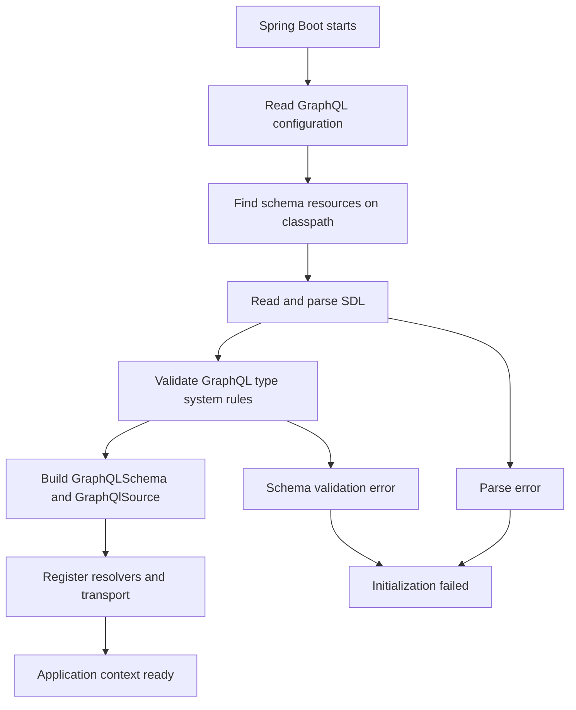

# Schema validation at startup

In a Spring for GraphQL application, the SDL schema is the contract describing the operations, object types, input types, scalars, enums, and data relationships that clients are allowed to use. Before the application can execute queries, Spring needs to load the schema files, parse the syntax, and build a valid GraphQL schema.

This process typically takes place when Spring Boot initializes the application context. If the SDL has syntax errors or violates GraphQL type system rules, building `GraphQlSource` will not complete and the application usually fails to start. This early check catches contract errors at deployment time instead of waiting for the first client request.

## 1. When is the schema loaded and validated?

When you add `spring-boot-starter-graphql`, Spring Boot auto-configures the core components of Spring for GraphQL. Under the default schema resource configuration, the application places SDL files on the classpath, usually under `src/main/resources/graphql/`.

Example structure:

```text
src/main/resources/
└── graphql/
    ├── common.graphqls
    ├── query.graphqls
    └── book/
        ├── book.graphqls
        └── author.graphqls
```

Spring Boot searches for schema resources based on the configured locations, loads their contents, and uses GraphQL Java to build the executable schema. Multiple SDL files can be combined into one schema, allowing definitions to be split by business domain instead of putting every type into a single large file.

The initialization flow can be visualized as follows:



Parsing checks whether the SDL has valid syntax. Schema validation checks whether the definitions form a valid GraphQL schema. These two steps are distinct: a file can parse successfully yet the schema can still be invalid due to referencing a nonexistent type or declaring a type in the wrong role.

## 2. Configuring schema locations

By default, `.graphqls` or `.gqls` files in `classpath:graphql/**/` are searched for loading. You can specify custom locations in `application.yml`:

```yaml
spring:
  graphql:
    schema:
      locations: classpath:graphql/**/
      file-extensions: .graphqls,.gqls
```

Important properties:

| Property | Purpose |
| --- | --- |
| `spring.graphql.schema.locations` | List of locations to search for schema resources on the classpath |
| `spring.graphql.schema.file-extensions` | Recognized schema file extensions |
| `spring.graphql.path` | HTTP GraphQL endpoint path, not the SDL location |

When a project has multiple modules or multiple teams responsible for the schema, files can be split by feature. Make sure every file is packaged into the artifact and matches the configured pattern. A file outside the searched directories will not be included in the schema merely because it has a `.graphqls` extension.

Do not duplicate a type or field across multiple files if the definitions cannot be validly merged. Splitting a schema into multiple files is a way to organize source files; it does not mean each file becomes a separate GraphQL endpoint or an independent schema.

## 3. Distinguishing parse errors from schema validation errors

### 3.1. Parse error: invalid SDL syntax

The parser cannot read an SDL document if the syntactic structure is wrong. For example, missing a `:` between a field name and its data type:

```graphql
type Book {
    id ID!
    title: String!
}
```

In this example, `id ID!` is not valid field declaration syntax. It must be fixed to:

```graphql
type Book {
    id: ID!
    title: String!
}
```

Parse errors usually include document position details such as line and column. Start fixing at the position the parser points to, then check surrounding lines because a missing brace or colon can cause the error message to appear at a later position.

### 3.2. Schema validation error: valid syntax but invalid type system

The following example parses cleanly, yet references an undefined `Publisher` type:

```graphql
type Book {
    id: ID!
    title: String!
    publisher: Publisher
}
```

If the schema has no `Publisher` definition in any loaded SDL file, schema building will fail. You must add that type or change the field to an existing type.

Therefore, when reading startup logs, determine whether the error lies in the parser or in type system rules. Fixing syntax will not resolve a type reference error; conversely, changing data types will not help if the parser cannot even read the SDL yet.

## 4. Type system rules that commonly cause startup failures

GraphQL checks many rules before a schema can be used. Some common error categories:

### 4.1. Query root type must exist

An executable schema must have a query root type that is an object type. Mutation and subscription root types are optional.

```graphql
type Query {
    book(id: ID!): Book
}

type Book {
    id: ID!
    title: String!
}
```

If the schema only declares `Book` without a query root type, the schema does not meet the minimum requirement to execute GraphQL queries. If you name the root type something other than `Query`, explicitly declare it in a `schema` definition:

```graphql
schema {
    query: LibraryQuery
}

type LibraryQuery {
    books: [Book!]!
}
```

### 4.2. Distinguishing input types and output types

Return fields use output types such as scalar, enum, object, interface, or union. Arguments and input object fields must use input types such as scalar, enum, or input object.

Invalid declaration:

```graphql
type Book {
    id: ID!
    title: String!
}

type Mutation {
    createBook(book: Book!): Book!
}
```

`Book` is an output object type and cannot be used as an input argument. Create a dedicated input object:

```graphql
input CreateBookInput {
    title: String!
}

type Mutation {
    createBook(input: CreateBookInput!): Book!
}
```

### 4.3. Interface implementations must be compatible

An object type implementing an interface must provide the fields required by the interface with compatible output types. For instance, an interface declaring `title: String!` while the object type declares `title: String` is invalid because the object could return null whereas the interface guarantees non-null.

```graphql
interface Publication {
    id: ID!
    title: String!
}

type Book implements Publication {
    id: ID!
    title: String!
    author: String!
}
```

When a schema is split across multiple files, check both the interface definition and every object type implementing it. A nullability change in the interface file can render an implementation in another file incompatible.

### 4.4. Unions can only contain object types

A union lists the object types that can appear. Scalars, interfaces, or input objects cannot be added to the member list.

```graphql
union SearchResult = Book | Author
```

If `Author` is not defined yet or a member is not an object type, schema validation will report an error.

### 4.5. Input objects cannot have unbreakable required cycles

Input objects can reference each other, but a cycle consisting solely of single non-null fields makes it impossible for clients to construct a finite input value.

Invalid example:

```graphql
input FirstInput {
    next: SecondInput!
}

input SecondInput {
    previous: FirstInput!
}
```

Each input requires containing the other, so there is no termination point to construct a value. You can break the cycle with a nullable field or a list:

```graphql
input FirstInput {
    next: SecondInput
}

input SecondInput {
    previous: FirstInput!
}
```

When designing nested inputs, check for type cycles and determine which structure is actually needed by the business domain.

### 4.6. Field names, arguments, and definitions must be consistent

Within the same type, you cannot declare duplicate field names or duplicate argument names within the same field. Types, directives, and enum values must also follow naming rules and avoid conflicting definitions. When merging multiple schema resources, duplicate name errors can span two different files, so check the resource paths in the logs.

## 5. Schema validation does not mean resolvers already work

An important point is that a valid schema does not prove the entire API can execute business logic properly.

Example SDL:

```graphql
type Query {
    book(id: ID!): Book
}

type Book {
    id: ID!
    title: String!
}
```

This schema can be valid even if the application does not yet have a `@QueryMapping` controller for the `book` field. The GraphQL type system verifies the SDL contract, while mapping fields to data is part of runtime wiring and resolvers. For a field without a custom data fetcher, GraphQL Java can use the default property/data fetcher; that does not guarantee the field returns the intended business data.

Therefore, distinguish:

- **SDL parse/schema validation**: syntax and GraphQL type system rules.
- **Runtime wiring**: attaching data fetchers, scalar coercing, type resolvers, and execution components.
- **Spring controller mapping**: mapping annotated methods such as `@QueryMapping`, `@MutationMapping`, and `@SchemaMapping` to schema fields.
- **Runtime business logic**: database, services, authorization, validation, and errors thrown inside resolvers.

Some wiring or mapping errors may be detected during initialization depending on the component and version; data or logic errors only surface when the field is actually invoked. Do not rely solely on the application context starting successfully to conclude that all queries are correct.

## 6. Checking schema configuration and GraphQlSource

In a typical Spring Boot application, let auto-configuration create `GraphQlSource` from schema resources. Only customize when there is a real need such as registering custom scalars, type resolvers, or special wiring.

Example runtime wiring configuration:

```java
import org.springframework.context.annotation.Bean;
import org.springframework.context.annotation.Configuration;
import org.springframework.graphql.execution.RuntimeWiringConfigurer;

@Configuration
public class GraphQlConfiguration {

    @Bean
    RuntimeWiringConfigurer runtimeWiringConfigurer() {
        return builder -> builder.scalar(MyScalars.LOCAL_DATE);
    }
}
```

`RuntimeWiringConfigurer` adds wiring to the schema creation process. It does not replace SDL parsing and schema validation. If a custom scalar is not registered or a scalar name in SDL lacks corresponding coercing, building or executing the schema may not fulfill the expected contract; check startup logs and integration tests.

If you declare your own `GraphQlSource` bean, understand the auto-configuration conditions of the Spring Boot version in use. A manual configuration that fails to load all schema resources or fails to apply required customizers can alter the application's default behavior.

## 7. Testing to catch schema errors before deployment

Testing application context initialization is a simple way to ensure schema resources are found and can be built into a schema.

```java
import org.junit.jupiter.api.Test;
import org.springframework.boot.test.context.SpringBootTest;

@SpringBootTest
class GraphQlSchemaStartupTest {

    @Test
    void applicationContextStartsWithValidSchema() {
        // Context must initialize successfully with the current schema.
    }
}
```

If the schema has syntax errors, lacks a root query, or violates the type system, the context usually fails to initialize and the test fails. This test is well suited as a smoke test in the build pipeline.

You can use `@GraphQlTest` to test the GraphQL slice and related controllers. However, a slice test does not necessarily load the full configuration and all schema resources like the complete application; choose tests according to the scope you want to verify.

Once the context starts, add tests executing representative operations with `GraphQlTester`. That additionally verifies resolver mappings, return data types, and actual behavior beyond confirming schema validity.

## 8. Workflow for diagnosing startup errors

When the application halts during GraphQL initialization, troubleshoot in this order:

1. **Confirm schema resources are found.** Check that files are under `src/main/resources`, extensions are supported, and they match `spring.graphql.schema.locations`.
2. **Read parse errors.** If the log indicates line/column, inspect `:`, `{}`, parentheses, characters, or declaration names at that position.
3. **Check type references.** Look for undefined types, typos, or unloaded files containing definitions.
4. **Check input/output positions.** Ensure object types are not used as inputs and input objects are not used as outputs.
5. **Check interfaces, unions, and root operations.** Compare every implementation against its interface, ensure unions only contain object types, and confirm a valid query root exists.
6. **Check declarations across multiple files.** Look for duplicate definitions, duplicate fields, or nullability changes making files incompatible.
7. **Check runtime wiring after SDL is valid.** Confirm custom scalars, type resolvers, and controller mappings are properly registered.

Do not look only at the `Application run failed` line at the end of the log. The cause usually lies deeper in the exception chain, at the step of reading resources, parsing SDL, or building the GraphQL schema. Find the root exception and schema filename before changing configuration.

## 9. Common causes and fixes

| Symptom | Possible cause | Resolution |
| --- | --- | --- |
| Query type not found | Missing query root type or misdeclared root type | Add `type Query` or `schema { query: ... }` |
| Unknown type | Undefined type or defining file not loaded | Check spelling and schema locations |
| Field argument uses object type | Confused output type with input type | Create a separate `input` type |
| Invalid interface implementation | Missing field or incompatible nullability/arguments | Align interface and object type |
| Invalid union member | Member is not an object type | List only object types |
| Invalid input cycle | Cycle consists solely of non-null singular fields | Allow termination via nullable or list |
| SDL parse error | Missing delimiter or invalid syntax | Fix at the parser-reported position |
| Schema file not found after build | Resource not packaged or wrong pattern | Check output artifact and locations |
| Valid schema yet query returns null or error | Incorrect resolver/data fetcher or data | Test operation and check runtime mappings |

## 10. Pre-deployment checklist

- Are all required `.graphqls`/`.gqls` files packaged in the artifact?
- Does `spring.graphql.schema.locations` match the actual resource structure?
- Does SDL parse cleanly and is the schema type system valid?
- Does the Query root type exist; are mutation and subscription declared when needed?
- Are input/output types used in the right positions?
- Do interfaces, unions, and input object cycles comply with GraphQL rules?
- Are required custom scalars and runtime wiring registered?
- Have controller mappings and resolvers been tested with real operations?
- Are context startup tests and GraphQL smoke tests included in the pipeline?
- Do error logs avoid leaking sensitive data while providing enough detail to diagnose schema resources?

Schema validation at startup catches errors in the GraphQL contract early before the application accepts requests. Spring Boot loads SDL from the classpath and builds `GraphQlSource`; GraphQL Java validates syntax and type system rules during that process. To ensure the API works properly, also verify runtime wiring, controller mappings, and representative operations with tests. When organizing a schema across multiple files, keep resource locations clear and treat the entire SDL as a unified contract of the Spring for GraphQL application.
