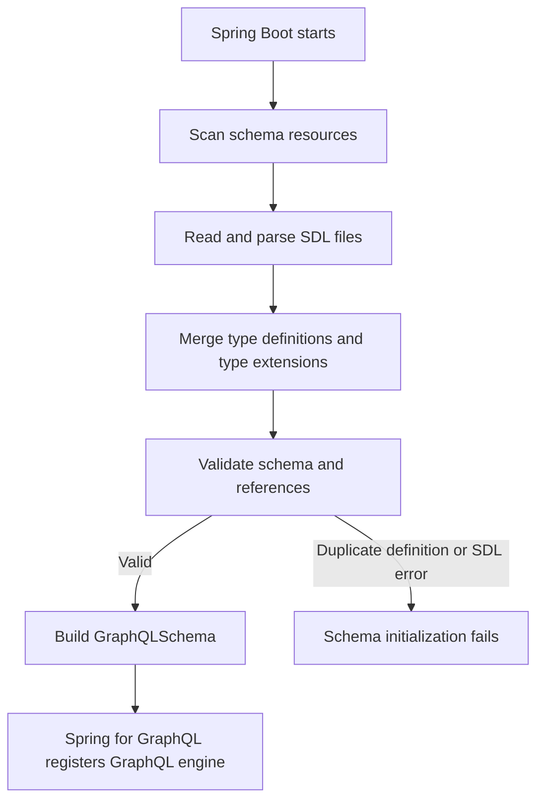

# Duplicate type in schema

## 1. Why can a schema have duplicate types?

As a Spring for GraphQL application grows, the SDL schema is often split across multiple files so each business domain manages its own data definitions. For example, the book module declares `Book`, the author module declares `Author`, and multiple modules add fields to the root `Query` type.

Splitting files keeps the schema readable and maintainable, yet all files are loaded into one shared GraphQL schema. Type names in GraphQL belong to the same namespace of that schema. If two files define a type with the same name, GraphQL does not treat them as two separate types scoped by Java package; schema building detects the duplicate definition and fails.

Invalid example:

`book.graphqls`:

```graphql
type Book {
    id: ID!
    title: String!
}
```

`catalog.graphqls`:

```graphql
type Book {
    isbn: String!
    publishedYear: Int
}
```

Both files declare `type Book`. These are two object type definitions with the same name, not two halves of one type that are automatically merged. When Spring for GraphQL loads the schema resources, GraphQL Java checks and reports a duplicate type error.

If the goal is to add fields to an existing `Book`, the second file must use `extend type Book`.

## 2. How does Spring for GraphQL load multiple SDL files?

In a typical Spring Boot setup, SDL schemas are placed in `src/main/resources/graphql/`. Files with `.graphqls` or `.gqls` extensions in the configured schema location are collected to build an executable schema.

Example directory structure:

```text
src/main/resources/graphql/
├── common/
│   ├── scalars.graphqls
│   └── pagination.graphqls
├── book/
│   ├── book.graphqls
│   └── book-query.graphqls
├── author/
│   └── author.graphqls
└── order/
    └── order.graphqls
```

These files do not produce independent schemas. They are combined into one shared schema so GraphQL Java can validate type references, fields, inputs, enums, and GraphQL rules.

High-level flow:



Therefore, an individual file may look valid while the overall schema still fails when files are merged. You must check the schema in its merged state, not just open each file individually to check syntax.

## 3. Rule: define a type once, extend with `extend`

A named type should have only one base definition in the schema. When you need to add fields or members in another file, use the corresponding type extension.

Base definition example:

`book.graphqls`:

```graphql
type Book {
    id: ID!
    title: String!
}

type Query {
    book(id: ID!): Book
}
```

Extending the type from another domain file:

`book-author.graphqls`:

```graphql
type Author {
    id: ID!
    name: String!
}

extend type Book {
    author: Author
}

extend type Query {
    booksByAuthor(authorId: ID!): [Book!]!
}
```

In this example:

- `Book` has only one base definition.
- `Query` has only one base definition.
- `Author` is a new type, so it has its own `type Author` definition.
- `extend type Book` adds the `author` field to the existing type.
- `extend type Query` adds the `booksByAuthor` field to the root query.

After merging, the schema can be understood as equivalent to a `Book` object type containing `id`, `title`, `author` and a root `Query` type containing both `book` and `booksByAuthor`.

`extend` is GraphQL SDL syntax. It is not Java inheritance, does not modify Java classes, and does not automatically create resolvers. If the new field needs data loading logic, the application must still provide an appropriate data fetcher or mapping.

## 4. Splitting root `Query` across multiple files

A common scenario is each business team wanting to declare root queries in its own file. Do not repeat `type Query` in every file.

Incorrect example:

`book-query.graphqls`:

```graphql
type Query {
    book(id: ID!): Book
}
```

`author-query.graphqls`:

```graphql
type Query {
    author(id: ID!): Author
}
```

Correct example:

`root.graphqls`:

```graphql
type Query {
    health: String!
}
```

`book-query.graphqls`:

```graphql
extend type Query {
    book(id: ID!): Book
    books(first: Int = 20): [Book!]!
}
```

`author-query.graphqls`:

```graphql
extend type Query {
    author(id: ID!): Author
    authors(first: Int = 20): [Author!]!
}
```

The merged schema has a single root `Query` with the fields `health`, `book`, `books`, `author`, and `authors`. Teams can manage their own fields in separate files without creating duplicate root type definitions.

A root query type is mandatory for an executable schema. With default root names, there must be a base `type Query` definition before other files extend it. If the schema uses a custom root name, declare the mapping in `schema` and extend the mapped object type; for example:

```graphql
schema {
    query: RootQuery
}

type RootQuery {
    health: String!
}

extend type RootQuery {
    book(id: ID!): Book
}
```

Similarly, if the API has mutations or subscriptions, define the corresponding root type once and use `extend type Mutation` or `extend type Subscription` to add fields. When a schema already declares an explicit root mapping and you want to add another operation root in a different file, use `extend schema` to extend the schema instead of declaring a second `schema` block:

```graphql
type Mutation {
    createBook(input: CreateBookInput!): Book!
}

extend schema {
    mutation: Mutation
}
```

## 5. Extending other kinds of types

GraphQL SDL supports type extensions for many kinds of named types, not only object types. Usage follows the same rule: one base definition, and other files only add valid members.

### Interface

```graphql
interface Node {
    id: ID!
}
```

Another file can add fields to the interface:

```graphql
extend interface Node {
    createdAt: DateTime!
}
```

Object types implementing `Node` must satisfy the interface contract after the schema is merged.

### Union

```graphql
union SearchResult = Book | Author
```

Another file can add a member:

```graphql
extend union SearchResult = Publisher
```

New members must be existing object types in the schema. Do not add a member that was already declared.

### Enum

```graphql
enum OrderStatus {
    PENDING
    PAID
}
```

Extend the enum with new values:

```graphql
extend enum OrderStatus {
    CANCELLED
    REFUNDED
}
```

Do not redeclare `PENDING` or `PAID` in the extension. An enum value may appear only once in the final enum.

### Input object

```graphql
input BookFilter {
    titleContains: String
}
```

Another file can add input fields:

```graphql
extend input BookFilter {
    authorId: ID
    publishedAfter: Date
}
```

Added input fields must use valid input types. Do not place an object type or interface in an input type position.

Using extensions for interfaces, unions, enums, and input objects still requires validating the entire schema after merging. `extend` does not bypass type system rules; it only provides syntax to combine valid definition parts.

## 6. Cases still treated as duplicates when using `extend`

`extend` does not allow redeclaring something that already exists. For example, the base type already has a `title` field:

```graphql
type Book {
    id: ID!
    title: String!
}
```

The following extension is still invalid:

```graphql
extend type Book {
    title: String
    author: Author
}
```

The `title` field is defined twice on the same type after merging. Remove the duplicate field and keep only the addition:

```graphql
extend type Book {
    author: Author
}
```

Other common duplicate cases:

- Two files both define `type Author` instead of one defining it and the other extending it.
- Two extensions both add the `author` field to `Book`.
- Two enum extensions both add the value `CANCELLED`.
- A union declares the `Publisher` member in both its base definition and an extension.
- An input object is extended with two input fields of the same name.
- Multiple files redeclare a scalar with the same name such as `scalar Date`.
- Multiple files redefine the schema root mapping instead of properly extending the schema.

Treat the merged schema as a single structure. Every field name, argument, enum value, union member, and named type must satisfy the uniqueness rules of its respective position.

## 7. Type extensions must reference a valid base type

An extension is only valid when the target type exists in the final schema. For example:

```graphql
extend type Invoice {
    overdue: Boolean!
}
```

Without a base `type Invoice` definition, the schema cannot extend this type. Create the base definition:

```graphql
type Invoice {
    id: ID!
    total: Money!
}
```

Only then extend it:

```graphql
extend type Invoice {
    overdue: Boolean!
}
```

In addition, every type referenced in a field, argument, input field, interface implementation, or union member must exist and be in the valid input/output position. For instance, `Author` must be defined if `Book.author` returns `Author`; `BookFilter` must be an input object if used as an argument.

## 8. Organizing schemas by business module

When a schema is large, split files by domain or feature, while still clearly identifying which file owns the base definition of each type.

A usable structure:

```text
graphql/
├── root/
│   ├── query.graphqls
│   ├── mutation.graphqls
│   └── subscription.graphqls
├── book/
│   ├── book.graphqls
│   ├── book-query.graphqls
│   └── book-input.graphqls
├── author/
│   ├── author.graphqls
│   └── author-query.graphqls
├── order/
│   ├── order.graphqls
│   └── order-query.graphqls
└── common/
    ├── scalars.graphqls
    └── pagination.graphqls
```

Conventions that help avoid duplicate types:

1. Each type has one file or module responsible for its base definition.
2. Other modules wanting to add fields use `extend type` and document field ownership clearly.
3. Root `Query`, `Mutation`, and `Subscription` have one centralized base definition.
4. Shared scalars such as `DateTime`, `Money`, or `UUID` are declared once and registered in runtime once.
5. Name types with domain semantics to prevent two teams from accidentally sharing overly generic names like `Result`, `Status`, or `Item`.
6. Avoid letting multiple modules modify the same type without agreeing on ownership, as changes can cause field or contract conflicts.

GraphQL type names have schema-wide scope. Different Java packages do not create separate namespaces for GraphQL. If two domains have two different `Status` concepts, name them explicitly such as `OrderStatus` and `PaymentStatus`.

## 9. Configuring schema locations in Spring Boot

Spring Boot looks for schemas on the classpath using the default location in GraphQL configuration. If you need to change locations, configure them in `application.yml`:

```yaml
spring:
  graphql:
    schema:
      locations: classpath:graphql/**/
      file-extensions: .graphqls,.gqls
```

`locations` specifies the schema resource locations to load; `file-extensions` specifies the recognized extensions. Make sure all required files reside in these locations and that the same file is not accidentally loaded twice through overlapping patterns.

Changing `locations` does not fix a duplicate type error. If two files are loaded and both define the same type, the schema remains invalid. Configuration only determines which resources are fed into the schema build process.

When an application uses a custom `GraphQlSource` configuration instead of auto-configuration, check the `schemaResources` list passed to the builder. Do not assume a file in `src/main/resources/graphql/` is guaranteed to be loaded if custom configuration has changed the schema source.

## 10. Mapping resolvers after extending the schema

Type extensions only add fields to the schema. If a field needs custom logic, Spring for GraphQL still needs a resolver.

Example SDL:

`book.graphqls`:

```graphql
type Book {
    id: ID!
    title: String!
}
```

`book-author.graphqls`:

```graphql
type Author {
    id: ID!
    name: String!
}

extend type Book {
    author: Author
}
```

Resolver:

```java
import org.springframework.graphql.data.method.annotation.SchemaMapping;
import org.springframework.stereotype.Controller;

@Controller
public class BookAuthorController {

    private final AuthorService authorService;

    public BookAuthorController(AuthorService authorService) {
        this.authorService = authorService;
    }

    @SchemaMapping(typeName = "Book", field = "author")
    public Author author(Book book) {
        return authorService.findById(book.authorId()).orElse(null);
    }
}
```

This example assumes the Java `Book` object has `authorId()`. `@SchemaMapping` maps the resolver to the `author` field of the `Book` GraphQL type, even though that field was added from an SDL file via `extend type`.

For root fields added via `extend type Query`, you can use `@QueryMapping`:

```java
@QueryMapping
public Author author(@Argument String id) {
    return authorService.findById(id).orElse(null);
}
```

The field name in SDL and the mapping name must match. If the schema is valid yet a request reports `Field ... has no data fetcher` or returns `null`, check the mapping and property access mechanism; this is a field execution issue, distinct from a duplicate type error at startup.

## 11. Identifying and fixing duplicate type errors in schemas

When a schema is invalid, the application usually fails during GraphQL schema or context initialization. Exact messages may vary by Spring Boot and GraphQL Java version, but they typically include the duplicate type, field, or enum value name.

| Message or symptom | Possible cause | Resolution |
| --- | --- | --- |
| `There can be only one type named "Book"` | Multiple files define `type Book` | Keep one base definition, change additional definitions to `extend type Book` |
| Field `title` already defined | Base type and extension both declare `title` | Remove the duplicate field from the extension |
| Enum value defined multiple times | Multiple files add the same enum value | Keep a single occurrence in the final enum |
| Duplicate union member | Same object type added from multiple places | Remove the duplicate member from the extension |
| Type extension cannot find target type | Missing base definition or typo in type name | Add base type or fix target type name |
| Referenced type not found | SDL uses an undefined type | Add the proper definition or verify schema resource is loaded |
| Missing root Query | No valid query root defined | Declare `type Query` once |
| Schema fails after adding a new file | New file loaded and conflicts with an older file | Check all definitions with the same name and resource patterns |
| Valid schema yet field does not run | Missing resolver or wrong mapping | Check `@QueryMapping`, `@SchemaMapping`, and service |

### Process to locate the duplicate-causing file

1. Read the type or field name in the startup error.
2. Search across `.graphqls` and `.gqls` files in the active schema locations.
3. Classify each occurrence: base definition, extension, or invalid duplicate definition.
4. Pick one authoritative owner for the base definition; convert additions to extensions.
5. Check whether any fields, input fields, enum values, or union members are duplicated after merging.
6. Restart the context or run schema tests to confirm the entire schema is valid.

Do not resolve the issue by mechanically renaming types if both files actually describe the same business concept. First determine whether they represent one type to extend or two distinct concepts needing separate names.

## 12. Testing the merged schema

Checking each file individually is not enough. You need tests that initialize the schema from the exact set of resources the application uses at runtime.

A Spring for GraphQL integration test can use `GraphQlTester` to confirm queries can invoke fields coming from multiple files:

```java
@SpringBootTest
@AutoConfigureHttpGraphQlTester
class SchemaCompositionTests {

    @Autowired
    GraphQlTester graphQlTester;

    @Test
    void queryCanUseFieldsDefinedAcrossSchemaFiles() {
        graphQlTester.document("""
            query {
                book(id: "book-42") {
                    id
                    title
                    author {
                        id
                        name
                    }
                }
            }
            """)
            .execute()
            .errors()
            .verify();
    }
}
```

This example assumes the test context has appropriate data or mock services and the corresponding resolvers are configured. The goal here is to confirm the merged schema initializes and the operation can be validated/executed. In a real project, also verify returned values and expected business errors.

You can add an introspection test to confirm extended fields appear on the final type:

```graphql
query BookFields {
    __type(name: "Book") {
        fields {
            name
        }
    }
}
```

The result must contain both base fields like `id`, `title` and extended fields like `author`. Introspection is helpful for inspecting the runtime schema, though it does not replace testing resolvers or validating real operations.

## 13. Checklist to avoid duplicate types in schemas

- [ ] Every named type has exactly one base definition in the merged schema.
- [ ] Other files use `extend` when adding fields or members.
- [ ] Root `Query`, `Mutation`, and `Subscription` have a single base definition.
- [ ] Every type extension references an existing base type.
- [ ] No duplicate field, input field, enum value, or union member names exist.
- [ ] All referenced types exist and are in valid input/output positions.
- [ ] Type names reflect domain concepts and avoid cross-module collisions.
- [ ] Schema locations do not load the same resource twice via overlapping patterns.
- [ ] Resolvers for new fields are mapped with appropriate annotations.
- [ ] Tests verify initialization of the merged schema and operations using fields across multiple files.

## Conclusion

Duplicate types in a schema occur when multiple SDL files define the same named type while Spring for GraphQL loads them into the same GraphQL schema. Splitting a schema into multiple files does not create separate namespaces; each type should have only one base definition. Modules that need to add fields should use `extend type`, `extend interface`, `extend input`, `extend enum`, or the appropriate extension for the type kind.

In Spring Boot, control schema locations, establish ownership conventions for base definitions, and test the schema after merging. `extend` only solves SDL organization; new fields still require resolvers when data logic is involved. When you can distinguish duplicate definition errors, extension errors, and resolver mapping errors, finding why a schema fails to start or a field fails to execute becomes clearer and faster.
