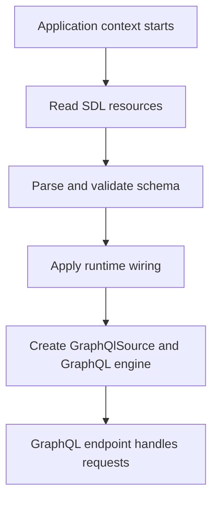
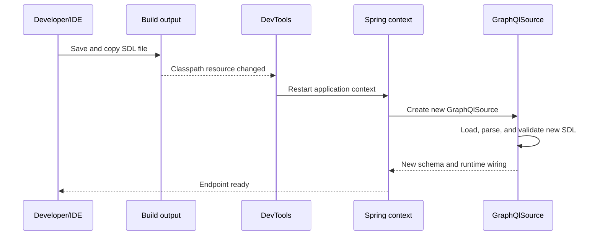

# Reloading schema in development

When developing a GraphQL API, the SDL schema changes frequently: adding fields, modifying arguments, adjusting nullability, or extending types. After saving a `.graphqls` file, the application needs to reload the schema so the GraphQL endpoint reflects the new definitions. With Spring for GraphQL, the schema is built during application initialization and held in `GraphQlSource`. Therefore, the simple and appropriate approach for development is using **Spring Boot DevTools restart** to restart the application context when classpath resources change.

DevTools restart recreates beans, including `GraphQlSource`, the executable `GraphQLSchema`, runtime wiring, and controller mappings. This is a development-time application restart mechanism, not GraphQL re-reading SDL on every request.

## 1. When is the schema loaded?

In a typical Spring Boot setup, Spring for GraphQL searches for SDL in classpath resources, defaulting to `classpath:graphql/**/`. Files such as `schema.graphqls`, `book.graphqls`, or `author.gqls` are read and combined to build the schema.

At startup, Spring Boot auto-configuration creates `GraphQlSource` from resources and runtime configuration. `GraphQlSource` provides the schema and the GraphQL engine used to execute operations. `RuntimeWiringConfigurer` beans, controller mappings such as `@QueryMapping` and `@SchemaMapping`, scalars, and type resolvers are also wired during runtime construction.



Once the context is running, editing an SDL file on disk does not automatically change the active schema. The application needs to recreate `GraphQlSource`, typically by restarting the context.

## 2. Spring Boot DevTools restart

Spring Boot DevTools provides an automatic restart mechanism when files on the classpath change. DevTools monitors build output directories such as `build/classes`, `build/resources/main`, or `target/classes`. When it detects relevant changes, it restarts the application context using a restart classloader.

When SDL files are rebuilt/copied back to the classpath, the restart recreates Spring beans. Spring for GraphQL loads the updated SDL and builds the new schema. You can continue sending queries to the endpoint once the application finishes restarting.

### Adding DevTools to the project

With Gradle and the Spring Boot plugin:

```groovy
dependencies {
    developmentOnly("org.springframework.boot:spring-boot-devtools")
}
```

With Maven:

```xml
<dependency>
    <groupId>org.springframework.boot</groupId>
    <artifactId>spring-boot-devtools</artifactId>
    <scope>runtime</scope>
    <optional>true</optional>
</dependency>
```

DevTools is for development only. The Spring Boot build plugin typically excludes DevTools from the packaged executable archive, yet you should still keep the dependency in an appropriate development configuration and verify production artifacts when needed.

DevTools restart is usually enabled automatically when the dependency is present in an appropriate runtime environment. You can configure it explicitly:

```yaml
spring:
  devtools:
    restart:
      enabled: true
```

If you want to disable restart for a single run, set `spring.devtools.restart.enabled=false`. Do not enable DevTools restart in production environments.

## 3. Why saving an SDL file sometimes does not trigger a restart

DevTools watches classpath output, not every file directly in the source directory. In a Gradle project, files in `src/main/resources/graphql` need to be copied to `build/resources/main/graphql`. In Maven, resources are usually copied to `target/classes/graphql`.

Thus, the workflow has two steps:

1. The IDE or build tool detects that the resource file changed and copies it to the output directory.
2. DevTools detects that the output directory changed and restarts the application context.

Example Gradle project structure:

```text
src/main/resources/graphql/
├── schema.graphqls
└── book.graphqls

build/resources/main/graphql/
├── schema.graphqls
└── book.graphqls
```

If you only save `src/main/resources/graphql/book.graphqls` without the IDE building/copying resources, DevTools may not notice the change because the classpath file still holds the old content.

In IntelliJ IDEA or a similar IDE, enable automatic project/resource building as fits your workflow. If using Gradle, you can run a continuous task to copy resources automatically:

```bash
./gradlew -t processResources
```

On Windows:

```powershell
gradlew.bat -t processResources
```

Run this task in a separate terminal while the application is running via `bootRun` or the IDE. When resources change, Gradle updates the output directory; DevTools will detect it and restart if that directory is within the watched scope.

## 4. Configuring schema locations

If the schema resides in the default location, you do not need to redeclare `spring.graphql.schema.locations`. Only configure this property when the project places SDL in a different resource root or needs to combine multiple sources:

```yaml
spring:
  graphql:
    schema:
      locations:
        - classpath:graphql/**/
        - classpath:shared-graphql/**/
```

Configured locations must cover all schema sources to be loaded. When changing file structures or locations, double-check resource patterns and ensure both base types and extensions are found.

If you want to edit schemas from a directory outside the classpath, you can configure resources using `file:`. For example:

```yaml
spring:
  graphql:
    schema:
      locations:
        - file:./config/graphql/**/
  devtools:
    restart:
      additional-paths:
        - ./config/graphql
```

Here, `spring.graphql.schema.locations` tells Spring for GraphQL where to read SDL. `spring.devtools.restart.additional-paths` tells DevTools to additionally watch that directory for changes and trigger restarts. The two properties have different responsibilities: adding a directory to the watch list does not automatically make it a schema resource; you must configure `file:` accordingly for Spring for GraphQL to read its contents.

Relative paths are resolved against the process working directory. When running the application from an IDE, check the working directory to avoid having the application look for schemas in an unexpected location.

## 5. Using a trigger file for controlled restarts

When editing multiple SDL files at once, restarting on every save can disrupt your workflow. DevTools supports a trigger file so restarts only happen after the trigger file is modified.

Example:

```yaml
spring:
  devtools:
    restart:
      trigger-file: .reloadtrigger
```

Place the `.reloadtrigger` file at the classpath root, such as `src/main/resources/.reloadtrigger`. After finishing a batch of schema edits and once resources have been copied to the classpath, update the trigger file to tell DevTools to restart.

The trigger file only controls when the restart happens. It does not replace building/copying resources and does not change schema locations. If the SDL file is not yet on the classpath or the `file:` path is misconfigured, restarting still cannot load the intended content.

## 6. What happens during a schema reload?

With DevTools, a schema reload is effectively an application context restart. The sequence typically proceeds as follows:



After restarting:

- The new SDL schema is parsed and validated.
- Runtime wiring is reapplied.
- Controller mappings are reregistered.
- Spring beans are recreated in the new context.
- The endpoint resumes processing queries against the new schema once the application is ready.

Because the application context restarts, in-memory bean state may also be reinitialized. In-flight requests may be interrupted. Therefore, use this mechanism only in development, and do not treat it as a zero-downtime schema update approach for production.

## 7. Verifying the reloaded schema

After DevTools reports the restart is complete, verify in this order:

1. Check logs to confirm the application context restarted and startup succeeded.
2. Check that the updated SDL file appears in `build/resources/main` or `target/classes`, if the schema is on the classpath.
3. Send a query using the newly added or modified field.
4. If introspection is enabled, inspect the type and fields via `__type`.

Example checking a new field on `Book`:

```graphql
query {
    __type(name: "Book") {
        name
        fields {
            name
            type {
                kind
                name
            }
        }
    }
}
```

Introspection may be disabled or restricted by the application's security configuration. In that case, test directly with a business operation or integration test using `GraphQlTester`.

Example test after the schema is loaded:

```java
graphQlTester.document("""
        query {
            book(id: "book-01") {
                id
                title
            }
        }
        """)
    .execute()
    .path("book.title")
    .entity(String.class)
    .isEqualTo("Spring in Action");
```

In development, you can use a small query for the newly added field to confirm both the schema and the resolver. If SDL has the new field without a matching resolver or property, the query may return `null` or a non-null error. Thus, keep schema and mapping/controller updates together.

## 8. Handling reload errors

The new schema must be valid before `GraphQlSource` can be created. If a file has syntax errors, references a nonexistent type, has duplicate extensions, or has an interface implementation violating the contract, the restart may fail.

When errors occur, check startup logs to identify the offending SDL file and position. Then:

- Check whether resources were copied to the right output directory.
- Check whether `spring.graphql.schema.locations` covers that file.
- Check whether the file extension is in the supported schema extensions list.
- Check syntax, type references, duplicate fields, and interface/union relationships.
- Check whether controller mappings and runtime wiring still match the new schema.

Do not assume the schema is valid simply because DevTools printed a restart message. Wait for startup logs to finish and send a test query. When a schema is invalid, fix the SDL and let DevTools restart again or restart the application manually.

## 9. Distinguishing DevTools restart from LiveReload

DevTools can integrate LiveReload to tell the browser to reload the page when frontend resources change. LiveReload and restart are two separate mechanisms:

| Mechanism | Effect |
| --- | --- |
| DevTools restart | Restarts the application context, recreating `GraphQlSource` and runtime wiring |
| LiveReload | Refreshes the browser page when frontend resources change |
| Build resource task | Copies SDL from source resources to classpath output |
| `spring.graphql.schema.locations` | Specifies where Spring for GraphQL reads schemas |

LiveReloading a web page does not change the GraphQL schema on the server. Conversely, a DevTools server restart does not guarantee the browser automatically reloads a frontend page. When developing pure GraphQL or using GraphiQL, re-run the operation after the server restart completes.

## 10. Can you reload the schema without restarting the application?

Spring for GraphQL does not provide a default `reload schema` endpoint or button to re-read SDL and swap the running schema on every file save. `GraphQlSource` is created within the application context lifecycle and serves GraphQL execution.

If a system genuinely needs to swap schemas dynamically without restarting the entire context, you must design a custom mechanism: build a new schema from resources, validate thoroughly, create the corresponding GraphQL engine/runtime wiring, and safely route new requests to the new engine. You must handle concurrent in-flight requests, DataLoaders, instrumentation, controller mappings, caches, and schema-dependent beans. That is an advanced runtime architecture, not a normal development configuration.

Do not mutate an active `GraphQLSchema` directly or replace an SDL file on disk assuming subsequent requests will automatically see the change. For daily development workflows, DevTools restart is simpler and ensures the entire context is rebuilt consistently.

## 11. Notes when using DevTools

- Add DevTools only in development environments and do not enable restart in production.
- Ensure the IDE or build tool copies resources after editing SDL.
- If using schemas outside the classpath, configure `file:` in schema locations and add the directory to `restart.additional-paths`.
- If restarts happen too frequently while editing multiple files, use a trigger file to choose when to restart.
- If a restart hits classloader errors or unstable application state, stop and relaunch the development process after fixing configuration or build output.
- Keep SDL, controller mappings, scalars, directive wiring, and type resolvers synchronized after every change.

In Spring for GraphQL, the schema is built alongside the application context. During development, let the build tool update resources and use DevTools restart to recreate the context and `GraphQlSource`. Understanding the roles of resource copying, schema locations, and restart triggers helps you pinpoint why a schema has not reflected changes while keeping the development workflow simple and testable.
