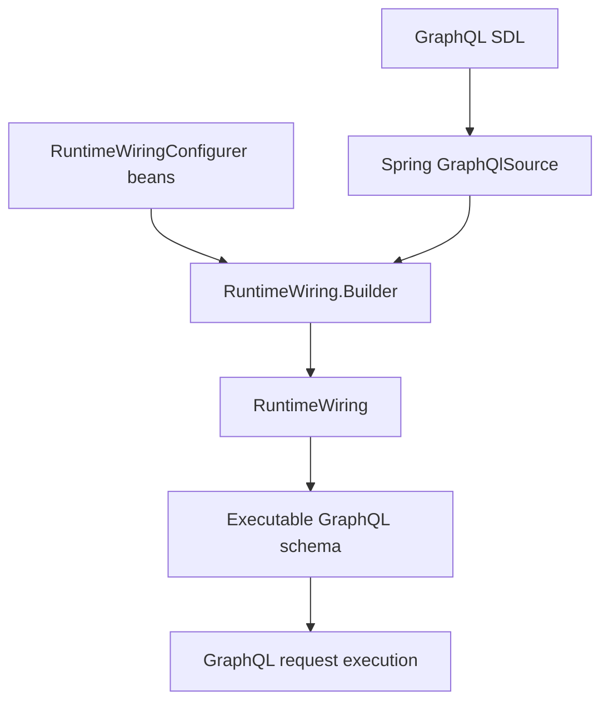

# RuntimeWiring.Builder in Spring for GraphQL

`RuntimeWiring.Builder` is the GraphQL Java API used to register how a schema is executed: which field invokes which data fetcher, which object type an interface or union resolves to, how custom scalars are handled, and which directives require logic to be applied during schema construction.

In Spring for GraphQL, applications typically do not create a `RuntimeWiring` or `GraphQL` instance directly. Spring manages schema construction through `GraphQlSource`, while `RuntimeWiringConfigurer` serves as the extension point for customizing `RuntimeWiring.Builder`. Understanding the builder's role helps you choose the right configuration level: use annotation controllers for standard resolvers and runtime wiring when direct integration with GraphQL Java is needed.

## 1. Where does runtime wiring fit in the initialization process?

GraphQL SDL describes the structure and contract of the API. Runtime wiring connects those declarations to execution logic in the application.



Key steps:

1. Spring loads the application's SDL schema files.
2. Spring creates the runtime wiring builder and applies the `RuntimeWiringConfigurer` beans.
3. GraphQL Java combines the schema definition with the runtime wiring to build an executable schema.
4. The GraphQL engine uses the executable schema to execute requests, invoke data fetchers, and complete the result.

`RuntimeWiring.Builder` is a builder used during schema initialization. It is not an object that receives individual HTTP requests, nor is it a place to store per-request state. User- or request-dependent values should be obtained from the execution context, `DataFetchingEnvironment`, or an appropriate service when the data fetcher runs.

## 2. Spring for GraphQL's RuntimeWiringConfigurer

Spring for GraphQL provides the `RuntimeWiringConfigurer` interface in the `org.springframework.graphql.execution` package. A bean implementing this interface receives `RuntimeWiring.Builder` to register configuration:

```java
import org.springframework.context.annotation.Bean;
import org.springframework.context.annotation.Configuration;
import org.springframework.graphql.execution.RuntimeWiringConfigurer;

@Configuration
public class GraphQlRuntimeConfiguration {

    @Bean
    RuntimeWiringConfigurer runtimeWiringConfigurer() {
        return wiringBuilder -> {
            // Register data fetchers, scalars, type resolvers, or directives here.
        };
    }
}
```

When using default Spring Boot auto-configuration, `RuntimeWiringConfigurer` beans are detected by Spring and applied during the creation of `GraphQlSource`. You can split the configuration into multiple beans by responsibility—for example, one bean for scalars, one for type resolvers, and one for data fetchers.

The type and field names passed to the builder must match those in the SDL. If the schema declares `type Query`, the configuration must use `"Query"`; if the field is `book`, the data fetcher must be attached to `"book"`.

## 3. Registering a data fetcher with RuntimeWiring.Builder

A data fetcher is the component that provides the value for a GraphQL field. Example schema:

```graphql
type Query {
    book(id: ID!): Book
}

type Book {
    id: ID!
    title: String!
}
```

You can register a data fetcher directly through the builder:

```java
import org.springframework.context.annotation.Bean;
import org.springframework.context.annotation.Configuration;
import org.springframework.graphql.execution.RuntimeWiringConfigurer;

@Configuration
public class BookRuntimeConfiguration {

    @Bean
    RuntimeWiringConfigurer bookDataFetcherConfigurer(BookService bookService) {
        return wiringBuilder -> wiringBuilder.type("Query", typeBuilder ->
                typeBuilder.dataFetcher("book", environment -> {
                    String id = environment.getArgument("id");
                    return bookService.findById(id).orElse(null);
                })
        );
    }
}
```

In this example:

- `type("Query", ...)` selects the GraphQL object type `Query`.
- `dataFetcher("book", ...)` attaches the data fetcher to the `book` field.
- `environment.getArgument("id")` retrieves the `id` argument sent by the client.
- `bookService` queries the domain and returns a `Book` or null.

Because the `book` field in the SDL is nullable (`Book`), returning null when no record is found is valid. If it is changed to `Book!`, the data fetcher must always provide a non-null value or handle errors according to the updated contract.

`DataFetchingEnvironment` also provides information such as the source object, arguments, GraphQL context, selection set, and execution metadata. Extract only the information needed for the field; business logic and data access should remain in services so they can be reused and tested.

## 4. Registering a type resolver for interfaces and unions

When a field returns an interface or union, GraphQL needs to determine the concrete object type for each value. Runtime wiring allows registering a `TypeResolver` by abstract type name.

Example schema:

```graphql
interface SearchResult {
    id: ID!
}

type Book implements SearchResult {
    id: ID!
    title: String!
}

type Author implements SearchResult {
    id: ID!
    name: String!
}

type Query {
    search: [SearchResult!]!
}
```

Registering the resolver:

```java
import graphql.schema.TypeResolver;
import org.springframework.context.annotation.Bean;
import org.springframework.context.annotation.Configuration;
import org.springframework.graphql.execution.RuntimeWiringConfigurer;

@Configuration
public class SearchRuntimeConfiguration {

    @Bean
    RuntimeWiringConfigurer searchTypeResolverConfigurer() {
        TypeResolver resolver = environment -> {
            Object source = environment.getObject();

            if (source instanceof Book) {
                return environment.getSchema().getObjectType("Book");
            }
            if (source instanceof Author) {
                return environment.getSchema().getObjectType("Author");
            }

            throw new IllegalStateException("Unsupported search result type");
        };

        return wiringBuilder -> wiringBuilder.type(
                "SearchResult", typeBuilder -> typeBuilder.typeResolver(resolver));
    }
}
```

`environment.getObject()` is the Java object returned by the data fetcher. The resolver must return an object type that is declared and valid for the abstract type being resolved. If a new subtype is added, the schema, mapping, and corresponding tests must be updated.

## 5. Registering a custom scalar

GraphQL has built-in scalars such as `String`, `Int`, `Float`, `Boolean`, and `ID`. When an application needs custom data types, such as `Date`, `DateTime`, or `Long`, you can create a `GraphQLScalarType` and register it via `builder.scalar(...)`.

The example below assumes the application has already created a `dateScalar` scalar with an appropriate `Coercing`:

```java
import graphql.schema.GraphQLScalarType;
import org.springframework.context.annotation.Bean;
import org.springframework.context.annotation.Configuration;
import org.springframework.graphql.execution.RuntimeWiringConfigurer;

@Configuration
public class ScalarRuntimeConfiguration {

    @Bean
    RuntimeWiringConfigurer scalarConfigurer(GraphQLScalarType dateScalar) {
        return wiringBuilder -> wiringBuilder.scalar(dateScalar);
    }
}
```

Schema using that scalar:

```graphql
scalar Date

type Event {
    id: ID!
    startsOn: Date!
}
```

Declaring `scalar Date` in the SDL only defines the type name. The scalar's `Coercing` is responsible for converting values between their GraphQL/JSON representation and Java types in the application. You should clearly define the input format, output format, invalid value handling, and timezone if the scalar represents a date or time.

There is no need to re-register built-in scalars if you only use `String`, `Int`, `Float`, `Boolean`, or `ID`. Only add scalar wiring when the application has genuine extended types.

## 6. Registering schema directive wiring

Directives in SDL can attach metadata or request special behavior on the schema. GraphQL Java provides `SchemaDirectiveWiring` to intercept schema elements as the schema is built.

Example SDL declaring a directive:

```graphql
directive @uppercase on FIELD_DEFINITION

type Query {
    greeting: String @uppercase
}
```

Registering a directive implementation:

```java
import graphql.schema.idl.SchemaDirectiveWiring;
import org.springframework.context.annotation.Bean;
import org.springframework.context.annotation.Configuration;
import org.springframework.graphql.execution.RuntimeWiringConfigurer;

@Configuration
public class DirectiveRuntimeConfiguration {

    @Bean
    RuntimeWiringConfigurer directiveConfigurer(
            SchemaDirectiveWiring uppercaseDirectiveWiring) {
        return wiringBuilder -> wiringBuilder.directive(
                "uppercase", uppercaseDirectiveWiring);
    }
}
```

`uppercaseDirectiveWiring` is a bean implemented by the application, responsible for modifying or wrapping data fetchers according to the directive definition. The snippet above illustrates how to register it; the uppercasing logic must be implemented inside the `SchemaDirectiveWiring` implementation.

Directive wiring is typically applied when the schema is built. It differs from inspecting directives on each request. If behavior depends on the current user or permissions, obtain the principal from the security context/request context when the data fetcher executes and apply appropriate authorization.

## 7. RuntimeWiring.Builder and annotation controllers

Spring for GraphQL supports annotation-based controllers such as `@QueryMapping`, `@MutationMapping`, `@SubscriptionMapping`, `@SchemaMapping`, and `@BatchMapping`. This is the standard way to write resolvers in Spring applications.

Example using annotations:

```java
@Controller
public class BookController {

    private final BookService bookService;

    public BookController(BookService bookService) {
        this.bookService = bookService;
    }

    @QueryMapping
    public Book book(@Argument("id") String id) {
        return bookService.findById(id).orElse(null);
    }
}
```

With this approach, Spring for GraphQL detects the controller and registers the corresponding data fetcher. There is no need to manually write a `RuntimeWiringConfigurer` just to map a regular controller method.

Choose the mechanism based on your needs:

| Need | Suitable Approach |
| --- | --- |
| Resolver bound to a Java method in a Spring bean | Annotations such as `@QueryMapping` or `@SchemaMapping`. |
| Registering a GraphQL Java data fetcher directly | `RuntimeWiringConfigurer` and `RuntimeWiring.Builder`. |
| Registering a type resolver for an interface/union | `RuntimeWiringConfigurer` with `typeResolver(...)`. |
| Adding a custom scalar or schema directive wiring | `RuntimeWiringConfigurer` with `scalar(...)` or `directive(...)`. |
| Batch loading data in a controller | `@BatchMapping` or an appropriate DataLoader mechanism. |

Avoid registering two competing data fetchers for the same field using both annotations and the builder. Establish a single place responsible for mapping a field so the configuration stays readable and maintainable. If a project needs to combine multiple configurers, split them by responsibility and verify the final wiring at startup/in tests.

## 8. Multiple RuntimeWiringConfigurers and custom GraphQlSource

An application can have multiple `RuntimeWiringConfigurer` beans. For example:

- `BookRuntimeConfiguration` registers data fetchers for certain fields.
- `SearchRuntimeConfiguration` registers type resolvers.
- `ScalarRuntimeConfiguration` registers custom scalars.
- `DirectiveRuntimeConfiguration` registers directive wiring.

Spring applies the configurers when building the runtime wiring. Each configurer should only manage the configuration belonging to its own responsibility. If configurers modify the same type/field or replace the same mapping, the outcome may depend on how wiring is merged and the order of application; avoid duplicate configuration and verify the actual behavior.

Spring Boot auto-configuration creates `GraphQlSource` from the schema and wiring components. If an application declares its own `GraphQlSource`, note that the default auto-configuration may back off. In that case, ensure the custom source still loads the schema, applies the `RuntimeWiringConfigurer` beans, and preserves necessary customizations such as instrumentation, exception resolvers, or schema resources. Do not create a standalone `RuntimeWiring`/`GraphQL` instance that Spring's HTTP handler does not use.

## 9. Testing runtime wiring

Tests should execute GraphQL documents to confirm that the wiring connects the schema to the right logic. With `GraphQlTester` configured in the test context, you can verify the `book` field:

```java
@Test
void bookFieldUsesConfiguredDataFetcher() {
    graphQlTester.document("""
            query {
                book(id: "book-1") {
                    id
                    title
                }
            }
            """)
        .execute()
        .path("book.title")
        .entity(String.class)
        .isEqualTo("Spring GraphQL");
}
```

If there is a custom scalar, test both input coercion and output serialization. If there is an interface/union, check `__typename` and inline fragments. If there is a directive, verify that the behavior is applied to fields with the directive and does not affect other fields.

Checks to include:

1. Type and field names in the wiring match the SDL.
2. Data fetchers receive the expected arguments and return the expected data type.
3. Result nullability matches the schema.
4. `TypeResolver` returns the right object type.
5. Custom scalars handle valid values properly and reject invalid values.
6. Directive wiring applies the expected behavior.
7. There are no two competing registration mechanisms for the same field.
8. The application starts up successfully with all configurers enabled.

## 10. Common issues

| Symptom | Possible Cause | Resolution |
| --- | --- | --- |
| Field has no data fetcher | Wrong type/field name or configurer not registered | Compare names in the SDL with `type(...)` and `dataFetcher(...)`. |
| No changes seen after adding a configurer | Bean not picked up by component scan or custom `GraphQlSource` does not apply configurers | Check Spring bean registration and the `GraphQlSource` creation process. |
| Schema startup error | Wiring references a nonexistent type/field or invalid resolver | Inspect the SDL and runtime wiring together. |
| Custom scalar fails to parse input | `Coercing` does not handle the format sent by the client | Check the scalar's `parseValue`, `parseLiteral`, and `serialize` methods. |
| Interface/union fails to resolve | Not registered or `TypeResolver` returns an invalid object type | Check the type resolver and the member list in the SDL. |
| Annotation resolver does not run as expected | Another competing mapping exists or field name does not match | Check data fetcher registration mechanisms and keep only one clear mapping. |
| Directive does not change output | Directive declared in SDL without registering a wiring implementation | Register `SchemaDirectiveWiring` and test the field annotated with the directive. |

## 11. Checklist for using RuntimeWiring.Builder

1. Declare the SDL schema first and use the exact type/field names in runtime wiring.
2. Use `RuntimeWiringConfigurer` beans so Spring applies configuration to `RuntimeWiring.Builder`.
3. Use `type(...).dataFetcher(...)` when you need to register a data fetcher directly.
4. Use `type(...).typeResolver(...)` for interfaces and unions.
5. Use `scalar(...)` to register a fully defined custom scalar.
6. Use `directive(...)` to bind a `SchemaDirectiveWiring` to a directive in the SDL.
7. Use annotation controllers for standard Spring resolvers; avoid duplicate mappings for the same field.
8. If declaring a custom `GraphQlSource`, ensure configurers and customizations are still applied.
9. Test with `GraphQlTester` and verify that the application starts with the complete wiring.

`RuntimeWiring.Builder` connects SDL declarations with GraphQL Java's execution behavior. In Spring for GraphQL, `RuntimeWiringConfigurer` is the proper integration point for adding data fetchers, type resolvers, scalars, and directive wiring. Clearly separating responsibilities between annotation controllers and runtime wiring makes the schema easier to control and prevents hard-to-trace overlapping mappings.
