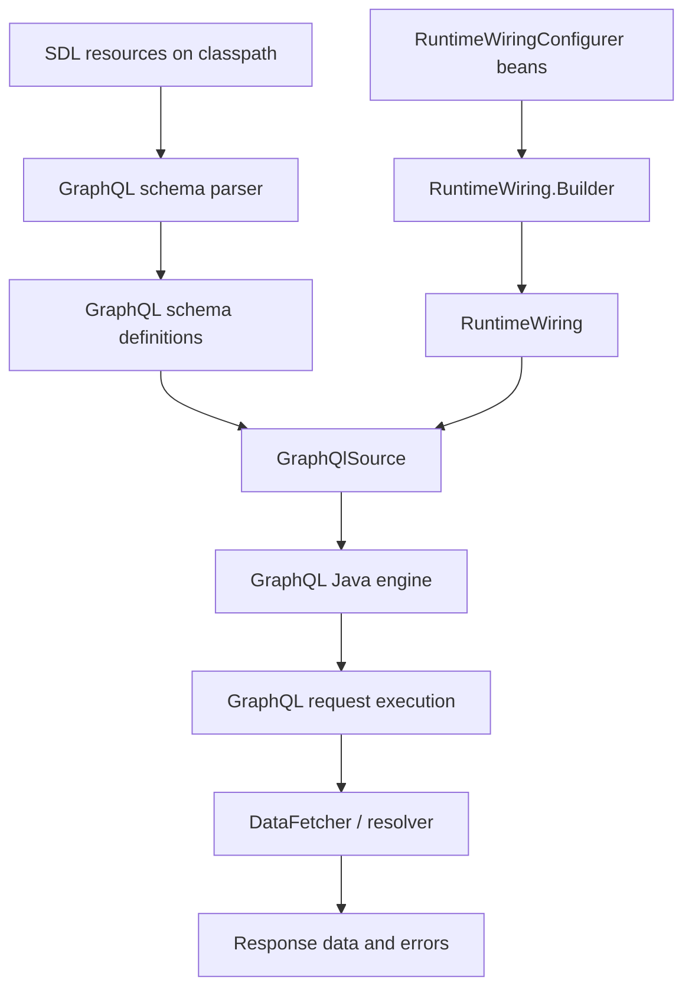

# RuntimeWiringConfigurer in Boot

In Spring for GraphQL, the SDL schema describes the types and fields that clients can query. However, for GraphQL to execute the schema, the runtime also needs to know how to convert scalars, how to determine the concrete object type for an interface or union, and how to invoke the data fetcher for each field. These registrations belong to **runtime wiring**.

Spring for GraphQL provides `RuntimeWiringConfigurer` to add configuration to GraphQL Java's `RuntimeWiring.Builder`. When using Spring Boot, you simply declare `RuntimeWiringConfigurer` beans; auto-configuration collects them and applies them when building `GraphQlSource`. This is the proper extension point for registering custom scalars, type resolvers, manual data fetchers, or directive wiring.

This lesson covers the schema creation lifecycle, how Spring Boot discovers and applies configurers, common usage scenarios, how to coordinate with annotated controllers, and how to test runtime wiring.

## 1. Where does runtime wiring fit in the GraphQL lifecycle?

A Spring for GraphQL application typically initializes the schema and runtime wiring when the application context is created. Overview flow:



Each part has a distinct responsibility:

- **SDL** declares types, fields, arguments, inputs, scalars, interfaces, and unions.
- **Runtime wiring** attaches runtime behavior to those declarations: scalar coercing, type resolvers, data fetchers, and directive wiring.
- **GraphQlSource** provides the built schema along with execution configuration to the GraphQL engine.
- **Resolver** handles a field when an operation actually executes.

Runtime wiring is typically built once during schema initialization. Methods in `RuntimeWiringConfigurer` do not run on every GraphQL request. Therefore, do not put current user info, current tenant, or per-request data into a configurer. That data belongs in the GraphQL context, an interceptor, the security context, or the resolver.

## 2. What is RuntimeWiringConfigurer?

`RuntimeWiringConfigurer` is Spring for GraphQL's extension point located in the package:

```java
org.springframework.graphql.execution.RuntimeWiringConfigurer
```

It is a functional interface with a method that configures a GraphQL Java builder:

```java
@FunctionalInterface
public interface RuntimeWiringConfigurer {
    void configure(RuntimeWiring.Builder builder);
}
```

In an application, it is typically declared as a bean:

```java
@Configuration
public class GraphQlRuntimeConfiguration {

    @Bean
    RuntimeWiringConfigurer runtimeWiringConfigurer() {
        return builder -> {
            // Register scalars, type resolvers, or data fetchers.
        };
    }
}
```

The builder is a GraphQL Java API. Spring for GraphQL provides the hook so that the application's configuration beans are applied when building the schema runtime. You do not need to manually invoke the configure method in controllers or on every request.

## 3. How does Spring Boot automatically collect configurers?

When the GraphQL starter and appropriate web configuration are present, Spring Boot creates the default GraphQL infrastructure. While building `GraphQlSource`, Boot picks up `RuntimeWiringConfigurer` beans from the application context and applies them to the runtime wiring builder.

Therefore, a basic setup typically only requires:

1. Declaring the SDL in the classpath schema location.
2. Creating one or more `RuntimeWiringConfigurer` beans.
3. Letting Spring Boot create `GraphQlSource` and the GraphQL engine.

Example:

```java
@Configuration
public class ScalarConfiguration {

    @Bean
    RuntimeWiringConfigurer scalarConfigurer() {
        return wiring -> wiring.scalar(MyScalars.UUID);
    }
}
```

The SDL must declare the corresponding scalar:

```graphql
scalar UUID

type Query {
  book(id: UUID!): Book
}
```

The scalar name in the SDL must match the scalar name registered in runtime wiring. Declaring `scalar UUID` in the SDL alone does not provide a way to parse and serialize Java values.

### One or multiple configurers?

You can split runtime wiring into multiple beans by responsibility, for example:

- `ScalarRuntimeWiringConfigurer` registers custom scalars.
- `TypeResolverRuntimeWiringConfigurer` registers resolvers for interfaces and unions.
- `LegacyDataFetcherConfigurer` registers certain manual data fetchers.
- `DirectiveRuntimeWiringConfigurer` registers directive wiring.

Spring manages these beans in the application context. If application order is needed, you can use Spring's ordering mechanisms such as `@Order` or `Ordered`. However, do not rely on ordering to resolve two configurers registering the same field in a conflicting way. Every field should have a single clear resolution mechanism.

## 4. Registering a custom scalar

A custom scalar requires two parts:

1. Declaring the scalar name in the SDL.
2. Registering a `GraphQLScalarType` with coercing in runtime wiring.

Example using the `DateTime` scalar from GraphQL Java Extended Scalars:

```java
@Configuration
public class DateTimeScalarConfiguration {

    @Bean
    RuntimeWiringConfigurer dateTimeScalarConfigurer() {
        return wiring -> wiring.scalar(ExtendedScalars.DateTime);
    }
}
```

SDL:

```graphql
scalar DateTime

type AuditEvent {
  id: ID!
  occurredAt: DateTime!
}
```

Extended Scalars requires a dependency version compatible with the GraphQL Java version managed by Spring Boot. If creating your own scalar, use `GraphQLScalarType.newScalar()` to provide a name, description, and `Coercing`.

Coercion directions that must be tested:

| Method | Conversion Direction |
| --- | --- |
| `parseValue` | JSON variable into a Java type |
| `parseLiteral` | Literal in a GraphQL document into a Java type |
| `serialize` | Java value into a GraphQL return value |

Do not forget to test variables, inline literals, and output. A scalar might parse variables correctly yet still fail when a client passes a literal or when a resolver returns an unexpected Java type.

## 5. Registering a TypeResolver for interfaces and unions

When a field returns an interface or union, GraphQL needs to know the concrete object type of each runtime value. GraphQL Java uses `TypeResolver` for this purpose.

SDL:

```graphql
interface SearchResult {
  id: ID!
  title: String!
}

type BookResult implements SearchResult {
  id: ID!
  title: String!
  isbn: String!
}

type AuthorResult implements SearchResult {
  id: ID!
  title: String!
  biography: String
}

union SearchHit = BookResult | AuthorResult

type Query {
  search: [SearchResult!]!
  featured: [SearchHit!]!
}
```

Suppose the Java model has two distinct result classes:

```java
public record BookSearchResult(
        String id, String title, String isbn) {
}

public record AuthorSearchResult(
        String id, String title, String biography) {
}
```

Registering type resolvers for the interface and union:

```java
@Configuration
public class SearchTypeResolverConfiguration {

    @Bean
    RuntimeWiringConfigurer searchTypeResolverConfigurer() {
        return wiring -> {
            wiring.type(TypeRuntimeWiring.newTypeWiring("SearchResult")
                    .typeResolver(environment -> {
                        Object source = environment.getObject();
                        if (source instanceof BookSearchResult) {
                            return environment.getSchema()
                                    .getObjectType("BookResult");
                        }
                        if (source instanceof AuthorSearchResult) {
                            return environment.getSchema()
                                    .getObjectType("AuthorResult");
                        }
                        throw new IllegalStateException(
                                "Unsupported SearchResult implementation");
                    }));

            wiring.type(TypeRuntimeWiring.newTypeWiring("SearchHit")
                    .typeResolver(environment -> {
                        Object source = environment.getObject();
                        if (source instanceof BookSearchResult) {
                            return environment.getSchema()
                                    .getObjectType("BookResult");
                        }
                        if (source instanceof AuthorSearchResult) {
                            return environment.getSchema()
                                    .getObjectType("AuthorResult");
                        }
                        throw new IllegalStateException(
                                "Unsupported SearchHit implementation");
                    }));
        };
    }
}
```

The resolver must return a valid object type declared in the schema that conforms to the interface or union. If a new implementation is introduced and the type resolver does not recognize it, the operation will raise an error when serializing the result.

With annotated controllers, Spring for GraphQL can infer the concrete type in some cases based on the model and schema mappings. Only register an explicit `TypeResolver` when you need control over identification or when default resolution is insufficient. Avoid configuring a resolver twice for the same abstract type.

## 6. Registering a manual DataFetcher

A field can be wired to a data fetcher directly using `TypeRuntimeWiring`:

```java
@Configuration
public class ManualDataFetcherConfiguration {

    @Bean
    RuntimeWiringConfigurer manualDataFetcherConfigurer(
            GreetingService greetingService) {

        return wiring -> wiring.type(
                TypeRuntimeWiring.newTypeWiring("Query")
                        .dataFetcher("greeting", environment -> {
                            String name = environment.getArgument("name");
                            return greetingService.greet(name);
                        })
        );
    }
}
```

Corresponding SDL:

```graphql
type Query {
  greeting(name: String!): String!
}
```

The `DataFetcher` receives `DataFetchingEnvironment`, from which it can read arguments, the source object, the GraphQL context, and other execution details. Keep business logic in services so it is easy to test and reuse.

### Choosing annotated controller or manual data fetcher?

Spring for GraphQL provides annotated controllers to map Java methods with `@QueryMapping`, `@MutationMapping`, and `@SchemaMapping`. Controller configuration is integrated into the runtime wiring process.

| Approach | Suitable When |
| --- | --- |
| Annotated controller | Standard Spring applications needing DI, argument binding, and readable code |
| Manual `DataFetcher` | Integrating special data fetchers, migrating from GraphQL Java, or needing low-level wiring control |
| `@BatchMapping` / DataLoader | Batch-loading related fields to avoid N+1 |

Do not register the same field with both `@QueryMapping` and a manual data fetcher unintentionally. Two approaches trying to own one field can cause conflicts or unpredictable behavior. Designate a single place responsible for resolving that field.

## 7. Registering directive wiring

Directives in SDL can carry metadata or request runtime behavior. If a directive needs to alter how a field executes, GraphQL Java allows registering a `SchemaDirectiveWiring` via runtime wiring.

Example SDL declaring a directive:

```graphql
directive @uppercase on FIELD_DEFINITION

type Query {
  greeting: String! @uppercase
}
```

A configurer can register the directive implementation:

```java
@Bean
RuntimeWiringConfigurer directiveConfigurer() {
    return wiring -> wiring.directive(
            "uppercase",
            new UppercaseDirectiveWiring());
}
```

`UppercaseDirectiveWiring` is a class implemented by the application extending/implementing `SchemaDirectiveWiring`. It can obtain the current data fetcher, wrap the fetcher, and transform the result before returning it. Specific implementation details depend on the GraphQL Java API version; verify the `SchemaDirectiveWiringEnvironment` signatures and how `GraphQLCodeRegistry` is updated in your dependency version.

Directive wiring does not automatically enforce authorization. If a directive denotes an access requirement, the implementation must actually check permissions or integrate with Spring Security. Simply placing `@auth` in the SDL does not protect a field.

## 8. RuntimeWiringConfigurer and other Spring extension points

Not every GraphQL customization belongs in runtime wiring:

| Need | Appropriate Extension Point |
| --- | --- |
| Registering scalars | `RuntimeWiringConfigurer` |
| Registering type resolvers for interfaces/unions | `RuntimeWiringConfigurer` |
| Low-level data fetchers | `RuntimeWiringConfigurer` |
| Directive wiring | `RuntimeWiringConfigurer` |
| Passing HTTP headers into GraphQL context | `WebGraphQlInterceptor` |
| Handling errors from data fetchers | `DataFetcherExceptionResolver` |
| Per-request batch loading | `BatchLoaderRegistry`, `@BatchMapping` |
| Authentication/authorization | Spring Security and appropriate method/field security |
| Changing schema locations | `spring.graphql.schema.locations` |
| Customizing `GraphQlSource` creation | Builder customizer or `GraphQlSource` bean when truly needed |

For instance, an interceptor that reads a request ID runs on every HTTP request. A runtime wiring configurer only registers schema components at startup. Putting request ID handling into a configurer uses the wrong lifecycle and has no request headers to read.

Similarly, do not use runtime wiring to hand-roll N+1 solutions if `@BatchMapping` or DataLoader meets the requirement. Runtime wiring can register data fetchers, whereas batch loaders require per-GraphQL-request lifecycles and context.

## 9. Multiple RuntimeWiringConfigurers and avoiding conflicts

An application can split configurers by responsibility for maintainability:

```java
@Configuration
public class GraphQlScalarConfiguration {

    @Bean
    RuntimeWiringConfigurer scalarConfigurer() {
        return wiring -> wiring.scalar(ExtendedScalars.DateTime);
    }
}
```

```java
@Configuration
public class GraphQlTypeConfiguration {

    @Bean
    RuntimeWiringConfigurer typeConfigurer() {
        return wiring -> wiring.type(
                TypeRuntimeWiring.newTypeWiring("SearchResult")
                        .typeResolver(new SearchResultTypeResolver()));
    }
}
```

Splitting configurers helps when each bean owns a distinct slice of configuration. However:

- Do not declare two custom scalars with the same name.
- Do not register two different data fetchers for the same field unless override behavior is explicitly defined.
- Do not register multiple competing type resolvers for the same interface or union.
- Use `@Order` when there is a genuine ordering dependency and verify the behavior of your Boot version.
- Keep configurers independent of mutable state in other configurers.

If runtime wiring grows complex, consider grouping related configuration into domain-focused classes or adding tests that verify the schema is built properly.

## 10. When do you need to declare GraphQlSource yourself?

In the default configuration, Spring Boot creates `GraphQlSource` from SDL resources and runtime wiring beans. Most applications only need to add `RuntimeWiringConfigurer` beans without creating the source themselves.

Declaring a `GraphQlSource` bean yourself is a lower-level option. When this bean is provided by the application, default auto-configuration may back off because its missing-bean condition is no longer satisfied. The application then becomes responsible for configuring schema resources, runtime wiring, and other required components.

If you only need to:

- Add a custom scalar: use `RuntimeWiringConfigurer`.
- Add a type resolver: use `RuntimeWiringConfigurer`.
- Change the SDL directory: use `spring.graphql.schema.locations`.
- Add request context: use `WebGraphQlInterceptor`.

Only customize `GraphQlSource` when you need control over schema construction beyond those extension points. Before replacing the default source, inspect what Boot automatically provides so you do not accidentally drop the annotated controller configurer or other runtime components.

## 11. Testing runtime wiring

Runtime wiring should be tested through actual GraphQL operations. `GraphQlTester` lets you send documents and assert on responses:

```java
@SpringBootTest
class RuntimeWiringTests {

    @Autowired
    GraphQlTester graphQlTester;

    @Test
    void customScalarIsAvailable() {
        graphQlTester.document("""
                query {
                    book(id: "550e8400-e29b-41d4-a716-446655440000") {
                        id
                    }
                }
                """)
                .execute()
                .path("book.id")
                .entity(String.class)
                .isEqualTo("550e8400-e29b-41d4-a716-446655440000");
    }
}
```

This test assumes the schema has the corresponding field, the UUID scalar is registered, and the service returns matching data. You can expand tests to check that:

- Both variables and literals are parsed properly by custom scalars.
- Output values are serialized in the published format.
- Interfaces/unions return the expected concrete type for inline fragments.
- Manual data fetchers receive the expected arguments.
- Directive wiring alters behavior as expected.
- Application startup fails clearly if the schema references an unregistered scalar.

If a test only uses `@GraphQlTest`, ensure custom configurers are imported into the test slice. When you want to confirm Boot collects beans and builds the source just like in production, `@SpringBootTest` usually gives fuller coverage.

## 12. Common issues

| Symptom | Cause | Resolution |
| --- | --- | --- |
| Unknown scalar | Scalar is in SDL but not registered in runtime wiring | Create a `RuntimeWiringConfigurer` bean and register the exact name |
| Interface/union fails to resolve | Missing or incorrect type resolver | Check the Java implementation and object type names in SDL |
| Resolver is not invoked | Wrong field name/type name or field does not exist | Cross-check SDL and mappings |
| Field has two data fetchers | Annotated controller and manual wiring both register the same field | Choose a single owner for the field |
| Directive has no effect | Directive declared in SDL without registering wiring behavior | Register `SchemaDirectiveWiring` |
| Configurer is not applied | Bean is not in the application context or custom source config skips configurers | Check component scan, bean registration, and `GraphQlSource` |
| Tests fail while production works | Test slice does not import the required configurer | Import runtime wiring configuration into the test or use `@SpringBootTest` |
| Error after upgrading dependencies | GraphQL Java API signatures changed | Use the compatible version managed by Boot and update implementations |

## 13. Design principles for RuntimeWiringConfigurer

- Use configurers for schema/runtime-level registrations, not per-request data handling.
- Split configurers by responsibility; avoid one class holding all wiring for the application.
- Maintain one clear owner for each field data fetcher.
- Register scalars with names matching the SDL and test all three coercion directions.
- Use type resolvers for abstract types when default resolution does not match the Java model.
- Use annotated controllers for the majority of resolvers in a Spring application.
- Use DataLoader and `@BatchMapping` for batch data loading.
- Use interceptors for HTTP/request context and exception resolvers for errors.
- Only replace `GraphQlSource` when smaller extension points cannot meet the requirement.
- Test the runtime schema after every change to scalars, type resolvers, data fetchers, or directives.

## 14. Practice exercise

Build a library application with the following requirements:

1. Declare a `UUID` scalar in the SDL and create a custom `GraphQLScalarType`.
2. Register the UUID scalar using a `RuntimeWiringConfigurer` bean.
3. Declare a `SearchResult` interface along with two implementing types: `BookResult` and `AuthorResult`.
4. Write a `TypeResolver` so GraphQL identifies the right concrete type.
5. Register a manual data fetcher for the `Query.serverVersion` field.
6. Write `GraphQlTester` tests verifying the scalar, inline fragments, and data fetcher.
7. Add a `WebGraphQlInterceptor` to pass a request ID into the context and explain why this logic does not belong in `RuntimeWiringConfigurer`.

Upon completion, you should be able to distinguish SDL schemas from runtime wiring, know when Boot collects configurers, choose the right API for scalars/type resolvers/data fetchers, and avoid conflicts with annotated controllers.

## 15. References

- [Spring for GraphQL — GraphQlSource and Runtime Wiring](https://docs.spring.io/spring-graphql/reference/request-execution.html)
- [Spring for GraphQL — Annotated Controllers](https://docs.spring.io/spring-graphql/reference/controllers.html)
- [Spring Boot — Spring for GraphQL](https://docs.spring.io/spring-boot/reference/web/spring-graphql.html)
- [GraphQL Java — RuntimeWiring Javadoc](https://javadoc.io/doc/com.graphql-java/graphql-java/latest/graphql/schema/idl/RuntimeWiring.html)

GraphQL Java APIs may change across versions. When a project upgrades Spring Boot, check the GraphQL Java version selected by dependency management and consult the corresponding Javadoc before modifying coercing, type resolver, or directive wiring signatures.
