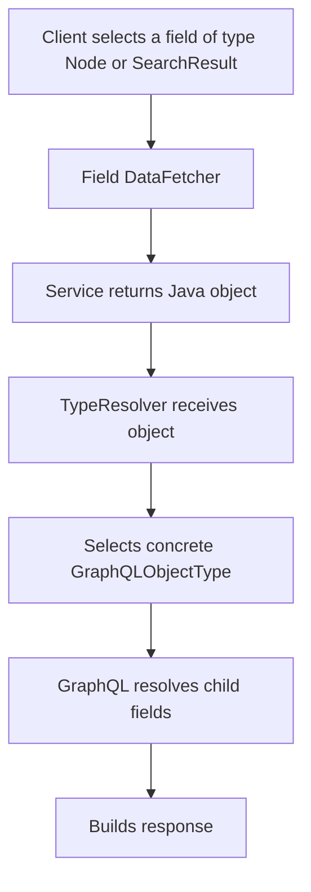

# TypeResolver wiring in Spring for GraphQL

GraphQL interfaces and unions allow a field to return multiple concrete object types. When a resolver returns a Java object, GraphQL needs to know which object type in the schema corresponds to that object so it can continue resolving fields and building the response. The component that performs this runtime type identification step is **TypeResolver**.

In Spring for GraphQL, resolvers declared with `@QueryMapping` or `@SchemaMapping` are responsible for fetching data objects. For fields whose return type is an interface or union, GraphQL Java additionally needs a `TypeResolver` to map the Java object to a `GraphQLObjectType`. We typically register this resolver using `RuntimeWiringConfigurer`.

After this lesson, you will be able to:

- Distinguish the roles of `DataFetcher` and `TypeResolver`.
- Understand when GraphQL needs to resolve concrete types for interfaces or unions.
- Read `TypeResolutionEnvironment` and retrieve the source object.
- Register a `TypeResolver` via `RuntimeWiringConfigurer` in Spring for GraphQL.
- Map multiple Java types to their corresponding GraphQL object types.
- Test type resolution and handle cases where the type cannot be determined.

## 1. Why is TypeResolver needed?

For a field returning a concrete object type, GraphQL already knows which type to resolve. For example, `Query.book` returns `Book`, so child fields are read according to the `Book` definition.

However, a field can return an interface or a union. An interface describes shared fields implemented by multiple object types; a union describes one of several object types that may appear at that position. When the runtime receives a Java object, GraphQL needs to determine whether it is a `Book`, an `Author`, or another concrete type.

Example schema:

```graphql
interface Node {
    id: ID!
}

type Book implements Node {
    id: ID!
    title: String!
}

type Author implements Node {
    id: ID!
    name: String!
}

union SearchResult = Book | Author

type Query {
    node(id: ID!): Node
    search(text: String!): [SearchResult!]!
}
```

`Query.node` returns `Node`, and `Query.search` returns a list of `SearchResult`. Both are abstract types: the schema does not state in advance which concrete type each actual object will have.

If the service returns a `Book`, GraphQL needs to select the `Book` object type; if the service returns an `Author`, GraphQL needs to select `Author`. `TypeResolver` provides that mapping.

## 2. DataFetcher and TypeResolver have different responsibilities

These two components participate at different stages in the execution flow:

| Component | Responsibility | Question Answered |
| --- | --- | --- |
| DataFetcher | Retrieves the value for a field, usually by calling a service or repository | What data does this field return? |
| TypeResolver | Determines the concrete object type when the declared type is an interface or union | Which GraphQL type does the received object belong to? |

Conceptual execution flow:



`TypeResolver` does not query databases and does not replace the field's resolver. It only receives the existing object and returns the corresponding concrete GraphQL type. Therefore, if a `DataFetcher` returns the wrong object or lacks required data, `TypeResolver` cannot fix the query logic on its own.

## 3. TypeResolver and TypeResolutionEnvironment

GraphQL Java defines the `TypeResolver` interface with a single method receiving `TypeResolutionEnvironment` and returning `GraphQLObjectType`:

```java
@FunctionalInterface
public interface TypeResolver {
    GraphQLObjectType getType(TypeResolutionEnvironment environment);
}
```

`TypeResolutionEnvironment` provides information for the current type resolution pass. The most commonly used members are:

- `getObject()`: the source object returned by the `DataFetcher`.
- `getSchema()`: the current schema, which can be used to look up a `GraphQLObjectType` by name.
- `getGraphQlContext()`: the GraphQL request context, if server-populated contextual information is needed.
- `getField()`: the field definition currently being executed.
- `getFieldType()`: the GraphQL type declared for the field.

For most applications, checking the Java type of `getObject()` and retrieving the corresponding object type from the schema is sufficient. There is no need to parse the query string or manually inspect the selection set to decide what type an object belongs to.

## 4. Preparing Java models for interfaces and unions

Suppose the domain model has books and authors. Each object can be returned in search results and has an ID:

```java
public interface Node {
    String id();
}

public interface SearchResult {
}
```

Concrete types implement the abstractions under which they can appear in the schema:

```java
public record Book(String id, String title)
        implements Node, SearchResult {
}

public record Author(String id, String name)
        implements Node, SearchResult {
}
```

The Java interfaces `Node` and `SearchResult` help the model express domain relationships. They do not automatically create GraphQL interfaces or unions; those two types must still be declared in SDL and connected to a `TypeResolver` through runtime wiring.

GraphQL object type names may differ from Java class names. Therefore, map them explicitly rather than defaulting to reflection on class names, especially when the schema follows its own naming conventions.

## 5. Declaring resolvers for fields returning abstract types

SDL declaring the fields:

```graphql
interface Node {
    id: ID!
}

type Book implements Node {
    id: ID!
    title: String!
}

type Author implements Node {
    id: ID!
    name: String!
}

union SearchResult = Book | Author

type Query {
    node(id: ID!): Node
    search(text: String!): [SearchResult!]!
}
```

Spring for GraphQL controller fetching the data:

```java
@Controller
public class CatalogController {

    private final CatalogService catalogService;

    public CatalogController(CatalogService catalogService) {
        this.catalogService = catalogService;
    }

    @QueryMapping
    public Node node(@Argument("id") String id) {
        return catalogService.findNode(id).orElse(null);
    }

    @QueryMapping
    public List<SearchResult> search(@Argument("text") String text) {
        return catalogService.search(text);
    }
}
```

`@QueryMapping` registers the `DataFetcher` for the corresponding root field. The `node` method returns an object implementing `Node`; the `search` method returns a list of objects implementing `SearchResult`. In the next step, GraphQL uses `TypeResolver` to determine the concrete object type of each value.

If a field returns a concrete object type such as `Book`, `TypeResolver` does not need to participate for that field. `TypeResolver` is only needed for abstract types such as interfaces and unions.

## 6. Writing a TypeResolver using instanceof

For a small number of object types, the most readable approach is checking the Java type with `instanceof`:

```java
public class CatalogTypeResolver implements TypeResolver {

    @Override
    public GraphQLObjectType getType(TypeResolutionEnvironment environment) {
        Object source = environment.getObject();

        if (source instanceof Book) {
            return environment.getSchema().getObjectType("Book");
        }

        if (source instanceof Author) {
            return environment.getSchema().getObjectType("Author");
        }

        throw new IllegalStateException(
                "Unsupported GraphQL result type: " + source.getClass().getName());
    }
}
```

Each branch returns an existing `GraphQLObjectType` in the schema. The name passed to `getObjectType(...)` must match the object type name in the SDL.

If the object does not match any supported type, throw an error with enough information to diagnose the issue. Do not silently return a default fallback object type, as GraphQL might then resolve the wrong fields and produce a response violating the contract.

In practice, consider `null` sources if a field is nullable and the `DataFetcher` can return null. GraphQL does not invoke `TypeResolver` to resolve a null value. However, if the `TypeResolver` method is called with a non-null object whose type is unrecognized, that is a mapping error that must be handled explicitly.

## 7. Registering TypeResolver via RuntimeWiringConfigurer

Spring for GraphQL uses `RuntimeWiringConfigurer` to add configuration to GraphQL Java's `RuntimeWiring`. You can register a `TypeResolver` for each abstract type as follows:

```java
@Configuration
public class GraphQlRuntimeConfiguration {

    @Bean
    RuntimeWiringConfigurer typeResolverConfigurer() {
        TypeResolver catalogTypeResolver = new CatalogTypeResolver();

        return wiringBuilder -> {
            wiringBuilder.type(
                    "Node",
                    typeWiring -> typeWiring.typeResolver(catalogTypeResolver));

            wiringBuilder.type(
                    "SearchResult",
                    typeWiring -> typeWiring.typeResolver(catalogTypeResolver));
        };
    }
}
```

Spring Boot automatically detects the `RuntimeWiringConfigurer` bean and applies it when creating the executable schema. `type("Node", ...)` registers the `TypeResolver` for the `Node` interface; `type("SearchResult", ...)` registers it for the `SearchResult` union.

In this example, both abstract types share the same member types `Book` and `Author`, so they can reuse a single resolver. If an interface and union have different members or different mapping rules, register separate resolvers for each type.

Do not register multiple competing `TypeResolver`s for the same abstract type. Centralize the mapping for each interface/union in one clear place to avoid overridden or hard-to-follow configuration.

## 8. How it works with unions

A union represents one of several object types without requiring them to share any fields. Given:

```graphql
union SearchResult = Book | Author
```

Clients must use inline fragments to select fields per concrete type:

```graphql
query Search($text: String!) {
    search(text: $text) {
        __typename
        ... on Book {
            id
            title
        }
        ... on Author {
            id
            name
        }
    }
}
```

Suppose the service returns:

```java
List<SearchResult> results = List.of(
        new Book("book-1", "Spring GraphQL"),
        new Author("author-1", "Nguyen An"));
```

`TypeResolver` is invoked for each object. For `Book`, the resolver returns the `Book` GraphQL object type; for `Author`, the resolver returns `Author`. GraphQL uses that concrete type to execute the matching inline fragment and populate `__typename`.

A union can only declare member object types. Do not include scalars, enums, or interfaces in a union's member list.

## 9. How it works with interfaces

An interface describes shared fields of the objects that implement it:

```graphql
interface Node {
    id: ID!
}

type Book implements Node {
    id: ID!
    title: String!
}

type Author implements Node {
    id: ID!
    name: String!
}
```

Clients can select the shared `id` field directly on `Node`, and then use inline fragments to fetch type-specific fields:

```graphql
query {
    node(id: "book-1") {
        __typename
        id
        ... on Book {
            title
        }
        ... on Author {
            name
        }
    }
}
```

`TypeResolver` must return an object type that actually implements that interface. If the resolver returns `Book` for an object, GraphQL checks that `Book` is a valid member type of `Node` in the schema. Having an `id()` method on a Java object is not enough to automatically make it a GraphQL `Node`; the implementation relationship must be declared in the SDL.

## 10. Using a discriminator instead of many instanceof checks

In systems with many result types, the domain model may contain an explicit discriminator. For example, data from a search index has a `kind` field:

```java
public interface SearchDocument {
    String kind();
}
```

`TypeResolver` can rely on the discriminator:

```java
public class SearchDocumentTypeResolver implements TypeResolver {

    @Override
    public GraphQLObjectType getType(TypeResolutionEnvironment environment) {
        SearchDocument source = (SearchDocument) environment.getObject();

        String graphQlTypeName = switch (source.kind()) {
            case "BOOK" -> "Book";
            case "AUTHOR" -> "Author";
            default -> throw new IllegalStateException(
                    "Unknown search document kind: " + source.kind());
        };

        return environment.getSchema().getObjectType(graphQlTypeName);
    }
}
```

A discriminator is useful when multiple data types are read from a shared source or deserialized into a common wrapper. Validate the discriminator value and map it explicitly to a GraphQL type name; never concatenate external input directly into an arbitrary type name.

If the domain model already has distinct classes, `instanceof` is usually simpler and more type-safe than adding a string discriminator solely for GraphQL.

## 11. Information available from TypeResolutionEnvironment

`TypeResolutionEnvironment` provides the context for the current type resolution pass. For example, when you need to log or apply a request-dependent mapping, you can read the GraphQL context:

```java
@Override
public GraphQLObjectType getType(TypeResolutionEnvironment environment) {
    Object source = environment.getObject();
    GraphQLSchema schema = environment.getSchema();
    GraphQLContext context = environment.getGraphQlContext();

    // Determine the object type from source; use context only when appropriate rules apply.
    if (source instanceof Book) {
        return schema.getObjectType("Book");
    }
    if (source instanceof Author) {
        return schema.getObjectType("Author");
    }

    throw new IllegalStateException("Unsupported source: " + source.getClass());
}
```

Normally, the GraphQL type should be determined from the intrinsic nature of the returned object. Do not make the same Java object resolve as `Book` at one time and `Author` at another merely because the client passed an arbitrary argument or context value; that makes the schema inconsistent. Context should only participate if the domain genuinely has type-selection rules tied to an authenticated context.

## 12. Type resolution errors and null propagation

Common errors include:

- `TypeResolver` is not registered for the interface or union being resolved.
- The GraphQL object type name in code does not exist in the schema.
- The resolver returns an object type that is not a member of the union.
- The resolver returns an object type that does not implement the interface.
- The Java object does not match any type recognized by `TypeResolver`.
- `DataFetcher` returns a new wrapper or projection while `TypeResolver` still only handles the old classes.

If the object type cannot be determined, GraphQL cannot finish resolving child fields and adds an error to the response. If the abstract field is nullable, the error may turn that field into null; if the field is non-null, null may propagate up to the nearest nullable parent field according to GraphQL rules.

Verify the actual runtime type returned by the service, especially when using ORM proxies, DTO projections, maps, or JSON-deserialized objects. When using Hibernate proxies or subclass proxies, `instanceof` against a domain interface is usually more resilient than comparing `getClass() == Book.class`.

## 13. Testing TypeResolver with GraphQlTester

Test through real operations to verify that `DataFetcher`, `TypeResolver`, and inline fragments work together:

```java
@SpringBootTest
class CatalogTypeResolverTests {

    @Autowired
    GraphQlTester graphQlTester;

    @Test
    void resolvesBookAndAuthorInUnion() {
        graphQlTester.document("""
                query {
                    search(text: "spring") {
                        __typename
                        ... on Book {
                            title
                        }
                        ... on Author {
                            name
                        }
                    }
                }
                """)
            .execute()
            .path("search[0].__typename")
            .entity(String.class)
            .isEqualTo("Book");

        graphQlTester.document("""
                query {
                    search(text: "spring") {
                        __typename
                    }
                }
                """)
            .execute()
            .path("search[1].__typename")
            .entity(String.class)
            .isEqualTo("Author");
    }
}
```

For interfaces, test both shared fields and type-specific fields:

```java
graphQlTester.document("""
        query {
            node(id: "book-1") {
                __typename
                id
                ... on Book {
                    title
                }
            }
        }
        """)
    .execute()
    .path("node.__typename")
    .entity(String.class)
    .isEqualTo("Book");
```

Add tests for unsupported object types, wrong type names, null results, and the actual DTOs/proxies that the service can return. Tests should confirm that GraphQL returns a diagnosable error and never accidentally maps an object to the wrong type.

## 14. Common design mistakes

- **Confusing TypeResolver with DataFetcher:** `DataFetcher` fetches the object; `TypeResolver` determines the concrete object type.
- **Only declaring the interface/union in SDL:** The schema describes the abstract type, but the runtime still needs to know which type a Java object corresponds to.
- **Returning a Java class name instead of GraphQLObjectType:** `TypeResolver` must return an object type from the schema, not a string or `Class<?>`.
- **Using the wrong type name:** The name in `getObjectType("...")` must match the SDL.
- **Returning a type outside the union/interface:** The chosen object type must be a valid member of the abstract type.
- **Using one fallback type for every object:** Responses can have invalid shapes and mask domain bugs.
- **Comparing classes strictly with `getClass()`:** Proxies or subclasses can make the check fail; prefer `instanceof` or a stable discriminator.
- **Registering multiple resolvers for the same abstract type:** Configuration becomes unpredictable and prone to overrides.
- **Assuming a Java interface automatically creates a GraphQL interface:** Java and SDL relationships must be wired via schema and runtime wiring.

## 15. Workflow for implementing TypeResolver

When adding a field that returns an interface or union, follow these steps:

1. Identify the abstract type in the SDL and list all object types that may appear.
2. Ensure each object type implements the interface or belongs to the union per the schema.
3. Identify the actual Java classes/DTOs returned by the service.
4. Write a `TypeResolver` mapping each Java object to a `GraphQLObjectType`.
5. Register the resolver under the exact interface/union name using `RuntimeWiringConfigurer`.
6. Keep `DataFetcher` logic in controllers/services focused on fetching data.
7. Handle unsupported objects and null results explicitly.
8. Test each runtime type using `__typename`, inline fragments, and field selections.
9. Review mappings whenever a new object type is added to an interface or union.

`TypeResolver` is the bridge between real Java objects and abstract types in a GraphQL schema. In Spring for GraphQL, controller `DataFetcher`s fetch data, while `TypeResolver` is registered via runtime wiring to pick the right concrete object type. When mappings are complete, explicit, and tested for every possible return type, interfaces and unions work reliably, allowing the API to represent diverse result shapes while preserving a strictly typed schema.

## References

- [GraphQL Specification — Interfaces](https://spec.graphql.org/October2021/#sec-Interfaces)
- [GraphQL Specification — Unions](https://spec.graphql.org/October2021/#sec-Unions)
- [GraphQL Java — RuntimeWiring and TypeResolver](https://graphql-java.com/documentation/schema/)
- [GraphQL Java — TypeResolver API](https://javadoc.io/doc/com.graphql-java/graphql-java/latest/graphql/schema/TypeResolver.html)
- [Spring for GraphQL — RuntimeWiringConfigurer](https://docs.spring.io/spring-graphql/reference/request-execution.html)
