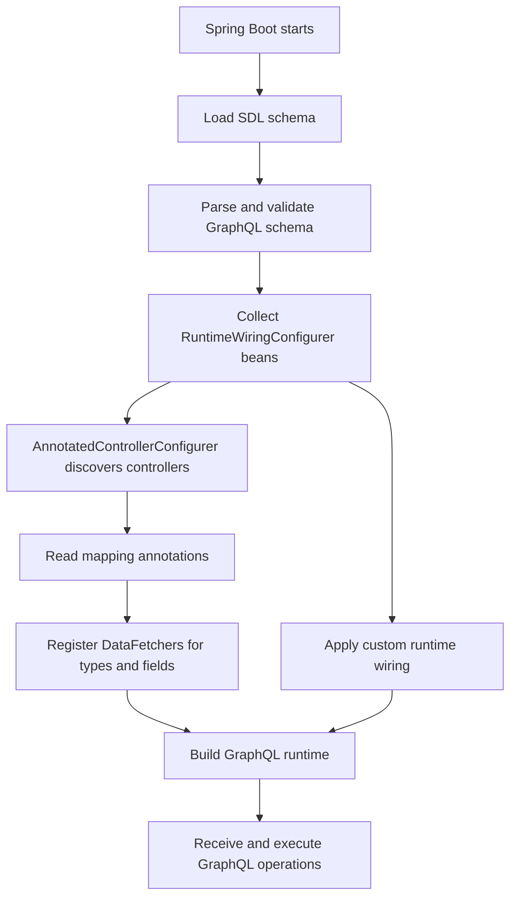

# AnnotatedControllerConfigurer

In Spring for GraphQL, `AnnotatedControllerConfigurer` connects annotated methods in Spring controllers to fields of the GraphQL schema. This lets applications write resolvers using familiar Java methods instead of manually registering each `DataFetcher` into GraphQL Java `RuntimeWiring`.

This configurer detects controller beans, reads annotations such as `@QueryMapping`, `@MutationMapping`, `@SchemaMapping`, and `@BatchMapping`, and registers the corresponding execution handlers for schema fields. Spring Boot typically auto-configures this component when integrating Spring for GraphQL. Consequently, when using `spring-boot-starter-graphql`, most applications only need to declare SDL and write controllers following the conventions.

## 1. What does AnnotatedControllerConfigurer handle?

GraphQL Java needs a `DataFetcher` for fields that retrieve data. When configured directly, the application must bind schema type and field names to Java logic:

```java
RuntimeWiring.newRuntimeWiring()
    .type("Query", typeWiring -> typeWiring
        .dataFetcher("book", environment -> {
            String id = environment.getArgument("id");
            return bookService.findById(id);
        }))
    .build();
```

With Spring for GraphQL, you can write a controller:

```java
@Controller
public class BookController {

    private final BookService bookService;

    public BookController(BookService bookService) {
        this.bookService = bookService;
    }

    @QueryMapping
    public Book book(@Argument String id) {
        return bookService.findById(id);
    }
}
```

`AnnotatedControllerConfigurer` handles converting annotated methods into `DataFetcher`s and registering them in runtime wiring. The controller remains a standard Spring bean capable of injecting services, repositories, and other dependencies via constructor.

Crucially, the configurer neither writes business logic itself nor generates a schema in place of SDL. It connects the declared schema contract to the application's field-handling methods.

## 2. Where does the configurer sit in initialization?

`AnnotatedControllerConfigurer` implements `RuntimeWiringConfigurer`. Spring for GraphQL uses beans of this type when building the GraphQL runtime, alongside the SDL schema and other runtime configurations.



During registration, the configurer determines which method handles which field. When a client sends an operation, the GraphQL runtime selects fields per the query and invokes the corresponding `DataFetcher`. The Spring adapter translates that invocation into calling the handler method, resolving parameters, and handling the return value.

Mapping registration generally happens when initializing the GraphQL schema/runtime, not on every request. Therefore, missing controller beans or incompatible mappings can be caught early depending on the case; data and business errors still surface only when fields are executed.

## 3. Spring Boot auto-configuration in standard setups

When an application uses `spring-boot-starter-graphql`, Spring Boot provides default integration for annotated controllers. Controllers must be Spring beans, typically annotated with `@Controller` and within component scan scope.

Example:

```java
package com.example.graphql;

import org.springframework.stereotype.Controller;

@Controller
public class BookController {
    // GraphQL mapping methods
}
```

If a controller resides outside the base package scanned by Spring Boot, the configurer cannot detect that bean. When a mapping appears to be ignored, check component scanning and whether the controller is registered in the application context.

Do not create an extra `AnnotatedControllerConfigurer` manually when auto-configuration already provides one. Registering duplicate configurers or duplicate mappings can cause unpredictable behavior and make it hard to trace the origin of a `DataFetcher`.

## 4. Mapping Query and Mutation

`@QueryMapping` is shorthand for mapping onto the `Query` root type. Similarly, `@MutationMapping` maps onto the `Mutation` root type.

SDL:

```graphql
type Query {
    book(id: ID!): Book
}

type Mutation {
    renameBook(id: ID!, newTitle: String!): Book!
}

type Book {
    id: ID!
    title: String!
}
```

Controller:

```java
@Controller
public class BookController {

    private final BookService bookService;

    public BookController(BookService bookService) {
        this.bookService = bookService;
    }

    @QueryMapping
    public Book book(@Argument("id") String id) {
        return bookService.findById(id);
    }

    @MutationMapping
    public Book renameBook(
            @Argument("id") String id,
            @Argument("newTitle") String newTitle) {
        return bookService.rename(id, newTitle);
    }
}
```

The method name is used as the field name by default. If the method name does not match the field name in the SDL, you can specify the name in the annotation:

```java
@QueryMapping(name = "book")
public Book findBook(@Argument("id") String id) {
    return bookService.findById(id);
}
```

The argument name in `@Argument` must match the argument declared on the schema field. Java parameter names do not alter the SDL contract.

## 5. Mapping nested fields with @SchemaMapping

Not every field lives on the `Query` or `Mutation` root types. An object type can have fields requiring separate data retrieval, such as a book's author.

SDL:

```graphql
type Query {
    book(id: ID!): Book
}

type Book {
    id: ID!
    title: String!
    author: Author
}

type Author {
    id: ID!
    name: String!
}
```

A controller can map the `author` field:

```java
@SchemaMapping(typeName = "Book", field = "author")
public Author author(Book book) {
    return authorService.findByBookId(book.id());
}
```

The `Book book` parameter is the source/parent object of the `author` field. If `typeName` is omitted, Spring can infer the GraphQL type name from the source parameter type by mapping convention. If `field` is omitted, the method name is used as the field name. When codebases grow or Java type names differ from GraphQL type names, declare them explicitly to keep mappings readable.

`@QueryMapping` and `@MutationMapping` are specialized variants of schema mapping for root operation types. Use `@SchemaMapping` when you need to specify the object type and field explicitly, especially for nested fields.

## 6. Batch mapping and field registration

`AnnotatedControllerConfigurer` also supports methods annotated with `@BatchMapping`. This annotation fits when the same field must be resolved for multiple parent objects and data can be loaded in batches.

For example, a book list page displays each book's author. If an `author(Book book)` resolver queries separately for each book, a list of 30 books could trigger many queries. You can use batch mapping:

```java
@BatchMapping(typeName = "Book", field = "author")
public Map<Book, Author> author(List<Book> books) {
    return authorService.findAuthorsByBooks(books);
}
```

The method receives a list of source objects and returns a map pairing each source with its corresponding result. Spring for GraphQL registers a batch loader mechanism for that field so requests are coalesced during execution.

When using `@BatchMapping`, ensure results can be looked up accurately for every source object, even when some parents have no related data. Clarify how missing values are represented and do not assume map iteration order serves as a response contract.

For complex batch loading, you can use `BatchLoaderRegistry` and DataLoader directly. `@BatchMapping` is a convenient declarative option when mapping one field across multiple source objects.

## 7. How are method arguments resolved?

The configurer does not simply locate a method and invoke it with a raw array of arguments. Spring for GraphQL provides a parameter resolution mechanism driven by annotations and parameter types.

Common parameter styles:

| Parameter | Meaning |
| --- | --- |
| `@Argument("id") String id` | Reads the `id` argument from the field being executed |
| Source object such as `Book book` | Receives the parent object of a nested field |
| `DataFetchingEnvironment` | Accesses GraphQL Java's low-level execution context |
| `Principal` | Receives the current principal when appropriate security integration is present |
| `@ContextValue("key")` | Reads a value from the GraphQL context |
| `@LocalContextValue("key")` | Reads a value from the field's local context |

Example using arguments and context:

```java
@QueryMapping
public List<Book> booksByCategory(
        @Argument("category") String category,
        @ContextValue("tenantId") String tenantId) {
    return bookService.findByCategory(tenantId, category);
}
```

Annotations help methods clearly declare their data dependencies. Never read user or tenant info from a client-supplied argument if that value must be derived from the request's security context.

If an argument name cannot be reliably inferred from the Java parameter name, specify it explicitly with `@Argument("...")`. This also keeps code independent of whether the compiler retains parameter name metadata.

## 8. Synchronous, asynchronous, and reactive results

Handler methods can return a regular object or an asynchronous type supported by Spring for GraphQL. Example:

```java
@QueryMapping
public CompletableFuture<Book> book(@Argument String id) {
    return bookService.findByIdAsync(id);
}
```

In reactive applications, methods can return Reactor types such as `Mono<Book>` or `Flux<Book>` when the corresponding dependencies and execution setup are present.

Spring's configurer and adapters handle converting method return values into results for GraphQL execution. However, do not wrap every synchronous call in `CompletableFuture` when there is no genuine asynchronous work. Switching to async does not make database queries faster on its own, nor does it replace thread pool control, backpressure, or resource limits.

For subscriptions, methods must return a publisher or data type compatible with the transport and execution model in use. Distinguish method-mapping capability from the application's transport capability; a properly mapped method does not guarantee every HTTP transport supports the subscription delivery mode clients expect.

## 9. Combining AnnotatedControllerConfigurer with other RuntimeWiringConfigurers

`RuntimeWiringConfigurer` is the extension point for adding GraphQL Java wiring directly, such as custom scalars or a specialized data fetcher. `AnnotatedControllerConfigurer` is one implementation focused on annotated controller methods.

You can register custom scalars with a separate configurer:

```java
import org.springframework.context.annotation.Bean;
import org.springframework.context.annotation.Configuration;
import org.springframework.graphql.execution.RuntimeWiringConfigurer;

@Configuration
public class GraphQlRuntimeConfiguration {

    @Bean
    RuntimeWiringConfigurer customScalarConfigurer() {
        return builder -> builder.scalar(MyScalars.LOCAL_DATE);
    }
}
```

Spring for GraphQL can apply multiple `RuntimeWiringConfigurer` beans when building the runtime. Keep each configurer focused on a single responsibility, and avoid registering the same field in both an annotated controller and a custom data fetcher.

There is no need to write a `RuntimeWiringConfigurer` just to replace `@QueryMapping` or `@SchemaMapping`. Only use manual wiring when you need special integration that the annotated controller model does not express cleanly.

## 10. When do you need to create AnnotatedControllerConfigurer manually?

In Spring Boot applications using the starter, the configurer is normally auto-configured. When not using Boot or when building the GraphQL runtime manually, you can register the configurer as a Spring bean:

```java
import org.springframework.context.annotation.Bean;
import org.springframework.context.annotation.Configuration;
import org.springframework.graphql.data.method.annotation.support.AnnotatedControllerConfigurer;

@Configuration
public class GraphQlControllerConfiguration {

    @Bean
    AnnotatedControllerConfigurer annotatedControllerConfigurer() {
        return new AnnotatedControllerConfigurer();
    }
}
```

When managed by Spring, the configurer receives the application context and required dependencies to discover controllers. Ensure this bean is included in the list of `RuntimeWiringConfigurer`s used by `GraphQlSource`.

If the application constructs `GraphQlSource` or `RuntimeWiring` manually, you must actively apply the configurer to the builder. Merely declaring the bean without passing it into schema construction will not automatically register handler methods in a fully standalone GraphQL Java setup.

Before adding a manual bean, inspect the existing configuration to avoid having two instances scan and register the same set of controllers.

## 11. Common mapping errors

| Symptom | Possible Cause | Check or Resolution |
| --- | --- | --- |
| Field returns null even though controller has a method | Controller is not a Spring bean or outside component scan | Check `@Controller` and package scanning |
| Method is never invoked | Annotation or field name does not match SDL | Compare type name, field name, and root operation |
| Argument receives null | Incorrect argument name or mismatched binding | Use explicit `@Argument("name")` |
| Mapped to wrong object type | Source parameter does not resolve the right type | Declare `typeName` in `@SchemaMapping` |
| Two methods handle the same field | Duplicate mapping registered | Locate annotations and custom data fetchers targeting the same type/field |
| Custom scalar does not work | Scalar not registered in runtime wiring | Add a `RuntimeWiringConfigurer` |
| Nested field triggers many queries | Resolver accesses data individually per parent | Use `@BatchMapping` or DataLoader |
| Controller exists but is missing in test context | Slice test does not load the controller or required config | Specify the controller and mock dependencies in the test |

When debugging, start from the schema field the client is calling, then identify the parent type, mapping annotation, method name, and controller bean. If the field is nested, inspect the source object passed to the method. Tracing from schema to method usually finds bugs faster than tweaking runtime configuration at random.

## 12. Testing annotated controllers

`GraphQlTester` lets you execute operations against the GraphQL runtime in tests and assert on field results. With slice tests, `@GraphQlTest` can narrow scope to selected controllers.

```java
import org.junit.jupiter.api.Test;
import org.springframework.beans.factory.annotation.Autowired;
import org.springframework.boot.test.autoconfigure.graphql.GraphQlTest;
import org.springframework.graphql.test.tester.GraphQlTester;

@GraphQlTest(BookController.class)
class BookControllerTest {

    @Autowired
    GraphQlTester graphQlTester;

    @Test
    void resolvesBookById() {
        graphQlTester.document("""
                query {
                    book(id: "book-1") {
                        id
                        title
                    }
                }
                """)
            .execute()
            .path("book.id")
            .entity(String.class)
            .isEqualTo("book-1");
    }
}
```

The example assumes the test context supplies a mock or test `BookService` bean returning a book with ID `book-1`. The test verifies the mapping from `Query.book` to the `@QueryMapping` method and that the response field matches the expected structure.

Also consider testing:

- Field mappings with missing, misnamed, or mistyped arguments.
- Nested field mappings with the proper source object.
- `@BatchMapping` with multiple parents and parents lacking related data.
- Service exceptions and normalized error responses.
- Authorization and context values.
- Async results or subscriptions if used by the application.

For full integration tests, verify schema resources, auto-configuration, security, transport, and resolvers together. Slice tests are helpful for controller mapping methods, but do not replace startup and HTTP verification.

## 13. AnnotatedControllerConfigurer configuration checklist

- Does the application have a valid GraphQL SDL schema and `GraphQlSource`?
- Is the controller registered as a Spring bean and within component scan?
- Is `AnnotatedControllerConfigurer` auto-configured by Spring Boot or properly registered manually?
- Do mapping annotations point to the right root type or object type in the SDL?
- Do field names and arguments match the schema contract?
- Does the source parameter of nested mappings match the parent type?
- Are there any duplicate mappings between controllers and custom runtime wiring?
- Have fields with batch-loadable queries been evaluated for `@BatchMapping` or DataLoader?
- Do tests verify operations through `GraphQlTester`?
- Are security rules and business errors handled at the appropriate layers?

`AnnotatedControllerConfigurer` is the bridge between Spring's annotated controller methods and `DataFetcher`s in GraphQL Java. It maps `@QueryMapping`, `@MutationMapping`, `@SchemaMapping`, and `@BatchMapping` methods to schema fields while leveraging Spring's dependency injection and parameter resolution. In Spring Boot applications, prefer default configuration and only customize runtime wiring when there is a clear need. When mappings are organized transparently and tested with real operations, the schema and Java code become easier to trace, extend, and maintain.
