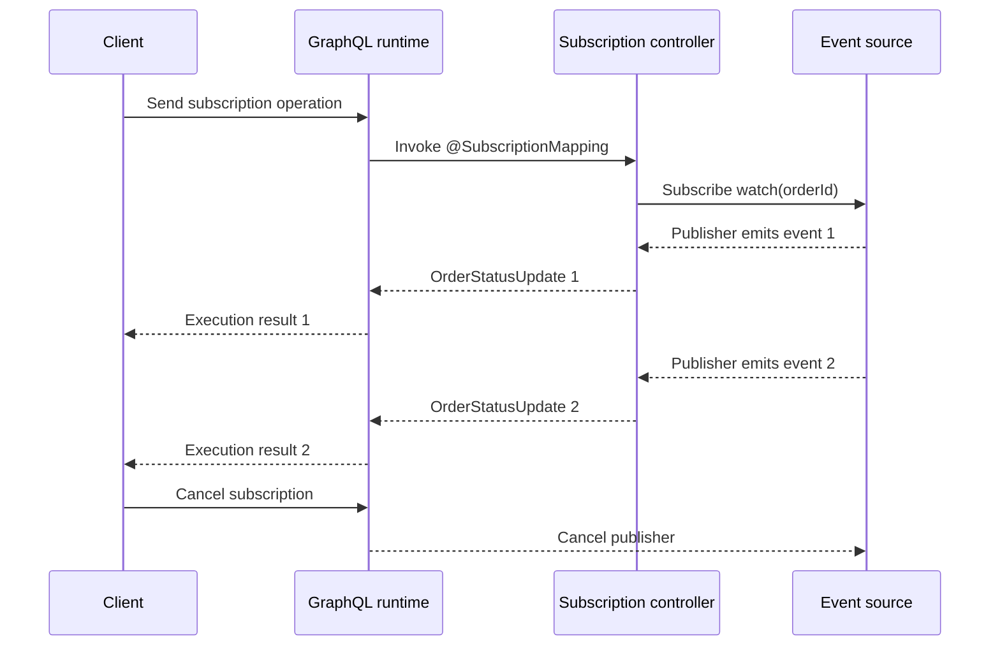

# `@SubscriptionMapping` in Spring for GraphQL

`@SubscriptionMapping` is a Spring for GraphQL annotation used to map a controller method to a field on the `Subscription` root type of a GraphQL schema. The method typically returns a `Publisher`, such as a Reactor `Flux`, so the server can emit multiple results over time to the client.

This annotation connects three parts of a subscription: the field declared in the SDL, the Java method that handles that field, and the event source that produces the data. `@SubscriptionMapping` does not generate events or open network connections on its own; it only registers the Subscription field execution logic in the GraphQL runtime.

## How Does Subscription Differ from Query and Mutation?

Query and Mutation typically handle a single request execution and return one result. Subscription maintains a stream of results so the server can send subsequent updates when new events occur.

| Operation | Purpose | Common Controller Return Type |
| --- | --- | --- |
| Query | Reads data at the moment the client requests it. | Object, collection, `Mono`, or an appropriate asynchronous type. |
| Mutation | Modifies data and returns the outcome of the operation. | Object, boolean, `Mono`, or an appropriate asynchronous type. |
| Subscription | Observes events and emits multiple results over the subscription lifecycle. | Reactive Streams `Publisher`, usually `Flux`. |

For example, an order details screen can use a Query to load the current status. Then, a Subscription observes changes to receive new statuses without requiring the client to poll continuously.

## Declaring a Subscription Field in SDL

Before writing the controller, the schema needs a `Subscription` root type and the field to observe. Example for tracking order status:

```graphql
type OrderStatusUpdate {
  orderId: ID!
  status: String!
  changedAt: String!
}

type Subscription {
  orderStatusChanged(orderId: ID!): OrderStatusUpdate!
}
```

The `orderStatusChanged` field accepts `orderId` to identify which order to watch. Each event returns an `OrderStatusUpdate` containing the order ID, new status, and timestamp of the change.

A client subscribes using a subscription operation:

```graphql
subscription WatchOrder($orderId: ID!) {
  orderStatusChanged(orderId: $orderId) {
    orderId
    status
    changedAt
  }
}
```

Variables sent with the operation:

```json
{
  "orderId": "ORD-1001"
}
```

A subscription operation may select only a single top-level field. Child fields of the payload such as `orderId`, `status`, and `changedAt` are still selected normally in that field's selection set.

## Mapping the Field with `@SubscriptionMapping`

Spring for GraphQL discovers controllers with `@SubscriptionMapping` and registers the methods as DataFetchers for fields on the `Subscription` root type. By convention, the method name is used as the field name unless another name is specified.

Example controller:

```java
import java.security.Principal;
import org.springframework.graphql.data.method.annotation.Argument;
import org.springframework.graphql.data.method.annotation.SubscriptionMapping;
import org.springframework.stereotype.Controller;
import reactor.core.publisher.Flux;

@Controller
public class OrderSubscriptionController {

    private final OrderEventService orderEventService;
    private final OrderAuthorizationService authorizationService;

    public OrderSubscriptionController(
            OrderEventService orderEventService,
            OrderAuthorizationService authorizationService) {
        this.orderEventService = orderEventService;
        this.authorizationService = authorizationService;
    }

    @SubscriptionMapping
    public Flux<OrderStatusUpdate> orderStatusChanged(
            @Argument String orderId, Principal principal) {
        authorizationService.checkCanReadOrder(principal, orderId);
        return orderEventService.watch(orderId);
    }
}
```

In this example:

- `@Controller` registers the class in Spring for GraphQL's annotated controller mechanism.
- `@SubscriptionMapping` maps the `orderStatusChanged` method to the field of the same name on the `Subscription` root.
- `@Argument String orderId` retrieves the `orderId` argument from the operation.
- `Principal` represents the authenticated identity provided by the request/security integration.
- `Flux<OrderStatusUpdate>` emits order status events over time.
- `OrderEventService` is responsible for connecting to the event source; the controller does not need to know message broker or event bus details.

The field name in the SDL and the method name must match according to the mapping convention. If the field name is changed, update the mapping or configure the explicit field name according to the annotation API of your Spring for GraphQL version.

## Why Do Subscription Handlers Return a Publisher?

A GraphQL Subscription does not return just a single object. When a client subscribes, the server needs a source capable of emitting multiple values in the future. A Reactive Streams `Publisher` represents that stream.

Common types:

- `Flux<T>` can emit zero, one, or many items and then complete or emit an error. This is the standard type for continuous subscriptions.
- `Mono<T>` emits at most one item. It is still a Publisher, but is generally more suited to a one-shot asynchronous result; if the goal is to observe multiple events, `Flux` expresses that intent more clearly.
- Another implementation of `org.reactivestreams.Publisher<T>` can also be used if it is compatible with the application's reactive infrastructure.

When the Publisher emits a value, GraphQL executes the selection set against that value and sends an execution result to the client. This process repeats until the Publisher completes, emits an error, or the subscription is canceled.

General processing flow:



## The Event Source Belongs in a Service

The controller should focus on mapping the GraphQL field, reading arguments, and applying appropriate checks before returning the Publisher. Emitting events generally belongs to a dedicated service.

Example service contract:

```java
import reactor.core.publisher.Flux;

public interface OrderEventService {
    Flux<OrderStatusUpdate> watch(String orderId);
}
```

Implementations can obtain data from:

- An event bus or message broker such as Kafka or RabbitMQ.
- An internal application event stream.
- An in-memory Reactor sink or publisher for simple cases.
- A notification system or external service with a streaming API.

The service must ensure the stream emits only events matching the subscribed `orderId`. For multi-instance deployments, the event source must work across instances; an in-memory `Flux` inside one JVM does not automatically synchronize events to other nodes.

### Cold and Hot Publishers

When designing the service, understand how Publishers behave:

- **Cold Publisher** typically creates a separate stream or source operation per subscriber. Each client can have an independent subscription.
- **Hot Publisher** emits events independently of individual subscribers. Clients receive only events occurring while they are subscribed, depending on the source's buffering and replay policy.

Choose the Publisher type based on business requirements. If clients need to recover events that occurred during a disconnection, simple WebSocket reconnection is not enough; you need event storage, a cursor, or a sequence number so clients can resume from the last received position.

## Reading Arguments and Request Information

`@Argument` is the standard way to receive data from a field in the SDL. Argument names in the mapping annotation must match the schema:

```graphql
type Subscription {
  inventoryChanged(warehouseId: ID!, productId: ID): InventoryUpdate!
}
```

```java
@SubscriptionMapping
public Flux<InventoryUpdate> inventoryChanged(
        @Argument String warehouseId,
        @Argument String productId) {
    return inventoryEventService.watch(warehouseId, productId);
}
```

In addition to arguments, annotated controllers can receive context objects supported by Spring for GraphQL such as `Principal`, `DataFetchingEnvironment`, `GraphQLContext`, or context values via the appropriate annotations. Use them when you need the identity, tenant, or correlation ID of the request.

Do not place authentication credentials or permissions inside client-supplied arguments. Arguments are input data; identity and permissions must come from the server's trusted security context.

## Securing Subscriptions by Resource

Subscriptions usually live longer than a single HTTP request, so access permissions must be considered throughout the lifetime of the stream.

In the order example, knowing an `orderId` does not mean a user is allowed to watch that order. The controller or service must verify permissions before subscribing to the event source:

```java
@SubscriptionMapping
public Flux<OrderStatusUpdate> orderStatusChanged(
        @Argument String orderId, Principal principal) {
    authorizationService.checkCanReadOrder(principal, orderId);
    return orderEventService.watch(orderId);
}
```

The initial check prevents unauthorized users from creating a subscription. If permissions can be revoked while a stream is active, the system also needs a revalidation policy, stream duration limits, or publisher cancellation when permissions change.

For multi-tenant applications, the service must bind the subscription to the current principal's tenant and filter events by both resource and tenant. Never trust a client-supplied `tenantId` unless the server verifies it belongs to the user's scope.

Additional principles to apply:

- Use `wss://` when deploying over HTTPS environments.
- Authenticate connections and handle credentials according to the chosen transport mechanism.
- Limit concurrent subscriptions and subscription rate.
- Do not log tokens or sensitive payloads.
- Enforce permissions for each observed resource.
- Have a policy for closing streams when a user logs out, a token expires, or permissions are revoked.

## Canceling Subscriptions and Releasing Resources

When a client no longer needs events, the client library cancels the operation. With GraphQL over WebSocket, this is represented by a `complete` message for the corresponding operation. The GraphQL runtime cancels the subscription Publisher; the cancellation signal should be propagated back to the source if the implementation supports it.

This is especially important if each subscriber creates:

- A consumer or listener on a message broker.
- A connection to a streaming service.
- A subscription to a Reactor sink.
- A dedicated buffer or queue.

The service must remove listeners and release resources when the Publisher is canceled or terminates. With Reactor, you can use operators such as `doFinally` to observe completion, error, or cancellation signals and perform appropriate cleanup. Never create a listener outside the Publisher and forget to remove it when the client disconnects.

Illustrative lifecycle example:

```java
public Flux<OrderStatusUpdate> watch(String orderId) {
    return createOrderEventStream(orderId)
            .doFinally(signal -> releaseSubscriptionResources(orderId));
}
```

`createOrderEventStream` and `releaseSubscriptionResources` are application implementation methods. If multiple subscribers watch the same order concurrently, cleanup must be tied to the specific subscription or reference count; do not close a shared source when a single client leaves.

## Backpressure and Resource Limits

An event source can emit faster than a client can process. Reactive Streams provides demand/cancellation mechanics, yet adapters, message brokers, and transports may have their own buffers. If buffers are unbounded, a slow client can cause memory usage to grow continuously.

When designing a stream, determine:

- Whether to use bounded buffers and define what happens when full.
- Whether intermediate events can be dropped, state merged, or only the latest state emitted.
- Whether events must be guaranteed lossless and replayable.
- Connection and subscription limits per user or tenant.
- Timeouts and connection-closing policies when a client becomes inactive.
- How to monitor subscriber count, emission rate, latency, and cancellation count.

Not every stream should use a `latest` or drop strategy. For dashboard status, the latest value alone may suffice; for financial transactions or order status histories, dropping events can break business logic. The backpressure policy must match the data requirements.

## Error Handling in Subscriptions

Errors can occur before or after the stream starts:

| Timing | Example | How to Handle |
| --- | --- | --- |
| Before returning Publisher | Invalid argument, unauthorized, resource does not exist. | Throw an appropriate business exception and map it via `DataFetcherExceptionResolver`. |
| While stream is active | Message broker failure, lost connection to event source. | Log error, terminate stream, or retry according to service policy. |
| When resolving payload | A field in the event cannot be fetched. | Apply GraphQL error handling and SDL nullability. |
| When client cancels | User leaves the screen or closes the connection. | Handle cancellation and release resources. |

Do not expose stack traces, broker connection details, or internal information in errors returned to clients. If the service retries automatically, avoid infinite retries or emitting duplicate events without an event ID/sequence so the client can deduplicate.

Nullability in the schema also matters. If a Subscription field returns `OrderStatusUpdate!`, every event must produce a non-null payload. If a payload is invalid, the error can affect the corresponding execution result; clients must inspect both `data` and `errors`.

## Transport: The Annotation Does Not Open a WebSocket on Its Own

`@SubscriptionMapping` registers the field with the GraphQL runtime. For clients to actually receive events over the network, the application also needs a subscription-capable transport and a compatible client.

In Spring Boot, a common approach is enabling GraphQL over WebSocket and configuring a WebSocket endpoint. Clients typically use a library supporting the `graphql-transport-ws` protocol, such as `graphql-ws` in JavaScript. The GraphQL HTTP endpoint used for Query/Mutation does not automatically turn into a WebSocket endpoint just because a controller has `@SubscriptionMapping`.

The basic WebSocket flow consists of handshake, connection initialization, operation registration, receiving multiple result messages, and canceling the operation. Path configuration, authentication, and protocol must match across client, server, and reverse proxies.

## Testing `@SubscriptionMapping`

Testing subscriptions must verify mapping, emitted data, and stream lifecycle. You can use `WebSocketGraphQlTester` or a corresponding GraphQL test client to test over the actual transport; testing the service separately is also helpful for verifying filtering and cleanup.

Cases to include:

- Valid subscription invokes the expected `@SubscriptionMapping` method.
- Arguments are passed accurately to `@Argument`.
- The stream emits multiple events with the expected payloads and order.
- Unauthorized users are rejected before subscribing to the event source.
- Events for other orders or tenants are not delivered to the current subscriber.
- Errors from the event source are translated into appropriate error results.
- Canceling the subscription releases listeners and resources.
- Multiple clients subscribing to the same field do not mix up data or each other's cleanup.
- Reconnection does not create duplicate listeners and has a policy for missed events.

For integration tests, emit events from a controllable test source, register a subscription, assert received results, then cancel the subscription and verify cleanup. Avoid only testing that the controller method returns a `Flux`; that does not prove the WebSocket transport and GraphQL subscription lifecycle work properly.

## Common Errors

| Symptom | Cause | How to Fix |
| --- | --- | --- |
| Operation cannot find subscription field | Field in SDL does not match method name or root type is not declared. | Check `Subscription` root and mapping name. |
| Controller returns one result and ends | Service returns a Publisher that emits only one item or completes immediately. | Check the event source and use a stream matching the requirement. |
| HTTP Query works but Subscription fails to connect | Subscription transport is not enabled or client uses the wrong endpoint/protocol. | Check WebSocket endpoint, handshake, and `graphql-transport-ws`. |
| Subscriber receives events for another resource | Service filtering is missing ID or tenant checks. | Bind the stream source to the authenticated principal, tenant, and resource. |
| Events continue after client leaves | Publisher does not handle cancellation or listener is not cleaned up. | Propagate cancellation to the source and release resources in `doFinally` or an equivalent mechanism. |
| Memory grows with slow clients | Unbounded buffers or producer emits faster than consumer capacity. | Apply backpressure and buffer limits appropriate to business needs. |
| Clients miss events on reconnect | Subscription has no replay/cursor. | Use event IDs or sequences and support resuming from persistent storage. |

## Key Takeaways

`@SubscriptionMapping` maps an annotated controller method to a field on the `Subscription` root type. The method typically receives arguments via `@Argument` and returns a Reactive Streams `Publisher`, most commonly `Flux`, so GraphQL can emit multiple execution results to the client.

The controller should delegate stream creation to a service, enforce per-resource access control, filter data by tenant, and ensure cancellation releases listeners. Subscriptions also require a compatible transport such as GraphQL over WebSocket, along with appropriate backpressure, error, and reconnection policies. The annotation only handles field mapping; the full event lifecycle must still be designed across the service and transport infrastructure.
