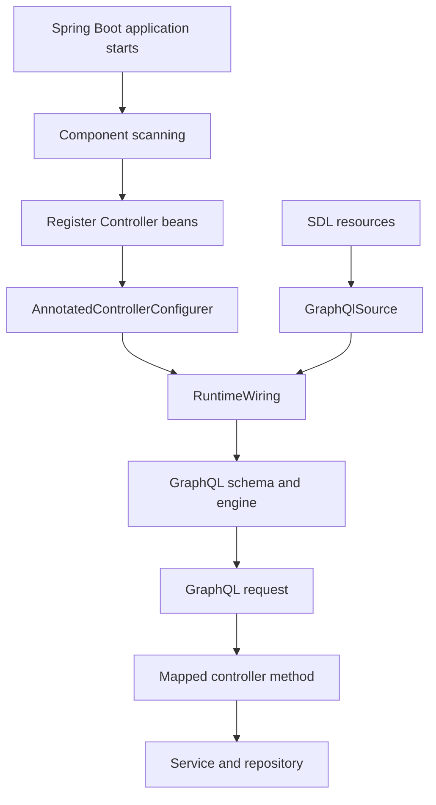

# Controller Scan

In Spring for GraphQL, methods that handle GraphQL operations typically reside in Java classes annotated with `@Controller`. Spring Boot does not discover these classes by reading SDL files. Instead, they are registered as Spring beans through component scanning or another bean registration mechanism; then Spring for GraphQL's annotated controller infrastructure discovers the handler methods and connects them to fields in the GraphQL schema.

Therefore, a controller with `@QueryMapping` placed outside the component scan scope will not be discovered. Conversely, if an SDL file is loaded without a matching controller or data fetcher, the field still lacks execution logic. Understanding these two discovery steps helps resolve common issues such as queries not invoking methods, field mappings not being registered, or tests behaving differently from the real application.

This lesson explains component scanning, the role of `@Controller`, how Spring for GraphQL discovers handler methods, how to configure package scanning for multi-module applications, and how to test and diagnose controller scanning.

## 1. Two Separate Discovery Steps

A GraphQL application using Spring Boot must perform two tasks:

1. Load the GraphQL SDL to create the runtime schema.
2. Discover Spring beans containing GraphQL handler methods and register data fetchers for fields.

Overall flow:



SDL and controllers have distinct responsibilities:

| Component | Role |
| --- | --- |
| GraphQL SDL | Declares types, fields, arguments, inputs, and return types |
| Component scanning | Finds Spring stereotype classes and registers beans in the application context |
| AnnotatedControllerConfigurer | Finds handler methods inside controller beans and registers data fetchers |
| Resolver method | Executes logic for a field when a client sends an operation |

The `src/main/resources/graphql` path is used to locate schema files. It is not a Java package and has no effect on component scanning. Likewise, placing a controller inside a `graphql` package does not automatically create a field in the schema if the SDL has not declared it.

## 2. Role of `@Controller`

Spring for GraphQL uses `@Controller` to mark classes containing handler methods. It is a Spring stereotype annotation recognized by component scanning and registered as a bean.

```java
package com.acme.library.graphql;

import org.springframework.graphql.data.method.annotation.Argument;
import org.springframework.graphql.data.method.annotation.QueryMapping;
import org.springframework.stereotype.Controller;

@Controller
public class BookGraphQlController {

    private final BookService bookService;

    public BookGraphQlController(BookService bookService) {
        this.bookService = bookService;
    }

    @QueryMapping
    public Book book(@Argument String id) {
        return bookService.findById(id);
    }
}
```

`@Controller` marks the class to be managed by Spring. `@QueryMapping` marks a method handling a field on the `Query` root type; `@Argument` extracts the `id` argument from the GraphQL field call.

The method above corresponds to the SDL:

```graphql
type Query {
  book(id: ID!): Book
}

type Book {
  id: ID!
  title: String!
}
```

GraphQL clients invoke operations through the shared GraphQL endpoint, usually `/graphql`. `@QueryMapping` does not create a separate HTTP route like `@GetMapping`. It maps a GraphQL field to a Java method.

### Common Mapping Annotations

| Annotation | Mapped Field |
| --- | --- |
| `@QueryMapping` | Field on the `Query` root type |
| `@MutationMapping` | Field on the `Mutation` root type |
| `@SubscriptionMapping` | Field on the `Subscription` root type |
| `@SchemaMapping` | Field of a GraphQL object type |
| `@BatchMapping` | Field resolved in batches for multiple source objects |

Example:

```java
@Controller
public class LibraryGraphQlController {

    @QueryMapping
    public List<Book> books() {
        return bookService.findAll();
    }

    @MutationMapping
    public Book createBook(@Argument CreateBookInput input) {
        return bookService.create(input);
    }

    @SchemaMapping(typeName = "Book", field = "author")
    public Author author(Book book) {
        return authorService.findById(book.authorId());
    }
}
```

These annotations take effect only when the class containing them is registered as a Spring bean and the annotated controller infrastructure is configured.

## 3. `@SpringBootApplication` Determines the Default Scan Package

`@SpringBootApplication` includes component scanning configuration. Unless specific packages are declared, Spring starts scanning from the package containing the application class and descends into subpackages.

Example structure:

```text
src/main/java/
└── com/acme/library/
    ├── LibraryApplication.java
    ├── graphql/
    │   ├── book/
    │   │   └── BookGraphQlController.java
    │   └── author/
    │       └── AuthorGraphQlController.java
    ├── service/
    │   └── BookService.java
    └── repository/
        └── BookRepository.java
```

Application class:

```java
package com.acme.library;

@SpringBootApplication
public class LibraryApplication {

    public static void main(String[] args) {
        SpringApplication.run(LibraryApplication.class, args);
    }
}
```

Because `LibraryApplication` resides in package `com.acme.library`, Spring scans this package and subpackages such as `com.acme.library.graphql.book`. The controllers in the example are discovered automatically.

An error-prone layout is placing the application class in too deep a subpackage:

```text
com/acme/library/bootstrap/LibraryApplication.java
com/acme/library/graphql/BookGraphQlController.java
```

Without configuring another scan root, the default package is `com.acme.library.bootstrap`; the controller in `com.acme.library.graphql` lies outside that branch and is not discovered. Place the application class in the shared root package of the application or configure scan packages explicitly.

## 4. Expanding the Scan Scope for Multi-Package Applications

When a controller resides outside the default root package, you can specify scan packages in `@SpringBootApplication`.

### Using `scanBasePackages`

```java
@SpringBootApplication(scanBasePackages = {
        "com.acme.library",
        "com.acme.shared.graphql"
})
public class LibraryApplication {
    // ...
}
```

`scanBasePackages` accepts package names as strings. This is straightforward, but package names are not checked by the compiler; when a package is renamed, string values can break without the IDE catching it.

### Using `scanBasePackageClasses`

You can use a marker class to specify packages more safely:

```java
package com.acme.shared.graphql;

public final class SharedGraphQlPackage {
    private SharedGraphQlPackage() {
    }
}
```

Then:

```java
@SpringBootApplication(scanBasePackageClasses = {
        LibraryApplication.class,
        SharedGraphQlPackage.class
})
public class LibraryApplication {
    // ...
}
```

Spring scans the package containing each marker class and its subpackages. This approach reduces risk when renaming packages.

Avoid scanning overly broad packages such as `com` or `org` unless necessary. An excessively wide scope can cause the application context to initialize unwanted beans, trigger bean name conflicts, or increase startup time.

## 5. Explicit Controller Registration

Component scanning is not the only way to bring a controller into the application context. You can register specific classes with `@Import`:

```java
@Configuration
@Import(ExternalBookGraphQlController.class)
public class ExternalGraphQlConfiguration {
}
```

The imported class must still be marked with `@Controller` and contain valid mapping methods:

```java
@Controller
public class ExternalBookGraphQlController {

    private final BookService bookService;

    public ExternalBookGraphQlController(BookService bookService) {
        this.bookService = bookService;
    }

    @QueryMapping
    public Book book(@Argument String id) {
        return bookService.findById(id);
    }
}
```

`@Import` is useful when integrating a controller from another library or module without widening the entire component scan. The controller's dependencies must still have matching beans for Spring to inject.

You can register a bean via a `@Bean` factory method in Java configuration if you need control over instantiation. However, the class must still be recognized as a controller by the annotated controller infrastructure. For ordinary controllers, component scanning or `@Import` is easier to read and requires less configuration.

## 6. `AnnotatedControllerConfigurer` Discovers Handler Methods

Once controller beans are in the application context, Spring for GraphQL uses `AnnotatedControllerConfigurer` to find methods with mapping annotations and connect them to schema fields.

`AnnotatedControllerConfigurer` is a runtime wiring component of Spring for GraphQL. In standard Spring Boot configurations, Boot registers this component to support annotated controllers. It inspects controller beans and registers data fetchers for annotated methods.

Example:

```java
@Controller
public class BookGraphQlController {

    @QueryMapping
    public Book book(@Argument String id) {
        // ...
    }

    @MutationMapping
    public Book archiveBook(@Argument String id) {
        // ...
    }

    @SchemaMapping(typeName = "Book", field = "reviews")
    public List<Review> reviews(Book book) {
        // ...
    }
}
```

The mappings above correspond to:

- `Query.book`
- `Mutation.archiveBook`
- `Book.reviews`

Field names are normally inferred from method names. You can specify `name` or `field` explicitly in the annotation if the Java method name differs from the SDL field name.

`@QueryMapping` is a shorthand form of `@SchemaMapping` on the `Query` root type; `@MutationMapping` and `@SubscriptionMapping` apply similarly to their respective root types.

### Distinguishing Component Scan from Handler Method Scan

Do not confuse the two steps:

1. Component scanning finds classes with stereotypes like `@Controller`, then registers beans.
2. The annotated controller configurer inspects registered beans and looks for methods with `@QueryMapping`, `@SchemaMapping`, or other mapping annotations.

If a class does not become a bean, the second step has no controller to inspect. If the class is a bean but a method lacks a mapping annotation, that method does not automatically become a GraphQL data fetcher.

## 7. Conditions and Profiles Affecting Controller Scan

A class annotated with `@Controller` can still be absent from the application context if excluded by configuration conditions.

Example using a profile:

```java
@Profile("admin-api")
@Controller
public class AdminGraphQlController {

    @QueryMapping
    public AdminDashboard adminDashboard() {
        // ...
    }
}
```

The controller is registered only when the `admin-api` profile is active. If a client calls a field provided only under that profile while the application does not have the profile enabled, that field will have no matching handler.

You can use `@ConditionalOnProperty` to toggle a controller via configuration:

```java
@ConditionalOnProperty(
        name = "features.graphql.admin-enabled",
        havingValue = "true")
@Controller
public class AdminGraphQlController {
    // ...
}
```

```yaml
features:
  graphql:
    admin-enabled: true
```

In addition, `@ComponentScan` can configure include/exclude filters. If `useDefaultFilters = false` is set or an exclude filter covers the controller's package, `@Controller` classes may not be registered as expected.

When investigating a missing controller, check:

- Is the class's package within the scan roots?
- Does the class have the `@Controller` annotation?
- Is the required profile active?
- Do `@Conditional...` conditions match?
- Does an include/exclude filter skip the class?
- Is a bean definition override or bean creation error preventing the context from starting cleanly?

## 8. Controller Scan Does Not Replace the GraphQL Schema

A controller method does not automatically add fields to the schema. The field must still exist in the SDL:

```graphql
type Query {
  book(id: ID!): Book
}
```

If the controller has:

```java
@QueryMapping
public Book book(@Argument String id) {
    return bookService.findById(id);
}
```

then `Query.book` is connected to the method. If the SDL lacks `Query.book`, controller mapping is not a way to automatically extend the schema.

Similarly, if the schema has the field but the controller was not scanned, GraphQL still knows the field exists, yet there is no annotated data fetcher to handle it. If the source object does not provide a matching property fetcher, the result may be null or an error depending on nullability.

| Schema SDL | Controller Bean/Mapping | Result |
| --- | --- | --- |
| Has field | Has matching mapping | Field is wired to handler |
| Has field | No mapping | Default property fetcher may be used; if no matching property exists, result may be null |
| Missing field | Has mapping method | Mapping cannot create fields in schema; declare in SDL |
| Has field | Mapping has wrong type or field name | Data fetcher is not bound to the right field or schema wiring fails |

## 9. Mapping Names and Duplicate Handler Errors

By default, Spring infers the field name from the method name. Example:

```java
@QueryMapping
public Book findBook(@Argument String id) {
    // ...
}
```

Here the default field is `findBook`, not `book`. If the SDL declares `book`, specify the name:

```java
@QueryMapping(name = "book")
public Book findBook(@Argument String id) {
    // ...
}
```

For nested fields:

```java
@SchemaMapping(typeName = "Book", field = "author")
public Author loadAuthor(Book book) {
    // ...
}
```

Avoid registering multiple methods for the same field within the same application context. For example, two controllers both having `@QueryMapping(name = "book")` on `Query.book` can create conflicting mappings. Assign a single owner per field, or design one resolver that coordinates multiple services if data aggregation is needed.

When a mapping fails to register, check `typeName`, `field`, method name, source parameter type, and SDL. In particular, the Java type used to infer the parent type must correspond to the GraphQL object type that owns the field.

## 10. Controller Beans Should Remain Stateless

Spring controllers are typically singleton beans. Therefore, never store per-request data in mutable instance fields:

```java
// Avoid: multiple requests can share the controller instance.
@Controller
public class UnsafeBookController {

    private String currentUserId;
}
```

Instead, obtain required information from method arguments or context:

```java
@QueryMapping
public List<Book> myBooks(Principal principal) {
    return bookService.findByOwner(principal.getName());
}
```

Spring for GraphQL supports method argument types such as `@Argument`, source object, `Principal`, `@ContextValue`, `GraphQLContext`, `DataLoader`, and other execution objects depending on the handler. Per-request data should be passed through these mechanisms or via services with explicit context.

Controller scanning only determines whether a bean is discovered. It does not automatically provide authentication, authorization, or data isolation between users.

## 11. Testing Controller Scan

There are two common test types:

- `@GraphQlTest` creates a test slice focused on GraphQL controllers and related configuration.
- `@SpringBootTest` starts the full application context, suitable for verifying component scanning and production-like configuration.

### Testing One Controller with `@GraphQlTest`

```java
@GraphQlTest(BookGraphQlController.class)
class BookGraphQlControllerTests {

    @Autowired
    GraphQlTester graphQlTester;

    @MockBean
    BookService bookService;

    @Test
    void findsBookById() {
        given(bookService.findById("book-1"))
                .willReturn(new Book("book-1", "Spring GraphQL"));

        graphQlTester.document("""
                query {
                    book(id: "book-1") {
                        id
                        title
                    }
                }
                """)
                .execute()
                .path("book.title")
                .entity(String.class)
                .isEqualTo("Spring GraphQL");
    }
}
```

`@GraphQlTest(BookGraphQlController.class)` brings the specified controller into the test slice. Business services are usually mocked because the test slice does not initialize the entire service/repository layers of the application.

If the controller depends on custom scalars or a custom runtime wiring configurer, import that configuration into the test:

```java
@GraphQlTest(BookGraphQlController.class)
@Import(BookScalarConfiguration.class)
class BookGraphQlControllerTests {
    // ...
}
```

### Testing Application Component Scanning

When you want to verify that a controller in another package is actually discovered by the scan configuration, use `@SpringBootTest`:

```java
@SpringBootTest
class GraphQlControllerScanTests {

    @Autowired
    ApplicationContext applicationContext;

    @Test
    void registersBookGraphQlController() {
        assertThat(applicationContext.getBeansOfType(
                BookGraphQlController.class)).hasSize(1);
    }
}
```

This test confirms the bean exists in the application context. To verify that handler methods are also registered properly, send a GraphQL operation using `GraphQlTester` and assert the response.

Do not rely on a test slice alone to conclude that production component scanning is broken. Test slices apply different filters and bean sets than `@SpringBootTest`.

## 12. Diagnosing Undiscovered Controllers

When a query fails to invoke a controller method, check in order:

1. Did the application start successfully and is the application context active?
2. Is the controller class registered as a bean?
3. Is the controller's package inside the component scan roots?
4. Is a profile or conditional annotation excluding the controller?
5. Does the class have `@Controller` and does the method have the right mapping annotation?
6. Does the SDL declare a field matching the mapping?
7. Do the mapping's type name and field name match?
8. Is another controller registering a conflicting mapping?
9. Is a test using `@GraphQlTest` and forgetting to specify/import the controller?

You can quickly check the bean in a test:

```java
assertThat(applicationContext.getBeansOfType(
        BookGraphQlController.class)).isNotEmpty();
```

Or inspect the list of bean names:

```java
String[] names = applicationContext.getBeanNamesForType(
        BookGraphQlController.class);
```

If the bean exists yet the handler does not work, inspect the mapping annotations and schema. If the bean does not exist, focus on component scanning, `@Import`, profiles, and conditional configuration.

## 13. Common Errors

| Symptom | Cause | How to Fix |
| --- | --- | --- |
| Controller is never called | Class lies outside component scan | Place class in a subpackage or configure `scanBasePackages`/`scanBasePackageClasses` |
| Controller has `@QueryMapping` yet field has no handler | Missing `@Controller` or bean is not registered | Check stereotype and application context |
| Works in production but `@GraphQlTest` misses controller | Test slice did not import that controller | Specify the controller in `@GraphQlTest` |
| Fails only under deployment profile | Controller has `@Profile` or `@Conditional...` not matching | Check active profiles and properties |
| Query reports field does not exist | SDL does not declare the field | Add field to SDL schema |
| Method does not match expected field | Method name differs from field without explicit name in annotation | Use `name` or `field` appropriately |
| Conflicting mappings | Multiple controllers own the same field | Consolidate logic or split fields clearly |
| Controller bean creation fails | Constructor dependency has no bean or invalid configuration | Check the first bean initialization error in logs |
| Controller scanned too broadly | Scan roots or filters are too wide | Narrow base packages and use marker classes |

## 14. Principles for Organizing Controller Packages

- Place the application class at the shared root package of modules that need scanning.
- Group GraphQL controllers by domain such as `graphql.book`, `graphql.author`, `graphql.order`.
- Use `@Controller` for annotated GraphQL controllers per Spring for GraphQL conventions.
- Keep one clear mapping owner for each schema field.
- Use `scanBasePackageClasses` when expanding scanning across multiple modules.
- Use `@Import` when registering only specific controllers from another module or library.
- Check `@Profile`, `@ConditionalOnProperty`, and scan filters when a controller appears only in certain environments.
- Keep controllers stateless; obtain request data from method arguments and context.
- Use `@GraphQlTest` for handler tests and `@SpringBootTest` for full component scan tests.
- Keep schema resource discovery and controller bean discovery as two separate steps when debugging.

## 15. Practice Exercise

Create a library application with two packages:

```text
com/acme/library/
├── LibraryApplication.java
├── graphql/book/BookGraphQlController.java
└── service/BookService.java

com/acme/shared/graphql/AuthorGraphQlController.java
```

Steps:

1. Place `LibraryApplication` in package `com.acme.library` and run the application.
2. Verify `BookGraphQlController` is discovered while `AuthorGraphQlController` lies outside the scan root.
3. Use `scanBasePackageClasses` with a marker class in `com.acme.shared.graphql` to include that package.
4. Write SDL for `Query.book` and `Query.author`.
5. Write `@QueryMapping` methods in both controllers.
6. Write a `@GraphQlTest` test for the Book controller.
7. Write a `@SpringBootTest` test confirming both controllers are beans.
8. Add `@Profile` to the Author controller and test when the profile is inactive.

After this exercise, you should be able to explain how component scanning registers controller beans, how `AnnotatedControllerConfigurer` finds handler methods, why schema files do not make controllers appear automatically, and how to choose between `@GraphQlTest` and `@SpringBootTest` when investigating scan issues.

## 16. References

- [Spring for GraphQL — Annotated Controllers](https://docs.spring.io/spring-graphql/reference/controllers.html)
- [Spring Boot — Spring for GraphQL](https://docs.spring.io/spring-boot/reference/web/spring-graphql.html)
- [Spring Framework — Classpath Scanning and Managed Components](https://docs.spring.io/spring-framework/reference/core/beans/classpath-scanning.html)
- [Spring Boot — Testing Spring Applications](https://docs.spring.io/spring-boot/reference/testing/spring-boot-applications.html)

Auto-configuration and test slice details can change across Spring Boot and Spring for GraphQL versions. When upgrading dependencies, consult the reference documentation and Javadoc matching the exact version used in your project.
