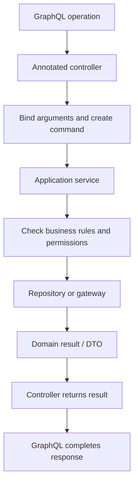

# Controller and Service Boundary in Spring for GraphQL

In Spring for GraphQL, an annotated controller is the layer that receives GraphQL operations and connects schema fields to application logic. The controller receives arguments, calls a service, and returns results so GraphQL can continue building the response. The service boundary is the separation between the GraphQL interface layer and application use cases: services execute business rules, coordinate repositories, manage transactions, and enforce business-level conditions.

Keeping this boundary clear makes resolvers easy to read, allows services to be reused outside GraphQL, and ensures schema changes do not force rewriting business logic. It also makes it possible to test each layer according to its responsibility while keeping GraphQL-specific concepts out of the domain or persistence layers.

After this lesson, you can:

- Understand the roles of annotated controllers, application services, and repositories.
- Write thin resolvers using `@QueryMapping`, `@MutationMapping`, and `@SchemaMapping`.
- Convert GraphQL arguments into application input models or commands.
- Place transactions, business validation, and authorization at the right boundary.
- Translate service errors into GraphQL errors at the interface layer.
- Choose synchronous or reactive return types matching the runtime.
- Avoid pitfalls such as controllers containing business logic, services depending on GraphQL, or resolvers causing N+1 queries.
- Test controllers and services independently by layer.

## 1. Why Do We Need a Service Boundary?

A GraphQL operation can call many fields, nest multiple levels deep, and select data according to client needs. If every resolver directly wrote database queries, checked permissions, opened transactions, and enforced business rules, controllers would quickly absorb the entire application.

Consider renaming a book title. It may require:

1. Determining whether the book exists.
2. Checking that the new title is valid.
3. Checking whether the user has permission to modify the book.
4. Updating the data and recording change history.
5. Returning data appropriate for the API.

This is an application use case, not a GraphQL-specific responsibility. If a REST endpoint, batch job, or message consumer also needs to rename a book, they should invoke the same service so the same rules apply consistently.

## 2. Dividing Responsibilities Across Layers

A common organization splits the codebase into three layers:

| Layer | Responsibility | Example in Spring for GraphQL |
| --- | --- | --- |
| GraphQL controller / adapter | Receive fields and arguments, convert input, call use case, return result | `@QueryMapping`, `@MutationMapping`, `@SchemaMapping` |
| Application service | Execute use case, coordinate domain, transactions, business authorization | `BookService.renameBook(...)` |
| Repository / gateway | Read and write data or communicate with external systems | `BookRepository`, `AuthorClient` |

Typical call flow:



The controller knows which GraphQL field is being called. The service knows which use case to execute. The repository knows how to read or write data. Whenever one layer has to know too many details of another, the boundary is blurring.

## 3. Declaring the Schema for the Example

The example throughout this lesson uses a book management API:

```graphql
type Query {
    book(id: ID!): Book
}

type Mutation {
    renameBook(id: ID!, input: RenameBookInput!): Book!
}

input RenameBookInput {
    title: String!
}

type Book {
    id: ID!
    title: String!
    author: Author
}

type Author {
    id: ID!
    name: String!
}
```

The schema only describes the contract: the query takes an ID, and the mutation takes an input object and returns a Book. It does not dictate whether the controller must use JPA or what the service must be named. Those are application implementation details.

## 4. Writing an Annotated Controller as an Adapter

The controller receives arguments via `@Argument`, invokes the service, and returns the result:

```java
@Controller
public class BookGraphQlController {

    private final BookService bookService;
    private final AuthorService authorService;

    public BookGraphQlController(
            BookService bookService,
            AuthorService authorService) {
        this.bookService = bookService;
        this.authorService = authorService;
    }

    @QueryMapping
    public BookView book(@Argument("id") String id) {
        return bookService.findById(id).orElse(null);
    }

    @MutationMapping
    public BookView renameBook(
            @Argument("id") String id,
            @Argument("input") @Valid RenameBookInput input) {

        RenameBookCommand command = new RenameBookCommand(id, input.title());
        return bookService.rename(command);
    }

    @SchemaMapping(typeName = "Book", field = "author")
    public AuthorView author(BookView book) {
        return authorService.findByBookId(book.id()).orElse(null);
    }
}
```

`@QueryMapping` binds the method to the field of the same name on the `Query` root type; `@MutationMapping` does the same for `Mutation`. `@SchemaMapping` binds a method to a field of an object type. In this example, `BookView` is the source object for the `Book.author` field, so the method receives the parent object to extract the required ID.

The controller only translates data from the GraphQL contract into application calls. Decisions such as whether the book can be renamed, whether an audit log must be recorded, and how long the transaction lasts belong in the service.

## 5. Using Input Models and Commands for Mutations

A GraphQL input object describes the data clients are allowed to send:

```java
public record RenameBookInput(
        @NotBlank
        @Size(max = 200)
        String title) {
}
```

An application command expresses the intent of the use case:

```java
public record RenameBookCommand(String bookId, String newTitle) {
}
```

The controller converts the input into a command:

```java
@MutationMapping
public BookView renameBook(
        @Argument("id") String id,
        @Argument("input") @Valid RenameBookInput input) {

    return bookService.rename(
            new RenameBookCommand(id, input.title()));
}
```

GraphQL inputs and commands do not have to be two distinct classes in every application. For simple use cases, you can share a single DTO if the API structure and application needs genuinely match. When they have different lifecycles or semantics, separating them lets you evolve the schema without impacting the application layer.

Do not pass `DataFetchingEnvironment`, `GraphQLContext`, `@Argument`, or GraphQL annotations into commands or service interfaces. Those are adapter details. Services should accept cleanly typed application data without caring whether the data arrived from GraphQL, REST, or messaging.

## 6. Placing Business Rules in the Service

The service executes the use case and invokes repositories:

```java
@Service
@Transactional(readOnly = true)
public class BookService {

    private final BookRepository bookRepository;
    private final BookMapper bookMapper;

    public BookService(
            BookRepository bookRepository,
            BookMapper bookMapper) {
        this.bookRepository = bookRepository;
        this.bookMapper = bookMapper;
    }

    public Optional<BookView> findById(String id) {
        return bookRepository.findById(id).map(bookMapper::toView);
    }

    @Transactional
    public BookView rename(RenameBookCommand command) {
        BookEntity book = bookRepository.findById(command.bookId())
                .orElseThrow(() -> new BookNotFoundException(command.bookId()));

        book.rename(command.newTitle());

        return bookMapper.toView(book);
    }
}
```

`findById` is a read operation so it can run inside a read-only transaction. `rename` modifies data and opens a write transaction. The repository is responsible only for fetching entities; renaming rules live in the domain method `book.rename(...)` or in the service depending on how the domain is structured.

Transactions should wrap the use case that requires consistency, not the entire GraphQL request by default. One operation can select multiple fields, and each field may invoke a different use case. If a mutation requires multiple changes to be atomic, create a single service method that coordinates all changes within one transaction.

## 7. Placing Transactions at the Right Boundary

Controllers typically do not need `@Transactional` just to call a service. Transactions on services clarify business scope and can be reused from other adapters.

Example mutation that renames a book and records an audit log:

```java
@Transactional
public BookView rename(RenameBookCommand command) {
    BookEntity book = bookRepository.findById(command.bookId())
            .orElseThrow(() -> new BookNotFoundException(command.bookId()));

    String previousTitle = book.title();
    book.rename(command.newTitle());
    auditRepository.save(AuditEntry.bookRenamed(
            book.id(), previousTitle, book.title()));

    return bookMapper.toView(book);
}
```

If updating the book succeeds while writing the audit entry fails, the transaction rolls back both operations when they participate in the same transaction manager. If a use case calls multiple independent systems, a database transaction does not automatically guarantee atomicity across all systems; design patterns like outbox or saga when needed.

Do not hold a transaction open while waiting for the client to send the next request or across a long-lived subscription. Transactions should be short and tied to a single use-case execution.

## 8. Validation in Adapters and Services

Validation can be divided into two groups:

- **Input structure validation:** GraphQL types, non-null checks, valid enums, formats, and simple input bounds. Schema and Bean Validation support this group.
- **Business validation:** whether the book exists, whether the title is allowed to change, whether the current state permits transitioning, or whether the user has permission to edit the record. Services/domains handle this group.

Example Bean Validation on an input record:

```java
public record RenameBookInput(
        @NotBlank(message = "Title must not be blank")
        @Size(max = 200, message = "Title must be at most 200 characters")
        String title) {
}
```

The resolver receives the bound input and can trigger validation with `@Valid`:

```java
@MutationMapping
public BookView renameBook(
        @Argument("id") String id,
        @Argument("input") @Valid RenameBookInput input) {
    return bookService.rename(new RenameBookCommand(id, input.title()));
}
```

For Bean Validation to work, the application needs the appropriate validation dependencies and configuration. Test how validation errors are translated into GraphQL responses for your version of Spring for GraphQL. Services must still protect domain invariants because use cases can be invoked from places that do not go through the GraphQL controller.

## 9. Authorization and the Service Boundary

Caller authentication is usually handled in the application's security layer. Authorization, however, must consider both the use case and the specific resource: whether the user is allowed to edit this book, whether the book belongs to the current tenant, or whether a field contains sensitive data.

You can protect service methods with Spring Method Security:

```java
@Service
public class BookService {

    @PreAuthorize("hasAuthority('BOOK_WRITE')")
    @Transactional
    public BookView rename(RenameBookCommand command) {
        // Load book, check record permissions, and update.
        // Implementation omitted to focus on the boundary.
        return performRename(command);
    }
}
```

The application must enable method security, for example with `@EnableMethodSecurity`, and ensure calls go through the Spring proxy. When permissions depend on ownership or tenant, checking a general authority alone is not enough; the service must verify the relationship between the current user and the record.

The controller can accept `Principal` or Spring-provided context info and pass an actor identifier into the command if the use case needs to know who is acting. Do not accept an arbitrary `userId` from the client and treat it as an authenticated identity. Identity must come from a trusted security context.

For sensitive fields such as `Book.internalNotes`, the resolver can call a service that performs dedicated permission checks. Even if the client UI does not select that field, the server must still protect it when an operation requests it directly.

## 10. Error Handling at the GraphQL Boundary

Services should throw exceptions or return results in the language of the application/domain, such as `BookNotFoundException` or `BookTitleConflictException`. Controller advice or `@GraphQlExceptionHandler` translates those errors into appropriate GraphQL errors.

Example handler:

```java
@ControllerAdvice
public class GraphQlErrorHandler {

    @GraphQlExceptionHandler
    public GraphQLError handleBookNotFound(BookNotFoundException exception) {
        return GraphqlErrorBuilder.newError()
                .errorType(ErrorType.NOT_FOUND)
                .message("Book not found")
                .build();
    }
}
```

`ErrorType` here is Spring for GraphQL's error classification. Handlers must not return stack traces or database details to clients. Full technical details can be logged on the server with an appropriate correlation ID.

Do not catch every exception inside the controller and return `null`. That hides the root cause of errors and can mislead clients into thinking data simply does not exist. Distinguish normal business outcomes (such as not finding a nullable field) from errors that belong in the `errors` array of the GraphQL response.

## 11. Nested Field Resolvers and N+1

A `@SchemaMapping` usually accepts a source object and calls a service to fetch data for a child field:

```java
@SchemaMapping(typeName = "Book", field = "author")
public AuthorView author(BookView book) {
    return authorService.findByBookId(book.id()).orElse(null);
}
```

For a single book, this works fine. However, if a client requests 100 books along with `author` for each book, the method may call the service 100 times. This creates an N+1 risk.

Keeping the service boundary clear still allows batch optimization. The service can expose a method like `findAuthorsByBookIds(List<String> bookIds)`, while the controller uses `@BatchMapping` or DataLoader to collect source objects. Batching orchestration belongs to the GraphQL adapter; the rules for fetching authors and querying data remain in the service/gateway.

Illustrative batch mapping sketch:

```java
@BatchMapping(typeName = "Book", field = "author")
public Mono<Map<BookView, AuthorView>> authors(List<BookView> books) {
    List<String> bookIds = books.stream()
            .map(BookView::id)
            .toList();

    return authorService.findByBookIds(bookIds)
            .map(authorsByBookId -> {
                Map<BookView, AuthorView> result = new HashMap<>();
                for (BookView book : books) {
                    result.put(book, authorsByBookId.get(book.id()));
                }
                return result;
            });
}
```

The service return type in the example is reactive for illustration. In a Spring MVC application with blocking services, the batch method can return a synchronous `Map`. What matters is that the service provides a genuine batch operation rather than looping over IDs and calling the repository individually for each item.

## 12. Keep Services Independent of GraphQL

Services should not accept objects that exist only at the GraphQL layer, such as:

- `DataFetchingEnvironment`.
- `GraphQLContext` or `DataFetchingFieldSelectionSet`.
- `DataLoader` if the application layer does not genuinely depend on GraphQL's batching concept.
- Annotations like `@Argument`, `@QueryMapping`, or `@SchemaMapping`.

Design to avoid:

```java
// Avoid: application service depends directly on GraphQL runtime.
public BookView findBook(DataFetchingEnvironment environment) {
    String id = environment.getArgument("id");
    // ...
}
```

Instead, the controller reads arguments and calls the service with ordinary data types:

```java
@QueryMapping
public BookView book(@Argument("id") String id) {
    return bookService.findById(id).orElse(null);
}
```

If the selection set helps choose a projection, the controller can translate it into an application query option, such as `BookViewOptions(includeAuthor = true)`. The service receives options meaningful to the application layer, never raw GraphQL Java objects. Do this only when the optimization provides measurable benefit; there is no need to turn every selection set into a complex projection framework.

## 13. DTOs, Entities, and Return Data

Controllers can return JPA entities directly, but this easily couples the API to the persistence model. Common risks include:

- GraphQL fields accidentally exposing internal entity attributes.
- Lazy relationships accessed after the persistence context closes.
- Database model changes altering the API response.
- Entities with mutable state or proxies behaving unpredictably when multiple fields execute.

A cleaner choice is having services return DTOs/view models suited to the use case:

```java
public record BookView(
        String id,
        String title,
        String authorId) {
}

public record AuthorView(
        String id,
        String name) {
}
```

There is no need to create a separate DTO for every GraphQL selection set. Pick a balanced level of abstraction: you can use shared application read models or projections if they represent meaningful data beyond a single query. When a DTO exists solely for a highly specific response, the adapter can map it from the application result at the boundary.

## 14. Blocking and Reactive Services

Controller return types should match how services access data and the web runtime.

With Spring MVC and JPA/JDBC, synchronous resolvers are the natural choice:

```java
@QueryMapping
public BookView book(@Argument("id") String id) {
    return bookService.findById(id).orElse(null);
}
```

With Spring WebFlux and reactive repositories, keep the pipeline non-blocking:

```java
@QueryMapping
public Mono<BookView> book(@Argument("id") String id) {
    return reactiveBookService.findById(id);
}
```

Reactive services can return `Mono<BookView>` or `Flux<BookView>`, and the controller forwards the result to Spring for GraphQL. Never call `.block()` or `.subscribe()` inside a controller to unwrap results manually. If a service in WebFlux still uses blocking JDBC/JPA, replace it with a non-blocking API or isolate blocking calls at the integration boundary using a bounded scheduler/executor.

Do not turn a blocking method into `Mono.just(blockingCall())`: the blocking call still executes before `Mono` is created. Reactive execution only helps when blocking work is eliminated or moved to an appropriate execution pool.

## 15. Controllers Are Singletons: Keep Them Stateless

Spring controllers are typically singleton beans. Multiple GraphQL requests can invoke methods on the same instance concurrently. Therefore, never store per-request data in mutable fields:

```java
// Avoid: this value can be overwritten by another request.
private String currentBookId;
```

Use method parameters, local variables, request context, or appropriately scoped services. Do not hold entities being processed in controller fields, and do not use static variables to share state across requests.

GraphQL queries can execute fields in parallel depending on the execution strategy; thus services and resolvers must be safe under concurrent calls. Do not rely on the execution order of sibling query fields to mutate state. Mutation root fields follow GraphQL's sequential execution rule, yet child fields of their results can still be resolved according to the engine's execution strategy.

## 16. Testing Controllers and Services Separately

Controller tests should verify schema mappings, argument binding, response paths, and how errors translate into GraphQL responses. You can use `@GraphQlTest` to load the required GraphQL slice and replace services with mocks.

Example operation test:

```java
graphQlTester.document("""
        query {
            book(id: "book-42") {
                id
                title
            }
        }
        """)
    .execute()
    .path("book.title")
    .entity(String.class)
    .isEqualTo("GraphQL in Practice");
```

Service tests focus on use cases and business rules: successful rename, book not found, invalid title, insufficient permissions, transaction rollback when audit logging fails. Service tests do not need to send GraphQL documents.

Integration tests can boot the full application with a test database to confirm that controllers, services, repositories, and the schema work together properly. Testing each layer at the appropriate level makes pinpointing regressions much faster when the API evolves.

## 17. Common Pitfalls at the Service Boundary

- **Controllers containing business logic:** long resolvers, duplicated logic across operations, and poor reusability. Move use cases into services.
- **Services knowing about GraphQL:** application layer depending on `DataFetchingEnvironment`, GraphQL context, or annotations. Move protocol data extraction back to controllers.
- **Repositories called directly from every resolver:** business logic and transactions become scattered. Route data access through appropriate services/use cases.
- **Transactions placed across the entire controller:** transaction scope no longer aligns with use cases and may stay open longer than intended.
- **Returning persistence entities directly:** API couples to database schema, lazy loading, and internal attributes.
- **Catching all exceptions and returning null:** hides failure causes and blurs errors with absent data.
- **Checking permissions only in controllers or the UI:** services may be called from other adapters and bypass policies. Protect use cases and resources on the server.
- **Each field resolver issuing a separate query:** easily causes N+1. Use batch services, `@BatchMapping`, or DataLoader.
- **Wrapping blocking calls in `Mono`:** does not make I/O non-blocking. Choose appropriate APIs or isolate blocking work properly.
- **Storing request state in singleton controllers:** can leak data across concurrent requests.

## 18. Workflow for Designing an Annotated Controller

When adding a new GraphQL operation:

1. Declare fields and input/output types in the SDL according to the contract clients need.
2. Create resolver methods with the annotation matching `Query`, `Mutation`, or an object field.
3. Bind arguments using `@Argument` and convert inputs into application command/query models.
4. Call the application service; keep controllers free of transactions or domain rules.
5. Place transactions, authorization, and invariants inside the appropriate use case/service.
6. Map application errors to GraphQL errors in controller advice or exception resolvers.
7. Choose DTOs/read models to control returned data.
8. If a nested field is called repeatedly, provide a batch use case and use `@BatchMapping`/DataLoader.
9. Keep synchronous or reactive return types aligned with the runtime and service.
10. Test GraphQL mappings, service use cases, and integration flows.

An annotated controller serves as the adapter between the GraphQL schema and the application. The service boundary keeps use cases, transactions, and business rules independent of how clients send requests. When controllers focus on mapping, services focus on application behavior, and repositories focus on persistence, a Spring for GraphQL API becomes easier to maintain, easier to test, and able to serve multiple adapter types without duplicating logic.

## References

- [Spring for GraphQL — Annotated Controllers](https://docs.spring.io/spring-graphql/reference/controllers.html)
- [Spring for GraphQL — Argument Binding and Validation](https://docs.spring.io/spring-graphql/reference/controllers.html#controllers.arguments)
- [Spring for GraphQL — Exception Handling](https://docs.spring.io/spring-graphql/reference/controllers.html#controllers.exception-handling)
- [Spring Framework — Declarative Transaction Management](https://docs.spring.io/spring-framework/reference/data-access/transaction/declarative.html)
- [Spring Security — Method Security](https://docs.spring.io/spring-security/reference/servlet/authorization/method-security.html)
