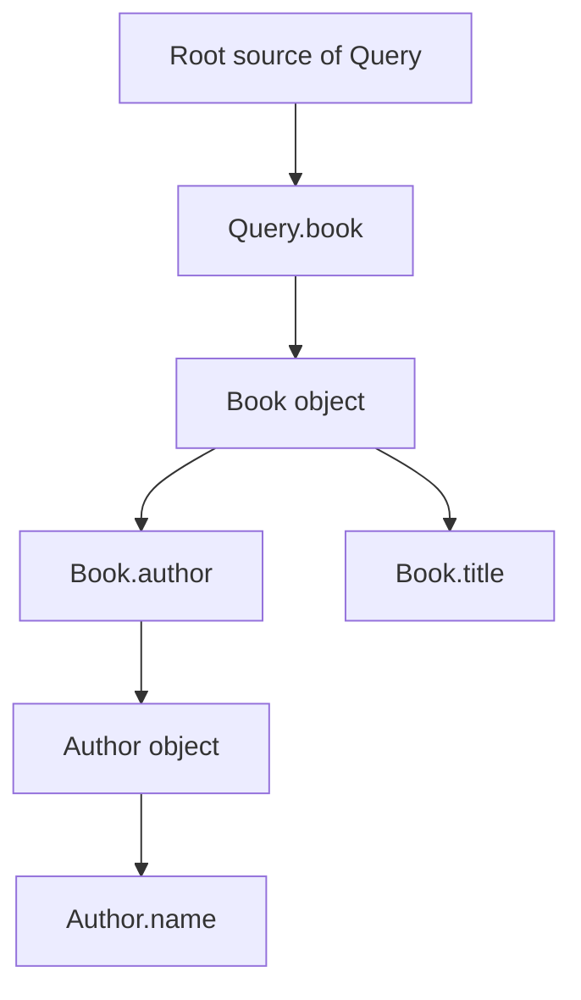

# Query Mapping with Root Source in Spring for GraphQL

In GraphQL, the top-level fields of a query reside under the root object type `Query`. Spring for GraphQL uses the `@QueryMapping` annotation to bind a controller method to each of these fields. When GraphQL executes a field, the data fetcher receives a source object from the execution environment; for root fields, that object is called the root source.

In typical Spring applications, `@QueryMapping` does not need a root source to work. Controllers usually obtain inputs from `@Argument`, call services injected via constructor, and return results. A root source is only meaningful when execution is initialized with a specific root value. Understanding the difference between a root source and the source of a nested field helps avoid confusing `@QueryMapping` with `@SchemaMapping`.

## 1. Query Root and Source in GraphQL

A GraphQL query executes as a tree of fields. GraphQL resolves a parent field first, then passes its return value as the source for child fields.



In this tree:

- The root source is the initial object supplied to GraphQL execution.
- `Query.book` is a root field, and its data fetcher receives the root source.
- If `Query.book` returns a `Book`, the `Book` object becomes the source for the `Book.author` and `Book.title` fields.
- If `Book.author` returns an `Author`, the `Author` object becomes the source for the `Author.name` field.

GraphQL Java provides a field's source via `DataFetchingEnvironment.getSource()`. For nested fields, the source is usually the object returned by the parent field's resolver. For root fields, the source is the operation's root value.

## 2. `@QueryMapping` Maps Fields on the Root Query

`@QueryMapping` is a specialized annotation for fields on the GraphQL `Query` type. It is equivalent to `@SchemaMapping(typeName = "Query")` and instructs Spring for GraphQL to register the method as a data fetcher for the root field.

Example SDL:

```graphql
type Query {
    book(id: ID!): Book
    books: [Book!]!
}

type Book {
    id: ID!
    title: String!
}
```

Controller handling the two queries:

```java
import java.util.List;

import org.springframework.graphql.data.method.annotation.Argument;
import org.springframework.graphql.data.method.annotation.QueryMapping;
import org.springframework.stereotype.Controller;

@Controller
public class BookQueryController {

    private final BookService bookService;

    public BookQueryController(BookService bookService) {
        this.bookService = bookService;
    }

    @QueryMapping
    public Book book(@Argument("id") String id) {
        return bookService.findById(id).orElse(null);
    }

    @QueryMapping
    public List<Book> books() {
        return bookService.findAll();
    }
}
```

The method name is used as the field name if no explicit name is specified. Thus `book` maps to `Query.book`, and `books` maps to `Query.books`. `@Argument("id")` extracts the `id` argument from the query.

In this common implementation pattern, the controller declares no source parameter. Spring injects `BookService` as a controller dependency, while each query's input data comes from arguments. This is the simplest approach when there is no need to supply a custom root value to GraphQL execution.

## 3. Default Root Source and When a Root Value Is Needed

In GraphQL Java, the root source is the object assigned to `ExecutionInput` when an operation starts. If no root value is provided, the source of root fields is typically `null`. The data fetcher registered for `Query.book` still works normally because it obtains data from arguments, services, or context rather than relying on the source.

Example of a simple root value:

```java
public record QueryRoot(String tenantCode, String locale) {
}
```

When using GraphQL Java directly, you can pass a root value to `ExecutionInput`:

```java
import graphql.ExecutionInput;
import graphql.ExecutionResult;
import graphql.GraphQL;

QueryRoot root = new QueryRoot("tenant-a", "vi-VN");

ExecutionInput input = ExecutionInput.newExecutionInput()
        .query("{ tenantCode }")
        .root(root)
        .build();

ExecutionResult result = graphQL.execute(input);
```

This snippet illustrates GraphQL Java's API; `graphQL` is an instance already built from a schema and runtime wiring. `ExecutionInput.root(root)` supplies the initial object for root fields in that operation.

In Spring for GraphQL, HTTP requests are processed through `GraphQlSource` and the Spring-managed execution service. Do not assume that merely declaring a Java bean of type `QueryRoot` causes Spring to automatically use it as the root source. If the application truly needs a custom root value, integrate it into the exact execution path used by the HTTP handler via a customization mechanism compatible with your project's Spring for GraphQL version. Do not construct a separate `GraphQL` instance that Spring's endpoint never calls.

## 4. Reading the Root Source in a `@QueryMapping` Method

Spring for GraphQL supports a source parameter in schema mapping methods: declare a parameter whose Java type matches the source object, and the framework retrieves the source from `DataFetchingEnvironment`. For root mappings, the source is the root value provided to the operation.

For example, if execution is initialized with `QueryRoot` from the previous section, the method can accept the source as follows:

```java
import org.springframework.graphql.data.method.annotation.QueryMapping;
import org.springframework.stereotype.Controller;

@Controller
public class TenantQueryController {

    @QueryMapping
    public String tenantCode(QueryRoot root) {
        return root.tenantCode();
    }
}
```

Corresponding schema:

```graphql
type Query {
    tenantCode: String!
}
```

The method above is only appropriate when the root source is genuinely a non-null `QueryRoot`. If execution provides no root value or provides a different Java type, the source parameter cannot be used this way. Therefore, only add a source parameter when the application explicitly controls root value initialization and has tests covering that execution path.

If you only need request metadata such as tenant, locale, or principal, consider `GraphQLContext`, `@ContextValue`, `Principal`, or `@AuthenticationPrincipal`. Those mechanisms are generally better suited than using the root source as a carrier for request metadata.

## 5. Distinguishing Root Source from Nested Field Source

A source parameter commonly appears in `@SchemaMapping` to access the parent object. Example:

```graphql
type Query {
    book(id: ID!): Book
}

type Book {
    id: ID!
    title: String!
    author: Author
}

type Author {
    id: ID!
    name: String!
}
```

Resolver:

```java
import org.springframework.graphql.data.method.annotation.Argument;
import org.springframework.graphql.data.method.annotation.QueryMapping;
import org.springframework.graphql.data.method.annotation.SchemaMapping;
import org.springframework.stereotype.Controller;

@Controller
public class BookController {

    private final BookService bookService;
    private final AuthorService authorService;

    public BookController(BookService bookService, AuthorService authorService) {
        this.bookService = bookService;
        this.authorService = authorService;
    }

    @QueryMapping
    public Book book(@Argument("id") String id) {
        return bookService.findById(id).orElse(null);
    }

    @SchemaMapping(typeName = "Book", field = "author")
    public Author author(Book source) {
        return authorService.findById(source.authorId()).orElse(null);
    }
}
```

Here, `book` is a root field, so the method accepts the `id` argument; the method needs no parent source object. Conversely, `author` is a field on `Book`, so the `Book source` parameter is the object returned by the `book` resolver.

| Characteristic | Root field with `@QueryMapping` | Nested field with `@SchemaMapping` |
| --- | --- | --- |
| Parent type | `Query` | Object type such as `Book` |
| Source | Root value of the operation | Value returned by the parent field |
| Typical inputs | `@Argument`, context, service | Source object, `@Argument`, context |
| Example | `book(id: ID!): Book` | `Book.author: Author` |

Do not confuse the source object with an argument. `@Argument("id")` is a value passed by the client into the field; `Book source` is the parent object passed down by the GraphQL engine to the child field.

## 6. Passing Request Metadata via GraphQLContext

Root source is not the only option for sharing request-level information across resolvers. Spring for GraphQL supports `GraphQLContext`, `@ContextValue`, and `Principal` from Spring Security.

Example schema and controller:

```graphql
type Query {
    greeting: String!
}
```

```java
import java.security.Principal;

import org.springframework.graphql.data.method.annotation.ContextValue;
import org.springframework.graphql.data.method.annotation.QueryMapping;
import org.springframework.stereotype.Controller;

@Controller
public class GreetingController {

    @QueryMapping
    public String greeting(
            @ContextValue(name = "tenantCode", required = false) String tenantCode,
            Principal principal) {

        String user = principal != null ? principal.getName() : "guest";
        return "Hello " + user + " at tenant " + tenantCode;
    }
}
```

This example assumes a `WebGraphQlInterceptor` or equivalent component has populated `tenantCode` in `GraphQLContext`, and Spring Security supplies `Principal` when the request is authenticated. Never trust a client-supplied tenant identifier without verifying access permissions for that tenant.

`GraphQLContext` is well suited for per-request metadata and can be shared across multiple data fetchers within the same operation. `@ContextValue` retrieves a value by key; `Principal` retrieves the authenticated user's identity. Never store request data in mutable fields of a singleton controller because multiple requests can execute concurrently.

## 7. Querying Root Source vs. Querying by Argument

Choose the data source according to the meaning of each piece of information:

| Data needed | Appropriate mechanism |
| --- | --- |
| ID, keyword, filter, pagination passed by the client | `@Argument` or `@Arguments` |
| Parent object of a nested field | Source parameter in `@SchemaMapping` |
| Root value passed when initializing GraphQL execution | Source parameter on root mapping or `DataFetchingEnvironment.getSource()` |
| Authenticated principal | `Principal` or `@AuthenticationPrincipal` |
| Shared per-request metadata | `GraphQLContext` or `@ContextValue` |
| Database or domain access logic | Constructor-injected service |

Example query with an argument:

```graphql
query {
    book(id: "book-10") {
        id
        title
    }
}
```

The resolver reads `id` via `@Argument`. There is no need to place the ID in a root source because it is field-specific input already sent by the client as an argument.

## 8. Accessing DataFetchingEnvironment for Lower-Level Details

If a method needs execution details not covered by annotated parameters, it can accept `DataFetchingEnvironment` directly:

```java
import graphql.schema.DataFetchingEnvironment;
import org.springframework.graphql.data.method.annotation.QueryMapping;
import org.springframework.stereotype.Controller;

@Controller
public class DiagnosticsController {

    @QueryMapping
    public String inspectRoot(DataFetchingEnvironment environment) {
        Object rootSource = environment.getSource();
        return rootSource == null
                ? "Root source is null"
                : rootSource.getClass().getSimpleName();
    }
}
```

This example is for illustration only. In a real API, avoid exposing internal class names through diagnostic fields. `environment.getSource()` returns the source of the field being resolved; for a root field, that is the operation's root value. `environment.getArgument("...")` retrieves an argument, and `environment.getGraphQlContext()` accesses the shared execution context.

Prefer typed parameters such as `@Argument`, `Principal`, or `@ContextValue` when they meet your needs. Only use `DataFetchingEnvironment` when you need extensive execution metadata or a specific GraphQL Java API.

## 9. Testing Query Mappings and Root Source

For regular query resolvers, you can use `GraphQlTester` to verify fields and arguments:

```java
@Test
void bookQueryUsesIdArgument() {
    graphQlTester.document("""
            query FindBook($id: ID!) {
                book(id: $id) {
                    id
                    title
                }
            }
            """)
        .variable("id", "book-10")
        .execute()
        .path("book.title")
        .entity(String.class)
        .isEqualTo("Spring GraphQL");
}
```

This test assumes `graphQlTester` is configured in the test context and the service returns a predictable fixture.

If the application uses a custom root value via GraphQL Java `ExecutionInput.root(...)`, write tests on the exact execution path that builds that `ExecutionInput`. A GraphQL Java unit test can verify the root source directly:

```java
@Test
void rootValueIsAvailableToRootFieldDataFetcher() {
    QueryRoot root = new QueryRoot("tenant-a", "vi-VN");

    ExecutionInput input = ExecutionInput.newExecutionInput()
            .query("{ tenantCode }")
            .root(root)
            .build();

    ExecutionResult result = graphQL.execute(input);

    assertThat(result.getErrors()).isEmpty();
    assertThat(result.getData()).isEqualTo(Map.of("tenantCode", "tenant-a"));
}
```

This test assumes the schema declares the `tenantCode` field and a data fetcher reads the root source, with `graphQL` properly configured. If the root value is supplied through a custom Spring integration, also write an integration test through `ExecutionGraphQlService` or the HTTP endpoint to confirm live requests actually receive that root value.

Cases to test:

1. `@QueryMapping` works when there is no custom root source.
2. Root fields receive the expected root value when execution is configured to supply it.
3. Incompatible source parameter types are not silently misused or masking configuration bugs.
4. `@SchemaMapping` receives the exact parent object returned by the parent field.
5. Arguments and `GraphQLContext` are read accurately without leaking across concurrent requests.
6. Nullability of root fields and child fields aligns with resolver outputs.

## 10. Common Errors

| Symptom | Possible Cause | Resolution |
| --- | --- | --- |
| Source parameter in `@QueryMapping` is null | Execution does not supply a root value | Remove the source parameter if unneeded, or configure a root value on the execution path. |
| Query field not found | Method name or name in `@QueryMapping` does not match SDL | Check fields under the root `Query` type. |
| Confusing source with argument | Mixing up parent object with client-passed data | Use `@Argument` for arguments and a source parameter for the parent object. |
| `@SchemaMapping` receives wrong source type | Java type does not match the parent object | Check what the parent field returns and the source parameter type. |
| Request data mixes across users | Metadata stored in mutable fields of a singleton controller | Use `GraphQLContext`, `Principal`, or an appropriate request-scoped mechanism. |
| Root source works in unit tests but not over HTTP | Spring's HTTP execution path does not use the `ExecutionInput` configured in tests | Test the actual `GraphQlSource`/execution service used by the endpoint. |
| Query root resolver depends unnecessarily on root object | Dependencies or arguments placed inside the root source | Inject services and use `@Argument`/context according to their roles. |

## 11. Checklist When Using `@QueryMapping` with Root Source

1. Declare query fields under the root `Query` type in the SDL.
2. Use `@QueryMapping` to register methods handling root fields.
3. Use `@Argument` for data passed by the client to the field.
4. Inject services via constructor instead of stuffing dependencies into a root source.
5. Only declare a source parameter when execution actually supplies a root value.
6. Distinguish the root source from the source object of `@SchemaMapping` on nested fields.
7. Use `GraphQLContext` or `Principal` for per-request metadata and user identity.
8. If using a custom root value, integrate it into the exact GraphQL execution path used by Spring.
9. Test both regular queries and custom root sources at the appropriate execution layer.

`@QueryMapping` focuses on handling fields of the root `Query`. The root source is the initial object that GraphQL execution provides to these fields; it is rarely needed in standard Spring controllers. When you understand source, arguments, and context accurately, you can design clear resolvers, avoid hidden dependencies on a root object, and test the real request execution path.
