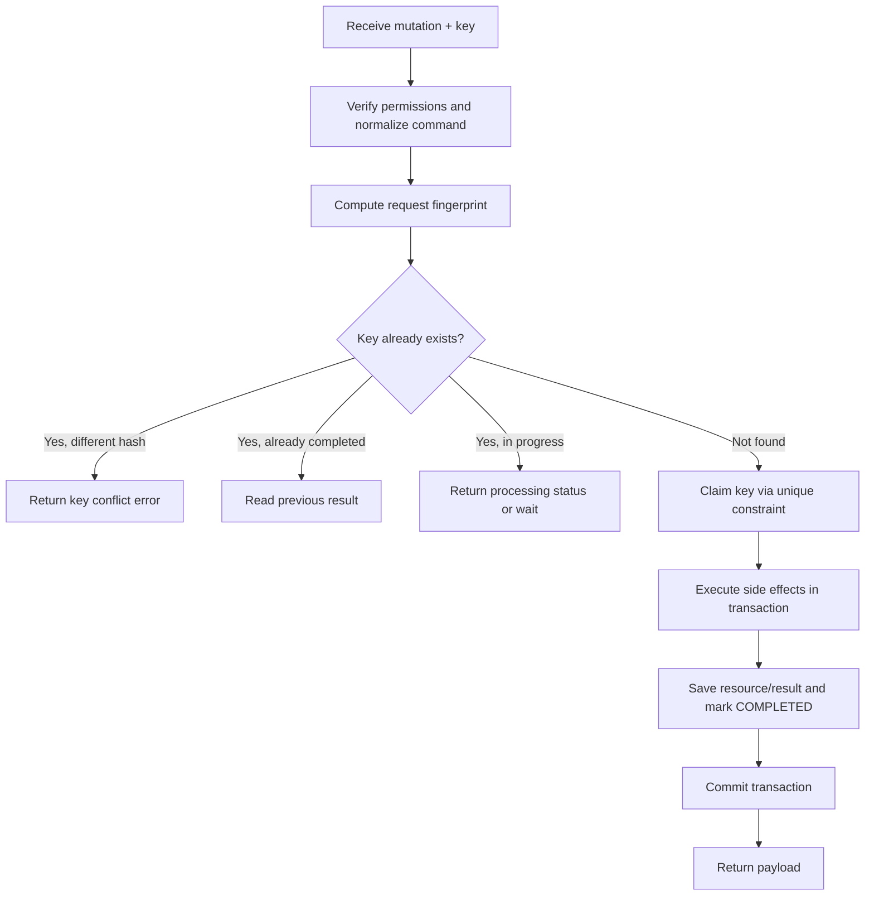

# Mutation Idempotency

A GraphQL mutation typically produces side effects: creating an order, decrementing inventory, registering an account, or processing a payment. In production, clients may resend a request after a timeout, connection drop, or missed response even though the server already finished processing it. If the server executes the side effect a second time, a single user action can create two orders or double-charge a card.

**Idempotency** ensures a business command can be retried safely. Given the same idempotency key and the same command content, the server performs the side effect only once; subsequent retries return the recorded result or current processing status. GraphQL does not automatically provide idempotency for mutations. A Spring for GraphQL application must design keys, persist state, control concurrency, and place transactions at the proper boundary.

## 1. What is Idempotency?

> An operation is idempotent if executing it once or multiple times with the same intent leads to the same final business state.

For example, setting an order status to `SHIPPED` can be idempotent:

```java
order.setStatus(OrderStatus.SHIPPED);
```

Calling this operation repeatedly still leaves the order in the `SHIPPED` state. By contrast, incrementing an inventory quantity:

```java
inventory.setQuantity(inventory.getQuantity() + 1);
```

is not idempotent. Calling it twice increases the quantity by two units.

Idempotency does not necessarily mean every response is byte-for-byte identical. What matters is that side effects are not duplicated. An API may return the same resource created on the first attempt, or include extra metadata indicating the request is a replay. For many APIs, returning the exact same business outcome simplifies client handling.

GraphQL has no built-in directive or standard annotation named `@Idempotent` to protect mutations automatically. This is an application- and persistence-layer discipline. Using HTTP POST for an endpoint does not make mutations idempotent either; clients need an explicit retry contract with the server.

## 2. Why Do Mutations Need Idempotency?

Consider a client calling an order creation mutation:

```graphql
mutation {
    createOrder(input: {
        customerId: "customer-01"
        productId: "book-01"
        quantity: 2
    }) {
        order {
            id
            status
        }
    }
}
```

The server creates the order and commits to the database, but the response is lost in transit. The client only sees a timeout and cannot tell whether the operation completed. If the client resends the same mutation without server-side duplicate detection, the server may create a second order.

Common scenarios include:

- Client timeout while the server is still processing.
- Server commits the transaction, but the connection drops before the response reaches the client.
- User clicks the submit button multiple times or the app retries automatically.
- Gateways or proxies retry requests after network errors.
- A message worker receives the same command again due to at-least-once delivery.

You cannot rely on clients sending a request only once. Distributed networks give clients no reliable way to know whether a request failed before server execution or only while returning the response. Idempotency lets clients retry the same intent without duplicating side effects.

## 3. Idempotency Keys

The client generates a unique key for each business intent and includes that key in the mutation. When retrying, the client must reuse the original key. When the user initiates a brand-new action, the client generates a new key.

Schema example:

```graphql
input CreateOrderInput {
    idempotencyKey: ID!
    productId: ID!
    quantity: Int!
}

type CreateOrderPayload {
    order: Order!
}

type Mutation {
    createOrder(input: CreateOrderInput!): CreateOrderPayload!
}
```

The client sends the key in the operation:

```graphql
mutation CreateOrder($input: CreateOrderInput!) {
    createOrder(input: $input) {
        order {
            id
            status
        }
    }
}
```

```json
{
  "input": {
    "idempotencyKey": "9f2f4d4e-5f45-4f53-8e8a-34a8c48a4e10",
    "productId": "book-01",
    "quantity": 2
  }
}
```

The key can be passed inside the input object as shown above or via an HTTP header such as `Idempotency-Key`. Putting it in the input keeps the key explicit in the GraphQL contract and binds it directly to the command. Headers work well when keeping the key at the transport layer. If using a header, pass it through an interceptor or context to the service; do not couple business logic directly to HTTP requests.

Guidelines for generating keys:

- Use UUIDs or sufficiently strong random values to avoid collisions.
- Every new action gets a new key; retries of the same action must reuse the key.
- Never reuse a single key across all mutations for a user.
- The server must scope keys by authenticated user, tenant, or client.
- Never treat the key as proof of authentication or authorization.

## 4. Same Key Must Match Same Command Content

The server must detect when a client reuses a key with different data. For instance, the first request with key `K1` creates an order with `quantity = 2`, and a later request with the same key `K1` sends `quantity = 5`. Silently returning the old result or running a new command confuses clients and can cause business bugs.

Therefore, alongside the key, the server should compute a **request fingerprint** from the normalized business command. A fingerprint is typically a SHA-256 hash of fields affecting the command after applying defaults and normalizing types.

Handling rules:

| Case | Recommended behavior |
| --- | --- |
| Key does not exist yet | Register the key and execute the command |
| Key already completed, identical fingerprint | Return the recorded result without re-running side effects |
| Key currently in progress, identical fingerprint | Return processing status or wait for the result per API contract |
| Key already exists with different fingerprint | Reject the request because the key was reused for different content |

Do not hash the raw GraphQL document because whitespace, aliases, or field ordering can differ even for identical business intent. Fingerprint the command once parsed into application data, including only attributes that affect side effects. Exclude the idempotency key itself from the fingerprint; the key is a separate lookup identifier.

For example, `CreateOrderFingerprint` might include tenant, product ID, quantity, currency, and resolved price. If price is computed by the server at execution time, decide clearly whether the fingerprint uses client-requested inputs or server-normalized data. The rule must remain consistent for the key's entire lifetime.

## 5. Where Should Idempotency Records Be Stored?

Idempotency must work across multiple server instances and survive process restarts. Therefore, do not store keys solely in an in-memory `Map` or single-JVM cache. Multiple instances will not share the cache, and restarts wipe request history.

A storage table may include:

| Column | Purpose |
| --- | --- |
| `scope` | Authenticated user, tenant, or client scope |
| `operation` | Command name, e.g., `createOrder` |
| `idempotency_key` | Key sent by the client |
| `request_hash` | Fingerprint of the normalized command |
| `status` | `IN_PROGRESS`, `COMPLETED`, or `FAILED` per state model |
| `resource_id` / `result` | Created resource ID or data needed to reconstruct the outcome |
| `created_at` | Processing start timestamp |
| `completed_at` | Completion timestamp |
| `expires_at` | Policy-based key expiration timestamp |

Add a unique constraint on the appropriate combination, such as:

```sql
CREATE UNIQUE INDEX uq_idempotency_scope_operation_key
    ON idempotency_record (scope, operation, idempotency_key);
```

A unique constraint is the ultimate safeguard against two concurrent requests claiming the same key. Running `SELECT` to verify absence before `INSERT` without a unique constraint still has a race condition: two requests can both read no record and both execute side effects.

You do not always need to store the full JSON response. For an order creation command, storing `order_id` and reconstructing the payload from the resource is often safer, avoiding storing sensitive data or oversized payloads. If the contract requires replaying the exact response verbatim, store sanitized results with sensitive fields stripped and define a clear retention period.

## 6. Transactions and Concurrency Control

For commands modifying data within a single database, the safest approach is placing the idempotency claim, business side effects, and completion update inside one transaction backed by a unique constraint.

Overview flow:



In a single-transaction model, the idempotency record and business data commit or roll back together. If the transaction fails before commit, both the claim and side effects roll back so the request can be retried. If commit succeeds but the response is lost, a subsequent retry reads the completed record and returns the earlier resource.

When two concurrent requests carry the same key, the unique constraint ensures only one request claims it successfully. The losing request must read the winner's state/result and avoid repeating side effects. How unique violations are handled depends on the database and transaction manager: a constraint violation can mark the current transaction rollback-only, so do not catch the exception and keep querying inside the same transaction as if it were still healthy. Use an atomic insert/upsert statement or perform the follow-up read in a fresh transaction.

For long-running or asynchronous workflows, you may need to persist an `IN_PROGRESS` state first, paired with a lease, owner token, and recovery mechanism for abandoned records. In that case, define how to handle crashed workers, expired leases, retries, and indeterminate outcomes. An `IN_PROGRESS` record without a timeout or recovery path can leave a key stuck permanently.

## 7. Integrating in Spring for GraphQL

The schema defines an input with the key and a returned payload:

```graphql
input CreateOrderInput {
    idempotencyKey: ID!
    productId: ID!
    quantity: Int!
}

type CreateOrderPayload {
    order: Order!
}

type Mutation {
    createOrder(input: CreateOrderInput!): CreateOrderPayload!
}
```

The Java input can be a record:

```java
public record CreateOrderInput(
        String idempotencyKey,
        String productId,
        int quantity) {
}
```

The controller receives the command and forwards it to the application service:

```java
@Controller
public class OrderMutationController {

    private final OrderCommandService orderCommandService;

    public OrderMutationController(OrderCommandService orderCommandService) {
        this.orderCommandService = orderCommandService;
    }

    @MutationMapping
    public CreateOrderPayload createOrder(
            @Argument("input") CreateOrderInput input,
            Principal principal) {
        return orderCommandService.create(principal.getName(), input);
    }
}
```

The idempotency scope comes from the authenticated identity, not an arbitrary client-supplied `customerId`. If the API allows users to act on behalf of a tenant or another customer, the service must verify authorization and derive the scope from the validated identity/tenant.

The application service coordinates fingerprinting, the idempotency store, and business logic:

```java
@Service
public class OrderCommandService {

    private final IdempotencyExecutor idempotencyExecutor;
    private final OrderRepository orderRepository;
    private final OrderMapper orderMapper;
    private final RequestFingerprint requestFingerprint;

    public OrderCommandService(
            IdempotencyExecutor idempotencyExecutor,
            OrderRepository orderRepository,
            OrderMapper orderMapper,
            RequestFingerprint requestFingerprint) {
        this.idempotencyExecutor = idempotencyExecutor;
        this.orderRepository = orderRepository;
        this.orderMapper = orderMapper;
        this.requestFingerprint = requestFingerprint;
    }

    @Transactional
    public CreateOrderPayload create(String principalScope, CreateOrderInput input) {
        CreateOrderCommand command = new CreateOrderCommand(
            input.productId(), input.quantity());

        String fingerprint = requestFingerprint.sha256(command);

        return idempotencyExecutor.execute(
            principalScope,
            "createOrder",
            input.idempotencyKey(),
            fingerprint,
            () -> {
                Order order = orderRepository.save(
                    Order.create(command.productId(), command.quantity()));
                return new CreateOrderPayload(orderMapper.toGraphQl(order));
            }
        );
    }
}
```

`IdempotencyExecutor` here is an application abstraction, not a built-in Spring for GraphQL API. Its contract is to atomically claim the key, compare fingerprints, and either return the completed outcome or run the supplier exactly once. Its implementation must join the same transaction as `OrderRepository` when side effects and idempotency records live in the same database. If using a separate store or async processing, design corresponding transaction and recovery boundaries.

Do not place all idempotency logic in the controller. Application services may be called from GraphQL, REST, message consumers, or jobs; keeping the rules at the service layer ensures every entry point follows one policy.

## 8. Handling In-Progress Keys and Reused Keys

The API must define responses when receiving a key again:

| Record status | Possible API behavior |
| --- | --- |
| `COMPLETED`, matching fingerprint | Return the original payload |
| `IN_PROGRESS`, matching fingerprint | Return operation ID / `PROCESSING` status, or wait within a bounded timeout |
| Any status, different fingerprint | Return a conflict error without executing the new command |
| Retryable `FAILED` | Allow retries only under explicit policy; never wipe evidence of uncertain side effects |

Not every failure means side effects did not happen. For example, a payment provider might have successfully charged the card before the connection timed out on the server. Marking it `FAILED` and letting the client submit a new charge with another key could double-charge the customer. Error states must distinguish guaranteed rollbacks from indeterminate outcomes.

In GraphQL, business errors can be returned through `DataFetcherExceptionResolver` as GraphQL errors with `extensions.code`, such as `IDEMPOTENCY_KEY_REUSED`. In-flight requests can return a status payload or an error code like `IDEMPOTENCY_IN_PROGRESS`; either works as long as the client knows whether to wait, poll, or retry with the same key.

HTTP status codes for GraphQL responses also depend on the transport and exception handling configuration. Do not assume every conflict automatically maps to HTTP 409; explicitly define the GraphQL response contract clients rely on.

## 9. Idempotency with External Services and Payments

An application's database transaction cannot automatically span an external payment system. For example, the server saves an order in the database and calls a payment provider. If the provider charges the card but the response times out, rolling back the local database transaction cannot undo the charge at the provider.

For payment integrations, you should:

1. Generate a stable idempotency key for the payment action and save it alongside the payment attempt.
2. Send that same key to the payment provider if the provider supports idempotency.
3. On timeout with an unknown outcome, query/reconcile payment status using the key or provider reference before initiating a new charge.
4. Record state and transition history so failures can be recovered.
5. Use a transactional outbox when events must be published after persisting order/payment state.

A transactional outbox writes outgoing events within the same transaction as business changes. A worker reads the outbox and publishes messages; if the worker sends a message and crashes before marking the event processed, the message may be sent again. Consumers also need deduplication by event ID or command ID so downstream side effects are not duplicated.

This is how retry-resilient workflows are built in distributed systems. Idempotency controls duplication, though it does not create an atomic distributed transaction across databases, payment providers, and message brokers.

## 10. Key Scope, Security, and Retention

Keys must be scoped so one user cannot guess or use another user's key to read back results. A common scope is the combination of tenant ID, authenticated principal, and operation. When replaying a result, the server must still authenticate the caller and verify resource access under current policies.

Fingerprints and results may contain sensitive data. Store only necessary information, restrict read access to the idempotency table, encrypt sensitive fields as needed, and set appropriate retention policies. Never log full inputs containing payment info or personal data just for debugging.

Key retention must exceed the maximum window during which clients or systems can retry. Purging records too early can cause a late retry to be treated as a brand-new command. For high-value operations like payments or order creation, align retention with the business lifecycle and consider long-lived unique business references outside the idempotency cache.

Idempotency keys do not replace business constraints. For example, if only one order may be created per `checkoutSessionId`, still enforce a unique constraint on `checkout_session_id`. Idempotency keys protect request retries; business keys protect domain invariants when a client inadvertently generates a new key for the same intent.

## 11. Testing Mutation Idempotency

Test both at the service layer and through the GraphQL endpoint. Key scenarios:

| Scenario | Expected result |
| --- | --- |
| Same key and same input sent twice | Only one order created; both calls reference the same order |
| Same key with different quantity | Second request rejected due to fingerprint mismatch |
| Two concurrent requests with the same key | Only one request claims the key and side effects execute once |
| Server commits but response is lost | Retry returns the saved result |
| Transaction fails before commit | No completed side effect/record remains; retry runs per policy |
| Same key across two different tenants | Handled in separate scopes; no cross-tenant result leakage |
| Expired key | Behavior follows published retention policy |
| Provider times out after possible charge | Reconcile by provider key before retrying the charge |

Example operation test using `GraphQlTester`:

```java
String mutation = """
    mutation CreateOrder($input: CreateOrderInput!) {
        createOrder(input: $input) {
            order {
                id
                status
            }
        }
    }
    """;

Map<String, Object> input = Map.of(
    "idempotencyKey", "test-order-key-01",
    "productId", "book-01",
    "quantity", 2
);

graphQlTester.document(mutation)
    .variable("input", input)
    .execute()
    .path("createOrder.order.id")
    .entity(String.class)
    .satisfies(firstOrderId -> {
        graphQlTester.document(mutation)
            .variable("input", input)
            .execute()
            .path("createOrder.order.id")
            .entity(String.class)
            .isEqualTo(firstOrderId);
    });
```

This example illustrates resending the same mutation and verifying the same order ID is returned. A complete test should also assert that the repository's order record count increased only once. For race conditions, write concurrency tests with a synchronization barrier so two requests start simultaneously; sequential tests cannot prove that a unique constraint handles contention properly.

## 12. Common Pitfalls

| Mistake | Consequence | Resolution |
| --- | --- | --- |
| Generating a new key for each retry | Server treats retries as new commands | Persist the key per intent and reuse it on retries |
| Storing keys only in memory | Restarts or multiple instances break deduplication | Persist in a durable database/shared store |
| `SELECT` then `INSERT` without a constraint | Race condition allows two requests to process together | Use a unique constraint and atomic claim operation |
| Skipping fingerprint comparison | Same key with altered payload returns stale result silently | Store and compare hashes of normalized commands |
| Deleting keys immediately upon completion | Late retries can trigger fresh side effects | Apply business-aligned retention |
| Catching unique constraint errors and continuing in a broken transaction | Transaction may already be rollback-only | Handle duplicates in a new transaction or use atomic upsert/claim |
| Enforcing idempotency only in GraphQL controller | Other entry points can still duplicate side effects | Place the mechanism at the application service/domain boundary |
| Assuming DB rollback undoes payment provider calls | External side effects still persist | Use provider idempotency keys, outbox, and reconciliation |
| Replacing business constraints with idempotency keys | New intent with a new key still duplicates data | Protect invariants with unique constraints/domain rules |

## 13. Design Principles

Design mutations around explicit business commands with input objects and idempotency keys whenever clients may retry side effects. Scope keys by authenticated identity, fingerprint normalized command content, and persist records durably with unique constraints. Keep records and side effects in the same transaction when sharing one database; for long-running workflows or external systems, use state machines, leases, outboxes, and proper reconciliation.

Clearly define behavior for completed keys, in-progress keys, keys reused with different payloads, and expired keys. Keep replayed responses consistent, never leak another principal's results, and never treat a timeout as proof that a side effect did not occur. Test both sequential retries and concurrent requests.

In Spring for GraphQL, `@MutationMapping` is merely the entry point receiving operations and forwarding data into the application. Idempotency must live in the service and persistence layers so all entry points follow one rule. When designed properly, clients can retry mutations after network failures without creating duplicate orders, transactions, or side effects.
