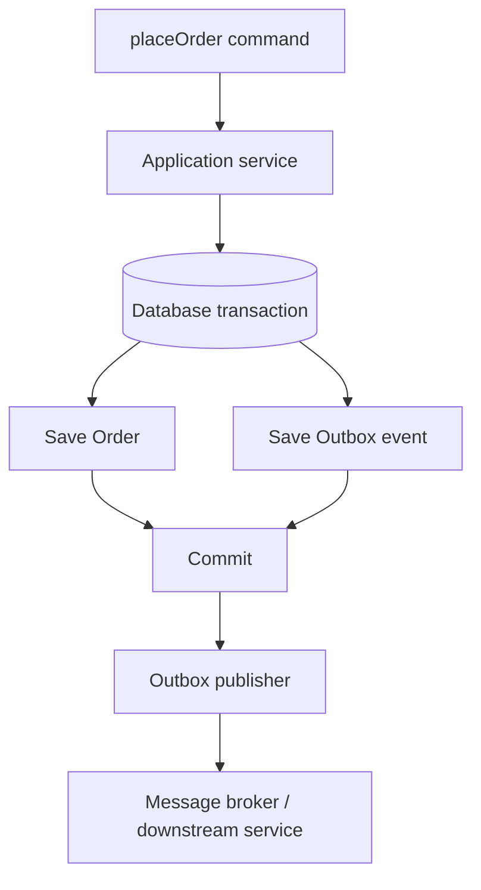

# Designing Mutations Around Business Logic in Spring for GraphQL

Mutations are the entry point of a GraphQL API for executing actions that change system state. When designing a mutation, start from the business action the user wants to complete—such as placing an order, canceling an order, approving a request, or changing a password. From that action, derive the inputs, outcomes, potential errors, and data-integrity rules.

In Spring for GraphQL, `@MutationMapping` connects a controller method to a field on the `Mutation` root type. The controller should receive inputs, obtain the caller's identity, and forward the request to an application service. Business rules, transactions, and data coordination belong in the service/domain layer, keeping the API consistent whether invoked from GraphQL or another entry point.

## 1. Designing Around Business Actions

A mutation should express a clearly named business intent. For example, in an e-commerce system:

| User action | Suggested mutation |
| --- | --- |
| Place a new order | `placeOrder` |
| Cancel an order that is still cancelable | `cancelOrder` |
| Confirm delivery receipt | `confirmDelivery` |
| Request a refund | `requestRefund` |

Names like `updateOrder`, `setStatus`, or `saveData` are usually too generic. They do not communicate which actions are allowed, which preconditions must hold, or what side effects will occur. For instance, `cancelOrder` can verify that the order is in `PENDING` or `CONFIRMED` status, record who canceled it, and emit an event. A generic `updateOrder(status: ...)` mutation could accidentally let a client revert an order from `DELIVERED` back to `PENDING` if the server fails to check thoroughly.

Ask yourself: what is the user asking the system to do? What is a valid outcome of the action? Under what conditions should the action be rejected? These answers determine the mutation name and business boundaries.

## 2. One Mutation Should Represent One Use Case

A mutation field should normally correspond to a single use case or an independently meaningful command. For example, `placeOrder` may involve checking products, calculating totals, reserving inventory, and creating the order. This is one cohesive business action even though it involves multiple internal steps.

Avoid forcing clients to call a chain of granular mutations to orchestrate an important use case themselves:

```graphql
mutation {
    reserveInventory(productId: "p-10", quantity: 2)
    calculateShipping(orderId: "o-20")
    createOrder(orderId: "o-20")
}
```

This forces clients to understand internal sequencing, handle partial failure when one step succeeds and the next fails, and risks leaving intermediate states behind. Instead, a business-level mutation coordinates the steps on the server:

```graphql
mutation PlaceOrder($input: PlaceOrderInput!) {
    placeOrder(input: $input) {
        order {
            id
            status
            total
        }
        userErrors {
            code
            message
        }
    }
}
```

GraphQL executes top-level fields in a mutation operation serially. However, that does not automatically create a shared transaction across all fields, nor does it serialize separate HTTP requests. If a use case requires atomicity, implement and manage the transaction inside the application service.

## 3. Designing Input Objects for Business Needs

When a mutation has multiple inputs, use an input object to group fields belonging to the same action. Example:

```graphql
input PlaceOrderLineInput {
    productId: ID!
    quantity: Int!
}

input PlaceOrderInput {
    idempotencyKey: String!
    lines: [PlaceOrderLineInput!]!
    deliveryAddressId: ID!
    note: String
}

type Mutation {
    placeOrder(input: PlaceOrderInput!): PlaceOrderPayload!
}
```

Input objects clarify command structure and facilitate schema evolution. When adding an optional field, older clients can continue sending inputs without knowing about the new field. For new required fields, consider backward compatibility because older clients may not provide them.

Input design guidelines:

- Accept only data the client is authorized and has a valid reason to supply. Never accept `userId`, `role`, or `ownerId` when those values must come from the authenticated identity.
- Use specific types and appropriate nullability. `quantity: Int!` requires an integer, yet still needs validation to ensure the quantity is greater than 0.
- Use dedicated input types for commands; avoid using output objects or persistence entities directly as inputs.
- Group related fields into nested input objects when it makes the schema easier to understand.
- Never include internal-only fields like flags to bypass authorization or client-computed prices inside inputs.

## 4. Distinguishing Create, Update, and State-Transition Commands

Not every change should be modeled as a generic `update` mutation.

| Operation kind | Example | Appropriate design |
| --- | --- | --- |
| Resource creation | Creating an order | `placeOrder(input: ...)` or `createDraftOrder(input: ...)` |
| Partial info update | Editing a shipping address | `updateDeliveryAddress(input: ...)` |
| Domain-rule state transition | Canceling an order | `cancelOrder(input: ...)` |
| Conditional action | Approving a request | `approveRequest(input: ...)` |

For partial updates, distinguish omitted fields from fields explicitly sent as `null`. For example, when editing a note, omitting `note` can mean keeping the existing note, whereas sending `note: null` can mean clearing the note. When needing to distinguish these two cases in Spring for GraphQL, use `ArgumentValue<T>` on the relevant argument or a binding model that preserves whether a field was provided.

For state-transition commands, clients should request the action (`cancelOrder`) rather than sending a target status (`status: CANCELLED`). The server enforces the state machine and execution permissions. This ensures checks like cancellation deadlines, completed payments, or already-delivered orders are never bypassed.

## 5. Designing Payloads for Mutation Outcomes

Mutations can return an object directly, but a payload type is helpful when clients need the result together with extra metadata or predictable business errors.

```graphql
enum OrderStatus {
    PENDING
    CONFIRMED
    CANCELLED
    SHIPPED
    DELIVERED
}

enum OrderErrorCode {
    INVALID_QUANTITY
    PRODUCT_UNAVAILABLE
    OUT_OF_STOCK
    ADDRESS_NOT_FOUND
    ORDER_NOT_FOUND
    ORDER_CANNOT_BE_CANCELLED
    VERSION_CONFLICT
}

type UserError {
    code: OrderErrorCode!
    message: String!
    field: String
}

type Order {
    id: ID!
    status: OrderStatus!
    total: Decimal!
    version: Int!
}

scalar Decimal

type PlaceOrderPayload {
    order: Order
    userErrors: [UserError!]!
    replayed: Boolean!
}

type CancelOrderPayload {
    order: Order
    userErrors: [UserError!]!
}

input CancelOrderInput {
    orderId: ID!
    expectedVersion: Int!
}

type Mutation {
    placeOrder(input: PlaceOrderInput!): PlaceOrderPayload!
    cancelOrder(input: CancelOrderInput!): CancelOrderPayload!
}
```

In the payload:

- `order` is nullable because a rejected request might not create or update an order.
- `userErrors` is always a non-null list; when no errors occur, the server returns `[]`.
- `replayed` indicates whether the result was returned from an earlier idempotent request.
- `expectedVersion` supports concurrent update control in the order cancellation command.

Not every API needs all of these fields. Design payloads around client requirements and domain rules. Avoid adding meaningless metadata just to make a payload look complete.

`Decimal` in this example is a custom scalar that must be registered with appropriate coercing, typically mapping to `BigDecimal`. Do not use GraphQL `Float` for currency or decimals requiring exact precision because floating-point numbers can introduce rounding errors.

## 6. Distinguishing Business Errors from GraphQL Execution Errors

Expected business errors are outcomes the client can handle in UI flows, such as an out-of-stock product or an order that can no longer be canceled. Represent these using `userErrors` in the payload.

GraphQL execution-layer errors typically reflect a request that could not be executed properly, for example:

- Malformed GraphQL document syntax or failed validation.
- Client passes the wrong argument type or omits a Non-Null value.
- Resolver encounters an unexpected system error.
- Service or database is unavailable.

Response example with a business error:

```json
{
  "data": {
    "placeOrder": {
      "order": null,
      "userErrors": [
        {
          "code": "OUT_OF_STOCK",
          "message": "Insufficient product stock",
          "field": "lines[0].quantity"
        }
      ],
      "replayed": false
    }
  }
}
```

Execution error example:

```json
{
  "data": {
    "placeOrder": null
  },
  "errors": [
    {
      "message": "Unable to process request",
      "path": ["placeOrder"]
    }
  ]
}
```

These are illustrative responses. Actual errors are also affected by nullability in the SDL and exception resolvers. Never include stack traces, SQL, table names, or sensitive details in client-facing messages. Use stable error codes for clients to handle; never force clients to parse free-form message strings.

## 7. Keeping Controllers Thin with `@MutationMapping`

In Spring for GraphQL, the controller receives input and forwards the command to the application service. DTO examples:

```java
import jakarta.validation.Valid;
import jakarta.validation.constraints.NotBlank;
import jakarta.validation.constraints.NotEmpty;
import jakarta.validation.constraints.Positive;
import jakarta.validation.constraints.PositiveOrZero;
import java.util.List;

public record PlaceOrderInput(
        @NotBlank String idempotencyKey,
        @NotEmpty List<@Valid PlaceOrderLineInput> lines,
        @NotBlank String deliveryAddressId,
        String note) {
}

public record PlaceOrderLineInput(
        @NotBlank String productId,
        @Positive Integer quantity) {
}

public record CancelOrderInput(
        @NotBlank String orderId,
        @PositiveOrZero Integer expectedVersion) {
}
```

Controller:

```java
import java.security.Principal;
import jakarta.validation.Valid;
import org.springframework.graphql.data.method.annotation.Argument;
import org.springframework.graphql.data.method.annotation.MutationMapping;
import org.springframework.stereotype.Controller;

@Controller
public class OrderMutationController {

    private final OrderApplicationService orderService;

    public OrderMutationController(OrderApplicationService orderService) {
        this.orderService = orderService;
    }

    @MutationMapping
    public PlaceOrderPayload placeOrder(
            @Valid @Argument("input") PlaceOrderInput input,
            Principal principal) {
        return orderService.placeOrder(principal.getName(), input);
    }

    @MutationMapping
    public CancelOrderPayload cancelOrder(
            @Valid @Argument("input") CancelOrderInput input,
            Principal principal) {
        return orderService.cancelOrder(principal.getName(), input);
    }
}
```

This example assumes requests are authenticated and `Principal` is always present for these mutations. If an API allows anonymous actions, model that case explicitly and avoid calling `principal.getName()` when `principal` can be null. For Jakarta Bean Validation to run, the application needs a validation implementation and proper Spring configuration.

Avoid placing inventory checks, price calculation, ownership verification, or multi-table persistence directly in the controller. The controller is a GraphQL adapter; the application service orchestrates the use case and can be tested independently.

## 8. Executing Use Cases in the Application Service

The service should accept the authenticated identity and command input, then execute business steps inside an appropriate transaction boundary.

```java
import org.springframework.stereotype.Service;
import org.springframework.transaction.annotation.Transactional;

@Service
public class OrderApplicationService {

    private final OrderRepository orderRepository;
    private final InventoryService inventoryService;
    private final AddressService addressService;

    public OrderApplicationService(
            OrderRepository orderRepository,
            InventoryService inventoryService,
            AddressService addressService) {
        this.orderRepository = orderRepository;
        this.inventoryService = inventoryService;
        this.addressService = addressService;
    }

    @Transactional
    public PlaceOrderPayload placeOrder(String userId, PlaceOrderInput input) {
        addressService.requireOwnedAddress(userId, input.deliveryAddressId());

        var reservation = inventoryService.reserve(input.lines());
        if (!reservation.successful()) {
            // reserve must be all-or-nothing and leave no partial reservation.
            return PlaceOrderPayload.withError(
                    OrderErrorCode.OUT_OF_STOCK,
                    "Insufficient product stock",
                    "lines");
        }

        Order order = Order.place(userId, input.lines(), reservation, input.note());
        orderRepository.save(order);

        return PlaceOrderPayload.success(order);
    }
}
```

This is an illustrative skeleton; types like `Order`, `OrderRepository`, `InventoryService`, `PlaceOrderPayload`, and `OrderErrorCode` are project domain/application components. Because the failure branch returns a normal payload, the transaction commits unless an exception is thrown. Consequently, `reserve` in this example must be all-or-nothing and leave no partial reservation when returning failure. If reservation needs to roll back via an exception, translate that error into a payload at an outer boundary after the transaction has rolled back. If inventory lives in an independent service, do not assume a local database transaction can roll back the remote system; use compensation or a saga workflow.

The application service orchestrates the use case, while domain objects can enforce state transition rules. For example, `order.cancel(...)` checks current status and cancellation reason itself instead of letting the controller assign `status = CANCELLED`.

## 9. Transactions and Atomicity

A use case may write multiple records: order, order lines, reservations, and audit records. When these changes belong to the same database and must succeed or fail together, enclose them in a single service transaction.

Key considerations:

- Place `@Transactional` on the application service to cover the entire business action.
- Use database constraints for invariants like unique order numbers or idempotency keys.
- Avoid making long-running network calls inside a database transaction whenever possible.
- If an operation spans multiple systems, consider sagas/process managers and compensating actions instead of assuming an automatic distributed transaction.
- GraphQL executes root mutation fields in an operation serially, yet does not automatically enclose them in a single transaction.

Transactions only guarantee atomicity within the scope of the transaction manager and participating resources. They do not automatically roll back sent emails, published messages, or remote payment API calls.

## 10. Idempotency for Handling Retries

Clients may resend mutations upon connection drops or timeouts even after the server already processed the earlier request. For order creation, retries can create duplicate orders without an idempotency mechanism.

A common approach is accepting `idempotencyKey` in the input and persisting the outcome under that key:

1. The client generates a unique key for one order intent and sends the same key on every retry.
2. The server looks up the idempotency record by key and appropriate principal/tenant.
3. If the key is already completed, the server returns the stored result.
4. If the key does not exist yet, the server processes the command and saves both the result and key in a transaction.
5. A unique constraint or locking mechanism prevents two concurrent requests from both processing as fresh requests.

Do not simply check `exists` and then insert without concurrency constraints; two requests can both observe the key missing. Use a unique constraint, controlled insert, or proper locking. Key scope must be clearly designed, typically combining principal/tenant and operation type.

Idempotency does not mean every mutation must require a key. It is especially valuable for actions with hard-to-reverse side effects or actions clients frequently retry, such as placing orders, creating payments, or submitting requests.

## 11. Controlling Concurrent Updates with Versions

Two users may open the same order and make changes nearly simultaneously. If both update without version checks, the later write can overwrite the earlier change.

You can require `expectedVersion` in the input:

```graphql
input CancelOrderInput {
    orderId: ID!
    expectedVersion: Int!
}

type Mutation {
    cancelOrder(input: CancelOrderInput!): CancelOrderPayload!
}
```

The service cancels the order only if the current version matches the version read by the client. On mismatch, return `VERSION_CONFLICT` so the client can reload the data and decide how to proceed. This can be implemented with optimistic locking like JPA `@Version` or a version-conditional update statement.

Versioning controls write conflicts; it does not replace authorization or domain state rules. The server must still verify that the caller has permission to cancel the order and that the order is in a cancelable state.

## 12. Side Effects and Post-Commit Events

A mutation may need to send emails, publish messages, or call external systems after persisting data. If side effects run before the transaction commits, the system might send a success notification even though the transaction later rolls back.

For high-reliability side effects, use a Transactional Outbox:



The order and outbox event are written in the same transaction. A publisher reads committed events and sends them to the message broker. Consumers must process messages idempotently because messaging systems typically redeliver events.

Not every side effect requires an outbox. For simple tasks or non-critical notifications, an after-commit event listener may suffice. Choose the mechanism based on message-loss tolerance, retry capabilities, and required business consistency.

## 13. Action- and Resource-Level Security

Mutations must enforce permissions on the server. User authentication only identifies who is calling; authorization determines whether that user is allowed to perform the action on the specific resource.

Examples:

- `placeOrder`: the user may place orders only for their own account or tenant.
- `cancelOrder`: the user has permission to cancel orders and owns the order, or holds an authorized support role.
- `approveRequest`: only users with approval authority within the matching organizational scope may execute it.

You can use Spring Security method security such as `@PreAuthorize` for coarse-grained checks, then verify ownership in the application service/domain. Never take `userId` from input and trust it as the caller's identity. Read the principal from the security context and verify permissions against the loaded resource.

For mutations involving sensitive data, record audit logs capturing actor, action, resource, timestamp, and outcome per system policy. Never log access tokens, passwords, or unnecessary sensitive data.

## 14. Testing Business-Driven Mutations

Testing must verify more than whether a resolver returns an object. Verify use-case rules and resulting data state after execution.

Example mutation test using `GraphQlTester`:

```java
import java.util.List;
import java.util.Map;

@Test
void placeOrderReturnsCreatedOrder() {
    graphQlTester.document("""
            mutation PlaceOrder($input: PlaceOrderInput!) {
                placeOrder(input: $input) {
                    order {
                        id
                        status
                    }
                    userErrors {
                        code
                    }
                    replayed
                }
            }
            """)
        .variable("input", Map.of(
                "idempotencyKey", "request-001",
                "deliveryAddressId", "address-10",
                "lines", List.of(Map.of(
                        "productId", "product-10",
                        "quantity", 2))))
        .execute()
        .path("placeOrder.order.status")
        .entity(String.class)
        .isEqualTo("PENDING");
}
```

This example assumes `graphQlTester`, address/product fixtures, and services are configured in the test context. Use integration tests with a test database to verify transactions and data constraints.

Scenarios to test:

1. Valid order creates the order and order lines properly.
2. Invalid quantities are rejected before writing data.
3. Out-of-stock products return the right user error and create no order.
4. Users who do not own a delivery address cannot place orders using that address.
5. Canceling an order in a disallowed state returns `ORDER_CANNOT_BE_CANCELLED`.
6. Two requests with the same idempotency key create only one order.
7. Two updates against the same version result in one appropriate conflict outcome.
8. Errors inside a transaction leave no partial order or reservation behind.
9. Outbox events are published only after the transaction commits.
10. Clients receive the expected payload or GraphQL execution error depending on error type.

## 15. Common Pitfalls When Designing Mutations

| Issue | Consequence | How to improve |
| --- | --- | --- |
| Overly generic CRUD mutations | Bypasses rules of specific business actions | Use explicit command names like `cancelOrder` or `approveRequest`. |
| Client orchestrates multiple internal steps | Partial state left behind when a step fails | Move the use case into an application service and expose one matching mutation. |
| Accepting `userId` or `role` from input | Callers can spoof identity or scope | Use the authenticated principal and check resource permissions. |
| Relying solely on GraphQL Non-Null for validation | Values can still violate domain rules | Use Bean Validation and domain/service checks. |
| Throwing exceptions for every business error | Clients struggle to tell recoverable errors from system failures | Use a `userErrors` payload for expected errors; exceptions for execution errors. |
| Treating multiple root mutation fields as one transaction | Earlier fields can commit when later fields fail | Place transactions in the application service per atomic use case. |
| Lacking idempotency | Retries can duplicate side effects | Use idempotency keys and concurrency constraints for critical commands. |
| Lacking version control | Later updates overwrite newer data | Use optimistic locking or version preconditions. |
| Publishing events before commit | Downstream consumers receive events for uncommitted data | Use after-commit handling or Transactional Outbox. |

## 16. Checklist for Designing Business-Driven Mutations

1. Name mutations after the action the user wants to perform.
2. Define use-case boundaries and domain invariants to uphold.
3. Design input objects containing only data clients are permitted to supply.
4. Choose appropriate nullability and defaults; distinguish omitted from explicit null in partial updates.
5. Choose direct output or a payload with stable error codes based on client needs.
6. Separate expected business errors from GraphQL execution/system errors.
7. Keep controllers thin and orchestrate business logic in the application service.
8. Manage transactions, database constraints, and concurrent updates at the right layers.
9. Use idempotency for actions needing duplicate-retry protection.
10. Protect actions and resources with authorization.
11. Handle side effects after commit or via an outbox when high reliability is required.
12. Test success, business errors, authorization, rollbacks, retries, and concurrency.

Good mutation design starts from business language and domain rules. When each mutation field represents a clear action, inputs accept only necessary data, payloads describe actionable outcomes, and application services enforce consistency, your GraphQL API stays easy to evolve without pushing domain logic onto clients.
