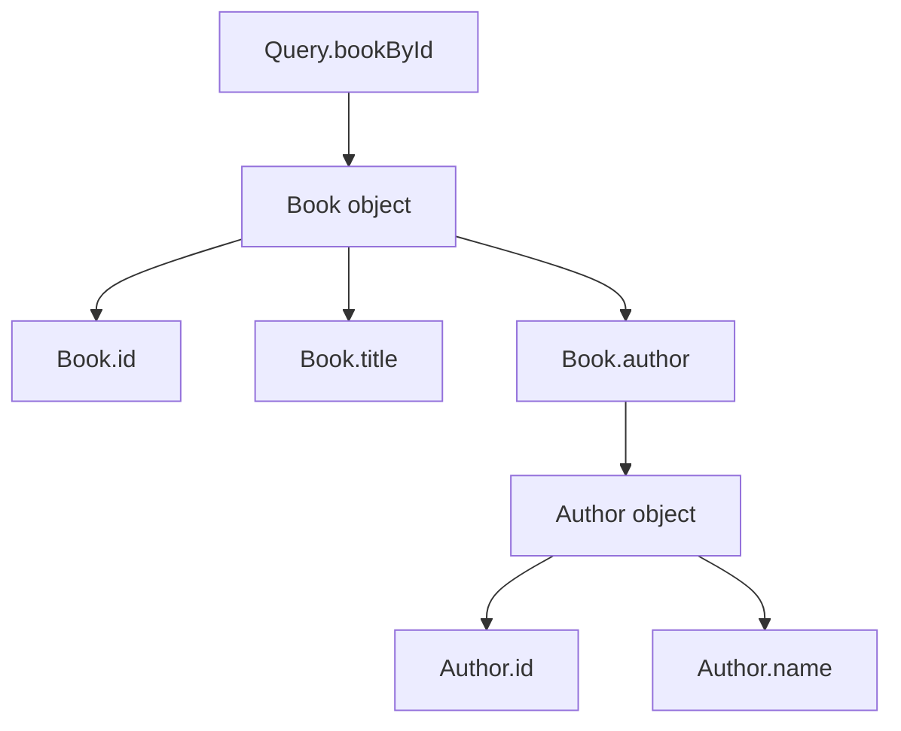

# Source parameter

In a GraphQL query, data is typically resolved along a field tree. A parent field's resolver returns an object; as GraphQL continues resolving child fields, that object becomes the **source** (also called the parent or container object) of the child fields. Spring for GraphQL lets you receive this object directly through a method parameter in an annotated controller.

For example, the `Query.bookById` resolver returns a `Book`. When the client also requests the `Book.author` field, Spring passes that exact `Book` object into the handler method `author(Book book)`. The method can read `authorId` from the source and load the corresponding author.

The source parameter is especially useful when a child field needs information from the parent object to compute or load data. It also helps Spring infer the GraphQL parent type for `SchemaMapping` in many cases, allowing annotations to stay concise.

This lesson explains the source object in GraphQL Java, how to receive a source parameter in Spring for GraphQL, how type names are inferred, how to combine the source with arguments and DataLoader, and common mapping pitfalls.

## 1. What is the source during GraphQL execution?

GraphQL executes an operation along a field tree. Each field can return a scalar, an object, or a list of objects. If the result is an object, GraphQL continues resolving the child fields selected by the client.

Example schema:

```graphql
type Query {
  bookById(id: ID!): Book
}

type Book {
  id: ID!
  title: String!
  author: Author
}

type Author {
  id: ID!
  name: String!
}
```

Client query:

```graphql
query {
  bookById(id: "book-1") {
    id
    title
    author {
      id
      name
    }
  }
}
```

The resolution process can be visualized as follows:



In the first step, the `bookById` resolver returns a `Book` object. That object is the source for the `id`, `title`, and `author` fields. When the `author` field returns an `Author` object, that `Author` object in turn becomes the source for the child fields `id` and `name`.

In GraphQL Java, the source is accessed via `DataFetchingEnvironment.getSource()`. With Spring annotated controllers, you do not need to retrieve the environment manually in typical cases: simply declare a method parameter with the desired Java type.

## 2. Receiving the source parameter in `@SchemaMapping`

Suppose the Java model is:

```java
public record Book(
        String id,
        String title,
        String authorId) {
}

public record Author(
        String id,
        String name) {
}
```

Root query resolver returning `Book`:

```java
@Controller
public class BookController {

    private final BookService bookService;

    public BookController(BookService bookService) {
        this.bookService = bookService;
    }

    @QueryMapping
    public Book bookById(@Argument String id) {
        return bookService.findById(id);
    }
}
```

Child field resolver receiving the source:

```java
@Controller
public class BookFieldController {

    private final AuthorService authorService;

    public BookFieldController(AuthorService authorService) {
        this.authorService = authorService;
    }

    @SchemaMapping
    public Author author(Book book) {
        return authorService.findById(book.authorId());
    }
}
```

The `Book book` parameter is the source object of the `author` field. Spring takes the object returned by the parent resolver and passes it into the method. You do not need to mark the source with `@Argument` or a dedicated annotation.

The method above is mapped by default to `Book.author` because:

- The method name is `author`, so the default field name is `author`.
- The source parameter type is `Book`, so the default parent type name is `Book`.

If the Java class name matches the object type name in the SDL, you can omit both attributes on `@SchemaMapping`.

## 3. Distinguishing the source parameter from `@Argument`

Both source and arguments can appear in the same handler method, but they come from two different places:

| Parameter | Data comes from | Example |
| --- | --- | --- |
| Source parameter | Parent object already resolved by the parent field | `Book book` |
| `@Argument` | Argument passed by the client to the current field | `@Argument String format` |
| `DataLoader` | DataLoader registered in the request | `DataLoader<String, Author> loader` |
| `GraphQLContext` | Shared context of the GraphQL request | `GraphQLContext context` |

For example, the `Book.author` field accepts an additional argument to choose the display format:

```graphql
type Book {
  id: ID!
  title: String!
  author(format: AuthorFormat = FULL): Author
}

enum AuthorFormat {
  FULL
  SHORT
}
```

Handler receiving both source and argument:

```java
@SchemaMapping(typeName = "Book", field = "author")
public Author author(
        Book book,
        @Argument("format") AuthorFormat format) {

    return authorService.findForBook(book.authorId(), format);
}
```

Here:

- `book` is the parent `Book` object of the `author` field.
- `format` is the argument of the `author` field itself requested by the client.

Do not add `@Argument` to the source parameter. If you write `@Argument("book") Book book`, Spring will look for an argument named `book` in the GraphQL field call rather than taking the parent object.

## 4. How the source parameter helps infer the type name

`@SchemaMapping` has two commonly used attributes:

- `typeName`: name of the GraphQL parent type owning the field.
- `field`: name of the field to map.

If omitted, Spring infers:

1. The field name from the method name.
2. The type name from the simple class name of the source parameter.

Example:

```java
@SchemaMapping
public Author author(Book book) {
    // ...
}
```

The default mapping is `Book.author`.

You can declare them explicitly:

```java
@SchemaMapping(typeName = "Book", field = "author")
public Author loadAuthor(Book source) {
    // ...
}
```

Java parameter names like `source` or `book` do not determine the GraphQL field name. The Java type of the source parameter is used to infer the parent type; the method name is used to infer the field name.

### When do you need to specify `typeName`?

If the Java simple class name does not match the GraphQL type name, specify `typeName`:

```java
public record BookEntity(
        String id,
        String title,
        String authorId) {
}
```

The schema still has a type named `Book`:

```graphql
type Book {
  id: ID!
  title: String!
  author: Author
}
```

Then:

```java
@SchemaMapping(typeName = "Book", field = "author")
public Author author(BookEntity book) {
    return authorService.findById(book.authorId());
}
```

If you omit `typeName = "Book"`, Spring may infer the parent type as `BookEntity` and fail to find that type in the schema. Explicitly specifying the type name decouples domain/persistence class names from GraphQL API names.

### Using `@SchemaMapping` at the class level

If multiple methods resolve fields of the same parent type, you can set a class-level default:

```java
@Controller
@SchemaMapping(typeName = "Book")
public class BookFieldController {

    @SchemaMapping
    public Author author(Book book) {
        // Field Book.author
    }

    @SchemaMapping
    public List<Review> reviews(Book book) {
        // Field Book.reviews
    }
}
```

The methods inherit `typeName = "Book"` from the class-level annotation. Method-level attributes can override this default when needed.

## 5. Source can be a record, class, or Map

The source does not have to be a JPA entity or a Spring-specific type. It is whatever object the parent resolver returns. It can be:

- A Java record.
- A POJO with getters.
- A domain object.
- A projection object.
- A `Map` or another data structure that a GraphQL data fetcher can use.

Example where the source is a record:

```java
public record Book(String id, String title, String authorId) {
}
```

Example where the source is a class:

```java
public class BookView {

    private final String id;
    private final String title;
    private final String authorId;

    public BookView(String id, String title, String authorId) {
        this.id = id;
        this.title = title;
        this.authorId = authorId;
    }

    public String getId() {
        return id;
    }

    public String getTitle() {
        return title;
    }

    public String getAuthorId() {
        return authorId;
    }
}
```

If the source is `BookView` while the GraphQL type is `Book`, specify the parent type explicitly:

```java
@SchemaMapping(typeName = "Book", field = "author")
public Author author(BookView book) {
    return authorService.findById(book.getAuthorId());
}
```

### Source as a `Map`

Some resolvers return a `Map` instead of a domain object:

```java
@QueryMapping
public Map<String, Object> bookById(@Argument String id) {
    return bookService.findViewAsMap(id);
}
```

A child field handler can receive that same `Map`:

```java
@SchemaMapping(typeName = "Book", field = "author")
public Author author(Map<String, Object> book) {
    String authorId = (String) book.get("authorId");
    return authorService.findById(authorId);
}
```

Because the simple class name of the source is `Map` rather than `Book`, you must declare `typeName` explicitly. Also ensure that keys and values have consistent types; an invalid cast can cause a runtime error.

`@Argument Map<String, Object>` is completely different: it reads an argument value from the client, whereas an unannotated `Map<String, Object>` in the example above is the field's source object.

## 6. One source object can feed multiple child fields

One parent object can serve as the source for multiple resolvers:

```graphql
type Book {
  id: ID!
  title: String!
  author: Author
  reviews: [Review!]!
  averageRating: Float
}
```

Controller:

```java
@Controller
@SchemaMapping(typeName = "Book")
public class BookFieldController {

    private final AuthorService authorService;
    private final ReviewService reviewService;

    public BookFieldController(
            AuthorService authorService,
            ReviewService reviewService) {
        this.authorService = authorService;
        this.reviewService = reviewService;
    }

    @SchemaMapping
    public Author author(Book book) {
        return authorService.findById(book.authorId());
    }

    @SchemaMapping
    public List<Review> reviews(Book book) {
        return reviewService.findByBookId(book.id());
    }

    @SchemaMapping
    public double averageRating(Book book) {
        return reviewService.averageRating(book.id());
    }
}
```

Each method receives the same `Book` source type but handles a different field. Spring distinguishes mappings by the parent type and field name pair.

If the source object already exposes an appropriate property, GraphQL Java can use the default property data fetcher without a separate `@SchemaMapping` method. Only write a resolver when custom logic, service calls, business rules, or data transformation are needed.

## 7. Combining the source parameter with DataLoader

The source parameter often holds a foreign key or information needed to load a relationship. If a query returns many parent objects, calling a service individually for each source can cause N+1.

Unoptimized example:

```java
@SchemaMapping
public Author author(Book book) {
    return authorService.findById(book.authorId());
}
```

If a client fetches 50 books and selects `author`, the method may be called 50 times. If each call runs a separate database query, the server executes one query to fetch books plus many queries to fetch authors.

You can keep the source parameter while using `DataLoader` to batch the loads:

```java
@SchemaMapping
public CompletableFuture<Author> author(
        Book book,
        DataLoader<String, Author> authorLoader) {

    return authorLoader.load(book.authorId());
}
```

The batch loader is registered per request:

```java
@Controller
public class BookController {

    public BookController(
            BatchLoaderRegistry registry,
            AuthorService authorService) {

        registry.forTypePair(String.class, Author.class)
                .registerMappedBatchLoader((authorIds, environment) ->
                        Mono.just(authorService.findAllByIds(authorIds)));
    }

    @SchemaMapping
    public CompletableFuture<Author> author(
            Book book,
            DataLoader<String, Author> authorLoader) {
        return authorLoader.load(book.authorId());
    }
}
```

Here the source parameter provides the author ID for each field call. `DataLoader` defers the loads, collects keys, and invokes the batch function. Multiple books referencing the same author can also share the result from the request-scoped cache.

If the case is simply loading a related field from a list of parent objects, `@BatchMapping` can be more concise:

```java
@BatchMapping
public Map<Book, Author> author(List<Book> books) {
    Set<String> authorIds = books.stream()
            .map(Book::authorId)
            .collect(Collectors.toSet());

    Map<String, Author> authors = authorService.findAllByIds(authorIds);

    return books.stream().collect(Collectors.toMap(
            Function.identity(),
            book -> authors.get(book.authorId())));
}
```

`@BatchMapping` takes a list of source objects and automatically registers a `DataLoader` for the corresponding field. When you need per-field-call arguments or complex local context, combining `@SchemaMapping` with `DataLoader` and `BatchLoaderRegistry` is more flexible.

The source parameter by itself does not solve N+1. It only supplies the parent object; batching data loads requires `DataLoader`, `@BatchMapping`, or a bulk query strategy.

## 8. Source parameter with interfaces and inheritance

Java models can use a shared interface across multiple GraphQL object types:

```graphql
interface Activity {
  id: ID!
  coordinator: User
}

type WorkshopActivity implements Activity {
  id: ID!
  coordinator: User
  room: String!
}

type BookLaunchActivity implements Activity {
  id: ID!
  coordinator: User
  isbn: String!
}
```

Java:

```java
public interface Activity {
    String id();
    String coordinatorId();
}
```

A resolver can accept an interface source type:

```java
@SchemaMapping
public User coordinator(Activity activity) {
    return userService.findById(activity.coordinatorId());
}
```

Spring for GraphQL supports interface schema mapping: a mapping on an interface can be extended to mappings for each object type implementing the interface. This lets you use one common source parameter across multiple subtypes when the logic is identical.

If a subtype needs custom handling, you can declare a mapping specific to that subtype:

```java
@SchemaMapping
public User coordinator(Activity activity) {
    return userService.findById(activity.coordinatorId());
}

@SchemaMapping
public User coordinator(WorkshopActivity activity) {
    return workshopService.findCoordinator(activity);
}
```

The specific source parameter type helps Spring identify the mapping dedicated to the subtype. Verify the GraphQL type names and your Spring for GraphQL version when using interface mappings in an application.

## 9. Source parameter and other method arguments

A handler method can combine the source with various method arguments supported by Spring:

```java
@SchemaMapping(typeName = "Book", field = "author")
public Author author(
        Book book,
        @Argument("locale") String locale,
        Principal principal,
        DataLoader<String, Author> authorLoader) {

    return authorLoader.load(book.authorId());
}
```

This example illustrates different data sources:

- `Book book`: source/parent object.
- `@Argument("locale")`: argument passed by the client to the field.
- `Principal`: current user when a Spring Security context is present.
- `DataLoader`: loader registered in the request's `DataLoaderRegistry`.

Other supported types include `GraphQLContext`, `@ContextValue`, `@LocalContextValue`, `DataFetchingEnvironment`, `DataFetchingFieldSelectionSet`, and `Locale`. Only add parameters when the resolver actually needs that data.

If you need access to the full source and low-level execution metadata, you can accept `DataFetchingEnvironment`:

```java
@SchemaMapping
public Author author(DataFetchingEnvironment environment) {
    Book book = environment.getSource();
    return authorService.findById(book.authorId());
}
```

Normally, declaring a typed source parameter is easier to read and more type-safe. Use `environment` directly when you need GraphQL Java APIs that method argument resolvers do not expose conveniently.

## 10. What the source parameter does not do

The source parameter only supplies the parent object to the handler. It does not automatically:

- Load related data from the database.
- Create a transaction.
- Check resource access permissions.
- Convert the source class name to a GraphQL type if the names do not match.
- Solve N+1.
- Read field arguments.
- Guarantee that the parent object is non-null or that data inside it is always valid.

For example, a source containing `authorId` only tells you the author's identifier. The resolver must still decide how to load the author, whether authorization checks are required, and how to handle missing authors.

Never treat a source object as proof of authorization. An object with a valid ID does not prove that the current user is permitted to read its fields. Access rights must be checked based on identity, tenant, and business policies.

## 11. Nullability and source data

If a parent resolver returns `null`, GraphQL applies null propagation according to the parent field's nullability. Child fields of a nonexistent object will not be resolved as for a normal object.

Example:

```graphql
type Query {
  bookById(id: ID!): Book
}

type Book {
  id: ID!
  author: Author!
}
```

`bookById` can return `null` if the book is not found. However, once a `Book` exists, the `author` field is declared non-null, so the resolver must return a valid `Author` or raise an execution error. If the domain allows a book without an author, the schema should model the field as nullable:

```graphql
type Book {
  id: ID!
  author: Author
}
```

Similarly, if the source object lacks `authorId` or a `Map` is missing that key, the resolver must have clear rules. Avoid unexpected type-cast errors or null pointer exceptions.

## 12. Source parameter in root fields vs. nested fields

The source parameter is used most often in resolvers for nested fields, such as `Book.author` or `Author.books`. In those cases, the parent object is a strongly typed domain object.

For a root field like `Query.bookById`, the method typically receives the query's arguments:

~~~java
@QueryMapping
public Book bookById(@Argument String id) {
    return bookService.findById(id);
}
~~~

Do not assume that the source of a root `Query` is a `Book`. The root source is the root object supplied by the GraphQL engine for the operation, which is usually not the domain object of the query result. `Book` only becomes the source of child fields after the `bookById` resolver returns it.

A helpful rule of thumb:

- A root field resolver receives input from the client and creates/returns the root object of the data branch.
- A nested field resolver receives the parent object as its source to resolve a child field.
- The result of a nested resolver becomes the source for the next field level.

## 13. Testing the source parameter

Test the source parameter by executing a full operation from the root field down to the child field. That way, the test confirms both that the parent resolver returns the right object and that the child resolver receives the right source.

Example using `GraphQlTester`:

~~~java
@GraphQlTest({BookController.class, BookFieldController.class})
class BookSourceMappingTests {

    @Autowired
    GraphQlTester graphQlTester;

    @MockBean
    BookService bookService;

    @MockBean
    AuthorService authorService;

    @Test
    void passesParentBookAsSourceToAuthorMapping() {
        Book book = new Book("book-1", "Spring GraphQL", "author-7");
        Author author = new Author("author-7", "An Nguyen");

        given(bookService.findById("book-1")).willReturn(book);
        given(authorService.findById("author-7")).willReturn(author);

        graphQlTester.document("""
                query {
                    bookById(id: "book-1") {
                        id
                        title
                        author {
                            id
                            name
                        }
                    }
                }
                """)
                .execute()
                .path("bookById.author.name")
                .entity(String.class)
                .isEqualTo("An Nguyen");

        then(authorService).should().findById("author-7");
    }
}
~~~

This is an illustrative example; import the actual controllers and mock the real dependencies. Useful tests should verify:

- The source object returned by the parent resolver has the expected type and data.
- The child field resolver reads the right property from the source.
- The parent type name is inferred properly or specified explicitly.
- Field arguments are not confused with the source parameter.
- Sources that are records, POJOs, or `Map`s are handled as designed.
- `DataLoader` is called with keys extracted from the source when using batch loading.
- Cases where the source lacks data follow the nullability and error contract.

## 14. Common issues

| Symptom | Cause | Resolution |
| --- | --- | --- |
| No mapping found for child field | Source class simple name does not match the GraphQL parent type | Specify `typeName` in `@SchemaMapping` |
| Resolver receives `null` or the wrong object | Parent resolver returns the wrong type or does not return the expected object | Check the parent field's return value |
| Spring treats the source as an argument | `@Argument` was mistakenly placed on the source parameter | Leave the source parameter without `@Argument` |
| Wrong field mapped | Method name does not match the SDL field | Specify `field` or `value` in `@SchemaMapping` |
| `Map` source type is not inferred properly | Simple class name of the source is `Map` | Specify `typeName` explicitly |
| Child method executes many queries | Each source calls the service/database individually | Use `DataLoader`, `@BatchMapping`, or a bulk query |
| Interface mapping does not apply to subtype | Source/interface and GraphQL interface mismatch or version does not support it as expected | Check the SDL, source type, and Spring for GraphQL version |
| Casting the source fails | Java source model does not match the method parameter type | Align the parent resolver's return type with the source parameter |
| Child field unexpectedly returns `null` | Property/key is missing in the source or the relationship does not exist | Check source data and nullability |

## 15. Principles for using the source parameter

- Use the source parameter to receive the parent object returned by the preceding resolver.
- Leave the source parameter without `@Argument`; use `@Argument` separately for client-supplied data.
- Match method names to field names to leverage default conventions.
- Keep the simple class name of the source aligned with the GraphQL parent type when possible.
- Specify `typeName` explicitly when the Java model and GraphQL schema use different names.
- Use class-level `@SchemaMapping` when multiple methods belong to the same parent type.
- Use an interface source type when multiple subtypes share the same logic.
- Use `DataLoader` or `@BatchMapping` when the source parameter leads to loading relationships across many parent objects.
- Keep resolvers readable and delegate business logic to services.
- Never use the source object in place of authorization or request context.
- Test from the root query down to child fields to confirm the source is passed properly.

## 16. Hands-on exercise

Build a library API with these requirements:

1. Declare `Query.bookById`, `Book.author`, and `Author.books` in the SDL.
2. Create a Java `Book` record with `id`, `title`, and `authorId`.
3. Write a `@QueryMapping` returning a `Book`.
4. Write a `@SchemaMapping` receiving `Book book` to load `Author`.
5. Add a `locale` argument to the `author` field and read it with `@Argument`.
6. Rename the Java model to `BookEntity` while keeping the GraphQL type as `Book`; update `typeName` explicitly.
7. Try returning the source as a `Map<String, Object>` and verify the mapping.
8. Add multiple books sharing the same author and use `DataLoader` to avoid repeated author queries.
9. Write `GraphQlTester` tests verifying both parent and child fields.

Once finished, make sure you can explain where the source object comes from, why the source parameter does not need a dedicated annotation, how Spring infers the parent type, and when to combine the source with `DataLoader`.

## 17. References

- [Spring for GraphQL — Annotated Controllers: Source](https://docs.spring.io/spring-graphql/reference/controllers.html#controllers.schema-mapping.source)
- [Spring for GraphQL — SchemaMapping API](https://docs.spring.io/spring-graphql/docs/1.4.x/api/org/springframework/graphql/data/method/annotation/SchemaMapping.html)
- [GraphQL Java — DataFetchingEnvironment](https://javadoc.io/doc/com.graphql-java/graphql-java/latest/graphql/schema/DataFetchingEnvironment.html)

Method argument signatures and mapping behavior may vary across Spring for GraphQL versions. When upgrading dependencies, check the reference documentation and Javadoc for the exact version used by your project.
