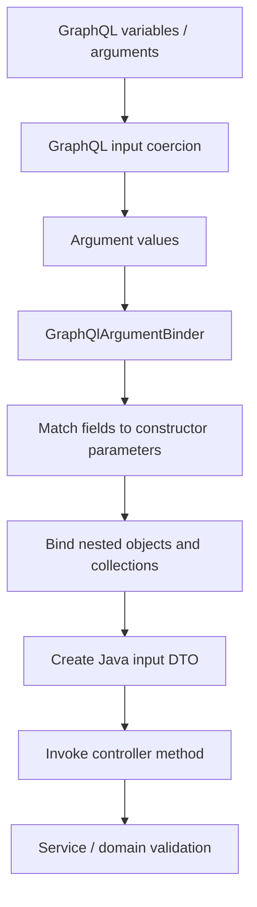

# Constructor binding

In Spring for GraphQL, clients send input data as GraphQL arguments or input objects. When a controller receives a Java parameter using `@Argument`, Spring converts that data into the Java type requested by the method. For an input DTO with a constructor, this process uses **constructor binding**: the values in the input are matched with constructor parameters to construct a complete object.

Constructor binding suits Java records and immutable DTOs. Instead of instantiating an empty object and calling setters for each property, the binder creates the object directly with the input values. This keeps input models concise, easy to test, and avoids incomplete or invalid intermediate object states.

This lesson explains `GraphQlArgumentBinder`, how to bind input objects into constructors, handling nested inputs and lists, renaming fields with `@BindParam`, parameter name requirements, validation, and how to test constructor binding in Spring for GraphQL.

## 1. From GraphQL input to Java object

GraphQL SDL defines input types and the fields clients are allowed to send:

```graphql
input CreateBookInput {
  title: String!
  authorId: ID!
  publishedYear: Int
}

type Mutation {
  createBook(input: CreateBookInput!): Book!
}

type Book {
  id: ID!
  title: String!
  publishedYear: Int
}
```

The client sends a mutation:

```graphql
mutation CreateBook($input: CreateBookInput!) {
  createBook(input: $input) {
    id
    title
    publishedYear
  }
}
```

Variables:

```json
{
  "input": {
    "title": "Spring for GraphQL",
    "authorId": "author-1",
    "publishedYear": 2026
  }
}
```

The controller receives the entire input using a single Java type:

```java
@MutationMapping
public Book createBook(@Argument("input") CreateBookInput input) {
    return bookService.create(input);
}
```

Spring for GraphQL retrieves the `input` argument and binds the map of fields into a `CreateBookInput` object. This conversion is performed by `GraphQlArgumentBinder`.

## 2. GraphQlArgumentBinder and constructor binding

`GraphQlArgumentBinder` is the Spring for GraphQL component responsible for converting GraphQL argument values into Java objects. The binder supports two common object instantiation styles:

- **Constructor binding:** creates the object by passing bound values into a constructor.
- **Property binding:** creates the object and then assigns values to accessible properties, such as setters or bindable fields.

For immutable input DTOs, constructor binding is the natural choice. The binder can recursively bind nested input objects and convert values to the target Java types. If binding encounters an error, the binder collects error details so Spring for GraphQL can return an appropriate execution error.

General flow:



GraphQL validates input structure, scalars, and nullability before invoking the data fetcher. Spring then binds argument values to the Java types of the method parameters. These two steps are related but have distinct responsibilities: GraphQL enforces the SDL contract; the binder converts values into Java objects.

## 3. Constructor binding with Java records

Java records are a concise choice for immutable input DTOs. Records automatically generate the canonical constructor, accessors, and `equals`, `hashCode`, and `toString` methods.

Java model:

```java
public record CreateBookInput(
        String title,
        String authorId,
        Integer publishedYear) {
}
```

Controller:

```java
@Controller
public class BookMutationController {

    private final BookService bookService;

    public BookMutationController(BookService bookService) {
        this.bookService = bookService;
    }

    @MutationMapping
    public Book createBook(@Argument("input") CreateBookInput input) {
        return bookService.create(input);
    }
}
```

The binder creates the record in a way equivalent to calling the constructor:

```java
new CreateBookInput(
        "Spring for GraphQL",
        "author-1",
        2026);
```

This is a conceptual illustration to explain the mechanism; in the application, Spring performs the binding and object creation automatically. The controller never needs to manually read maps or invoke constructors.

### Why are records a good fit?

- No setters are needed.
- All fields are initialized together.
- Once created, the input object cannot be mutated unexpectedly.
- Field types clearly communicate the data contract.
- Easy to use in unit tests and service methods.

For nullable fields, use nullable Java types such as `Integer`, `Long`, or `Boolean` instead of primitives `int`, `long`, or `boolean`. Primitives cannot represent null.

## 4. Constructor binding with regular classes

Using a record is not required. A regular class with a suitable constructor can also be bound:

```java
public class CreateAuthorInput {

    private final String name;
    private final String biography;

    public CreateAuthorInput(String name, String biography) {
        this.name = name;
        this.biography = biography;
    }

    public String getName() {
        return name;
    }

    public String getBiography() {
        return biography;
    }
}
```

SDL:

```graphql
input CreateAuthorInput {
  name: String!
  biography: String
}

type Mutation {
  createAuthor(input: CreateAuthorInput!): Author!
}
```

Controller:

```java
@MutationMapping
public Author createAuthor(@Argument("input") CreateAuthorInput input) {
    return authorService.create(input);
}
```

The binder needs to know the constructor parameter names to match them with the field names in the input object. For regular Java classes, ensure the compiler preserves parameter names (e.g., compile with the `-parameters` option) or use an appropriate parameter name metadata mechanism. Java records store record component names in bytecode, making them naturally suited for constructor binding.

Keep a single primary constructor whose parameters correspond to the input fields. Multiple overloaded constructors can make constructor selection confusing; input DTOs should have a simple, unambiguous structure.

## 5. Constructor parameter names must match input fields

By default, the binder matches constructor parameter names with field names in the GraphQL input object.

SDL:

```graphql
input CreateBookInput {
  title: String!
  authorId: ID!
}
```

Java:

```java
public record CreateBookInput(
        String title,
        String authorId) {
}
```

`title` matches `title`; `authorId` matches `authorId`. The binder can assign the corresponding values without additional configuration.

If the names do not match, the binder cannot match the right fields to the constructor parameters. For example:

```java
public record CreateBookInput(
        String bookTitle,
        String authorIdentifier) {
}
```

While the SDL still uses `title` and `authorId`, these two Java names differ from the input field names. You must use `@BindParam` to declare the corresponding GraphQL input field name.

## 6. Renaming fields with @BindParam

`@BindParam` allows explicitly specifying the input field name bound to a constructor parameter. The annotation resides in package:

```java
org.springframework.graphql.data.method.annotation.BindParam
```

Example SDL using snake_case:

```graphql
input CreateBookInput {
  book_title: String!
  author_id: ID!
}

type Mutation {
  createBook(input: CreateBookInput!): Book!
}
```

Java record continues using camelCase:

```java
public record CreateBookInput(
        @BindParam("book_title") String bookTitle,
        @BindParam("author_id") String authorId) {
}
```

`@BindParam("book_title")` tells the binder that the `bookTitle` parameter receives its value from the `book_title` SDL field. Similarly, `authorId` receives its value from `author_id`.

Client sends:

```graphql
mutation {
  createBook(input: {
    book_title: "Spring GraphQL"
    author_id: "author-1"
  }) {
    id
    title
  }
}
```

### When should you use @BindParam?

- The GraphQL API uses snake_case while Java uses camelCase.
- Public field names must remain stable while the Java model is renamed.
- The DTO uses Java terminology that differs from the API field name.
- You want to avoid depending on automatic naming conventions.

Do not rename fields arbitrarily. Names in the SDL are part of the API's public contract; `@BindParam` simply creates a mapping between that contract and Java names.

## 7. Constructor binding with nested input objects

A GraphQL input object can contain another input object. The binder supports recursive binding of nested structures.

SDL:

```graphql
input AuthorInput {
  name: String!
  email: String
}

input CreateBookInput {
  title: String!
  author: AuthorInput!
}

type Mutation {
  createBook(input: CreateBookInput!): Book!
}
```

Java DTOs:

```java
public record AuthorInput(
        String name,
        String email) {
}

public record CreateBookInput(
        String title,
        AuthorInput author) {
}
```

Controller:

```java
@MutationMapping
public Book createBook(@Argument("input") CreateBookInput input) {
    return bookService.create(input);
}
```

The binder performs the following steps:

1. Reads the `title` field of `CreateBookInput`.
2. Reads the `author` map.
3. Binds that map into `AuthorInput`.
4. Invokes the `CreateBookInput` constructor with the title and created `AuthorInput`.

Client:

```graphql
mutation {
  createBook(input: {
    title: "Spring GraphQL"
    author: {
      name: "An Nguyen"
      email: "an@example.com"
    }
  }) {
    id
    title
  }
}
```

Each input layer should have its own DTO representing the API structure. There is no need to manually convert nested maps in the controller when the binder can bind them into Java types.

## 8. Constructor binding with lists and collections

An input object can contain lists of scalars or lists of input objects:

```graphql
input ChapterInput {
  title: String!
  pageCount: Int!
}

input CreateBookInput {
  title: String!
  tags: [String!]!
  chapters: [ChapterInput!]!
}
```

Java DTOs:

```java
public record ChapterInput(
        String title,
        Integer pageCount) {
}

public record CreateBookInput(
        String title,
        List<String> tags,
        List<ChapterInput> chapters) {
}
```

The binder converts each element in the `chapters` list into a `ChapterInput`, and then passes the collection to the `CreateBookInput` constructor.

If an immutable collection is needed in the domain, the service can copy the data:

```java
List<Chapter> chapters = input.chapters().stream()
        .map(chapter -> new Chapter(
                chapter.title(),
                chapter.pageCount()))
        .toList();
```

Input DTOs should only represent data sent by clients. Converting into domain entities or aggregates belongs in the service/domain layer.

## 9. Nullability and default values

GraphQL SDL determines which fields are required and which may be null:

```graphql
input CreateBookInput {
  title: String!
  subtitle: String
  publishedYear: Int = 2026
}
```

Meaning:

- `title: String!`: required and cannot be null.
- `subtitle: String`: may be omitted or passed as null.
- `publishedYear: Int = 2026`: GraphQL applies the default value when the client omits the field according to input coercion rules.

Java DTO:

```java
public record CreateBookInput(
        String title,
        String subtitle,
        Integer publishedYear) {
}
```

Use `Integer` for `publishedYear` because the SDL field lacks `!` and can be null. If you used primitive `int`, Java could not represent the null state.

GraphQL handles required fields and default values during input coercion. Constructor binding receives the values after that step. Therefore, avoid duplicating default logic inside the constructor if the default is already declared in the SDL, unless the domain has a distinct rule.

### Distinguishing omitted and null

In partial updates, clients may need to distinguish:

| Input | Possible business meaning |
| --- | --- |
| Field omitted | Keep the existing value |
| Field sent with null | Clear the current value |
| Field sent with value | Assign the new value |

A plain nullable field in a constructor DTO is usually not enough to distinguish the first two states if both bind to null. For this requirement, use a presence-aware type such as `ArgumentValue<T>` at the appropriate argument level or design an input model with explicit state. Never assume null always means leave unchanged or clear data.

## 10. Constructor binding vs. property binding

Spring for GraphQL can bind inputs into classes via constructor or property binding. Each approach has different characteristics:

| Characteristic | Constructor binding | Property binding |
| --- | --- | --- |
| Object creation | Calls constructor with bound values | Instantiates object then assigns properties |
| Suitable DTOs | Records, immutable classes | Mutable beans with setters or bindable fields |
| Object state | Values are passed at initialization | Intermediate state can exist before all properties are set |
| Immutability | Natural | Requires extra design |
| Required metadata | Constructor parameter names or `@BindParam` | Property/setter/bindable field names |

Property binding example:

```java
public class MutableCreateBookInput {

    private String title;
    private String authorId;

    public MutableCreateBookInput() {
    }

    public void setTitle(String title) {
        this.title = title;
    }

    public void setAuthorId(String authorId) {
        this.authorId = authorId;
    }

    public String getTitle() {
        return title;
    }

    public String getAuthorId() {
        return authorId;
    }
}
```

This class can be bound via its no-argument constructor and setters. However, for DTOs used solely to accept input, records are usually shorter and easier to understand.

Do not confuse constructor binding in `GraphQlArgumentBinder` with the `@ConstructorBinding` annotation used in some Spring Boot configuration properties setups. They are two different mechanisms serving different purposes.

## 11. Data type conversion

GraphQL has built-in scalars such as `String`, `Int`, `Float`, `Boolean`, and `ID`. When using custom scalars, GraphQL Java performs coercion before Spring binds the value to the target Java type.

Example schema declaration:

```graphql
scalar UUID

input CreateBookInput {
  id: UUID!
  title: String!
}
```

Java DTO:

```java
public record CreateBookInput(
        UUID id,
        String title) {
}
```

This requires the `UUID` custom scalar to be properly registered in runtime wiring and return a Java value compatible with the `UUID` type. If scalar coercing returns a String while the DTO expects a UUID, an appropriate conversion is needed or the scalar and DTO should be aligned.

Do not rely on ambiguous implicit casts. For enums, dates/times, currencies, or specialized identifiers, explicitly define the Java type produced by scalar coercion and the type accepted by the constructor.

## 12. Validation after binding

Constructor binding builds the input DTO; it does not replace business validation. You can use Jakarta Bean Validation on records:

```java
public record CreateBookInput(
        @NotBlank
        @Size(max = 200)
        String title,

        @NotBlank
        String authorId,

        @Min(1)
        Integer publishedYear) {
}
```

Controller:

```java
@MutationMapping
public Book createBook(
        @Argument("input") @Valid CreateBookInput input) {
    return bookService.create(input);
}
```

When using nested DTOs, add `@Valid` to the component requiring cascading validation:

```java
public record CreateBookInput(
        @NotBlank String title,
        @Valid AuthorInput author) {
}
```

Validation can check format, length, or input values. Rules that depend on the database—such as whether the author exists or whether the user has permission to create a book in the library—should be checked in the service/domain layer.

GraphQL non-null checks only nullability; it does not check whether a string is blank or whether a value is business-valid. For example, `String!` can still be an empty string.

## 13. Handling constructor binding errors

Binding can fail because:

- An input field cannot be converted to the Java type.
- A nested input object fails to bind.
- A constructor parameter does not have a name matching an input field.
- A null value cannot be assigned to the target type.
- A constructor or setter throws an exception while instantiating the object.

Spring for GraphQL collects binding errors and reports an error during field execution. When debugging, inspect the GraphQL error message, field path, and detailed binding errors in server logs.

Mismatch example:

```graphql
input CreateBookInput {
  title: String!
  authorId: ID!
}
```

```java
public record CreateBookInput(
        String bookTitle,
        String authorId) {
}
```

The `bookTitle` parameter does not match the `title` field. Fix the Java parameter name or map it explicitly with `@BindParam("title")`:

```java
public record CreateBookInput(
        @BindParam("title") String bookTitle,
        String authorId) {
}
```

Do not catch every binding exception and return an empty object. That could cause the mutation to proceed with missing data and corrupt domain state.

## 14. Do not bind persistence entities directly

Do not accept JPA entities or complex domain aggregates directly as input DTOs:

```java
// Do not use persistence entities as public inputs.
@MutationMapping
public BookEntity createBook(@Argument BookEntity input) {
    // ...
}
```

Entities may contain internal fields such as server-generated IDs, owners, tenants, moderation statuses, or persistence relationships. If clients bind directly into an entity, the API can inadvertently allow updating fields clients should not control.

Create a dedicated DTO instead:

```java
public record CreateBookInput(
        String title,
        String authorId) {
}
```

The service verifies permissions, applies server-managed values, and constructs the entity:

```java
@Transactional
public Book create(CreateBookInput input, UserPrincipal principal) {
    Author author = authorRepository.findById(input.authorId())
            .orElseThrow(AuthorNotFoundException::new);

    authorizationService.checkCanCreateBook(principal, author);

    BookEntity entity = new BookEntity(
            input.title().trim(),
            author,
            principal.userId());

    return bookRepository.save(entity).toDomain();
}
```

The input DTO describes the data clients are permitted to send. The service decides what data is accepted and which fields are server-managed.

## 15. Testing constructor binding with GraphQlTester

Testing through GraphQL operations verifies the schema, argument binding, and controller mapping together:

```java
@GraphQlTest(BookMutationController.class)
class BookConstructorBindingTests {

    @Autowired
    GraphQlTester graphQlTester;

    @MockBean
    BookService bookService;

    @Test
    void bindsInputObjectToRecord() {
        Book created = new Book(
                "book-1",
                "Spring for GraphQL",
                2026);

        given(bookService.create(any(CreateBookInput.class)))
                .willReturn(created);

        graphQlTester.document("""
                mutation CreateBook($input: CreateBookInput!) {
                    createBook(input: $input) {
                        id
                        title
                        publishedYear
                    }
                }
                """)
                .variable("input", Map.of(
                        "title", "Spring for GraphQL",
                        "authorId", "author-1",
                        "publishedYear", 2026))
                .execute()
                .path("createBook.title")
                .entity(String.class)
                .isEqualTo("Spring for GraphQL");

        then(bookService).should()
                .create(any(CreateBookInput.class));
    }
}
```

This is an illustrative example; replace the models, service signatures, and mocks to match your real application. You can capture the service argument to assert that every record component was bound accurately.

You should write tests for:

- Records with fields matching SDL names.
- Class constructors with preserved parameter names.
- `@BindParam` when Java names differ from SDL names.
- Nested input objects and lists of input objects.
- Nullable fields and default values.
- Custom scalars converted to target Java types.
- Validation failures and binding failures.
- Inputs missing required fields.

With `@GraphQlTest` test slices, import any required custom scalar configurations or runtime wiring if your schema uses them. Use `@SpringBootTest` when you want to test the full application configuration and bean setup.

## 16. Common errors

| Symptom | Cause | Fix |
| --- | --- | --- |
| Input DTO is not created | Constructor parameter does not match input field name | Rename parameter or use `@BindParam` |
| Record receives wrong values | Component name does not match SDL | Check record component names and input type |
| Regular class fails constructor binding | Compiler did not preserve parameter names | Compile with `-parameters` or use proper name metadata |
| Nested object binding error | Java nested DTO does not match input structure | Create DTOs for each nested input type |
| Nullable field fails with primitive | Primitives cannot represent null | Use wrappers such as `Integer` or `Boolean` |
| Custom scalar fails to convert | Scalar coercing and Java constructor type are incompatible | Align scalar output with DTO type |
| Validation does not run | Missing `@Valid` or Bean Validation provider | Check annotations and validation dependency |
| Input allows modifying internal fields | Binding directly into persistence entity | Use a separate input DTO and map in the service |
| Test cannot find configurer | Test slice does not import runtime wiring | Import configuration or use a suitable application test |

## 17. Design principles for constructor-bound inputs

- Use Java records for simple, immutable input DTOs.
- Keep constructor parameter names aligned with GraphQL input field names.
- Use `@BindParam` when mapping differing names.
- Ensure parameter names are available for regular Java classes.
- Prefer a single clear primary constructor and avoid unnecessary overloads.
- Use dedicated DTOs for nested input objects and collections.
- Use wrapper types for nullable fields.
- Let GraphQL SDL handle required fields and default values.
- Use Bean Validation for structural constraints and service/domain validation for business rules.
- Never bind persistence entities or aggregates with server-managed fields directly.
- Verify custom scalar coercion is compatible with constructor types.
- Test from GraphQL operations through to service arguments using `GraphQlTester`.

## 18. Practice exercise

Build a book creation mutation with nested inputs:

1. Declare `CreateBookInput` with `title`, `publishedYear`, `author`, and `tags`.
2. Declare `AuthorInput` with `name` and `email`.
3. Create Java records for both input DTOs.
4. Write a `@MutationMapping` receiving `@Argument("input") CreateBookInput`.
5. Add `@BindParam` to map the SDL field `book_title` to the record component `bookTitle`.
6. Use `List<String>` to bind tags and verify element ordering.
7. Add Bean Validation for title and email.
8. Use a service to validate the author and create the entity; do not bind the entity directly from the client.
9. Write `GraphQlTester` tests verifying successful binding, nested binding, and validation failure.
10. Try using a primitive for a nullable field, observe the error, and switch to a wrapper type.

After completing the exercise, make sure you can explain how `GraphQlArgumentBinder` instantiates input DTOs, how constructor parameters are matched to SDL fields, when to use `@BindParam`, and why records are well suited for constructor-bound inputs.

## 19. References

- [Spring for GraphQL — Annotated Controllers: Argument Binding](https://docs.spring.io/spring-graphql/reference/controllers.html#controllers.arguments)
- [Spring for GraphQL — BindParam API](https://docs.spring.io/spring-graphql/docs/1.4.x/api/org/springframework/graphql/data/method/annotation/BindParam.html)
- [Spring for GraphQL — GraphQlArgumentBinder API](https://docs.spring.io/spring-graphql/docs/1.4.x/api/org/springframework/graphql/data/GraphQlArgumentBinder.html)
- [Spring Framework — Data Binding](https://docs.spring.io/spring-framework/reference/core/validation/data-binding.html)

Details of constructor selection, parameter name discovery, and method argument support may change across Spring for GraphQL/Spring Framework versions. When upgrading dependencies, check the reference documentation and Javadoc for the exact version your project uses.
