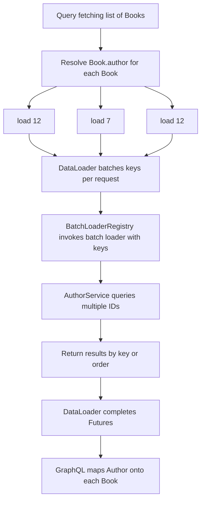

# Register batch loader

In GraphQL, multiple nested fields may need the same kind of data. For instance, a query fetches a list of books and requests each book's author. If every `Book.author` field calls a repository to look up one author, the server can end up issuing a separate query for every book. DataLoader solves this by combining those data-loading calls into a single batch.

With Spring for GraphQL, `BatchLoaderRegistry` is where batch loaders are registered. Spring creates and manages DataLoaders per GraphQL request and connects them to the execution context. Resolvers can request data using `DataLoader.load(key)`; the keys are collected and passed to the registered batch loader.

## 1. Why register a batch loader?

Suppose a schema models the relationship between books and authors:

```graphql
type Query {
    books: [Book!]!
}

type Book {
    id: ID!
    title: String!
    author: Author
}

type Author {
    id: ID!
    name: String!
}
```

The client sends a query:

```graphql
query {
    books {
        id
        title
        author {
            id
            name
        }
    }
}
```

Suppose `books` returns 30 books. If the `Book.author` resolver calls `authorRepository.findById(book.authorId())` for each book, the server may execute:

- One query to fetch the list of 30 books.
- 30 separate queries to fetch the authors.

This is the N+1 problem. A single GraphQL HTTP request can still produce many database queries.

DataLoader batches the author keys requested during the same execution tick, then invokes the batch loader once with that set of keys. The server can fetch multiple authors in one query such as `WHERE id IN (...)`.

## 2. BatchLoaderRegistry and DataLoader lifecycle

`BatchLoaderRegistry` belongs to the `org.springframework.graphql.execution` package. It is Spring for GraphQL's abstraction for registering batch loaders and mapped batch loaders.

In a Spring Boot application using `spring-boot-starter-graphql`, Spring Boot provides a default registry bean. You can inject the registry into a configuration or component to register loaders when the application context starts up.

Important lifecycle points:

- Batch loader definitions are registered at the application level on startup.
- `DataLoader` instances are created and bound to the GraphQL request context per request.
- `load(key)` calls within the same request can be batched together.
- DataLoader's default cache is request-scoped, not a cache shared across all users.
- Once a request finishes, that request's `DataLoader` is not reused for subsequent requests.

Per-request scoping prevents data caches from leaking between users. You should never manually create a static `DataLoader` or hold an instance inside a singleton service to share across multiple requests.

## 3. Registering a batch loader by key/value type pair

Suppose `Book.authorId` has type `Long` and the returned object is `Author`. You can register a loader with `forTypePair`:

```java
package com.example.graphql.config;

import org.springframework.context.annotation.Configuration;
import org.springframework.graphql.execution.BatchLoaderRegistry;

@Configuration
public class GraphQlBatchLoaderConfiguration {

    public GraphQlBatchLoaderConfiguration(
            BatchLoaderRegistry registry,
            AuthorService authorService) {

        registry.forTypePair(Long.class, Author.class)
            .registerBatchLoader((authorIds, environment) ->
                authorService.findAllByIds(authorIds)
            );
    }
}
```

This example assumes `AuthorService.findAllByIds` receives a list of IDs and returns `CompletionStage<List<Author>>` (or a compatible reactive type). `registerBatchLoader` registers a standard batch loader: the input is the keys to load, and the output is the corresponding list of values.

`forTypePair(Long.class, Author.class)` declares the key type and value type so Spring for GraphQL can match the corresponding `DataLoader`. This works well when a key/value type pair uniquely identifies a loader in the application.

In real projects, the service may use JDBC, JPA, another service, or any data source. What matters is that the batch service accepts multiple IDs in a single call and returns results conforming to the loader's contract.

## 4. Ordering rules for a standard batch loader

With `registerBatchLoader`, the returned list must match the exact order of the input key list. This is critical because DataLoader pairs values with keys by positional index.

For example, the received keys are:

```text
[12, 7, 25]
```

The loader must return a list in the same order:

```text
[Author(12), Author(7), Author(25)]
```

Do not assume a `WHERE id IN (...)` query will return records in the order of the input IDs. Many databases do not guarantee order without an `ORDER BY`, and even `ORDER BY` must be specifically constructed to match the key list.

A safe approach is to collect the fetched data into a map and rebuild the list in key order:

```java
public CompletionStage<List<Author>> findAllByIds(List<Long> ids) {
    Map<Long, Author> authorsById = repository.findAllById(ids).stream()
        .collect(Collectors.toMap(AuthorEntity::getId, mapper::toDomain));

    List<Author> ordered = ids.stream()
        .map(authorsById::get)
        .toList();

    return CompletableFuture.completedFuture(ordered);
}
```

The snippet illustrates a synchronous service wrapped in `CompletionStage`; in real applications, there is no need to wrap in a future merely to pretend there is async I/O. You can run a synchronous batch query inside a transaction or use a reactive/async API suited to your stack. Handle missing keys explicitly; the result list must still include a slot for that key, typically `null` if the field contract permits it.

## 5. Using registerMappedBatchLoader when returning a Map

If the service returns data as a key/value map, `registerMappedBatchLoader` is usually easier to use because you do not have to sort the result list to match key order.

```java
@Configuration
public class GraphQlBatchLoaderConfiguration {

    public GraphQlBatchLoaderConfiguration(
            BatchLoaderRegistry registry,
            AuthorService authorService) {

        registry.forTypePair(Long.class, Author.class)
            .registerMappedBatchLoader((authorIds, environment) ->
                authorService.findMapByIds(authorIds)
            );
    }
}
```

This example assumes `findMapByIds` returns `CompletionStage<Map<Long, Author>>` (or a reactive `Mono<Map<Long, Author>>`). Because the map uses ID as the key, entry order does not matter.

Example result:

```java
Map<Long, Author> authorsById = Map.of(
    12L, author12,
    7L, author7,
    25L, author25
);
```

DataLoader looks up each value by its matching key. If a key is absent from the map, the result for that key is `null`; the corresponding GraphQL field must have compatible nullability or handle the error per business rules.

Choose:

- `registerBatchLoader` when the service naturally returns a list and can guarantee ordering matching the keys.
- `registerMappedBatchLoader` when the service returns a key/value map and you want results matched by key.

Do not pick a loader out of syntactic preference; look at the natural return type of your data-access layer and how missing records should be represented.

## 6. Injecting DataLoader into a resolver

After registering the loader, a resolver can accept `DataLoader<K, V>` as a parameter. For example:

```java
package com.example.graphql.book;

import org.dataloader.DataLoader;
import org.springframework.graphql.data.method.annotation.SchemaMapping;
import org.springframework.stereotype.Controller;

import java.util.concurrent.CompletableFuture;

@Controller
public class BookFieldController {

    @SchemaMapping(typeName = "Book", field = "author")
    public CompletableFuture<Author> author(
            Book book,
            DataLoader<Long, Author> authorLoader) {

        return authorLoader.load(book.authorId());
    }
}
```

The method receives `Book` as the source object and `DataLoader<Long, Author>` as the loader registered for that type pair. Calling `load` returns `CompletableFuture<Author>`; the GraphQL runtime waits asynchronously for the result to complete the field.

When a query fetches multiple books, the resolver is invoked for each `Book`. Each invocation simply submits its key to `DataLoader`. DataLoader accumulates the keys and dispatches the batch loader according to GraphQL execution mechanics, allowing multiple `load` calls to be processed together.

Resolvers do not need to call `dispatch()` manually under normal Spring for GraphQL integration. The framework hooks `DataLoader` into GraphQL execution and manages dispatching during request processing.

## 7. How a batch flows

Suppose a query returns three books with `authorId` values `12`, `7`, and `12`:



With the default cache enabled, the two `load(12)` calls in the same request reuse the loaded result, so the batch only needs two distinct keys: `12` and `7`. All three `Book.author` fields still receive their respective authors.

Batching does not mean every key across an entire query is always sent in a single call regardless of timing. DataLoader batches `load` calls occurring within the same dispatch cycle; if later-stage resolvers trigger additional `load` calls, a subsequent batch may run.

## 8. Registering multiple batch loaders

An API may need several types of batch loaders—for example, authors by book, reviews by book, and permissions by user. You can register multiple type pairs:

```java
@Configuration
public class GraphQlBatchLoaderConfiguration {

    public GraphQlBatchLoaderConfiguration(
            BatchLoaderRegistry registry,
            AuthorService authorService,
            ReviewService reviewService) {

        registry.forTypePair(Long.class, Author.class)
            .registerBatchLoader((ids, environment) ->
                authorService.findAllByIds(ids));

        registry.forTypePair(Long.class, ReviewSummary.class)
            .registerMappedBatchLoader((bookIds, environment) ->
                reviewService.findSummaryByBookIds(bookIds));
    }
}
```

In this example, the first loader takes author IDs and returns a list of `Author`; the second takes book IDs and returns a `bookId -> ReviewSummary` map. Key/value types differentiate loaders by data purpose.

If the same key/value type pair requires multiple independent loaders, assign explicit loader names using the naming API on `RegistrationSpec` provided by your Spring for GraphQL version and specify the matching name when injecting. Do not register multiple loaders with the same default identifier and expect Spring to guess the right one.

## 9. When should you use named loaders?

`forTypePair` is convenient when the key/value type pair uniquely identifies a loader. In some designs, the same key/value types might load two different views, for example:

- `Long -> UserSummary` for public profile data.
- `Long -> UserPermissionView` for permission data.

If the value types differ, the type pair is already enough to distinguish them. If two loaders share both key and value types for different purposes, give them distinct loader names to prevent registration collisions.

When using named loaders, ensure the name at registration matches the name used to resolve the `DataLoader` in the handler. API syntax can vary across Spring for GraphQL versions; check the Javadoc of `BatchLoaderRegistry.RegistrationSpec` for your project's version.

## 10. Request-scoped data, tenants, and security context

A batch loader may need information beyond the key, such as the current tenant, locale, or principal to scope data. Spring for GraphQL passes `BatchLoaderEnvironment` to batch loaders and integrates context propagation during execution.

Never put a client-supplied `tenantId` or user ID into the key and treat it as proof of authorization. Identity and tenant must come from an authenticated security context or a trusted server-side context.

Conceptual example:

```java
registry.forTypePair(Long.class, Author.class)
    .registerBatchLoader((authorIds, environment) ->
        authorService.findVisibleAuthors(authorIds, environment)
    );
```

Here `findVisibleAuthors` represents a service that reads context and enforces access scope. The exact context-reading API depends on how your application configures GraphQL context and Spring Security; never assume a context entry exists unless it has been configured.

DataLoader caches are normally request-scoped, yet that does not replace authorization. Batch queries must still restrict data to the current user/tenant, especially when a single request spans multiple fields or keys with differing access scopes.

## 11. Caching and missing data

DataLoader typically caches by key within a request scope to avoid loading the same data repeatedly. For instance, calling `load(12)` multiple times in the same request shares the loaded result.

This caching has several implications:

- If the same key is reloaded after a mutation changes data within the same request, consider clearing or priming the corresponding `DataLoader` to avoid stale values.
- Do not use the request-scoped cache in place of an application or distributed cache.
- Do not share `DataLoader` instances across requests or users.
- If a key is not unique across contexts, include the distinguishing attributes in the key or handle context inside the batch loader.

When a resource does not exist, the batch loader must return results honoring its contract. With `registerBatchLoader`, the missing key's position must still appear in the returned list, typically as `null`. With a mapped loader, the key may be omitted from the map and DataLoader returns `null` for that load call.

If a GraphQL field is declared non-null yet the loader returns `null`, GraphQL raises an execution error and propagates null per nullability rules. Decide clearly whether the field can be absent or should return a not-found error.

## 12. Batch size and query limits

Putting every key into a single `IN` clause is not always desirable. One query could request tens of thousands of keys; databases impose limits on bind parameters, statement size, and execution resources.

Consider:

- Capping elements per batch based on database/service capabilities.
- Splitting large batches into chunks if the data layer has parameter limits.
- Using pagination at root queries to avoid producing excessive parent objects.
- Loading only fields the client needs, while avoiding projection designs that multiply query counts.
- Measuring batch duration, key counts, dispatch counts, and backend query counts.

DataLoader cuts down data source calls when keys can be batched, but it does not optimize the underlying SQL or downstream API on its own. The batch service still needs efficient queries, proper indexes, and bounded result payloads.

## 13. Testing batch loaders

Test both the GraphQL response and the number of times the batch service is called. Example test querying multiple books:

```java
import org.junit.jupiter.api.Test;
import org.springframework.beans.factory.annotation.Autowired;
import org.springframework.boot.test.autoconfigure.graphql.GraphQlTest;
import org.springframework.graphql.test.tester.GraphQlTester;

@GraphQlTest({BookQueryController.class, BookFieldController.class})
class BookBatchLoaderTest {

    @Autowired
    GraphQlTester graphQlTester;

    @Test
    void resolvesAuthorsForMultipleBooks() {
        graphQlTester.document("""
                query {
                    books {
                        id
                        author {
                            id
                            name
                        }
                    }
                }
                """)
            .execute()
            .path("books[0].author.name")
            .entity(String.class)
            .isEqualTo("Nguyen An");
    }
}
```

This example assumes the test context provides `BookService` and `AuthorService` mocks/test beans with corresponding fixtures, and imports the batch loader registration configuration (such as via `@Import(GraphQlBatchLoaderConfiguration.class)` in a slice test). You can use Mockito `verify(authorService, times(1))` to verify that the batch method was called once with the expected ID set rather than once per book. Write assertions matching the actual batch count of the query; do not assume every scenario always produces a single batch if a query has multiple branches or dispatch cycles.

Scenarios to verify:

- Multiple parent objects with distinct keys.
- Multiple parents sharing one key with caching working properly.
- One or more keys yielding no data.
- Result ordering for a standard batch loader.
- Mapped loader returning a map missing some keys.
- Service errors and how GraphQL populates `errors`.
- Two independent requests not sharing cached data.
- Context/tenant/security properly scoping results.

`@GraphQlTest` exercises the GraphQL slice. When you need to verify real SQL, transactions, indexes, or performance, add integration/performance tests backed by an appropriate data source.

## 14. How BatchLoaderRegistry and @BatchMapping differ

Spring for GraphQL provides two common approaches to batching data:

| Approach | Characteristics | When appropriate |
| --- | --- | --- |
| `BatchLoaderRegistry` + `DataLoader` | Registers loaders by key/value; resolvers call `load(key)` | Reusing a loader across resolvers, controlling caching/context, or complex loading workflows |
| `@BatchMapping` | Directly declares a method receiving multiple source objects and returning field results | Straightforward field mapping where resolver and batch logic belong in one method |

`@BatchMapping` example:

```java
@BatchMapping(typeName = "Book", field = "author")
public Map<Book, Author> author(List<Book> books) {
    return authorService.findAuthorsByBooks(books);
}
```

`@BatchMapping` is a concise declaration for a specific field relationship. When you need a DataLoader invoked from multiple places or keyed independently of the source object, `BatchLoaderRegistry` is more flexible.

Both approaches aim to eliminate N+1; pick one clear mechanism per field and avoid registering both mechanisms to resolve the same field.

## 15. Common errors when registering batch loaders

| Symptom | Possible cause | Resolution |
| --- | --- | --- |
| DataLoader not found | Loader not registered or key/value type/name mismatch | Check `forTypePair`, loader name, and handler parameter types |
| Results matched to the wrong parent | List batch loader returned items out of key order | Reorder to match input keys or use a mapped loader |
| Field returns `null` even though record exists | Java key types differ or map uses wrong key | Align key types and check ID mapping |
| Multiple backend queries still occur | Resolver bypasses DataLoader or dispatches split into multiple batches | Check where `load` is called and measure batch count |
| Stale data after mutation | DataLoader cached the key within the same request | Clear/prime the key after updates as needed |
| Data leaked between tenants | Loader or cache shared beyond request scope | Keep DataLoader request-scoped and enforce tenant filtering |
| Batch query too large | Unbounded key count or page size | Chunk batches and enforce query limits |
| Missing key triggers non-null error | Schema guarantees non-null while loader returns `null` | Adjust contract or handle not-found explicitly |

When debugging, check in order: whether the loader is registered, whether the resolver receives the right `DataLoader`, whether keys share the exact type, whether the batch method is invoked, and whether results map back to the right keys. Then measure database queries to confirm N+1 has actually been eliminated.

## 16. Batch loader registration checklist

- Have you chosen the right key/value type pair for the loader?
- Is the loader registered once when the application context starts?
- Does the resolver call `DataLoader.load(key)` instead of querying per parent?
- For list batch loaders, do results match the input key order?
- For mapped batch loaders, does the map use the exact key and handle missing keys?
- Are `DataLoader` instances scoped per request?
- Is caching isolated from being shared across users or tenants?
- Does the batch service bound batch size and query efficiently?
- Do mutations update/clear the cache when needed within the same request?
- Do tests verify responses, batch invocation counts, and missing-key cases?

`BatchLoaderRegistry` lets you register bulk data-loading strategies, while `DataLoader` provides the `load(key)` API for resolvers. Spring for GraphQL binds loaders to each request so loads can be batched and cached within request scope. By choosing the right loader type, preserving key/value relationships, controlling result order, and protecting user context, applications can reduce N+1 while keeping GraphQL mappings clean and safe.
