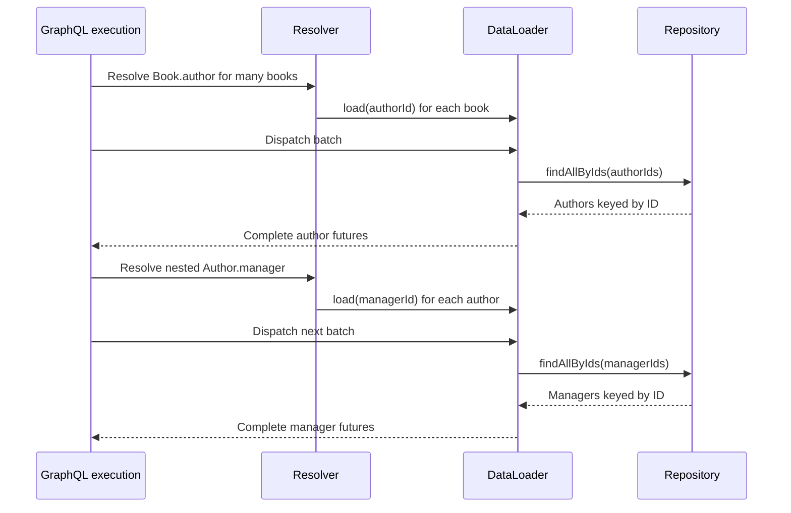

# DataLoaderRegistry

In GraphQL, an operation can return many objects, and each object may need to load related data. If every resolver independently queries data for each object, the server quickly runs into the N+1 problem. GraphQL Java's **DataLoaderRegistry** is the container holding named `DataLoader`s so resolvers can request data by key, batch multiple requests together, and use caching within the scope of a single execution.

`DataLoaderRegistry` is neither a store for business data nor a singleton shared across the entire application. It holds the `DataLoader` instances for a single GraphQL execution. In Spring for GraphQL, `BatchLoaderRegistry` is the Spring-level abstraction for registering how loaders are created; Spring creates and attaches an appropriate `DataLoaderRegistry` to each request. Understanding the boundary between these two registries prevents mismanaging loader lifecycles manually.

## 1. The N+1 problem and the role of DataLoader

Suppose a schema allows fetching a list of books with their authors:

```graphql
type Query {
    books: [Book!]!
}

type Book {
    id: ID!
    title: String!
    author: Author
}

type Author {
    id: ID!
    name: String!
}
```

If a query fetches 30 books and the `Book.author` field calls the repository once per book, the server may execute one query to fetch the list of books and then 30 queries to fetch the authors. The total query count grows with the number of books.

DataLoader changes how resolvers request data. Each resolver calls `load(key)` instead of querying immediately. DataLoader gathers keys within the same execution, then invokes the batch loader once for a group of keys. Results are distributed back to each resolver that requested the corresponding key.

```mermaid
flowchart TD
    A[Query fetching list of Books] --> B[Book 1, Book 2, ..., Book N]
    B --> C[Book.author resolver calls load(authorId)]
    C --> D[DataLoaderRegistry holds authorLoader]
    D --> E[Batch authorIds together]
    E --> F[Batch loader queries multiple Authors]
    F --> G[Distribute results by key]
    G --> H[GraphQL completes response]
```

DataLoader does not inherently know how to query a database. The application supplies a batch loader that accepts multiple keys and returns the corresponding data. DataLoader handles request batching, result coordination, and configurable caching.

## 2. What is DataLoaderRegistry?

In GraphQL Java, `DataLoaderRegistry` is a registry holding multiple `DataLoader`s registered by name. Resolvers retrieve a loader by name from `DataFetchingEnvironment`, then call `load(key)` to obtain a `CompletionStage` or `CompletableFuture` for the result.

Example of a registry with two loaders:

| Loader name | Key | Value |
| --- | --- | --- |
| `authorLoader` | `String` author ID | `Author` |
| `reviewCountLoader` | `String` book ID | `Integer` review count |

The two loaders serve different data types while belonging to the same `DataLoaderRegistry` for the current execution. Resolvers do not need to know whether a loader is backed by a database, an HTTP client, or a cache; they only need the agreed-upon name and key/value types.

`DataLoaderRegistry` provides these primary operations:

- `register(name, dataLoader)`: registers a loader under a name.
- `getDataLoader(name)`: retrieves a registered loader.
- `containsKey(name)`: checks whether a loader name exists in the registry.
- `unregister(name)`: removes a loader by name.
- `dispatchAll()`: dispatches pending loaders in the registry when managing the dispatch loop manually at a low level.

The loader name is part of an internal contract between the registration site and the resolver. If the names do not match, `getDataLoader` fails to retrieve the desired loader. Use constants or a centralized naming convention when there are multiple loaders.

## 3. Lifecycle of DataLoaderRegistry

A `DataLoaderRegistry` should be created for each GraphQL execution/request so caches are never shared beyond their intended scope. When the request finishes, the registry and its loaders are no longer reused for the next request.

Do not register a `DataLoader` in a static field or Spring singleton and share the same instance across all requests. Doing so can cause the cache to retain a previous user's data and mistakenly return it to a later request; loaders could also retain stale data after an entity changes.

Typical lifecycle flow:

1. A GraphQL request arrives at the server.
2. Spring for GraphQL or the integration layer creates a `DataLoaderRegistry` for the execution.
3. `DataLoader`s are registered into the registry.
4. Resolvers retrieve a loader and call `load(key)`.
5. GraphQL Java coordinates batch dispatches during execution.
6. Results are returned in the response; the registry ends with the execution.

For long-lived subscriptions emitting many events, clearly understand the execution scope of each event and avoid holding request caches for too long. Do not assume a cached loader is safe to keep across a long-lived subscription connection if underlying data can change.

## 4. Creating DataLoaders and registering manually in GraphQL Java

GraphQL Java DataLoader supports different kinds of batch loaders. `BatchLoader<K, V>` takes a list of keys and returns a list of values in the same order. For example:

```java
BatchLoader<String, Author> authorBatchLoader = authorIds ->
    authorRepository.findAllByIdsAsync(authorIds);

DataLoader<String, Author> authorLoader =
    DataLoaderFactory.newDataLoader(authorBatchLoader);

DataLoaderRegistry registry = new DataLoaderRegistry();
registry.register("authorLoader", authorLoader);
```

When using `BatchLoader`, element positions in the returned list must match the order of input keys. If the database returns results in a different order, build a `Map` by ID and reconstruct the list in input key order:

```java
BatchLoader<String, Author> authorBatchLoader = authorIds ->
    authorRepository.findAllByIdsAsync(authorIds)
        .thenApply(authors -> {
            Map<String, Author> byId = authors.stream()
                .collect(Collectors.toMap(Author::id, Function.identity()));

            return authorIds.stream()
                .map(byId::get)
                .toList();
        });
```

In these examples, `findAllByIdsAsync` returns `CompletionStage<List<Author>>`; the batch loader does not block a thread waiting on the repository. If the repository only offers a blocking API, isolate it on a bounded executor rather than running blocking I/O on the common pool by default. If a key has no data, the result list must still maintain the exact count and position; the value at that index can be `null` if the GraphQL type permits it.

### Using MappedBatchLoader

When the repository returns data out of key order, `MappedBatchLoader<K, V>` is often more convenient. The batch loader accepts a set of keys and returns a `Map` from key to value:

```java
MappedBatchLoader<String, Author> authorBatchLoader = authorIds ->
    authorRepository.findAllByIdsAsync(authorIds)
        .thenApply(authors -> authors.stream()
            .collect(Collectors.toMap(Author::id, Function.identity())));

DataLoader<String, Author> authorLoader =
    DataLoaderFactory.newMappedDataLoader(authorBatchLoader);

DataLoaderRegistry registry = new DataLoaderRegistry()
    .register("authorLoader", authorLoader);
```

A map allows omitting keys that were not found; DataLoader has no value for that key and the resolver receives an empty/`null` result per the loader API. Define clearly how missing entries are represented in the schema, especially for non-null fields.

### Attaching the registry to GraphQL execution

When configuring GraphQL Java directly, pass the registry to `ExecutionInput`:

```java
ExecutionInput input = ExecutionInput.newExecutionInput()
    .query("{ books { id title author { name } } }")
    .dataLoaderRegistry(registry)
    .build();
```

GraphQL Java requires a dispatch mechanism so `load` calls are batched and batch loaders are invoked at the right moment. When building the engine manually, configure `DataLoaderDispatcherInstrumentation` according to your GraphQL Java version:

```java
GraphQL graphQL = GraphQL.newGraphQL(schema)
    .instrumentation(new DataLoaderDispatcherInstrumentation())
    .build();
```

The instrumentation coordinates dispatches across execution phases, including subsequent rounds when child resolvers issue additional DataLoader requests. Never call `dispatch()` manually inside every resolver; doing so can break batching and cause every field to dispatch separately.

The configuration above applies to applications using GraphQL Java directly. With Spring for GraphQL, use `BatchLoaderRegistry` and the built-in integration instead of building a custom `GraphQL` engine or singleton registry.

## 5. Retrieving DataLoader in a resolver

Once a loader is registered under the name `authorLoader`, a resolver can retrieve it from `DataFetchingEnvironment`:

```java
@SchemaMapping(typeName = "Book", field = "author")
public CompletableFuture<Author> author(
        Book book,
        DataFetchingEnvironment environment) {

    DataLoader<String, Author> loader =
        environment.getDataLoader("authorLoader");

    return loader.load(book.authorId());
}
```

`load` does not execute a query synchronously. It records the key and returns a future for the result. GraphQL Java coordinates dispatching after collecting eligible requests. The resolver returns the future to the engine instead of calling `join()` or `get()` to block the thread.

One operation can resolve many `Book.author` fields. Each resolver calls `load(authorId)`; if multiple books share the same author ID, DataLoader can use its cache to share the same result within the request. Distinct IDs can be batched together.

## 6. DataLoaderOptions and caching

DataLoader provides options to control batching and caching. For example:

```java
DataLoaderOptions options = DataLoaderOptions.newOptions()
    .setCachingEnabled(true)
    .setMaxBatchSize(100);

DataLoader<String, Author> authorLoader =
    DataLoaderFactory.newMappedDataLoader(authorBatchLoader, options);
```

Commonly used options:

| Option | Meaning |
| --- | --- |
| Caching enabled | Caches results by key for the loader's lifetime; typically enabled by default |
| Max batch size | Caps how many keys go into one batch; helpful when databases limit parameters or query size |
| Caching key function | Normalizes cache keys when the key type needs custom comparison rules |
| Cache map | Replaces the default cache structure when custom policies are needed |
| Batch loader context | Passes required context to the batch loader |

DataLoader's cache acts as per-key memoization within the loader's scope. It is not a distributed cache and does not synchronize across requests. When the request ends, the loader's cache ends too.

If caching is disabled, the same key can be requested multiple times in one execution and appear repeatedly in batches depending on configuration. Disable caching only with a clear reason and ensure the batch loader handles duplicate keys. For most data reads, per-request caching prevents loading the same object multiple times.

### Clearing and priming the cache

DataLoader provides operations such as `clear(key)`, `clearAll()`, and `prime(key, value)` to manage the cache within the current execution.

For example, after a mutation updates an author, the loader can clear the old key and prime the new value:

```java
DataLoader<String, Author> loader = environment.getDataLoader("authorLoader");
loader.clear(updatedAuthor.id());
loader.prime(updatedAuthor.id(), updatedAuthor);
```

`prime` normally does not overwrite a key already present in the cache; therefore, clearing first and then priming replaces the old value with the new result in the current request. This does not update external caches or other requests. If the application has a service-level cache, that cache still needs invalidation according to its own policy.

## 7. BatchLoaderRegistry in Spring for GraphQL

Spring for GraphQL provides `BatchLoaderRegistry` to register batch loaders by key/value type. Spring uses this registry to create DataLoaders for each GraphQL request and place them into GraphQL Java's `DataLoaderRegistry`. This frees the application from building `ExecutionInput` manually or managing dispatch instrumentation at the controller layer.

Example registering a mapped batch loader:

```java
@Configuration
public class DataLoaderConfiguration {

    public DataLoaderConfiguration(
            BatchLoaderRegistry registry,
            AuthorService authorService) {

        registry.forTypePair(String.class, Author.class)
            .registerMappedBatchLoader((authorIds, environment) ->
                authorService.findAllByIds(authorIds));
    }
}
```

`forTypePair(String.class, Author.class)` specifies the loader's key/value types. `registerMappedBatchLoader` registers a function that takes a set of author IDs and returns a `Map` from ID to `Author`. Spring registers the loader per request and supports propagating the GraphQL execution context to the batch loader.

In a controller, you can accept `DataLoader` as a parameter resolved by Spring based on its key/value types:

```java
@Controller
public class BookController {

    @SchemaMapping(typeName = "Book", field = "author")
    public CompletableFuture<Author> author(
            Book book,
            DataLoader<String, Author> authorLoader) {
        return authorLoader.load(book.authorId());
    }
}
```

Spring for GraphQL resolves `DataLoader` parameters in annotated controllers based on generic key/value types. This avoids having to call `environment.getDataLoader(name)` manually in resolvers when using type-pair registration.

`BatchLoaderRegistry` and `DataLoaderRegistry` serve distinct roles:

| Component | Role |
| --- | --- |
| `BatchLoaderRegistry` | Registers batch loader definitions in Spring configuration; used to create per-request loaders |
| `DataLoaderRegistry` | Holds the actual `DataLoader` instances attached to a single GraphQL execution |
| `DataLoader` | Accepts keys, batches requests, caches results, and returns futures for values |
| `BatchLoader` / `MappedBatchLoader` | Performs data loading for a group of keys |

Do not create a singleton `DataLoaderRegistry` to replace `BatchLoaderRegistry`. Spring manages the runtime registry per request lifecycle; the application only registers how data should be loaded.

## 8. Using @BatchMapping or DataLoaderRegistry?

For simple nested field resolvers, `@BatchMapping` is often the most concise option:

```java
@Controller
public class BookController {

    private final AuthorService authorService;

    public BookController(AuthorService authorService) {
        this.authorService = authorService;
    }

    @BatchMapping(typeName = "Book", field = "author")
    public Map<Book, Author> authors(List<Book> books) {
        Set<String> ids = books.stream()
            .map(Book::authorId)
            .collect(Collectors.toSet());
        Map<String, Author> byId = authorService.findAllByIds(ids);

        Map<Book, Author> result = new HashMap<>();
        for (Book book : books) {
            result.put(book, byId.get(book.authorId()));
        }
        return result;
    }
}
```

`@BatchMapping` automatically registers a batch loader and binds it to the corresponding field. Use `BatchLoaderRegistry` when you want to reuse a loader by key/value type across multiple resolvers or need finer control over the loader. Use `DataLoaderRegistry` directly when integrating GraphQL Java at a low level or managing `ExecutionInput` yourself.

There is no need to add both `@BatchMapping` and another registered `DataLoader` for the same field without a specific design reason. Two mechanisms mapping the same field can conflict or confuse developers about which resolver runs.

## 9. Batch dispatching occurs across multiple rounds

DataLoader often dispatches across multiple rounds during GraphQL execution. For example, a query fetching books, each book's author, and the author's manager:

```graphql
type Query {
    books: [Book!]!
}

type Book {
    id: ID!
    author: Author
}

type Author {
    id: ID!
    manager: Author
}
```

In the first round, GraphQL invokes the `Book.author` resolver for the books; resolvers call `authorLoader.load(...)`. At the dispatch point, author IDs are gathered and batch-loaded. Once `Author`s arrive, GraphQL continues resolving `Author.manager`; resolvers call `authorLoader.load(managerId)`, creating the next batch. Thus, one operation can involve multiple dispatch rounds depending on the selection set structure.



Never call `dispatch()` immediately after each `load()` inside a resolver. If every resolver dispatches on its own, keys never have a chance to batch together. Let GraphQL Java instrumentation or Spring's integration coordinate dispatching.

## 10. Context and security in batch loaders

A batch loader sometimes needs a tenant ID, user identity, or request metadata to filter data. Spring for GraphQL supports passing context to batch loaders via `BatchLoaderEnvironment` and `BatchLoaderRegistry`'s context integration.

Never rely on unauthenticated client-supplied values like `tenantId` to make access-control decisions. Derive the scope from a verified security context, then pass the necessary values to the batch loader. If a loader returns tenant-scoped data, the batch query must enforce the tenant filter across all keys.

DataLoader caches by key inside the registry. If the same ID can yield different data depending on tenant or principal, using only the ID as the key may be insufficient in an execution spanning multiple security scopes. Ensure an execution has a consistent security scope, or design keys containing all necessary context and avoid sharing loaders across differing scopes.

With Spring Security and async batch loaders, ensure context is properly propagated up to batch dispatch time. Never assume `ThreadLocal` is automatically present on the thread executing the batch. When needed, use Spring's context propagation mechanisms and explicitly pass verified tenant/principal values.

## 11. Handling errors and missing data

A batch loader may encounter errors when querying a database or external service. If a batch loader completes exceptionally, all related loads in that batch can fail together. Define how errors are categorized and let GraphQL error handling translate them appropriately for clients.

Cases where some keys lack data must be distinguished from whole-batch failures. With `MappedBatchLoader`, the `Map` can omit unfound keys; DataLoader completes those loads without a value. With `BatchLoader`, you must return a list matching every key position, using `null` for missing keys if the contract permits.

For example, `Book.author: Author` can be nullable so an unfound author returns `null`. If the schema declares `author: Author!`, a `null` value violates the contract and GraphQL applies null propagation. Choose nullability based on actual data guarantees.

Never catch all exceptions and return an empty `Map`, because that makes system failures look as though all keys do not exist. Only omit missing keys when that is a valid business outcome; query failures must be propagated as errors.

## 12. Cache invalidation after mutations

DataLoader caching avoids loading the same key multiple times in one request, yet it can cause resolvers to read stale values after a mutation modifies data within the same operation or execution context.

For instance, a mutation operation updates an author and then requests that author again. If the loader already cached the old value, clear the key or prime the new value:

```java
@MutationMapping
public Author updateAuthor(
        @Argument("input") UpdateAuthorInput input,
        DataLoader<String, Author> authorLoader) {

    Author updated = authorService.update(input);
    authorLoader.clear(updated.id());
    authorLoader.prime(updated.id(), updated);
    return updated;
}
```

This applies to the current DataLoader's cache. If a mutation updates data while another request has its own cache, clearing in this request does not affect the other request. Distributed caches or service-level caches must be invalidated independently.

## 13. Testing DataLoaderRegistry and batching

Tests must prove both the GraphQL output and that the batch loader actually reduces query counts. Verifying only a correct response does not prove DataLoader batched keys.

With `GraphQlTester`, send a query fetching multiple books and authors:

```java
graphQlTester.document("""
        query {
            books {
                id
                title
                author {
                    id
                    name
                }
            }
        }
        """)
    .execute()
    .path("books")
    .entityList(BookView.class)
    .hasSize(3);
```

Mock or spy on the batch service/repository to assert that:

- Multiple author IDs are sent in a batch rather than once per book.
- Books sharing the same author ID reuse the result within the request.
- Nonexistent keys are handled according to schema nullability.
- Two separate GraphQL requests do not share DataLoader caches.
- Mutations clear/prime the cache for updated results within the current execution.
- Batch loader errors produce appropriate GraphQL errors instead of silently turning into empty data.

If using GraphQL Java directly, you can separately test loader name registration and attaching the registry to `ExecutionInput`. With Spring for GraphQL, include an application context integration test confirming `BatchLoaderRegistry` is discovered and `DataLoader` is injected into controllers with the expected generic types.

## 14. Common mistakes

| Symptom | Cause | Resolution |
| --- | --- | --- |
| `getDataLoader` returns `null` | Loader name mismatch or unregistered in registry | Align names and check registry configuration |
| Batch still runs one query per object | Resolver calls repository directly or dispatches prematurely | Call `load(key)` and let execution coordinate batches |
| Results assigned to wrong keys | `BatchLoader` returns list in the wrong order | Return in exact key order or use `MappedBatchLoader` |
| Stale data within the same request | DataLoader cache retains value loaded before mutation | Use `clear(key)` and `prime(key, value)` as needed |
| Another user's data exposed | Sharing loader/cache across requests or missing tenant scope | Create registry per request and enforce security scope |
| Batch error fails multiple fields | Batch loader completes exceptionally | Classify errors, log, and map GraphQL errors clearly |
| Missing key treated as system error | Not distinguishing nonexistent records from batch failure | Use mapped results/nullable fields per contract |
| Loader never dispatches | Missing dispatcher instrumentation when using GraphQL Java directly | Configure `DataLoaderDispatcherInstrumentation` or use Spring integration |
| Resolver blocks waiting on loader | Calling `join()` or `get()` | Return the future from `load(key)` directly |

## 15. Design principles for DataLoaderRegistry

Create a `DataLoaderRegistry` per GraphQL execution, assign clear loader names, and align key/value types between batch loaders and resolvers. Use `MappedBatchLoader` when data is keyed and repository ordering is not guaranteed; use `BatchLoader` when you can reliably preserve input order. Configure max batch sizes according to database limits and keep caching scoped to the request.

In Spring for GraphQL, prefer `BatchLoaderRegistry` to register loaders and let the framework create a `DataLoaderRegistry` per request. Use `@BatchMapping` for straightforward field relationships; use registered `DataLoader`s when you need reuse or fine-grained loader control; only manage `DataLoaderRegistry` and instrumentation manually when integrating GraphQL Java at a low level.

Do not block with `join()` inside resolvers, do not manually dispatch after every load, and do not share caches across users. Test batch call counts, key/value ordering, errors, cache invalidation, and tenant isolation. With a properly managed lifecycle, `DataLoaderRegistry` provides the foundation for GraphQL to batch queries, curb N+1, and keep resolvers decoupled from underlying data loading.
