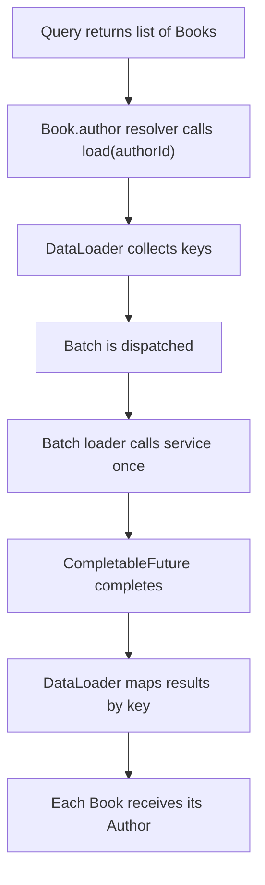

# Batch loader returning `CompletableFuture`

In GraphQL, a nested field may be resolved for many parent objects within a single operation. If every resolution hits the database separately, the application quickly runs into the N+1 problem. **DataLoader** collects keys requested within the same batch window and invokes a batch loader to load data in groups.

With GraphQL Java, a batch loader can return a `CompletionStage`, commonly implemented via `CompletableFuture`. This lets batch queries execute asynchronously: resolvers call `DataLoader.load(key)` and return the future to GraphQL; once the batch completes, each field receives the value corresponding to its key.

In Spring for GraphQL, you should register loaders through `BatchLoaderRegistry` so Spring manages DataLoaders per GraphQL request. If a service already has an API returning `CompletableFuture`, you can use `Mono.fromFuture` to bridge that API to the reactive publisher accepted by Spring's registry.

## The N+1 problem before DataLoader

Suppose an API returns a list of books and each book has an author:

```graphql
type Query {
  books: [Book!]!
}

type Book {
  id: ID!
  title: String!
  author: Author
}

type Author {
  id: ID!
  name: String!
}
```

The client sends an operation:

```graphql
query BooksWithAuthors {
  books {
    id
    title
    author {
      id
      name
    }
  }
}
```

Suppose `Query.books` loads 100 books in one query. Then the `Book.author` resolver is invoked for each book and queries the author by `authorId` each time. The query count can be:

- 1 query to fetch the list of books.
- 100 queries to fetch authors for the 100 books.

That totals 101 queries for a single operation. If multiple books reference the same author, the system may also load the same record repeatedly.

DataLoader replaces individual loads with calls to `load(authorId)`. Keys requested close together during execution are combined into a batch, and the batch loader queries multiple authors at once.

## How DataLoader works



The process typically follows these steps:

1. The `Query.books` resolver returns the list of `Book`s.
2. GraphQL executes the `Book.author` field on each element.
3. Each resolver calls `authorLoader.load(book.getAuthorId())`; the call immediately returns a `CompletableFuture<Author>`.
4. DataLoader collects the keys and dispatches the batch per GraphQL Java's execution mechanics.
5. The batch loader calls the service to load multiple authors and returns a `CompletableFuture` containing the results.
6. DataLoader distributes values to the future corresponding to each key.
7. GraphQL continues assembling the response according to the selection set.

Resolvers do not need to collect key lists themselves or manually dispatch in standard GraphQL integration. GraphQL Java coordinates DataLoader dispatching during operation execution.

## GraphQL Java's `BatchLoader` returning CompletionStage

GraphQL Java DataLoader provides the `BatchLoader<K, V>` interface. Its `load` method accepts a list of keys and returns `CompletionStage<List<V>>`. A `CompletableFuture<List<V>>` satisfies this contract because `CompletableFuture` implements `CompletionStage`.

Example of a service returning asynchronous results:

```java
public interface AuthorService {
    CompletableFuture<List<Author>> findAllByIds(List<Long> authorIds);
}
```

Registering a `BatchLoader` directly with GraphQL Java:

```java
import org.dataloader.BatchLoader;
import org.dataloader.DataLoader;
import org.dataloader.DataLoaderFactory;

BatchLoader<Long, Author> batchLoader = authorIds ->
        authorService.findAllByIds(authorIds);

DataLoader<Long, Author> authorLoader =
        DataLoaderFactory.newDataLoader(batchLoader);
```

Here:

- `Long` is the key type, matching `Book.authorId`.
- `Author` is the value type to load per key.
- `BatchLoader` receives the list of keys in a batch.
- `CompletableFuture<List<Author>>` indicates the result will complete asynchronously.

This shows direct usage of the GraphQL Java API. In a Spring for GraphQL application, you should normally register via `BatchLoaderRegistry` so DataLoaders are created and attached to each request's registry. The next sections cover that integration.

## Crucial rule: results must match key order

With a `BatchLoader<K, V>` returning `List<V>`, element ordering in the list must match the input key order exactly. DataLoader pairs results by position rather than inferring relationships from IDs inside objects.

Suppose a batch receives keys:

```text
[12, 5, 20]
```

Then the returned list must have the order:

```text
[Author(id=12), Author(id=5), Author(id=20)]
```

If the database returns results in `[5, 12, 20]` order and the service passes that list straight back, DataLoader can assign the wrong author to a book. Never rely on the natural order of a `WHERE id IN (...)` query; databases do not guarantee order without `ORDER BY`, and `ORDER BY` on ID will not necessarily match the original key list order either.

You can reorder results to match the key list:

```java
BatchLoader<Long, Author> batchLoader = authorIds ->
        authorService.findAllByIds(authorIds).thenApply(authors -> {
            Map<Long, Author> byId = authors.stream()
                    .collect(Collectors.toMap(Author::getId, Function.identity()));

            return authorIds.stream()
                    .map(byId::get)
                    .collect(Collectors.toList());
        });
```

This example preserves exact key order. If an ID does not exist, `byId.get(id)` returns `null`; that is only suitable when the GraphQL field is nullable and the application wants to represent not-found as `null`. If the schema declares `author: Author!`, handle not-found according to contract to avoid unintended `null`s.

## Using `MappedBatchLoader` when the service returns a Map

Many services or repositories return results as `Map<ID, Entity>`. In that case, `MappedBatchLoader<K, V>` is often more convenient because the loader returns `CompletionStage<Map<K, V>>`; DataLoader matches results by key rather than list position.

```java
import org.dataloader.MappedBatchLoader;

MappedBatchLoader<Long, Author> mappedBatchLoader = authorIds ->
        authorService.findAllByIdsAsMap(authorIds);
```

Service contract:

```java
public interface AuthorService {
    CompletableFuture<Map<Long, Author>> findAllByIdsAsMap(Set<Long> authorIds);
}
```

With a mapped loader, there is no need to sort a list to match key order. Each value is looked up by its corresponding key in the map. Keys absent from the map are treated as having no result and typically resolve to `null` for that key.

| Loader type | Input | Asynchronous result | Result-matching requirement |
| --- | --- | --- | --- |
| `BatchLoader<K, V>` | `List<K>` | `CompletionStage<List<V>>` | List must match the exact order of the key list. |
| `MappedBatchLoader<K, V>` | `Set<K>` | `CompletionStage<Map<K, V>>` | Matched by key; no ordering requirement. |

Choose a mapped loader when the service returns a map or data is naturally looked up by ID. Choose a list batch loader when the service already guarantees order or can explicitly reorder results.

## Registering a CompletableFuture batch loader in Spring for GraphQL

Spring for GraphQL provides `BatchLoaderRegistry` to register DataLoaders. This registry integrates with the GraphQL request lifecycle and ensures DataLoaders are never inadvertently shared across distinct requests.

Suppose the service has a method returning `CompletableFuture<Map<Long, Author>>`:

```java
public interface AuthorService {
    CompletableFuture<Map<Long, Author>> findAllByIdsAsMap(Set<Long> authorIds);
}
```

You can register a mapped batch loader and adapt the future to a Reactor `Mono` using `Mono.fromFuture`:

```java
import org.springframework.context.annotation.Configuration;
import org.springframework.graphql.execution.BatchLoaderRegistry;
import org.springframework.beans.factory.annotation.Autowired;
import reactor.core.publisher.Mono;

@Configuration
public class GraphQlDataLoaderConfiguration {

    @Autowired
    public void registerAuthorLoader(
            BatchLoaderRegistry registry,
            AuthorService authorService) {

        registry.forTypePair(Long.class, Author.class)
                .registerMappedBatchLoader((authorIds, environment) ->
                        Mono.fromFuture(
                                () -> authorService.findAllByIdsAsMap(authorIds)));
    }
}
```

`registerMappedBatchLoader` accepts the keys to load and a publisher emitting the result map. `Mono.fromFuture` converts `CompletableFuture<Map<Long, Author>>` to `Mono<Map<Long, Author>>`, matching Spring for GraphQL's reactive integration. The supplier defers creating the future until the publisher is subscribed, rather than invoking the service prematurely during configuration.

`BatchLoaderRegistry` is normally pre-configured by Spring Boot/Spring for GraphQL. The application can inject the registry to register loaders; there is no need to build a singleton DataLoader shared across all requests.

### Using `registerBatchLoader` with a list result

If the service returns `CompletableFuture<List<Author>>`, you can register a list-based batch loader. Spring's registry expects a publisher of `Author` values, so convert the future list into a `Flux<Author>`:

```java
registry.forTypePair(Long.class, Author.class)
        .registerBatchLoader((authorIds, environment) ->
                Mono.fromFuture(
                            () -> authorService.findAllByIdsInKeyOrder(authorIds))
                        .flatMapMany(Flux::fromIterable));
```

`findAllByIdsInKeyOrder` must return a list in the exact same order as `authorIds`. `Flux.fromIterable` emits elements in that order; Spring converts the publisher output into the batch result for GraphQL Java DataLoader.

With the Spring API, `registerBatchLoader` and `registerMappedBatchLoader` hide low-level `DataLoader` construction while integrating context and request lifecycle. Specific registry signatures may have version-dependent overloads; use the exact `Publisher` type declared in your project's Spring for GraphQL dependency.

## Calling DataLoader from `@SchemaMapping`

Once a loader is registered for the `Long` and `Author` key/value pair, a controller can accept `DataLoader<Long, Author>` as a parameter:

```java
import org.dataloader.DataLoader;
import org.springframework.graphql.data.method.annotation.SchemaMapping;
import org.springframework.stereotype.Controller;

@Controller
public class BookController {

    @SchemaMapping(typeName = "Book", field = "author")
    public CompletableFuture<Author> author(
            Book book, DataLoader<Long, Author> authorLoader) {
        return authorLoader.load(book.getAuthorId());
    }
}
```

`load` returns `CompletableFuture<Author>`. The resolver returns this future directly to GraphQL without calling `join()` or `get()` to block synchronously. When multiple `Book.author` resolutions call `load`, DataLoader can batch the IDs and invoke the batch loader once.

The generic types of `DataLoader` in the controller must match the registered loader. If you register `forTypePair(Long.class, Author.class)` while the controller requests `DataLoader<String, Author>`, those are two different type pairs and Spring cannot treat them as the same loader.

## Complete flow from Query to CompletableFuture batch

Condensed example of the main components:

```graphql
type Query {
  books: [Book!]!
}

type Book {
  id: ID!
  title: String!
  author: Author
}

type Author {
  id: ID!
  name: String!
}
```

`Query.books` returns the list of books. `Book.author` uses DataLoader:

```java
@Controller
public class BookQueryController {

    private final BookService bookService;

    public BookQueryController(BookService bookService) {
        this.bookService = bookService;
    }

    @QueryMapping
    public List<Book> books() {
        return bookService.findAll();
    }

    @SchemaMapping(typeName = "Book", field = "author")
    public CompletableFuture<Author> author(
            Book book, DataLoader<Long, Author> authorLoader) {
        return authorLoader.load(book.getAuthorId());
    }
}
```

With 100 books having 100 distinct author IDs, instead of calling the service 100 times inside the field resolver, DataLoader batches the keys and calls the batch service. If multiple books share the same author, per-key caching within the same request also avoids duplicate loads.

## Per-request DataLoader caching

DataLoader typically caches results by key within the scope of a single request. When the same key is loaded multiple times in a request, DataLoader can return the stored future and keep the duplicate key out of subsequent batches.

In Spring for GraphQL, loaders registered via `BatchLoaderRegistry` are attached to each request's DataLoader registry. This matters because results may depend on that request's principal, tenant, or authorized data scope.

Do not create a static or singleton DataLoader and share it across multiple requests. A shared cache can let stale data linger too long and leak data across users or tenants if results depend on access permissions.

When a mutation updates an `Author` and the same operation later reads that author via DataLoader, the request's cache may still hold the old value. You can remove or update the entry using operations like `clear(key)` and `prime(key, value)` on the DataLoader depending on the business flow. You do not need to clear the cache for ordinary reads.

## Batch size, dispatching, and load limits

DataLoader combines keys into batches, yet an oversized batch can exceed a database's `IN` clause limit or overload a downstream service. Consider:

- Capping the maximum keys per database query.
- Splitting large batches into smaller queries inside the service when necessary.
- Limiting root Query element counts via pagination.
- Setting timeouts for queries and dependent services.
- Monitoring keys per batch, batch duration, cache hits, and errors.

DataLoader reduces round-trips, but it does not replace pagination or query optimization. A single batch loading tens of thousands of records can still consume significant memory and serialization time.

## Handling errors and missing data

A batch loader can fail when querying a database or external service. If the `CompletableFuture` completes exceptionally, DataLoader has no normal result for that batch and the error enters GraphQL execution.

Example of wrapping errors with context:

```java
BatchLoader<Long, Author> batchLoader = authorIds ->
        authorService.findAllByIds(authorIds)
                .handle((authors, error) -> {
                    if (error != null) {
                        throw new CompletionException(
                                new AuthorBatchLoadException(error));
                    }
                    return authors;
                });
```

In real applications, let Spring for GraphQL's exception resolvers map errors to safe public messages and error codes. Never expose raw SQL, stack traces, or internal connection details in responses.

Distinguish whole-batch failures from a single missing key:

- If the service cannot find one author, the batch loader can return `null` for that key or omit it from the map in a mapped loader. This works when the GraphQL field is nullable.
- If an element is non-null in SDL, GraphQL generates an execution error and applies null propagation per schema rules.
- If the entire batch query fails, the future completes exceptionally; multiple fields waiting on that batch may all receive errors.

Do not use a generic exception to represent an ordinary not-found case when the API contract expects `null`. Conversely, never silently convert database errors into `null`, because clients cannot tell missing data apart from an unhealthy system.

## Do not block futures with `join()` or `get()`

This is an anti-pattern inside a resolver:

```java
@SchemaMapping(typeName = "Book", field = "author")
public Author author(Book book, DataLoader<Long, Author> authorLoader) {
    return authorLoader.load(book.getAuthorId()).join();
}
```

`join()` blocks the thread waiting for the future to complete. This negates DataLoader's asynchronous benefits and can cause thread starvation or deadlocks under certain execution setups.

Return the future directly:

```java
@SchemaMapping(typeName = "Book", field = "author")
public CompletableFuture<Author> author(
        Book book, DataLoader<Long, Author> authorLoader) {
    return authorLoader.load(book.getAuthorId());
}
```

GraphQL Java coordinates futures and DataLoader dispatching during execution.

## Testing batch loaders returning CompletableFuture

You can test two layers separately:

1. **Batch service/loader:** verify that a single invocation accepts multiple keys, returns results in exact order or mapped accurately by key, and handles missing keys/errors.
2. **GraphQL integration:** send a query with multiple parent objects, verifying the resolver uses DataLoader and the service is called only in the expected batches.

Example checking the response with `GraphQlTester`:

```java
@Test
void booksResolveAuthorsThroughBatchLoader() {
    graphQlTester.document("""
        query {
          books {
            id
            author {
              id
              name
            }
          }
        }
        """)
        .execute()
        .path("books[0].author.name")
        .entity(String.class)
        .isEqualTo("Nguyen An");
}
```

Integration tests should also assert the batch service call count and received key sets. Do not verify only a correct response, because a resolver can still cause N+1 while returning valid data.

Scenarios to cover:

- Multiple parent objects produce one batch instead of one service call per parent.
- Duplicate keys within the same request are cached per default configuration.
- List batches are returned in exact key order.
- Mapped batches return accurate values by key even when map ordering is non-deterministic.
- Keys without results honor nullability.
- An exceptional `CompletableFuture` produces an appropriate GraphQL error.
- Two separate requests do not share DataLoader caches.
- Mutations updating data do not leave loaders returning unintended stale entries.
- Large batches are bounded or chunked according to service policy.

## Common mistakes

| Symptom | Cause | Solution |
| --- | --- | --- |
| Wrong author assigned to a book | `BatchLoader` returned list in a different order than keys. | Sort results to match input keys or use `MappedBatchLoader`. |
| N+1 still happens | Resolver calls repository directly or DataLoader is not injected properly. | Use `DataLoader.load` and verify loader registration. |
| `DataLoader` not resolved in controller | Key/value types mismatch registry or loader is unregistered. | Check `forTypePair` and generic parameters. |
| Resolver blocks | Calling `.join()` or `.get()` on the future. | Return `CompletableFuture` directly. |
| One missing key breaks the whole response | Non-null field yet batch returns `null` for that key. | Align nullability and handle not-found per contract. |
| Stale data after mutation | Per-request DataLoader cache still holds old value. | `clear(key)` and `prime(key, value)` when appropriate. |
| Cache leaks data across requests | Using a singleton or static DataLoader/cache. | Use Spring for GraphQL's per-request registry. |
| Oversized batch causes slowness or SQL errors | No cap on key count. | Chunk batches, paginate, and enforce load limits. |

## Key takeaways

GraphQL Java's `BatchLoader<K, V>` accepts `List<K>` and returns `CompletionStage<List<V>>`; `CompletableFuture<List<V>>` is a natural fit. With the list form, results must preserve exact key order. `MappedBatchLoader<K, V>` returns `CompletionStage<Map<K, V>>`, ideal when services return results keyed by ID.

In Spring for GraphQL, register loaders via `BatchLoaderRegistry` so DataLoaders are managed per request. If a service returns `CompletableFuture`, convert it to `Mono` using `Mono.fromFuture` when registering with the registry. Resolvers accept `DataLoader<K, V>`, call `load(key)`, and return the future directly—never calling `join()` or `get()`. Batching, per-request caching, error handling, and batch limits curb N+1 while keeping data and request lifecycles sound.
