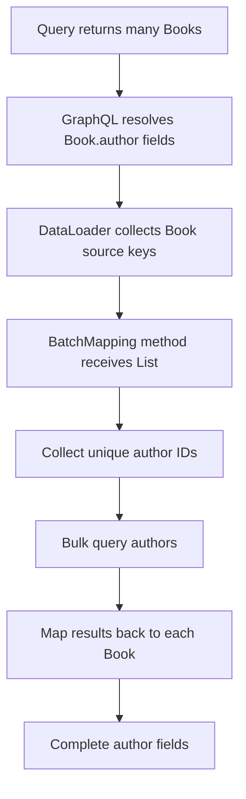

# @BatchMapping

When a GraphQL query fetches a list of multiple objects and each object has a relational field, a regular resolver can cause the **N+1 query** problem. For example, a query fetches 50 books, and then each book makes a separate database call to load its author. The server must execute one query to fetch the books and an additional 50 queries to fetch the authors.

Spring for GraphQL provides `@BatchMapping` to solve this pattern. Instead of calling a resolver once for each parent object, Spring groups the source objects into a batch and invokes the method once for that group. The method loads related data in bulk and returns the results mapped back to each source object. `@BatchMapping` integrates DataLoader automatically, so the controller does not need to manually register a batch loader for straightforward cases.

This lesson explains the N+1 problem, how `@BatchMapping` connects to DataLoader, method signatures, returning `Map` or `List`, reactive batch processing, configuring batch size, handling nulls, and testing to verify that batching works properly.

## 1. The N+1 problem in field mapping

Suppose the schema has Book and Author:

```graphql
type Query {
  books: [Book!]!
}

type Book {
  id: ID!
  title: String!
  author: Author
}

type Author {
  id: ID!
  name: String!
}
```

The client fetches the list of books and their authors:

```graphql
query {
  books {
    id
    title
    author {
      id
      name
    }
  }
}
```

A direct implementation using `@SchemaMapping`:

```java
@Controller
public class BookFieldController {

    private final AuthorService authorService;

    public BookFieldController(AuthorService authorService) {
        this.authorService = authorService;
    }

    @SchemaMapping
    public Author author(Book book) {
        return authorService.findById(book.authorId());
    }
}
```

If the query returns N books, the `author` resolver can be invoked N times. If each invocation executes a separate query, the total number of queries is roughly `1 + N`.

| Number of books | Queries for books | Queries for authors | Total |
| ---: | ---: | ---: | ---: |
| 1 | 1 | 1 | 2 |
| 10 | 1 | 10 | 11 |
| 50 | 1 | 50 | 51 |
| 100 | 1 | 100 | 101 |

This is N+1: one query to fetch the parent list and N queries to load the related data. As the number of parent objects grows, the number of round-trips to the database increases accordingly.

The solution is to collect all author IDs from the list of Books, query the Authors in a single batch, and then map the results back to each Book.

## 2. What is @BatchMapping?

`@BatchMapping` is a Spring for GraphQL annotation in the package:

```java
org.springframework.graphql.data.method.annotation.BatchMapping
```

This annotation lets you declare a batch resolver for a field of a GraphQL object type. Spring registers the corresponding DataLoader and calls the method with a list of source objects when GraphQL needs to resolve the field for multiple parent objects.

Instead of a method receiving a single source:

```java
@SchemaMapping
public Author author(Book book) {
    // One source object per call.
}
```

A batch method receives a list of sources:

```java
@BatchMapping
public List<Author> author(List<Book> books) {
    // A group of source objects per call.
}
```

`@BatchMapping` is a concise shorthand for registering a field mapping backed by a DataLoader. It is well suited when child field values can be computed for a group of source objects at once.

## 3. Basic @BatchMapping example

Suppose the Java models are:

```java
public record Book(
        String id,
        String title,
        String authorId) {
}

public record Author(
        String id,
        String name) {
}
```

The service has a method to load multiple authors by ID:

```java
public interface AuthorService {

    Map<String, Author> findAllByIds(Set<String> authorIds);
}
```

The batch controller:

```java
@Controller
public class BookFieldController {

    private final AuthorService authorService;

    public BookFieldController(AuthorService authorService) {
        this.authorService = authorService;
    }

    @BatchMapping(typeName = "Book", field = "author")
    public List<Author> author(List<Book> books) {
        Set<String> authorIds = books.stream()
                .map(Book::authorId)
                .filter(Objects::nonNull)
                .collect(Collectors.toSet());

        Map<String, Author> authorsById =
                authorService.findAllByIds(authorIds);

        return books.stream()
                .map(book -> book.authorId() == null
                        ? null
                        : authorsById.get(book.authorId()))
                .collect(Collectors.toCollection(ArrayList::new));
    }
}
```

The method receives the full list of Books whose `author` field needs to be resolved. It collects the unique author IDs, calls the service once to load the data in bulk, and then builds the list of Authors corresponding to each Book.

If a query fetches 50 books, the batch method can handle that entire group with a single service call. The number of database queries now depends on how `findAllByIds` is implemented, but typically only a single query with an `IN` clause is needed instead of N individual queries.

Repository example:

```java
public interface AuthorRepository extends JpaRepository<AuthorEntity, String> {

    List<AuthorEntity> findByIdIn(Collection<String> ids);
}
```

Service:

```java
public Map<String, Author> findAllByIds(Set<String> authorIds) {
    if (authorIds.isEmpty()) {
        return Map.of();
    }

    return authorRepository.findByIdIn(authorIds).stream()
            .map(AuthorEntity::toDomain)
            .collect(Collectors.toMap(
                    Author::id,
                    Function.identity()));
}
```

The repository and service snippets illustrate bulk loading; adapt them to your application's persistence layer.

## 4. Rules for matching results to source objects

A batch method must return results matching the exact source objects provided by Spring. There are two common return forms:

1. `Map<Source, Value>`: the key is the source object, and the value is the corresponding field value.
2. `List<Value>`: each element must be at the exact index corresponding to the source object at the same index in the input list.

### Returning a List in exact order

With the signature:

```java
@BatchMapping
public List<Author> author(List<Book> books) {
    // ...
}
```

If the source list is:

```text
[Book-A, Book-B, Book-C]
```

Then the result list must have the exact same order:

```text
[Author-A, Author-B, Author-C]
```

Do not sort the results by author name or database order if that order differs from the source list. Spring matches elements by index. Returning them in the wrong order can cause a book to display the wrong author.

The result list must also have the same number of elements as the source objects. For nullable relationships, you can place `null` at the corresponding index if the SDL field allows null.

### Returning a Map keyed by source object

You can use a Map when you want to express the source-to-value relationship explicitly:

```java
@BatchMapping(typeName = "Book", field = "author")
public Map<Book, Author> author(List<Book> books) {
    Set<String> authorIds = books.stream()
            .map(Book::authorId)
            .filter(Objects::nonNull)
            .collect(Collectors.toSet());
    Map<String, Author> authorsById =
            authorService.findAllByIds(authorIds);

    Map<Book, Author> result = new HashMap<>();
    for (Book book : books) {
        Author author = book.authorId() == null
                ? null
                : authorsById.get(book.authorId());
        result.put(book, author);
    }

    return result;
}
```

With a Map, the key must be the source object passed into the batch method. Do not use the author ID as the key if the source is Book; DataLoader needs to map the result back to the exact source object.

If a key is missing from the Map, the result for the corresponding source is treated as having no value. Deliberately decide whether that field can be null or should raise a domain error.

A Map relies on the key's equality/hashCode semantics. If the source is a Java record, `equals`/`hashCode` are generated automatically. With mutable entities or classes, ensure key semantics remain stable throughout the batch lifecycle. If you prefer not to rely on source object equality, use the List return form and preserve the order.

## 5. Inferring typeName and field name

`@BatchMapping` can declare explicitly:

- `typeName`: the GraphQL parent type that owns the field.
- `field`: the GraphQL field being resolved in batch.
- `maxBatchSize`: the limit on the number of source keys in a single batch.

If omitted, Spring infers the field name from the method name and the parent type from the element type of the source parameter `List<T>`.

For example:

```java
@BatchMapping
public List<Author> author(List<Book> books) {
    // ...
}
```

The default mapping is `Book.author`:

- The method name `author` becomes the field name.
- The element type `Book` in `List<Book>` is used to infer the parent type.

If the Java class name does not match the GraphQL type, declare it explicitly:

```java
@BatchMapping(typeName = "Book", field = "author")
public List<Author> authors(List<BookEntity> books) {
    // ...
}
```

Here the Java source type is `BookEntity`, while the schema type is `Book`. The `typeName` attribute keeps the mapping aligned with the SDL.

## 6. Reactive @BatchMapping

A batch resolver can return results asynchronously. For reactive data sources, you can return `Mono<List<V>>` or `Mono<Map<S,V>>` to avoid blocking threads in WebFlux.

Reactive service example:

```java
public interface ReactiveAuthorService {

    Mono<Map<String, Author>> findAllByIds(Set<String> authorIds);
}
```

Batch mapping:

```java
@BatchMapping(typeName = "Book", field = "author")
public Mono<List<Author>> author(List<Book> books) {
    Set<String> authorIds = books.stream()
            .map(Book::authorId)
            .filter(Objects::nonNull)
            .collect(Collectors.toSet());

    return authorService.findAllByIds(authorIds)
            .map(authorsById -> books.stream()
                    .map(book -> book.authorId() == null
                            ? null
                            : authorsById.get(book.authorId()))
                    .collect(Collectors.toCollection(ArrayList::new)));
}
```

The method returns a Mono containing the result list matched in order. GraphQL awaits the asynchronous result before completing the field.

Do not call `block()` inside a WebFlux batch resolver. If the service still uses JDBC or a blocking API, offload the work to an appropriate Executor or redesign the data access layer; wrapping a blocking call in `Mono.just` does not make it non-blocking.

## 7. maxBatchSize and splitting large batches

A query may request a very large number of parent objects. Sending thousands of IDs in a single SQL statement or in one request to another service can exceed parameter limits, payload limits, or dependency capacity.

`@BatchMapping` lets you configure `maxBatchSize`:

```java
@BatchMapping(
        typeName = "Book",
        field = "author",
        maxBatchSize = 200)
public List<Author> author(List<Book> books) {
    // Load at most 200 source objects per batch.
}
```

When the number of keys exceeds the limit, DataLoader splits them into multiple batches. The method may be invoked multiple times within the same GraphQL request.

For example, a query needing to resolve 450 books with `maxBatchSize = 200` can produce batches of sizes:

| Batch | Number of source objects |
| --- | ---: |
| 1 | 200 |
| 2 | 200 |
| 3 | 50 |

The optimal value depends on the database, column count, bind parameter limits, data size, and dependency latency. Do not set an overly large batch size just to reduce call count; a huge batch can cause slow queries and excessive memory usage.

If `maxBatchSize` is not specified, DataLoader uses its default configuration with no batch size limit set by the annotation. Set a limit when the backend has clear thresholds.

## 8. How @BatchMapping and DataLoader work together

DataLoader batches load requests targeting the same loader within a GraphQL request. When field resolvers request data, the loader can collect keys and invoke the batch function instead of performing a separate load for each key.

With `@BatchMapping`, Spring creates and registers the corresponding loader from the batch method. The controller only declares the source list and how to produce the results. There is no need to inject `DataLoader` or call `BatchLoaderRegistry` manually for simple cases.

General flow:



The loader and its cache are scoped to the GraphQL request. Different requests do not share DataLoader caches. This is an important design choice to prevent data from one request or user from being reused in another request.

Batching only combines compatible load calls occurring within the same request and targeting the same loader. It does not automatically combine calls to different loaders or across independent HTTP requests.

### Cache keys and source objects

With `@BatchMapping`, the source object is used as the key for the field mapping. If multiple field calls use the same source key within the same request, DataLoader can reuse the cached result.

If the source class is a mutable entity and its `equals`/`hashCode` depend on fields that can change, be careful when using the source as a Map key. You can use an immutable projection/record or switch to a custom DataLoader with a stable key such as an ID.

If you want to cache by author ID rather than by the Book source, a custom DataLoader keyed by author ID may be a better fit. In that case, `@SchemaMapping` receives each Book and calls `authorLoader.load(book.authorId())`.

## 9. When to use @BatchMapping vs. @SchemaMapping?

Both approaches can avoid N+1, but they differ in the level of control:

| Criterion | `@BatchMapping` | `@SchemaMapping` + DataLoader |
| --- | --- | --- |
| Source parameter | `List<Source>` | A single `Source` |
| Who registers the loader? | Spring creates it automatically from the annotation | The application registers the loader |
| Batch function | Batch method receiving multiple source objects | Batch loader registered separately |
| Loader key | Field's source object | Can be an ID or composite key |
| Flexibility | Simple for a single field depending on the source | Flexible for multiple key types and custom logic |
| Boilerplate | Less | More configuration |

Choose `@BatchMapping` when:

- The child field is resolved from source objects of the same type.
- Related data can be loaded for the entire group of parent objects.
- Results can be returned as a Map keyed by source or a List in exact order.
- You do not need direct control over the DataLoader key.

Choose `@SchemaMapping` combined with DataLoader when:

- You want the key to be an ID rather than the source object.
- You need to reuse the same DataLoader across multiple resolvers.
- You need a composite key or a key containing field arguments.
- You need finer control over caching, local context, or the batch loader.
- A single batch loader is used by multiple fields or controllers.

Do not combine both `@BatchMapping` and `@SchemaMapping` for the same parent type/field pair. Each field should have one clear mapping mechanism.

## 10. Field arguments and batch keys

A GraphQL field can accept arguments:

```graphql
type Book {
  reviews(limit: Int, language: String): [Review!]!
}
```

The result of `reviews` can vary depending on `limit` or `language`. However, `@BatchMapping` by default batches source objects as keys; if the result depends on arguments of each individual field call, using only the source object as the key may not be sufficient to distinguish different requests.

For example, the same Book can be requested with two different limit values:

```graphql
query {
  first: bookById(id: "book-1") {
    reviews(limit: 5) { id }
  }
  second: bookById(id: "book-1") {
    reviews(limit: 20) { id }
  }
}
```

When the result depends on arguments, design a key that includes both the source ID and the arguments, such as `ReviewQueryKey(bookId, limit, language)`, and use a custom DataLoader. Alternatively, redesign the schema so the batched field does not have arguments that alter the result. Do not assume a batch mapping keyed solely by source will automatically distinguish all argument variations.

## 11. Nulls and non-existent relationships

A relationship may not exist:

- A Book does not have an author yet.
- The author ID in the Book is no longer valid.
- The record has been deleted or is not permitted to be viewed.

If the SDL field is nullable:

```graphql
type Book {
  author: Author
}
```

The batch method can return null at the corresponding index in the List, or a Map without a value for the corresponding source. The earlier example used `ArrayList` to preserve null values in the result.

If the field is non-null:

```graphql
type Book {
  author: Author!
}
```

The batch method must guarantee a valid Author is always returned or raise an error. Returning null for a non-null field causes GraphQL to produce an execution error and apply null propagation to the parent.

Do not turn every missing author case into an exception if the domain allows a Book without an author. Nullability should reflect the real data contract.

### Distinguishing a missing key from a null value

With a Map return:

- Map contains the key and the value is an object: the field receives that object.
- Map contains the key with a null value: the field receives null.
- Map does not contain the key: there is no result for the corresponding source, and it is treated as having no value.

Choose a consistent convention so the code stays clear. If you need to distinguish "not found" from "not authorized to view", represent that in the service/domain result and error policy rather than relying implicitly on a missing key.

## 12. Batch loading and data security

Batch queries typically load multiple records at once. That does not mean authorization can be skipped. Every result must be filtered according to the current user, tenant, and access policies.

For example, the service should accept tenant or principal information if data is partitioned:

```java
Map<String, Author> findVisibleAuthors(
        Set<String> authorIds,
        String tenantId);
```

A batch resolver can obtain the tenant from the GraphQL context or the principal provided by Spring Security via an appropriate method argument mechanism:

```java
@BatchMapping(typeName = "Book", field = "author")
public List<Author> author(
        List<Book> books,
        Principal principal) {
    // Filter data by the current user in the service.
}
```

This signature illustrates passing the principal; check the method arguments supported by the version of Spring for GraphQL you are using. Most importantly, the service must enforce permission filtering on the batch query rather than loading all author IDs and returning them unfiltered.

DataLoader is request-scoped by default so the cache is not shared across requests. However, that does not replace authorization. The batch method must still authenticate the user and filter data before returning results.

## 13. Errors in batch resolvers

A batch method can fail because:

- The backend cannot query the database.
- A source object contains an invalid ID.
- The batch response cannot be mapped back to source objects.
- The service throws an exception due to a business rule.
- The batch size exceeds a dependency limit.

If the entire batch method throws an exception, all fields relying on that batch may receive an error. For an error specific to a single source object, consider how to represent per-element errors and the capabilities of the batch loader; do not turn a localized data error into a failure for the entire batch if it can be handled individually.

Guidelines:

- Validate input keys before calling dependencies.
- Handle the empty batch case.
- Return all results in the exact order if using a List.
- Do not return a Map keyed by an ID type instead of the source object.
- Limit batch size according to backend constraints.
- Map technical errors to safe GraphQL errors.
- Do not include stack traces or SQL in messages returned to clients.

## 14. Testing @BatchMapping with GraphQlTester

You should test end-to-end from a root query returning multiple parent objects down to the batched relational field:

```java
@GraphQlTest({BookQueryController.class, BookFieldController.class})
class BookBatchMappingTests {

    @Autowired
    GraphQlTester graphQlTester;

    @MockBean
    BookService bookService;

    @MockBean
    AuthorService authorService;

    @Test
    void loadsAuthorsForBooksInOneBatch() {
        Book book1 = new Book("book-1", "GraphQL", "author-1");
        Book book2 = new Book("book-2", "Spring", "author-2");

        given(bookService.findAll())
                .willReturn(List.of(book1, book2));

        Author author1 = new Author("author-1", "An");
        Author author2 = new Author("author-2", "Binh");
        given(authorService.findAllByIds(Set.of("author-1", "author-2")))
                .willReturn(Map.of(
                        "author-1", author1,
                        "author-2", author2));

        graphQlTester.document("""
                query {
                    books {
                        id
                        author {
                            id
                            name
                        }
                    }
                }
                """)
                .execute()
                .path("books[0].author.name")
                .entity(String.class)
                .isEqualTo("An");

        then(authorService).should(times(1))
                .findAllByIds(Set.of("author-1", "author-2"));
    }
}
```

The example assumes `BookQueryController` has a `books()` method calling `bookService.findAll()`, and the batch controller returns `List<Author>` in exact order. Add imports, models, and test configuration as appropriate for your actual application.

This test verifies that the batch service is called once for the group of two books within the same request when no batch splitting is configured. If `maxBatchSize` is set lower than the number of source objects, multiple batch calls are the expected behavior.

### Additional cases to test

- Empty or single-element source list.
- Multiple Books sharing the same author ID.
- A Book with no author ID.
- A non-existent author ID.
- List return preserving source order.
- Map return matching the exact source object.
- `maxBatchSize` splitting a batch into multiple calls.
- Reactive batch returning correct results without blocking.
- Tenant/user permissions enforced on the bulk query.
- Backend errors returned according to the error contract.

## 15. Common pitfalls

| Symptom | Cause | Solution |
| --- | --- | --- |
| Batch method is not invoked | Controller is not scanned or annotation does not match SDL | Check `@Controller`, `typeName`, and `field` |
| Field returns wrong object | List return is not in the same order as source list | Match results in source order |
| Map fails to match results | Using ID as key instead of source object | Use the source object as the Map key or return a List |
| Still executing N queries | Batch method calls service individually per source | Use a bulk query by set of IDs |
| Batch method runs multiple times | `maxBatchSize` splits groups or DataLoader dispatches multiple rounds | Check batch size and execution phases |
| Unexpected null propagation | SDL declares non-null but batch result contains null | Adjust nullability or ensure non-null results |
| Duplicate key when building Map | Multiple results share the same key ID | Use `toMap` with an explicit merge rule or handle duplicates |
| Argument-dependent results shared incorrectly | Loader key is based only on the source object | Use a custom DataLoader with a composite key |
| Batch exposes another tenant's data | Bulk query does not filter by permissions | Pass tenant/principal into the service query |
| Reactive batch blocks the event loop | Calling blocking APIs inside a reactive method | Use a reactive dependency or an appropriate Executor |

## 16. @BatchMapping design principles

- Use `@BatchMapping` for relational fields resolved from multiple source objects.
- Collect unique keys before calling the backend.
- Use a single bulk query instead of looping over repository calls per source.
- Return a `List` in exact source order or a `Map` keyed by the source object.
- Specify `typeName` and `field` when Java names cannot be inferred to match the SDL.
- Set `maxBatchSize` based on database or downstream service limits.
- Use `Mono<List<V>>` or `Mono<Map<S,V>>` for reactive batch loading.
- Use a custom DataLoader if the key needs to include IDs or arguments.
- Keep DataLoader caching request-scoped and filter data by permissions.
- Design nullability to match the domain relationship.
- Do not register another mapping simultaneously for the same parent type/field.
- Test result ordering, bulk call counts, and error cases.

## 17. Practice exercise

Build a GraphQL API for a library:

1. Declare `Query.books` and `Book.author` in the SDL.
2. Create a `Book` record with `id`, `title`, and `authorId`; create an `Author` record with `id` and `name`.
3. Write a query resolver returning a list of Books.
4. Write an initial `@SchemaMapping` to load each Author individually and observe the number of service calls.
5. Replace it with `@BatchMapping` accepting `List<Book>`.
6. Use a bulk service method accepting a set of author IDs and returning a Map keyed by ID.
7. Return `List<Author>` in the exact order of the Book source list.
8. Add a Book without an author and test the nullable field.
9. Configure `maxBatchSize` and verify the number of batch calls.
10. Write a `GraphQlTester` test confirming the author names are accurate and the bulk service is called fewer times.
11. Try replacing the List return with `Map<Book, Author>` and compare how results are matched.
12. Explain when to use `@SchemaMapping` combined with a custom DataLoader instead of `@BatchMapping`.

After completing this exercise, you should understand why N+1 occurs, how Spring batches source objects, the rules for matching batch results, and how to measure and prove that query counts have decreased.

## 18. References

- [Spring for GraphQL — Annotated Controllers: Batch Mapping](https://docs.spring.io/spring-graphql/reference/controllers.html#controllers.batch-mapping)
- [Spring for GraphQL — BatchLoaderRegistry](https://docs.spring.io/spring-graphql/reference/request-execution.html#execution.batch-loading)
- [GraphQL Java — DataLoader](https://github.com/graphql-java/java-dataloader)
- [Spring for GraphQL — BatchMapping API](https://docs.spring.io/spring-graphql/docs/1.4.x/api/org/springframework/graphql/data/method/annotation/BatchMapping.html)

Return signatures, annotation attributes, and reactive capabilities may change across versions of Spring for GraphQL. When upgrading dependencies, check the reference documentation and Javadoc for the exact version managed by Spring Boot.
