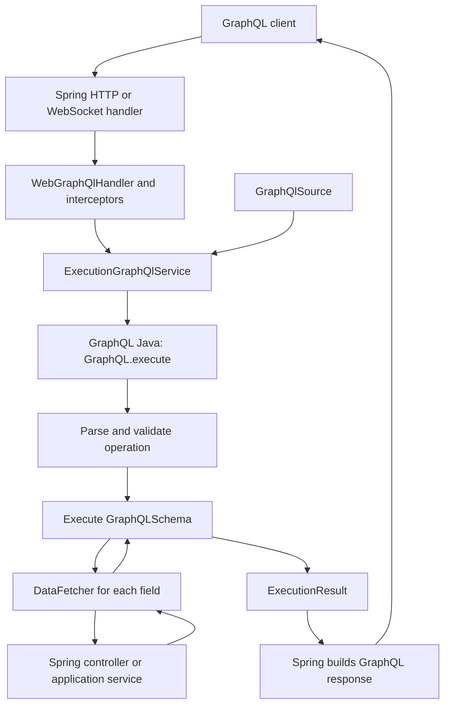

# Relationship with GraphQL Java

Spring for GraphQL and GraphQL Java handle two different layers of responsibility within the same application. **GraphQL Java is the GraphQL execution library on the JVM**: it understands the schema, parses and validates operations, orchestrates data fetching for each field, and produces the execution result. **Spring for GraphQL integrates that engine into the Spring ecosystem**: it manages the schema and runtime configuration, connects application methods to GraphQL fields, routes requests over HTTP or WebSocket, and provides mechanisms for context, error handling, DataLoader, and testing.

Therefore, when building an API with Spring for GraphQL, GraphQL execution is still handled by GraphQL Java. Spring provides a convenient configuration and extension model so the application does not have to wire together all the low-level components manually.

## 1. The two projects sit at different layers

GraphQL Java is a Java library independent of Spring. It provides core types and APIs such as `GraphQL`, `GraphQLSchema`, `ExecutionInput`, `ExecutionResult`, `DataFetcher`, `DataFetchingEnvironment`, and `RuntimeWiring`. You can use this library in a plain Java application without Spring Boot or Spring MVC.

Spring for GraphQL builds an integration layer around GraphQL Java. The framework provides abstractions such as `GraphQlSource`, `GraphQlService`, `ExecutionGraphQlService`, `RuntimeWiringConfigurer`, controller annotations, and transport adapters. These components work together to turn a client request into a GraphQL Java execution call, then convert the result into a response suited to the transport.

| Component | Primary responsibility |
| --- | --- |
| GraphQL SDL | Declares the contract: types, fields, arguments, scalars, queries, mutations, and subscriptions |
| GraphQL Java | Builds the executable schema, validates operations, and executes fields according to the schema |
| GraphQL Java `DataFetcher` | Retrieves the value for a field from a data source, service, or external system |
| Spring for GraphQL | Connects the schema, `DataFetcher`, Spring beans, transport, context, error handling, and testing |
| Spring application | Contains the actual business logic in services, repositories, and domain components |

The overall flow when a client sends a query over HTTP can be visualized as follows:



`GraphQlSource` holds the built schema and GraphQL Java configuration. `ExecutionGraphQlService` receives requests at the GraphQL level, constructs the execution input, and invokes the engine. The HTTP, WebSocket, or other supported transport adapter handles receiving and returning data over the corresponding protocol. Spring interceptors can participate before or after execution to enrich context, inspect requests, or record observability data.

## 2. How does GraphQL Java execute schemas and operations?

Schema SDL describes what clients are allowed to request. For example:

```graphql
type Query {
    bookById(id: ID!): Book
}

type Book {
    id: ID!
    title: String!
    author: Author
}

type Author {
    id: ID!
    name: String!
}
```

The SDL snippet above declares `Query.bookById`, `Book.author`, and other fields, but the SDL itself does not know which database to query or which service to call. The connection between schema fields and data sources is implemented using `DataFetcher`.

When using GraphQL Java directly, the setup process typically consists of these steps:

1. `SchemaParser` parses the SDL and creates a `TypeDefinitionRegistry`.
2. `RuntimeWiring` registers `DataFetcher` instances for the fields to be handled, along with runtime configurations such as scalars or type resolvers.
3. `SchemaGenerator` combines the registry and wiring to create an executable `GraphQLSchema`.
4. `GraphQL.newGraphQL(schema).build()` builds the engine.
5. Each request is represented by an `ExecutionInput`, which is passed to `GraphQL.execute(...)` or `GraphQL.executeAsync(...)`.

A condensed example using GraphQL Java without Spring:

```java
TypeDefinitionRegistry registry = new SchemaParser().parse(sdl);

RuntimeWiring wiring = RuntimeWiring.newRuntimeWiring()
    .type(TypeRuntimeWiring.newTypeWiring("Query")
        .dataFetcher("bookById", environment ->
            bookService.findById(environment.getArgument("id"))))
    .type(TypeRuntimeWiring.newTypeWiring("Book")
        .dataFetcher("author", environment -> {
            Book book = environment.getSource();
            return authorService.findById(book.authorId());
        }))
    .build();

GraphQLSchema schema = new SchemaGenerator()
    .makeExecutableSchema(registry, wiring);

GraphQL graphQL = GraphQL.newGraphQL(schema).build();

ExecutionInput input = ExecutionInput.newExecutionInput()
    .query("""
        { bookById(id: "book-1") { title author { name } } }
        """)
    .build();

ExecutionResult result = graphQL.execute(input);
```

Here, `environment.getArgument("id")` reads the argument of the field being executed. For the `Book.author` field, `environment.getSource()` returns the `Book` object provided by the parent field. GraphQL Java uses that source object to compute the value for the child field.

When executing an operation, GraphQL Java is responsible for parsing, validating the operation against the schema, determining the requested fields, and orchestrating calls to `DataFetcher` instances. It also enforces GraphQL rules such as types, nullability, aliases, fragments, variables, field-level errors, and mutation execution semantics. The result is packaged in an `ExecutionResult`, containing data, a list of errors, and extensions if present.

A GraphQL response can contain both `data` and `errors`. For instance, a child field may fail while other fields still return valid data. This is intentional behavior of the GraphQL execution model, unlike how an arbitrary error always fails an entire HTTP response.

## 3. Spring for GraphQL connects controllers to DataFetchers

When using GraphQL Java directly, developers must manually build `RuntimeWiring` and register a `DataFetcher` for each field. Spring for GraphQL allows declaring methods in Spring beans using annotations. The framework discovers those methods and registers them into the runtime wiring so GraphQL Java invokes them when fetching data.

Example using the same schema above:

```java
@Controller
public class BookController {

    private final BookService bookService;
    private final AuthorService authorService;

    public BookController(
            BookService bookService,
            AuthorService authorService) {
        this.bookService = bookService;
        this.authorService = authorService;
    }

    @QueryMapping
    public Book bookById(@Argument String id) {
        return bookService.findById(id);
    }

    @SchemaMapping(typeName = "Book", field = "author")
    public Author author(Book book) {
        return authorService.findById(book.authorId());
    }
}
```

`@QueryMapping` is a shorthand declaration for a field on the `Query` root type. `@SchemaMapping` binds a method to a specific field of a GraphQL type. In the example, `Book` passed into the `author` method is the source object for the `Book.author` field.

When invoking a controller method, Spring for GraphQL handles resolving parameters such as `@Argument`, the source object, and `DataFetchingEnvironment`, then invokes the Spring bean method. The method's return value is passed back to GraphQL Java so the engine can continue processing according to the type declared in the schema. Thus, Spring's annotations form the mapping declaration layer, while field execution rules still belong to GraphQL Java.

Commonly used annotations include:

| Annotation | Meaning |
| --- | --- |
| `@QueryMapping` | Maps a method to a field on the `Query` root type |
| `@MutationMapping` | Maps a method to a field on the `Mutation` root type |
| `@SubscriptionMapping` | Maps a method to a field on the `Subscription` root type |
| `@SchemaMapping` | Maps a method to a field on any GraphQL type |
| `@BatchMapping` | Registers batch resolution of a field across a group of source objects |
| `@Argument` | Extracts a GraphQL field argument and converts it into a method parameter |

Not every field needs a `@SchemaMapping` method. GraphQL Java has a default `PropertyDataFetcher` to read properties from a source object, such as Java bean getters, record accessors, or `Map` keys. If the `Book` object already has a `title` property, the engine can usually retrieve `Book.title` directly without writing a dedicated resolver. Declare a mapping when a field needs to call a service, transform data, apply business logic, or fetch data from another source.

### Configuring RuntimeWiring with Spring's API

Controller annotations fit resolvers tied to application business logic. In some cases, you need to configure runtime wiring directly, such as registering scalars, directives, type resolvers, or a specialized `DataFetcher`. Spring for GraphQL provides `RuntimeWiringConfigurer` to contribute configuration to GraphQL Java's `RuntimeWiring.Builder`:

```java
@Bean
RuntimeWiringConfigurer bookRuntimeWiring(BookService bookService) {
    return builder -> builder
        .type("Query", type -> type
            .dataFetcher("bookById", environment ->
                bookService.findById(environment.getArgument("id"))));
}
```

This configuration still uses GraphQL Java's `DataFetcher` API. The difference is that Spring manages the bean and incorporates the configuration when building `GraphQlSource`. This approach can be combined with annotated controllers when each is used for its intended purpose.

## 4. Synchronous, asynchronous, and Subscription execution

A GraphQL Java `DataFetcher` can return a regular object or an asynchronous result, such as a `CompletionStage` or `CompletableFuture`. The engine manages those results during query execution. Therefore, a field can call an asynchronous service without manually orchestrating the entire operation.

Spring for GraphQL supports the same approach in controllers. Mapping methods can return synchronous types or suitable asynchronous types. For reactive applications, types such as `Mono` and `Flux` are integrated via Reactive Streams.

Mutations are also mapped to `DataFetcher`, but GraphQL Java applies sequential execution rules for top-level mutation fields. For subscriptions, the root field produces an event stream. GraphQL Java supports the `Publisher` model for that stream; Spring for GraphQL connects this model with the reactive types used by the application.

Example of a subscription in a reactive controller:

```java
@Controller
public class BookEventController {

    private final BookEventService eventService;

    public BookEventController(BookEventService eventService) {
        this.eventService = eventService;
    }

    @SubscriptionMapping
    public Flux<BookEvent> bookEvents(@Argument String category) {
        return eventService.eventsFor(category);
    }
}
```

`@SubscriptionMapping` tells Spring to register the method for a field on the `Subscription` root type. Managing the subscription operation and executing fields are still handled by GraphQL Java; Spring provides adapters to accept and maintain the appropriate transport connection.

## 5. DataLoader and solving the N+1 problem

GraphQL Java invokes resolvers according to the field structure requested by the client. If a query fetches multiple books and each book requests `author`, the `Book.author` resolver may be invoked many times. If each invocation queries the database individually, a single request can generate one query for the list of books plus N queries for the authors. This is the N+1 problem.

GraphQL Java integrates DataLoader to batch data loading calls into a single batch and cache results within the scope of a request. Spring for GraphQL provides `BatchLoaderRegistry` to register batch loaders scoped to the lifecycle of a GraphQL request, and also provides `@BatchMapping` for the common case.

Example using `@BatchMapping` to resolve authors for multiple books:

```java
@Controller
public class BookAuthorController {

    private final AuthorService authorService;

    public BookAuthorController(AuthorService authorService) {
        this.authorService = authorService;
    }

    @BatchMapping(typeName = "Book", field = "author")
    public Map<Book, Author> authors(List<Book> books) {
        Set<String> authorIds = books.stream()
            .map(Book::authorId)
            .collect(Collectors.toSet());

        Map<String, Author> authorsById =
            authorService.findAllByIds(authorIds);

        Map<Book, Author> result = new HashMap<>();
        for (Book book : books) {
            result.put(book, authorsById.get(book.authorId()));
        }
        return result;
    }
}
```

The method receives a batch of `Book` objects, loads the authors by the set of IDs, and returns a mapping from each source object to its corresponding `Author`. Spring registers this batch mechanism through GraphQL Java's DataLoader. Field resolutions within the same request can be grouped together to invoke the batch loader, instead of executing a separate load for each book.

When finer control is needed, you can register loaders via `BatchLoaderRegistry` and retrieve the `DataLoader` from `DataFetchingEnvironment` or via a Spring-supported parameter. Regardless of the approach, ensure the loader is created and managed per request so the cache does not accidentally share data across different requests.

## 6. Context, errors, and extension points

GraphQL Java provides `DataFetchingEnvironment` for each `DataFetcher` invocation. From this object, a resolver can read the source object, arguments, field metadata, selection set, GraphQL context, and registered DataLoaders. This is the bridge between the current operation and the data or state needed during execution.

Spring for GraphQL adds mechanisms to pass information from the transport layer into execution. `WebGraphQlInterceptor` can participate in request handling, and `GraphQLContext` is used to pass necessary data to resolvers. For example, an application can place authenticated user details or a correlation ID into the context for services and resolvers to use. Do not use the context as a place to store long-lived business state; it serves a single GraphQL execution.

Regarding errors, GraphQL Java represents execution errors as `GraphQLError` and can return partial data alongside a list of errors. Spring for GraphQL provides `DataFetcherExceptionResolver` and the convenience class `DataFetcherExceptionResolverAdapter` to translate exceptions thrown by data fetchers into GraphQL errors with appropriate messages and error classifications. Distinguish these errors from query syntax or validation errors: syntax and validation errors are detected during GraphQL Java's operation processing before the corresponding resolver is invoked.

GraphQL Java also has engine-level extension points, such as `Instrumentation`, scalars, directives, type resolvers, and execution strategies. Spring for GraphQL lets you add engine configuration while building `GraphQlSource`, so applications can use GraphQL Java extensions while keeping Spring-style configuration. When integrating field-level security, checks can be placed in services or resolvers using Spring's security mechanisms; GraphQL Java itself does not know an application's specific authorization rules.

## 7. Testing through Spring GraphQL

Because GraphQL Java is the execution engine, you can test an individual `DataFetcher` or schema directly when low-level logic verification is needed. However, when an application uses Spring for GraphQL, `GraphQlTester` is usually the appropriate choice for testing from a GraphQL perspective: sending a document, passing variables, executing an operation, and asserting data paths or errors in the response.

Example:

```java
graphQlTester.document("""
        query {
            bookById(id: "book-1") {
                id
                title
            }
        }
        """)
    .execute()
    .path("bookById.title")
    .entity(String.class)
    .isEqualTo("Spring in Action");
```

`GraphQlTester` verifies behavior at the GraphQL level without forcing tests to call GraphQL Java's `GraphQL.execute(...)` directly. If you need to test HTTP or WebSocket integration, you can use the transport-specific tester variant to verify the connection layer provided by Spring as well.

## 8. When to work at each layer?

In a typical Spring Boot application, start with SDL and annotations such as `@QueryMapping`, `@MutationMapping`, `@SchemaMapping`, or `@BatchMapping`. This declarative style aligns closely with Spring application structure, keeping dependency injection, testing, and business logic organization clear.

Use `RuntimeWiringConfigurer` when you need to add GraphQL Java-specific configuration such as scalars or type resolvers. Explore `DataFetcher`, `DataFetchingEnvironment`, `ExecutionInput`, and `ExecutionResult` when you need deeper insight into how the engine calls resolvers, handles asynchronous data, or diagnoses execution behavior. Use GraphQL Java directly when building a Java component that does not need Spring or when low-level engine control is required.

Spring for GraphQL depends on GraphQL Java to execute schemas and operations. Therefore, when declaring dependencies or upgrading the framework, let Spring Boot dependency management or the Spring for GraphQL version in use manage the compatible GraphQL Java version. Only override the GraphQL Java version directly after verifying API compatibility and re-running the relevant tests.

The key takeaway is: **Spring for GraphQL provides the Spring integration and programming model; GraphQL Java provides the GraphQL execution engine.** Understanding this boundary helps you determine the right place to configure things: controllers and interceptors for application integration, `RuntimeWiring` and `DataFetcher` for connecting fields to data, while schema validation and execution strategies remain GraphQL Java's responsibility.
