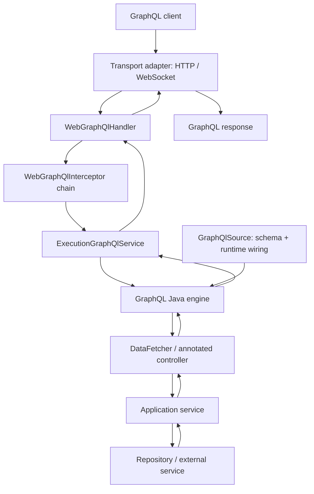

# Layers in the Spring GraphQL Architecture

Spring for GraphQL organizes GraphQL API processing into multiple layers with distinct responsibilities: the transport layer that receives requests, the request orchestration layer, the GraphQL engine that executes operations, the schema that describes the API contract, and the data fetchers that retrieve data from the application. Spring provides ways to integrate these layers with Spring MVC, Spring WebFlux, Spring Boot, and the controller-based programming model.

Understanding this architecture helps determine the right place to put logic: endpoints and protocols belong to the transport layer; cross-cutting request handling belongs to interceptors; field mapping belongs to controllers or data fetchers; business logic belongs to services; data access belongs to repositories or integration clients. The layers connect together, but you should not cram all responsibilities into a single controller.

## The big picture

Spring for GraphQL relies on GraphQL Java to parse and execute GraphQL operations. Spring adds abstractions and adapters to bring the engine into a Spring application. With standard Spring Boot configuration, many foundational components are auto-configured; developers primarily declare the schema and write the components that resolve fields.

The overall processing flow can be visualized as follows:



The diagram illustrates the high-level path. During application startup, the schema and runtime wiring are prepared in advance for the engine to use when requests arrive. When a request arrives, the transport adapter converts the protocol payload into a Spring GraphQL request; execution then invokes the data fetchers corresponding to the fields requested by the client.

## 1. Schema and GraphQL configuration layer

### Schema Definition Language

The schema is the contract describing which operations clients can call, what arguments fields take, and what types the results have. Spring for GraphQL typically uses Schema Definition Language (SDL) to declare schemas in `.graphqls` or `.gqls` files.

For example, a book management API might declare:

```graphql
type Book {
  id: ID!
  title: String!
  price: Float!
  author: Author!
}

type Author {
  id: ID!
  name: String!
}

type Query {
  book(id: ID!): Book
  books: [Book!]!
}

input CreateBookInput {
  title: String!
  price: Float!
  authorId: ID!
}

type Mutation {
  createBook(input: CreateBookInput!): Book!
}
```

The schema describes structure and type rules. It does not query the database by itself, nor does it contain the application's business logic. For a field to return actual data, GraphQL needs a data fetcher or default field resolution mechanism.

In Spring Boot, schemas are typically placed under `src/main/resources/graphql/`. Spring Boot discovers and merges schema files according to the application configuration. You can split schemas into multiple files by business domain; at startup, they are combined into a single shared GraphQL schema.

### GraphQlSource and RuntimeWiring

`GraphQlSource` is the central abstraction representing the built GraphQL schema together with the runtime wiring required for execution. It connects SDL definitions with data fetchers, scalars, and other runtime components.

Runtime wiring tells GraphQL Java how to resolve fields. Spring for GraphQL supports registering runtime configuration via `RuntimeWiringConfigurer`. For example, an application can add a scalar or register a custom data fetcher:

```java
@Configuration
public class GraphQlRuntimeConfig {

    @Bean
    RuntimeWiringConfigurer customWiring() {
        return wiringBuilder -> {
            // Register custom scalars or DataFetchers here.
        };
    }
}
```

The code snippet above illustrates the extension point; the configuration inside depends on the specific scalars or schema fields. For annotated controllers, Spring for GraphQL automatically registers handler methods into the runtime wiring, so you do not have to write a `DataFetcher` manually for every field.

## 2. GraphQL engine and execution service layer

GraphQL Java is the engine that enforces the core rules of GraphQL. The engine receives an operation, parses it, validates it against the schema, then executes the selected fields and builds the result.

In Spring for GraphQL, `GraphQlService` is the service abstraction for executing GraphQL requests. `ExecutionGraphQlService` is the implementation backed by GraphQL Java and `GraphQlSource`. This class converts requests into execution inputs, invokes the engine, and turns execution results into Spring GraphQL responses.

The main steps when the engine processes an operation include:

1. **Parse:** converts the GraphQL text into a processable query structure.
2. **Validate:** checks field names, arguments, data types, and selection sets against the schema.
3. **Execute:** traverses fields according to GraphQL rules and invokes the corresponding data fetchers.
4. **Collect result:** assembles field values, handles errors, and builds the `data` structure along with `errors` if any.

The engine orchestrates execution according to the schema and operation. It does not decide business rules such as whether a book is allowed to be sold or whether a user has permission to edit a book. Those decisions belong to application services and the application's security layer.

## 3. Transport and communication layer

The transport layer receives requests from clients over a specific protocol. Spring for GraphQL separates communication from GraphQL execution so the same schema and field logic can serve multiple connection types.

### HTTP

With HTTP, clients typically send GraphQL operations to the `/graphql` endpoint. The request contains a query or mutation, optionally accompanied by `operationName` and `variables`. Spring's HTTP adapter turns the HTTP request into a GraphQL request and returns the response over HTTP.

Applications can integrate with Spring MVC or Spring WebFlux. Spring Boot supports auto-configuring the GraphQL endpoint based on the web stack in use. Choosing MVC or WebFlux affects the application's HTTP processing model, while the schema and field mapping follow the GraphQL model.

Example of a request body sent by a client:

```json
{
  "query": "query BookById($id: ID!) { book(id: $id) { id title price } }",
  "operationName": "BookById",
  "variables": {
    "id": "book-10"
  }
}
```

### WebSocket and Subscription

HTTP request/response works well for regular operations. When clients need to receive data emitted by the server over time, the application can enable the WebSocket transport for GraphQL Subscriptions.

The WebSocket adapter manages connections and messages according to the supported GraphQL over WebSocket protocol. Subscriptions are still executed through the GraphQL engine and data fetchers; the transport only handles connection lifecycle and delivering events/results to clients.

Enabling Subscriptions requires configuring the WebSocket endpoint and an appropriate event publishing mechanism. Do not assume that merely declaring `type Subscription` in SDL enables the application to emit events: the server must also provide a publisher or event source for the subscription field and configure the corresponding transport.

## 4. Request orchestration layer: WebGraphQlHandler and interceptors

`WebGraphQlHandler` is Spring for GraphQL's high-level entry point for web requests. HTTP or WebSocket adapters convert transport requests into Spring requests and delegate processing. As a result, GraphQL orchestration logic is not tightly coupled to a single protocol.

`WebGraphQlInterceptor` allows intercepting requests and responses at the web layer before and after a GraphQL operation executes. This is the right place for cross-cutting concerns such as:

- Reading authentication information or metadata from HTTP headers.
- Putting shared data such as tenant ID, correlation ID, or user details into the GraphQL context.
- Logging, timing execution, and adding request observability metadata.
- Normalizing or validating request metadata according to application policy.

For example, an interceptor can extract a tenant ID from a header and place it into the context:

```java
@Component
public class TenantInterceptor implements WebGraphQlInterceptor {

    @Override
    public Mono<WebGraphQlResponse> intercept(
            WebGraphQlRequest request, Chain chain) {
        String tenantId = request.getHeaders().getFirst("X-Tenant-Id");

        request.configureExecutionInput((input, builder) ->
                builder.graphQLContext(context ->
                        context.put("tenantId", tenantId)).build());

        return chain.next(request);
    }
}
```

This example requires the corresponding Reactor and Spring GraphQL imports. In a real application, you must authenticate the tenant and verify access permissions before trusting a value sent by the client in a header. The interceptor can pass the information into the context; services must still enforce authorization and data scoping checks.

Do not put all business logic inside interceptors. Interceptors are suited for shared request data and behavior; use-case rules belong in application services or the corresponding security layer.

## 5. Field mapping layer: DataFetchers and annotated controllers

GraphQL executes field by field. For each field in the selection set, the engine needs a data fetcher to retrieve its value. In GraphQL Java, a `DataFetcher` is the component that provides a field's value based on `DataFetchingEnvironment`, which holds the source object, arguments, and execution context.

Spring for GraphQL provides an annotated controller model to map Java methods to fields in the schema. Controllers are marked with `@Controller`; specialized annotations identify the fields to handle.

Example with the `Query.book` schema above:

```java
@Controller
public class BookController {

    private final BookService bookService;

    public BookController(BookService bookService) {
        this.bookService = bookService;
    }

    @QueryMapping
    public Book book(@Argument String id) {
        return bookService.findById(id);
    }

    @QueryMapping
    public List<Book> books() {
        return bookService.findAll();
    }
}
```

`@QueryMapping` maps a method to a field on the `Query` root type; `@Argument` extracts an argument value from the operation. Other corresponding annotations include `@MutationMapping` for `Mutation` fields, `@SubscriptionMapping` for `Subscription` fields, and `@SchemaMapping` for fields on any object type.

### Nested fields and source objects

When a client requests `book { author { name } }`, the GraphQL engine must resolve both the `book` field and the nested `author` field. For the `Book.author` field, Spring can pass the parent `Book` object as the first parameter of the mapping method:

```java
@Controller
public class AuthorController {

    private final AuthorService authorService;

    public AuthorController(AuthorService authorService) {
        this.authorService = authorService;
    }

    @SchemaMapping(typeName = "Book", field = "author")
    public Author author(Book book) {
        return authorService.findById(book.getAuthorId());
    }
}
```

`@SchemaMapping` binds the method to the `author` field of the `Book` type. If the method name matches the field name and the source type can be inferred from the parameter, some mapping attributes can be omitted; explicit declarations often make examples easier to read.

For simple fields whose names match properties on the Java object, GraphQL Java can use its default property data fetcher to read the property. You only need to write a custom mapping when a field requires an extra query, data transformation, business rules, or specialized logic.

### Inputs to controller methods

Spring for GraphQL supports several parameter types to access execution data, for example:

- `@Argument` to receive a specific field argument.
- `DataFetchingEnvironment` when access to GraphQL Java's low-level execution API is needed.
- `GraphQLContext` to read contextual data shared within the operation.
- `Principal` or integrated authentication details to access the current identity, depending on security configuration.

Only accept the parameters needed by the method. For large input objects, bind them to an input DTO or record to keep method signatures clear and easy to test.

## 6. Business and data access layer

A GraphQL controller should act as an adapter: receive arguments, invoke a use case, and return the result. Business logic should live in services; persistence or external system calls should live in repositories or integration clients.

```java
@Service
public class BookService {

    private final BookRepository bookRepository;

    public BookService(BookRepository bookRepository) {
        this.bookRepository = bookRepository;
    }

    public Book findById(String id) {
        return bookRepository.findById(id)
                .orElseThrow(() -> new BookNotFoundException(id));
    }

    public List<Book> findAll() {
        return bookRepository.findAll();
    }
}
```

`BookService` does not need to know whether a request came over HTTP or WebSocket. By keeping business logic independent of transports and GraphQL annotations, the same use case can be reused from REST controllers, scheduled jobs, or other workflows when needed.

For nested fields, the split between services and data fetchers must be designed to avoid repeated queries. If a query fetches a list of many books and each `author` field queries the database separately, the number of queries can grow with the number of books. This is the N+1 problem.

## 7. Batching and DataLoader layer

Spring for GraphQL integrates GraphQL Java's DataLoader to batch data loading calls within the same execution. `BatchLoaderRegistry` is where batch loaders are registered and bound to the GraphQL context. When multiple resolvers request the same kind of data, DataLoader can group keys to invoke the batch loader once while also supporting caching within the appropriate scope.

For the common case of loading the same relationship across multiple parent objects, Spring for GraphQL provides `@BatchMapping`. For example, instead of each book querying its author individually, you can map a batch from a list of books to their authors:

```java
@Controller
public class BookAuthorController {

    private final AuthorService authorService;

    public BookAuthorController(AuthorService authorService) {
        this.authorService = authorService;
    }

    @BatchMapping(typeName = "Book", field = "author")
    public Map<Book, Author> author(List<Book> books) {
        return authorService.findByBooks(books);
    }
}
```

This example illustrates the batch mapping signature; the service implementation needs to return a map keyed by each `Book` with the corresponding `Author` as the value. You can use `@BatchMapping` when loading the field fits a single batch operation. For more complex requirements, register a `DataLoader` via `BatchLoaderRegistry` and inject the loader in the resolver.

Batching reduces calls down to the data layer, but does not automatically make every query faster. Batch loaders still need bounded queries, proper ordering/mapping of results back to keys, and per-record authorization enforcement.

## 8. Cross-cutting concerns: security, errors, and observability

Security and operational layers span multiple parts of the architecture; they should not be treated as the sole responsibility of a single resolver.

### Security

Authentication is typically handled at the Spring Security and transport layer, after which user identity can be made available to GraphQL execution. Authorization can be applied at the request, method, or field level. With Spring Security method security, service or controller methods can use annotations such as `@PreAuthorize` if method security is enabled in the application.

```java
@QueryMapping
@PreAuthorize("hasAuthority('BOOK_READ')")
public Book book(@Argument String id) {
    return bookService.findById(id);
}
```

Field-level access control prevents users from accessing data they are not authorized to see. However, you must also protect services and sensitive data operations; never rely on clients not requesting a field as a security measure.

### Error handling

Business or technical errors can occur inside data fetchers or services. Spring for GraphQL provides `DataFetcherExceptionResolver` to translate exceptions into structured GraphQL errors. With controllers, you can use `@GraphQlExceptionHandler` inside a controller or `@ControllerAdvice` at the appropriate scope.

Error mapping must avoid leaking stack traces, SQL queries, or sensitive data in responses. Clients should receive stable error codes and messages sufficient for handling; technical details should be logged server-side with a correlation ID.

### Observability and performance

In production, monitor operation execution time, slow fields or data fetchers, error rates, database query counts, and resource usage. Spring for GraphQL integrates observability with the Micrometer ecosystem; exact configuration depends on the Spring Boot version and the application's metrics/tracing setup.

Beyond batching, the server must consider pagination, query depth or complexity limits, timeouts, and request size limits. A single GraphQL request can request many deeply nested fields, so rate-limiting HTTP requests alone is not enough to control execution cost.

## 9. How does Spring Boot connect the layers?

In a Spring Boot application using the GraphQL starter, auto-configuration can create foundational components based on present dependencies and configuration, such as the schema source, execution service, and transport endpoints. Applications typically need to provide:

- SDL schema files in the configured resource directory.
- `@Controller` beans containing mapping methods for Query, Mutation, Subscription, or nested fields.
- Services and repositories implementing business logic and data access.
- Additional configuration when custom scalars, runtime wiring, interceptors, DataLoaders, security, or error handling are needed.

An example source code layout can be organized as follows:

```text
src/main/
  java/com/example/library/
    config/
      GraphQlRuntimeConfig.java
    graphql/
      BookController.java
      AuthorController.java
    service/
      BookService.java
      AuthorService.java
    repository/
      BookRepository.java
      AuthorRepository.java
  resources/
    graphql/
      schema.graphqls
```

This is a reference layout; projects can group or split packages according to scale and conventions. The key point is keeping clear boundaries between the schema, GraphQL mapping layer, business logic, and data access.

When deeper customization is required, you can replace or supplement default beans using extension points provided by Spring Boot and Spring for GraphQL. Only customize when there is a clear need, as rebuilding the entire infrastructure manually can negate the benefits of auto-configuration.

## 10. Choosing the right layer to implement a requirement

| Requirement | Appropriate layer or component |
| --- | --- |
| Declare fields, arguments, return types | SDL schema |
| Add custom scalars or data fetchers | `RuntimeWiringConfigurer` / runtime wiring |
| Receive HTTP or WebSocket messages | Transport adapter |
| Read headers, add tenant or correlation ID to context | `WebGraphQlInterceptor` |
| Execute operations according to schema | `GraphQlService` / GraphQL Java engine |
| Map Query, Mutation, and object fields | `@QueryMapping`, `@MutationMapping`, `@SchemaMapping` |
| Batch loading relationships for multiple objects | `@BatchMapping` / DataLoader |
| Execute business rules | Application service |
| Read/write data or call external systems | Repository / integration client |
| Map exceptions to GraphQL errors | `DataFetcherExceptionResolver` / `@GraphQlExceptionHandler` |
| Enforce access control | Spring Security at request, method, or service level |

When a new requirement arrives, determine whether it belongs to cross-cutting request handling, a specific field, or business logic. For instance, adding a `Book.discountedPrice` field requires updating the schema and providing field resolution logic; if the discounted price depends on promotion rules, those rules belong in the service. If the field loads related data across many books, consider batching. Organizing work this way prevents controllers from becoming a dumping ground for the entire application.

## Key takeaways

The Spring for GraphQL architecture consists of the schema and runtime wiring, the GraphQL Java engine, Spring's execution service, the transport layer, request orchestration/interceptors, and data fetchers mapped from controllers. Behind data fetchers sit application services and repositories to handle business logic and data.

Spring Boot can auto-configure many of the connecting pieces. Developers focus on the schema, controller mappings, and services; then add interceptors, DataLoaders, security, and error handling as needed. Clearly understanding the responsibilities of each layer helps you design APIs that are easier to test, easier to extend, and better controlled for performance.
