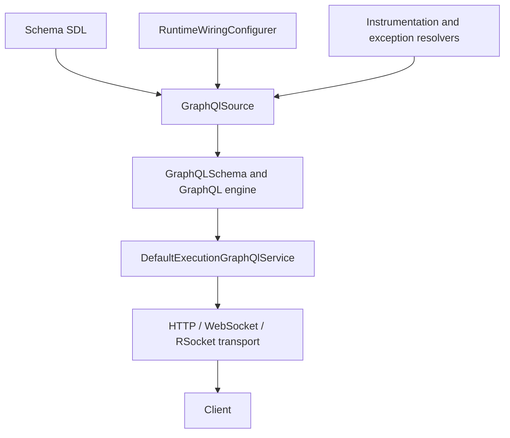
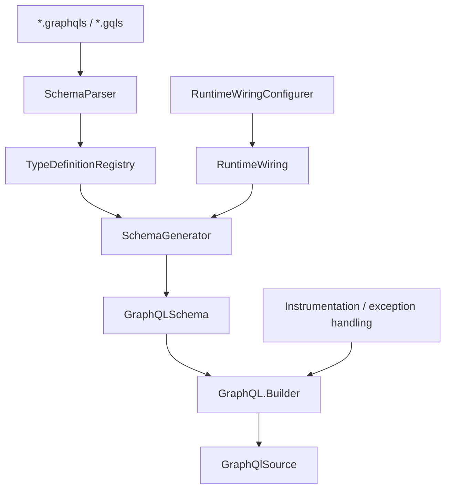

# GraphQlSource

## Objectives

After this lesson, you will be able to:

- Explain the role of `GraphQlSource` in the Spring for GraphQL architecture.
- Describe how Spring builds `GraphQLSchema` and the `GraphQL` object from SDL files and runtime configuration.
- Distinguish between `GraphQlSource`, `RuntimeWiringConfigurer`, and controllers using `@QueryMapping` and `@SchemaMapping`.
- Configure schema resources and runtime wiring using Spring Boot or directly via builders.
- Use schema mapping inspection to detect unmapped fields.

## 1. What is GraphQlSource?

`GraphQlSource` is the central Spring for GraphQL abstraction that provides two components:

- `GraphQLSchema`: the executable schema describing the types, fields, arguments, and relationships in the API.
- `GraphQL`: the GraphQL Java engine configured to parse, validate, and execute operations.

The `org.springframework.graphql.execution.GraphQlSource` interface provides the two corresponding accessor methods:

```java
GraphQL graphQL = graphQlSource.graphQl();
GraphQLSchema schema = graphQlSource.schema();
```

In a typical application, you do not need to call this engine directly inside controllers. `DefaultExecutionGraphQlService` uses `GraphQlSource` to obtain the GraphQL engine and execute requests. Transport layers such as HTTP or WebSocket forward requests to the execution service.

The roles of these components can be visualized as follows:



Key point to remember: `GraphQlSource` prepares the GraphQL runtime. It is not a controller, an HTTP endpoint, or the place that handles individual user requests directly.

## 2. From SDL files to the GraphQL runtime

To create an executable GraphQL API, the server needs both the schema declaration and the behavior implementation for the fields.

Example schema:

```graphql
type Query {
  book(id: ID!): Book
}

type Book {
  id: ID!
  title: String!
  author: String
}
```

The SDL tells us that the `book` query accepts an `id` argument and returns a `Book`. However, the schema does not know how to find the book in the database. The server needs a `DataFetcher` or a controller method to supply the data.

The runtime creation process can be broken down into these steps:

1. **Read schema resources:** Spring reads one or more resources containing SDL.
2. **Parse and merge definitions:** GraphQL Java parses the SDL into a `TypeDefinitionRegistry`. Multiple files can contribute types or fields to the same schema.
3. **Build RuntimeWiring:** configurators register `DataFetcher` instances, custom scalars, directive wiring, `TypeResolver` instances, and other runtime components.
4. **Build GraphQLSchema:** `SchemaGenerator` combines `TypeDefinitionRegistry` with `RuntimeWiring` to create an executable schema and verify validity.
5. **Build GraphQL engine:** the builder configures the `GraphQL` object for Spring to use when executing requests.



If the SDL has syntax errors or invalid type definitions, schema initialization can fail at application startup. Certain wiring errors, such as registering a DataFetcher for a field that does not exist in the schema, may not be fully caught by GraphQL Java unless schema mapping inspection is enabled. Therefore, you should verify both schema validity and the correspondence between the schema and its implementation.

## 3. Where are schema resources located?

By default, the Spring Boot GraphQL starter looks for files with the `.graphqls` or `.gqls` extension under:

```text
src/main/resources/graphql/
```

A project can split its schema into multiple files by business domain:

```text
src/main/resources/
└── graphql/
    ├── common.graphqls
    ├── book.graphqls
    ├── author.graphqls
    └── review.graphqls
```

For example, `book.graphqls` declares `Book` and book-related fields; `author.graphqls` declares the `Author` type. The files are loaded and merged into a single schema. Splitting files helps organize source code and does not create multiple GraphQL endpoints or independent schemas.

You can customize the location and file extensions via configuration:

```yaml
spring:
  graphql:
    schema:
      locations: classpath:graphql/**/
      file-extensions: .graphqls,.gqls
```

If schemas live across multiple modules or dependencies on the classpath, use the `classpath*:` prefix to search resources in all matching locations:

```yaml
spring:
  graphql:
    schema:
      locations: classpath*:graphql/**/
```

`classpath:` typically searches a single classpath location; `classpath*:` enables searching across multiple classpath locations. This is useful when each module contributes a portion of the schema.

Spring uses Spring Framework's `Resource` abstraction, so the builder can also accept resources from the filesystem or application-provided sources. All schemas do not have to be stored in a single file.

## 4. RuntimeWiring and RuntimeWiringConfigurer

`RuntimeWiring` is GraphQL Java's runtime configuration. It connects declarations in SDL to the server's actual behavior.

Components commonly registered via runtime wiring include:

| Component | Role |
|---|---|
| `DataFetcher` | Fetches data for a field |
| Custom scalar | Defines how to parse and serialize a custom data type |
| `TypeResolver` | Resolves the concrete object type for an interface or union |
| `SchemaDirectiveWiring` | Attaches processing behavior to directives in the schema |
| Wiring factory | Creates wiring based on schema definition metadata |

Spring for GraphQL provides `RuntimeWiringConfigurer` so applications can customize `RuntimeWiring.Builder`. With Spring Boot, beans of this type are automatically detected and added to the `GraphQlSource` configuration.

Example of registering a `DataFetcher` directly:

```java
@Configuration
public class GraphQlRuntimeConfiguration {

    @Bean
    RuntimeWiringConfigurer bookDataFetcher(BookRepository repository) {
        return wiringBuilder -> wiringBuilder
            .type("Query", typeBuilder -> typeBuilder
                .dataFetcher("book", environment -> {
                    String id = environment.getArgument("id");
                    return repository.findById(id).orElse(null);
                }));
    }
}
```

In this example:

- `type("Query", ...)` selects the GraphQL object type named `Query`.
- `dataFetcher("book", ...)` attaches behavior to the `Query.book` field.
- `environment.getArgument("id")` reads the argument passed by the client.
- The value returned by the repository becomes the source value for the `book` field.

Type and field names must match the SDL. If the SDL renames `book` to `findBook` while the wiring still registers `book`, the configuration will no longer map properly to the updated schema.

### When should you register a DataFetcher directly?

Spring for GraphQL commonly uses annotated controllers. Controller methods are discovered and registered as `DataFetcher` instances via `AnnotatedControllerConfigurer`, which is itself a `RuntimeWiringConfigurer`.

Example:

```java
@Controller
public class BookController {

    private final BookRepository repository;

    public BookController(BookRepository repository) {
        this.repository = repository;
    }

    @QueryMapping
    public Book book(@Argument String id) {
        return repository.findById(id).orElse(null);
    }
}
```

With the Spring Boot GraphQL starter, controllers are configured automatically. You usually only need to declare controllers and schemas. Use `RuntimeWiringConfigurer` for additions such as custom scalars, directives, type resolvers, or a specialized `DataFetcher`.

Avoid registering two handlers for the same field without an explicit reason. For example, do not both declare `@QueryMapping` for `Query.book` and register another `DataFetcher` for that exact same field. Defining a mapping in multiple places makes configuration hard to understand and prone to conflicts.

## 5. Building GraphQlSource with a builder

Spring for GraphQL provides a default builder via:

```java
GraphQlSource.schemaResourceBuilder()
```

This builder reads SDL resources and uses `RuntimeWiring` to construct `GraphQLSchema`.

The following example creates a `GraphQlSource` directly without relying on Spring Boot's GraphQL auto-configuration:

```java
@Configuration
public class GraphQlSourceConfiguration {

    @Bean
    GraphQlSource graphQlSource(BookRepository repository) {
        return GraphQlSource.schemaResourceBuilder()
            .schemaResources(
                new ClassPathResource("graphql/books.graphqls")
            )
            .configureRuntimeWiring(wiringBuilder ->
                wiringBuilder.type("Query", typeBuilder ->
                    typeBuilder.dataFetcher("book", environment -> {
                        String id = environment.getArgument("id");
                        return repository.findById(id).orElse(null);
                    })
                )
            )
            .inspectSchemaMappings(System.out::println)
            .build();
    }
}
```

This configuration demonstrates the main parts:

- `schemaResources(...)` provides the SDL files to parse.
- `configureRuntimeWiring(...)` registers field behavior.
- `inspectSchemaMappings(...)` tells Spring to inspect mappings and pass the report to the callback.
- `build()` creates `GraphQlSource` from the declared configuration.

Key imports:

```java
import org.springframework.context.annotation.Bean;
import org.springframework.context.annotation.Configuration;
import org.springframework.core.io.ClassPathResource;
import org.springframework.graphql.execution.GraphQlSource;
```

This example illustrates the low-level builder. When creating `GraphQlSource` manually in a Spring Boot application, you are responsible for supplying all required runtime configurations for the application. For typical projects, leverage Spring Boot auto-configuration and only add the custom beans you need.

In addition to `schemaResourceBuilder()`, `GraphQlSource.builder(graphQLSchema)` allows building a source from an externally prepared `GraphQLSchema`. This is suitable when the schema is generated by a specialized pipeline or another integration library.

## 6. How does Spring Boot auto-configure GraphQlSource?

When `spring-boot-starter-graphql` is added, Spring Boot automatically creates the builder and configures `GraphQlSource` based on the components present in the application context.

At a high level, Boot performs the following:

- Discovers schema resources according to `spring.graphql.schema.locations` and `spring.graphql.schema.file-extensions`.
- Applies configuration properties for the GraphQL source.
- Detects `RuntimeWiringConfigurer` beans to add runtime wiring.
- Detects `Instrumentation` beans to integrate instrumentation and metrics.
- Detects `DataFetcherExceptionResolver` and `SubscriptionExceptionResolver` beans for error handling.
- Registers the mechanism that maps annotated controllers to data fetchers.

As a result, everyday configuration may only require schema resources and extension beans:

```java
@Configuration
public class GraphQlConfiguration {

    @Bean
    RuntimeWiringConfigurer customRuntimeWiring() {
        return wiringBuilder -> {
            // Register custom scalars, directives, or TypeResolvers here.
        };
    }
}
```

If deeper changes to settings on `GraphQlSource.Builder` are needed, Spring Boot provides the `GraphQlSourceBuilderCustomizer` extension point. For example, a customizer can call `configureGraphQl(...)` to configure an option on `GraphQL.Builder`.

Choose the right extension point for your goal:

| Requirement | Mechanism |
|---|---|
| Add custom scalars, directives, or DataFetchers | `RuntimeWiringConfigurer` |
| Write logic for queries or fields in controllers | `@QueryMapping`, `@SchemaMapping`, `@BatchMapping` |
| Tune GraphQL engine configuration | `GraphQlSourceBuilderCustomizer` |
| Build schema from SDL resources | `GraphQlSource.schemaResourceBuilder()` |
| Use a pre-built GraphQLSchema | `GraphQlSource.builder(schema)` |

Do not declare a custom `GraphQlSource` bean just to add a scalar or a DataFetcher. In that case, a `RuntimeWiringConfigurer` bean is simpler and lets Spring Boot continue managing the source configuration lifecycle.

## 7. Inspecting schema mappings at application startup

Valid SDL does not guarantee a complete implementation. For example:

```graphql
type Query {
  book(id: ID!): Book
}

type Book {
  id: ID!
  title: String!
}
```

If the server has no data fetcher for `Query.book`, the query cannot retrieve the expected data. For nested fields like `Book.title`, GraphQL Java can use the default `PropertyDataFetcher` to read the corresponding property or getter from the parent object. However, a field with neither an explicit mapping nor a matching property may return `null`.

Some mapping errors only surface when a client sends a query. They can slip through if tests do not cover that field. Spring for GraphQL supports schema mapping inspection to catch common issues early.

Inspection can be enabled on the builder:

```java
GraphQlSource graphQlSource = GraphQlSource.schemaResourceBuilder()
    .schemaResources(new ClassPathResource("graphql/books.graphqls"))
    .inspectSchemaMappings(System.out::println)
    .build();
```

The report can highlight:

- Schema fields that lack a matching data fetcher or property.
- DataFetchers registered for fields that do not exist in the schema.
- Arguments expected by a data fetcher that do not match arguments declared in SDL.
- Certain determinable nullability mismatches between the schema and Java types.

Inspection cannot infer every case. If a data fetcher returns `Object`, `List<?>`, or an overly generic type, Spring may not have enough information for deep checks. For interfaces and unions, concrete Java type information or appropriate type mapping configuration is required.

### Nullability must be designed intentionally

GraphQL distinguishes between nullable and non-null fields:

```graphql
type Book {
  title: String
  isbn: String!
}
```

If the `isbn` field is declared non-null but the data fetcher returns `null` or throws an error, GraphQL applies null propagation: the null bubbles up to the nearest nullable parent field and can wipe out part of the response data.

Therefore, do not mark every field non-null out of habit. Use `!` when the application can guarantee the field always has a value according to the business contract. Schema inspection helps find some mismatches between SDL nullability and Java types, but you still need to test realistic data scenarios.

## 8. Extension options on GraphQlSource.Builder

Beyond loading schemas and configuring runtime wiring, the builder provides extension points for advanced scenarios.

| API | Purpose |
|---|---|
| `configureGraphQl(...)` | Configures `GraphQL.Builder`, such as execution ID providers or operation caches |
| `exceptionResolvers(...)` | Registers resolvers for errors thrown during data fetching |
| `subscriptionExceptionResolvers(...)` | Registers resolvers for errors from subscription streams |
| `instrumentation(...)` | Attaches instrumentation to monitor or customize execution |
| `typeVisitors(...)` | Traverses the schema after creation and can update the code registry |
| `typeVisitorsToTransformSchema(...)` | Traverses and transforms the schema when structural changes are genuinely needed |
| `schemaFactory(...)` | Supplies a custom way to create `GraphQLSchema` from the registry and runtime wiring |

Some usage scenarios:

- **Custom scalars or directives:** use `RuntimeWiringConfigurer` to register the corresponding behavior.
- **Interfaces and unions:** configure a `TypeResolver` when the server needs to determine concrete object types. The builder provides `defaultTypeResolver(...)`; by default, Spring uses `ClassNameTypeResolver` to infer GraphQL type names from Java class names and inheritance hierarchies.
- **Federation or specially constructed schemas:** consider `schemaFactory(...)` when the default `SchemaGenerator` does not fit the schema creation process.
- **Observability:** use `Instrumentation` to measure execution times or attach metadata to execution.
- **Operation caching:** you can configure `PreparsedDocumentProvider` via `configureGraphQl(...)` to cache parse and validation results. This caches operations, which is different from caching business data.

Only add extension points when there is a concrete requirement. The more customization at the source level, the more carefully configuration, version upgrades, and error diagnostics must be managed.

## 9. Distinguishing commonly confused components

| Component | Primary responsibility | Example |
|---|---|---|
| SDL | Declares the API contract | `type Query { book(id: ID!): Book }` |
| `GraphQlSource` | Provides the GraphQL engine and executable schema | Reads SDL, applies wiring, and builds the runtime |
| `RuntimeWiringConfigurer` | Adds runtime wiring configuration | Custom scalars, directives, DataFetchers |
| Annotated controller | Implements field logic | `@QueryMapping`, `@SchemaMapping` |
| `ExecutionGraphQlService` | Orchestrates GraphQL request execution | `DefaultExecutionGraphQlService` |
| Transport handler | Receives requests over a specific protocol | HTTP, WebSocket, RSocket |

For example, when a client sends the query `book(id: "b-1")` over HTTP:

1. The HTTP handler receives the request and forwards it to the execution service.
2. `DefaultExecutionGraphQlService` uses the GraphQL engine from `GraphQlSource`.
3. The GraphQL engine validates the query against the schema.
4. The DataFetcher registered for the `Query.book` field invokes the controller or wired logic.
5. The result is packaged into a GraphQL response and returned over the transport.

This separation of responsibilities allows the same GraphQL schema and runtime to be used across appropriate transports without forcing business logic to depend directly on HTTP.

## 10. When should you customize GraphQlSource?

In most Spring Boot applications, start with auto-configuration:

- Place SDL files in `src/main/resources/graphql/`.
- Use annotated controllers for queries, mutations, and field mappings.
- Use `RuntimeWiringConfigurer` for custom scalars, directives, type resolvers, or specialized DataFetchers.
- Use exception resolver and instrumentation beans when error handling or runtime observability is needed.

Only construct `GraphQlSource` manually when low-level control over schema creation or runtime setup is required, such as special schema sources, a custom schema factory, or an engine configuration that cannot be expressed through standard extension points.

When building the source manually, verify that all required schema resources, runtime wiring, annotated controller configurers, exception resolvers, and instrumentation are passed to the builder. If a component that Boot previously registered automatically is missing, the application may start up while certain fields or runtime behaviors fail to work as expected.

## Conclusion

`GraphQlSource` is the bridge between the SDL schema, runtime wiring, and the GraphQL Java engine in Spring for GraphQL. It produces the executable `GraphQLSchema` and supplies the `GraphQL` object to `ExecutionGraphQlService`.

With Spring Boot, most applications do not need to build the source manually. Boot automatically locates schema resources, detects `RuntimeWiringConfigurer` beans, controllers, and extension components. By understanding the role of `GraphQlSource`, you can choose the right extension point: controllers for field logic, runtime configurers for additional wiring, builder customizers for engine configuration, and the builder directly when you truly need control over creating the GraphQL runtime.

## References

- [Spring for GraphQL — Request Execution](https://docs.spring.io/spring-graphql/reference/request-execution.html)
- [Spring for GraphQL 1.4.3 — GraphQlSource.SchemaResourceBuilder API](https://docs.spring.io/spring-graphql/docs/1.4.3/api/org/springframework/graphql/execution/GraphQlSource.SchemaResourceBuilder.html)
- [Spring Boot — Spring for GraphQL](https://docs.spring.io/spring-boot/reference/web/spring-graphql.html)
