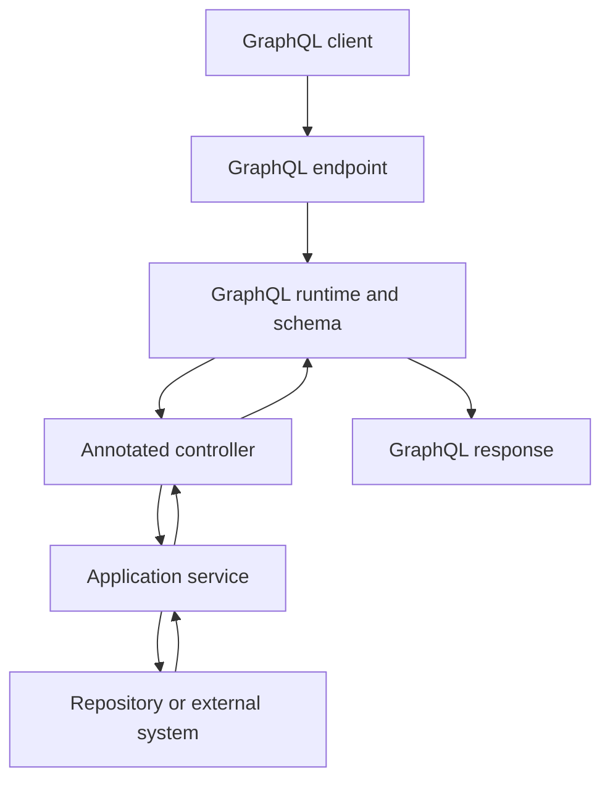

# Annotated Controller

## Objectives

After this lesson, you will be able to:

- Explain the role of annotated controllers in Spring for GraphQL and the relationship between controllers and the SDL schema.
- Use `@QueryMapping`, `@MutationMapping`, and `@SubscriptionMapping` to map root fields.
- Use `@SchemaMapping` to supply data for fields on object types.
- Receive arguments, source objects, and required contexts in controller methods.
- Organize controllers by responsibility, handle synchronous or asynchronous results, and test mappings.

## What is an annotated controller?

Spring for GraphQL provides the annotated controller model to bind Java methods to fields in a GraphQL schema. Instead of registering each `DataFetcher` manually through configuration code, you annotate a Spring bean with `@Controller` and use method annotations to specify which method handles which field.

A controller is the orchestration layer for GraphQL requests. It receives input data, calls services to execute business logic, and returns results to the GraphQL runtime. The SDL schema still defines the API contract: type names, fields, arguments, data types, and nullability. Annotations only connect Java methods to fields already declared in the schema; annotations do not replace the schema or automatically produce a complete API design.

For example, the schema has a field `bookById(id: ID!): Book`. A Java method annotated with `@QueryMapping` can handle this field. Clients call the field through the GraphQL endpoint; Spring for GraphQL uses the mapping to locate the right method and pass the argument into it.

## Declaring the schema before writing the controller

Suppose a library application provides an API to read books, view authors, and add books. The SDL schema can be declared as follows:

```graphql
type Query {
  bookById(id: ID!): Book
}

type Mutation {
  addBook(input: CreateBookInput!): Book!
}

type Book {
  id: ID!
  title: String!
  author: Author
}

type Author {
  id: ID!
  name: String!
}

input CreateBookInput {
  title: String!
  authorId: ID!
}
```

The schema above describes two root operation types: `Query` and `Mutation`. `Book.author` is a nested field that may need to look up an author from a book's `authorId`. `CreateBookInput` is an input object used to accept data when adding a book.

In a Spring Boot application, schema files are typically placed in `src/main/resources/graphql/`. Spring Boot automatically discovers schemas in this default location when Spring for GraphQL is properly configured. File names can be organized by domain or feature; the SDL files are merged into the application's schema.

## Registering a controller with `@Controller`

An annotated controller is a Spring bean marked with `org.springframework.stereotype.Controller`:

```java
import org.springframework.stereotype.Controller;

@Controller
public class BookGraphQlController {
    // GraphQL field handler methods are declared here.
}
```

Spring for GraphQL detects controller beans and registers methods with mapping annotations. Use `@Controller` to mark a bean that handles GraphQL. This is not a REST controller: GraphQL mapping methods do not create individual HTTP routes per method. HTTP requests arrive at the GraphQL endpoint, and the GraphQL runtime selects resolvers based on the operation and schema.

A single controller can hold many mappings. However, when a controller accumulates too many methods or mixes multiple business domains, split it into controllers grouped by type or feature for easier reading, testing, and maintenance.

## Mapping root fields with `@QueryMapping`

`@QueryMapping` is the specialized annotation for fields on the `Query` root type. This annotation is a shorthand for `@SchemaMapping(typeName = "Query", ...)`.

Given the schema:

```graphql
type Query {
  bookById(id: ID!): Book
}
```

The controller can be implemented as follows:

```java
import org.springframework.graphql.data.method.annotation.Argument;
import org.springframework.graphql.data.method.annotation.QueryMapping;
import org.springframework.stereotype.Controller;

@Controller
public class BookQueryController {

    private final BookService bookService;

    public BookQueryController(BookService bookService) {
        this.bookService = bookService;
    }

    @QueryMapping
    public Book bookById(@Argument("id") String id) {
        return bookService.findById(id).orElse(null);
    }
}
```

The method name `bookById` is used as the default field name. `@Argument("id")` binds the Java parameter to the `id` argument in SDL. Specifying the argument name explicitly keeps the mapping independent of parameter names retained in bytecode during compilation.

If needed, you can specify the field name directly in the annotation:

```java
@QueryMapping(name = "bookById")
public Book findBook(@Argument("id") String bookId) {
    return bookService.findById(bookId).orElse(null);
}
```

The field name in the schema and in the mapping must match. If the method returns `null`, GraphQL returns `null` for this field because `Book` is nullable in the schema. If business rules require reporting an error when a book is not found, use an exception or a GraphQL error-handling mechanism per the API's conventions rather than changing nullability arbitrarily.

## Mapping nested fields with `@SchemaMapping`

Root resolvers usually return parent objects. When a client requests a nested field, Spring for GraphQL needs a resolver to supply that field's value if it is not already available on the parent object.

For the `Book.author` schema field, we can write:

```java
import org.springframework.graphql.data.method.annotation.SchemaMapping;
import org.springframework.stereotype.Controller;

@Controller
public class BookFieldController {

    private final AuthorService authorService;

    public BookFieldController(AuthorService authorService) {
        this.authorService = authorService;
    }

    @SchemaMapping(typeName = "Book", field = "author")
    public Author author(Book book) {
        return authorService.findById(book.authorId()).orElse(null);
    }
}
```

In this example:

- `typeName = "Book"` specifies the object type containing the field to handle.
- `field = "author"` specifies the mapped field.
- The `Book book` parameter is the source object, i.e., the parent object currently being resolved by GraphQL.
- The returned `Author` value is used to populate the `Book.author` field.

If `field` is omitted, Spring for GraphQL infers the field name from the method name by default. If `typeName` is omitted, the framework can infer the type name from the type of the source argument. Declaring them explicitly as above makes the mapping easier to read, especially when the Java class name differs from the schema type name.

`@SchemaMapping` can be used for fields on any object type, not just `Book`. For instance, `Author.books`, `Order.customer`, or `Product.category` can all be handled with corresponding mappings.

### Not every field needs a dedicated resolver

If a Java object already has a property or getter matching the schema field, the GraphQL runtime can read the value from that object using the default property data fetcher. For example, if `Book` already has `getTitle()` and the schema has `Book.title`, there is no need to write an extra method just to return `title`.

Write `@SchemaMapping` when you need to execute additional logic, query another data source, transform results, or control field resolution. This keeps controllers focused on fields that genuinely need orchestration.

## Receiving arguments with `@Argument`

GraphQL fields can declare multiple arguments. `@Argument` retrieves values by name from the current field's arguments.

Example schema with a search query:

```graphql
type Query {
  books(authorId: ID, keyword: String, first: Int = 20): [Book!]!
}
```

The controller receives each argument:

```java
@QueryMapping
public List<Book> books(
        @Argument("authorId") String authorId,
        @Argument("keyword") String keyword,
        @Argument("first") Integer first) {

    int pageSize = first != null ? first : 20;
    return bookService.search(authorId, keyword, pageSize);
}
```

Java types must be compatible with GraphQL types. For arguments that may be omitted or receive `null`, use a reference type like `Integer` rather than the primitive `int` to represent the absence of a value. Default values in SDL are applied according to GraphQL coercion rules when the argument is not supplied.

### Binding an input object to a Java object

For an input object, you can bind the entire argument to a Java record or class:

```java
public record CreateBookInput(String title, String authorId) {}
```

```java
@MutationMapping
public Book addBook(@Argument("input") CreateBookInput input) {
    return bookService.add(input.title(), input.authorId());
}
```

Spring for GraphQL uses argument binding to convert GraphQL data into Java structures. Property names and types must match the input object in the schema. For complex inputs, use a dedicated DTO to control incoming data and avoid binding directly to persistence-layer entities.

If the application uses Spring Validation, you can combine `@Valid` with `@Argument` to validate constraints declared on the DTO:

```java
@MutationMapping
public Book addBook(@Argument("input") @Valid CreateBookInput input) {
    return bookService.add(input.title(), input.authorId());
}
```

Clearly define how validation failures are converted into GraphQL errors and what error details clients are allowed to see.

## Mapping mutations with `@MutationMapping`

`@MutationMapping` is a shortcut for mappings on the `Mutation` root type. Usage is similar to `@QueryMapping`, except the method typically calls a service to modify system state.

```java
@Controller
public class BookMutationController {

    private final BookService bookService;

    public BookMutationController(BookService bookService) {
        this.bookService = bookService;
    }

    @MutationMapping
    public Book addBook(@Argument("input") CreateBookInput input) {
        return bookService.add(input.title(), input.authorId());
    }
}
```

Given the SDL `addBook(input: CreateBookInput!): Book!`, the method above handles the `addBook` root field. GraphQL still lets clients choose which fields they want to receive on the returned object:

```graphql
mutation AddBook($input: CreateBookInput!) {
  addBook(input: $input) {
    id
    title
    author {
      id
      name
    }
  }
}
```

A mutation can trigger `@SchemaMapping` resolvers to resolve nested fields on the returned object. Because mutations modify data, apply authentication, authorization, transactions, and error handling appropriate to the business rules. Do not put all business logic inside controller methods; controllers should delegate to services responsible for executing use cases.

## Mapping subscriptions with `@SubscriptionMapping`

`@SubscriptionMapping` maps fields on the `Subscription` root type. The method typically returns a reactive publisher that emits multiple results over time.

Example schema:

```graphql
type Subscription {
  bookAdded: Book!
}
```

The controller can return `Flux<Book>`:

```java
import reactor.core.publisher.Flux;
import org.springframework.graphql.data.method.annotation.SubscriptionMapping;
import org.springframework.stereotype.Controller;

@Controller
public class BookSubscriptionController {

    private final BookEventService eventService;

    public BookSubscriptionController(BookEventService eventService) {
        this.eventService = eventService;
    }

    @SubscriptionMapping
    public Flux<Book> bookAdded() {
        return eventService.bookAdded();
    }
}
```

`Flux<Book>` emits new books as events occur. Subscriptions require a transport that supports streaming connections, such as WebSocket or Server-Sent Events depending on application configuration. Declaring `@SubscriptionMapping` only creates the GraphQL-layer mapping; the application still needs transport configuration and an event source.

## Method parameters beyond `@Argument`

Annotated controllers support several parameter types so methods can access data from the current execution. Common ones include:

| Parameter | Purpose |
| --- | --- |
| `@Argument("id") String id` | Retrieves the field argument named `id` |
| `Book book` | Receives the source object when handling a nested field |
| `DataFetchingEnvironment environment` | Accesses GraphQL Java execution details |
| `GraphQLContext context` | Reads the shared context for a single GraphQL execution |
| `@ContextValue("tenantId") String tenantId` | Retrieves a value by key from the GraphQL context |
| `Principal principal` | Accesses the authenticated principal if present |

For example, a field needing the current tenant can accept a context value:

```java
@QueryMapping
public List<Book> booksForTenant(
        @ContextValue("tenantId") String tenantId) {
    return bookService.findForTenant(tenantId);
}
```

The `tenantId` value must be populated into the GraphQL context in an earlier request-handling step. Do not take a tenant or user identity from a client-supplied argument and treat it as proof of authorization. Context values and principals must come from trusted server-side sources.

## Return types and asynchronous handling

Mapping methods can return objects or data types compatible with Spring for GraphQL's execution mechanism. Depending on how the application is built, common return types include:

- An object or collection for synchronous processing.
- `CompletableFuture<T>` or `CompletionStage<T>` for standard Java asynchronous processing.
- `Mono<T>` and `Flux<T>` in applications using Project Reactor.
- `Publisher<T>` for reactive data streams, especially in subscriptions.

Example of an asynchronous query:

```java
@QueryMapping
public CompletableFuture<Book> bookById(@Argument("id") String id) {
    return bookService.findByIdAsync(id);
}
```

You do not need to spawn a thread manually per resolver if the framework or service already provides an appropriate asynchronous mechanism. Understand schedulers, transaction contexts, and persistence access patterns so you avoid running blocking tasks on the event loop in reactive applications.

## Organizing controllers and business responsibilities

A clean structure can divide responsibilities as follows:



The controller binds fields to use cases, forwards arguments and source objects to service calls, and returns results. Services enforce business rules and coordinate repositories or external systems. The schema describes the contract clients consume.

Guidelines to keep controllers maintainable:

- Keep mapping methods short and focused on orchestration.
- Use input DTOs for mutations and queries with multiple related arguments.
- Do not return persistence entities directly if doing so exposes internal structure or creates coupling to the database.
- Place authorization checks where all access paths are protected; you can combine Spring Security method security when configured.
- Do not create dedicated resolvers for every field mechanically; leverage the default property data fetcher when the object already holds the data.
- Monitor queries triggered by field mappings. Resolvers calling the database per object can cause the N+1 problem; when needed, consider `@BatchMapping` or DataLoader.

## Testing annotated controllers

Spring for GraphQL provides `GraphQlTester` to test operations and responses without writing an HTTP client per test. In controller or application tests, you can send a GraphQL document, pass variables, and assert paths in the response.

Example:

```java
graphQlTester.document("""
        query BookById($id: ID!) {
            bookById(id: $id) {
                id
                title
            }
        }
        """)
    .variable("id", "book-101")
    .execute()
    .path("bookById.title")
    .entity(String.class)
    .isEqualTo("Spring in Practice");
```

A mapping test suite should cover:

1. Field names in annotations match the SDL schema.
2. Arguments and input objects bind to the right types, including missing or invalid cases.
3. Root mappings return expected data; nested fields receive the proper source object.
4. Mutations execute the intended use case and handle errors per the contract.
5. Subscriptions emit events along the expected stream and configured transport.
6. Access control is verified for both root fields and nested fields holding sensitive data.

When testing mappings in isolation, you can use `@GraphQlTest` to create a test slice for the needed GraphQL components and mock dependent services. When verifying HTTP integration or subscription transports, add tests at the appropriate application level.

## Common errors

| Symptom | Possible cause | How to check |
| --- | --- | --- |
| Field has no mapping | Method name or `name`/`field` value does not match SDL; controller not detected by Spring | Inspect schema, annotations, and component scanning |
| Argument receives `null` | Wrong `@Argument` name or incompatible Java type | Compare argument name in SDL and annotation; check input binding |
| Nested field returns `null` | Source object missing data or lookup resolver found no record | Check source object and service |
| Input object binding error | DTO incompatible with input type or invalid data | Check field names, types, constructor, and validation |
| Subscription emits no events | No publisher or transport misconfigured | Check event source and WebSocket/SSE configuration |
| Slow query when returning lists | Nested field resolver loads data separately per object | Monitor query count; consider batch loading |

## Comprehensive practice

Using the library schema from the beginning of this lesson, build a complete annotated controller with the following features:

1. `bookById(id: ID!)` finds a book by ID.
2. `addBook(input: CreateBookInput!)` adds a new book.
3. `Book.author` retrieves author details for a book.

Then extend the exercise:

- Add a query to search books by author and keyword.
- Use a DTO for the input object and enable validation.
- Add authorization checks to the mutation.
- Write `GraphQlTester` tests for root fields and nested fields.
- Observe the number of repository calls when returning a list of many books; if N+1 occurs, explore `@BatchMapping` or DataLoader in the dedicated lessons.

## Key takeaways

Annotated controllers are how Spring for GraphQL binds Java methods to fields in an SDL schema. `@Controller` registers GraphQL handler beans; `@QueryMapping`, `@MutationMapping`, and `@SubscriptionMapping` handle root fields; `@SchemaMapping` handles fields on object types. `@Argument` binds input values, source objects provide the parent object for nested fields, and context and principals supply server-side execution metadata. Controllers should orchestrate services, keep the schema as the API contract, and be tested with real GraphQL operations.
