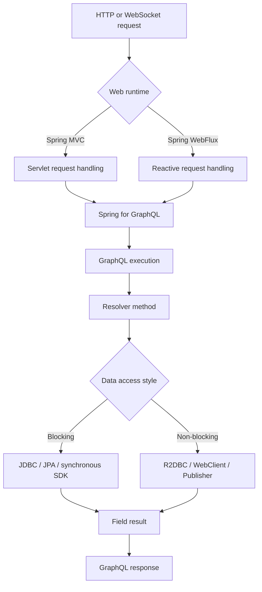

# Blocking and Reactive Applications with Spring for GraphQL

Spring for GraphQL can run inside either a Spring MVC or a Spring WebFlux application. GraphQL resolvers can also return synchronous values, `CompletableFuture`, `Mono`, or `Flux`. These two choices are related, but they are not the same concept: MVC/WebFlux determines the application's request-processing model, whereas the return type and data access approach determine how the resolver performs its work.

What matters most is where I/O runs. JDBC, JPA, and synchronous libraries typically block the current thread while waiting on a database or external service. If that operation runs on a WebFlux event-loop thread, it can slow down many unrelated requests. Conversely, a reactive pipeline only yields real benefits when the operations inside it are also non-blocking.

After this lesson, you will be able to:

- Distinguish between Spring MVC and Spring WebFlux runtimes when serving GraphQL.
- Choose synchronous, asynchronous, or reactive resolver return types based on your data access stack.
- Identify thread blocking in a WebFlux application and isolate blocking libraries when they cannot yet be replaced.
- Build resolvers, batch mappings, and subscriptions tailored to each model.
- Handle transactions, errors, timeouts, and testing for blocking or reactive applications.

## 1. Two axes to distinguish

When designing with Spring for GraphQL, examine two independent questions:

1. Does the application receive HTTP requests via Spring MVC or Spring WebFlux?
2. Does the resolver fetch data using blocking APIs, asynchronous APIs, or reactive APIs?

Spring MVC typically runs on Servlet containers with a thread-per-request synchronous processing model. Spring WebFlux is built for non-blocking processing and usually runs on Reactor Netty's event loop; WebFlux can also run on certain Servlet containers. In both environments, Spring for GraphQL uses the same annotations such as `@QueryMapping`, `@MutationMapping`, and `@SchemaMapping`.

| Aspect | Spring MVC | Spring WebFlux |
| --- | --- | --- |
| Web model | Servlet, typically one thread handling the request during synchronous work | Reactive, prioritizing non-blocking processing and event loops |
| Naturally suited data access | JDBC, JPA, and blocking libraries | R2DBC, `WebClient`, and reactive/non-blocking APIs |
| Synchronous resolver | Usually fits blocking services well | Can be declared, but you must verify where the method is called and avoid blocking I/O on reactive threads |
| Reactive resolver | Can be used when compatible with services and Spring MVC adapters | Natural choice for non-blocking execution paths |
| Primary risk | Holding request threads too long, exhausting servlet threads or connection pools | Blocking the event loop, degrading concurrency |

Therefore, do not assume that returning `Mono` turns an application into WebFlux, or that running WebFlux automatically makes JDBC non-blocking. Choose the runtime based on application needs and keep the data path consistent with that choice.

## 2. Where resolvers sit in the processing flow

A GraphQL request passes through the web runtime, GraphQL handler, schema execution engine, and resolvers. Resolvers call services or repositories to fetch data, and GraphQL assembles the results according to the client's selection set.



Spring for GraphQL provides the integration layer to turn annotated methods into data fetchers and adapt Spring-supported return types. However, the framework cannot automatically turn a synchronous JDBC call into a non-blocking operation. If a method calls a blocking library, that call still waits for completion on the executing thread unless the application explicitly offloads the work to another executor or scheduler.

## 3. Spring MVC applications with blocking resolvers

If the application uses Spring MVC with JDBC or JPA, synchronous resolvers are usually the simplest implementation. Example:

```java
@Controller
public class BookGraphQlController {

    private final BookService bookService;

    public BookGraphQlController(BookService bookService) {
        this.bookService = bookService;
    }

    @QueryMapping
    public Book book(@Argument("id") String id) {
        return bookService.findById(id).orElse(null);
    }

    @QueryMapping
    public List<Book> books() {
        return bookService.findAll();
    }
}
```

In this example, `BookService` may use Spring Data JPA or `JdbcTemplate`. When calling the service, the resolver thread waits for the database to return results before returning the object to GraphQL. This model is easy to understand, easy to debug, and fits many CRUD applications.

In return, each waiting I/O operation holds a thread resource for the duration of the wait. If many requests arrive simultaneously, servlet threads and database connections can become bottlenecks. Configure connection pools, query timeouts, concurrent request limits, and thread pool sizes based on real load.

Spring MVC also supports asynchronous and reactive return types through Spring adapters. That does not change the underlying nature of the data access library: if a resolver calls synchronous JPA before returning a `Mono`, the JPA call is still blocking. A reactive return type cannot fix an operation that already blocked the thread.

## 4. WebFlux applications with reactive resolvers

With WebFlux, prefer non-blocking APIs such as Spring Data R2DBC, `WebClient`, or services returning Reactor `Mono`/`Flux`. Resolvers pass publishers directly back to Spring for GraphQL:

```java
@Controller
public class BookGraphQlController {

    private final ReactiveBookRepository bookRepository;

    public BookGraphQlController(ReactiveBookRepository bookRepository) {
        this.bookRepository = bookRepository;
    }

    @QueryMapping
    public Mono<Book> book(@Argument("id") String id) {
        return bookRepository.findById(id);
    }

    @QueryMapping
    public Flux<Book> books() {
        return bookRepository.findAll();
    }
}
```

`Mono<Book>` represents a result of at most one book; if no result exists, the publisher can complete empty. `Flux<Book>` represents a sequence of books for a list field. Spring for GraphQL integrates Spring-recognized reactive types to deliver results back to GraphQL execution.

A reactive pipeline does not hold a thread while waiting on non-blocking I/O. When the database or HTTP client does not have data yet, the runtime can use that thread for other work; when a signal arrives, the pipeline resumes. This approach can improve concurrency, though it does not eliminate limits on databases, connection pools, CPU, or downstream services.

Let the framework manage subscribing to the resolver's publisher. Do not call `subscribe()` manually inside a controller method to run side work; doing so can allow GraphQL to finish the response before the work completes and makes errors hard to attach to the corresponding field.

## 5. Why is blocking I/O dangerous in WebFlux?

The following snippet looks reactive, yet still blocks:

```java
@QueryMapping
public Mono<Book> book(@Argument("id") String id) {
    Book book = jpaBookRepository.findById(id).orElse(null);
    return Mono.justOrEmpty(book);
}
```

`findById` is invoked immediately as the method runs. The `Mono` is only created after the database has already returned a result, so it does nothing to move the JPA operation onto another thread. In a WebFlux environment, a blocking call like this can occupy a reactive processing thread and impact unrelated requests.

Common symptoms include:

- Sharp latency spikes when a database or downstream service responds slowly.
- Falling throughput even though CPU is underutilized.
- Many unrelated requests slowing down together because reactive threads are tied up.
- Warnings or errors from tools that detect blocking calls on non-blocking threads.

Calls to avoid on the reactive path include `block()`, `blockFirst()`, `blockLast()`, `Future.get()`, `Thread.sleep()`, and synchronous JDBC/JPA APIs. Renaming a method or wrapping the result in `Mono.just(...)` does not change their blocking behavior.

## 6. Isolating blocking libraries when they cannot be replaced yet

During a migration, an application may still need to use JPA, JDBC, or an SDK that only offers synchronous APIs. In that case, isolate blocking calls onto a scheduler dedicated to blocking work:

```java
@QueryMapping
public Mono<Book> book(@Argument("id") String id) {
    return Mono.fromCallable(() -> jpaBookRepository.findById(id))
            .subscribeOn(Schedulers.boundedElastic())
            .flatMap(optional -> Mono.justOrEmpty(optional));
}
```

`Mono.fromCallable` defers invoking the repository until the publisher is subscribed to. `subscribeOn(Schedulers.boundedElastic())` shifts upstream execution onto a scheduler suited for blocking tasks. `flatMap` converts `Optional<Book>` into a publisher that can complete empty if no record is found.

`boundedElastic` bounds resources better than spawning unbounded threads, but it does not make the database non-blocking. If the number of blocking tasks exceeds capacity, queues and wait times still grow. Under heavy load or when a downstream system has its own capacity limits, consider creating a dedicated scheduler with bounded threads and queue capacity to isolate load.

Guidelines when using schedulers:

- Use `subscribeOn` to move execution of blocking work upstream, close to where the I/O originates.
- Do not use `Schedulers.parallel()` for JDBC, JPA, or blocking tasks; that scheduler is intended for short CPU-bound work that does not wait on I/O.
- `publishOn` shifts execution for downstream signals; placing `publishOn` after an already-executed blocking call cannot retroactively move that call to another thread.
- Do not create a new scheduler per request. If load isolation is needed, create and manage the scheduler at the application level and shut it down when the application stops.
- Configure timeouts on the repository, driver, or client itself. A GraphQL-layer timeout will not necessarily interrupt a JDBC call that has already blocked a thread.

When it is feasible to replace JPA with R2DBC or synchronous SDKs with non-blocking APIs, that is usually the better long-term path for a pure reactive WebFlux pipeline. Wrapping blocking calls is a controlled bridge, not the final optimization.

## 7. Using CompletableFuture and executors

GraphQL Java supports asynchronous results via `CompletionStage`; Spring for GraphQL can also adapt `CompletableFuture`. This type works well when services or libraries already provide a future-based API:

```java
@QueryMapping
public CompletableFuture<Book> book(@Argument("id") String id) {
    return bookService.findByIdAsync(id);
}
```

If you need to run a blocking call asynchronously, you can use a bounded executor:

```java
@Configuration
public class GraphQlExecutorConfiguration {

    @Bean
    public ThreadPoolTaskExecutor bookIoExecutor() {
        ThreadPoolTaskExecutor executor = new ThreadPoolTaskExecutor();
        executor.setCorePoolSize(8);
        executor.setMaxPoolSize(16);
        executor.setQueueCapacity(200);
        executor.setThreadNamePrefix("book-io-");
        executor.setRejectedExecutionHandler(new ThreadPoolExecutor.AbortPolicy());
        return executor;
    }
}
```

```java
@Controller
public class BookGraphQlController {

    private final BookService bookService;
    private final Executor bookIoExecutor;

    public BookGraphQlController(
            BookService bookService,
            @Qualifier("bookIoExecutor") Executor bookIoExecutor) {
        this.bookService = bookService;
        this.bookIoExecutor = bookIoExecutor;
    }

    @QueryMapping
    public CompletableFuture<Book> book(@Argument("id") String id) {
        return CompletableFuture.supplyAsync(
                () -> bookService.findById(id).orElse(null),
                bookIoExecutor);
    }
}
```

This example illustrates using a dedicated executor to bound blocking work. Real-world sizing must be tuned based on processing times, database connection counts, and expected load. When the executor is saturated, the rejection policy surfaces an error so the application can handle overload; avoid policies that run rejected tasks on the calling thread if that thread could be an event-loop thread. `CompletableFuture.supplyAsync(...)` without specifying an executor uses the default common pool; do not assume the common pool is appropriate for application blocking I/O.

`CompletableFuture` provides asynchronous composition but lacks Reactive Streams backpressure. If your services already use Reactor everywhere, keeping `Mono`/`Flux` end-to-end is usually simpler than converting back and forth across abstractions.

## 8. Batch loading must still match the runtime

Batch loading reduces the number of queries when GraphQL resolves child fields across many parent objects. However, batching does not automatically make I/O non-blocking.

With a reactive repository, a batch mapping can return `Mono<Map<...>>`:

```java
@BatchMapping(typeName = "Book", field = "author")
public Mono<Map<Book, Author>> authors(List<Book> books) {
    Set<String> authorIds = books.stream()
            .map(Book::authorId)
            .collect(Collectors.toSet());

    return authorRepository.findAllById(authorIds)
            .collectMap(Author::id)
            .map(authorsById -> {
                Map<Book, Author> result = new HashMap<>();
                for (Book book : books) {
                    result.put(book, authorsById.get(book.authorId()));
                }
                return result;
            });
}
```

With a JPA repository in an MVC application, a synchronous batch method is equally appropriate:

```java
@BatchMapping(typeName = "Book", field = "author")
public Map<Book, Author> authors(List<Book> books) {
    Set<String> ids = books.stream()
            .map(Book::authorId)
            .collect(Collectors.toSet());

    Map<String, Author> byId = authorRepository.findAllById(ids).stream()
            .collect(Collectors.toMap(Author::id, Function.identity()));

    Map<Book, Author> result = new HashMap<>();
    for (Book book : books) {
        result.put(book, byId.get(book.authorId()));
    }
    return result;
}
```

If you must call a blocking repository from WebFlux, move the entire batch operation into the blocking isolation boundary rather than looping object by object on a reactive thread. Also verify that the batch loader truly issues a single batch query; looping over each ID to call the repository is still N+1 even inside `@BatchMapping`.

For `DataLoader`, the same principle applies: a batch loader can return a Spring-supported future or publisher, while the data access inside must follow the chosen blocking/non-blocking model. Grouping keys only reduces the number of round trips; it does not change the nature of the underlying driver.

## 9. Subscriptions and event streams

Subscriptions are commonly represented with `Flux<T>` because clients receive multiple events over the lifetime of a connection:

```java
@SubscriptionMapping
public Flux<BookEvent> bookCreated() {
    return bookEventService.bookCreated();
}
```

On a reactive path, the event source should emit signals in a non-blocking manner and respect subscription lifecycle. When a client disconnects, the pipeline must support cancellation and resource cleanup. If each event must invoke a blocking SDK, offload that work onto an appropriate scheduler and bound concurrency so a high-volume event stream does not exhaust resources.

The application must also configure a transport that supports subscriptions, such as WebSocket or RSocket. Having a resolver return `Flux` does not automatically create an endpoint or connection protocol for clients.

## 10. Transactions and asynchronous boundaries

Transactions must match the data access technology and how resolvers execute.

With JDBC/JPA, transactions are normally bound to the current thread. An imperative service can open a transaction, read or write data, and complete the transaction within the same synchronous call. If work is offloaded to another executor, do not assume transactions or thread-bound resources propagate automatically to the new thread.

With R2DBC and Spring reactive transaction management, transactions propagate through the Reactor context and are tied to subscribing to the pipeline. Use a reactive transaction manager and keep operations within the same reactive chain. Never call `.block()` mid-pipeline to wait for a result, as doing so breaks the reactive execution model and can lose the transaction context.

Another caveat with JPA is lazy loading. If a resolver returns an entity and a nested field resolver later accesses a lazy relationship after the transaction has closed, the application can hit `LazyInitializationException` or trigger unexpected extra queries. Consider DTOs, projections, fetch plans, or batch loaders to fetch data within proper boundaries and avoid relying on long-lived open sessions.

Do not mix imperative and reactive transactions arbitrarily. Choose the transaction manager matching your data technology, define transaction boundaries in services, and test real execution paths—especially when schedulers or multiple publishers are involved.

## 11. Errors, timeouts, and cancellation

In blocking resolvers, exceptions are usually thrown directly while the method runs. In reactive resolvers, errors are emitted as `onError` signals; in `CompletableFuture`, errors are represented via exceptional completion. Spring for GraphQL feeds these errors into GraphQL error handling, including `DataFetcherExceptionResolver` and configured exception handlers.

For predictable business errors, map them to appropriate codes and messages for clients. Do not swallow errors with `onErrorResume` returning fake data if doing so makes the response look like a success. Log details server-side and avoid exposing stack traces or sensitive information in responses.

Timeouts should be configured where I/O occurs: database query timeouts, HTTP client timeouts, service call limits, and appropriate request limits. When a client cancels a request or subscription, reactive publishers can receive a cancel signal; however, an in-flight blocking call generally cannot be safely stopped merely because a wrapper future or publisher was cancelled. Therefore, timeouts and resource limits on the blocking library itself remain essential.

## 12. Testing blocking and reactive resolvers

`GraphQlTester` lets you test operations from a GraphQL perspective without coupling tests to the wiring details of individual resolvers:

```java
graphQlTester.document("""
        query {
            book(id: "book-42") {
                id
                title
            }
        }
        """)
    .execute()
    .path("book.title")
    .entity(String.class)
    .isEqualTo("Spring GraphQL in Practice");
```

For blocking resolvers, verify that services/repositories are called properly and that slow or failing queries are handled properly. For reactive resolvers, verify that publishers complete with the expected data, emit errors in the right cases, and do not subscribe multiple times unexpectedly. For batch mappings, verify that a group of source objects results in a single batch query.

If a WebFlux application still depends on blocking libraries, consider using BlockHound in test or development environments to detect blocking calls on threads marked non-blocking. This tool complements load testing and runtime monitoring; it does not replace integration tests against real databases and downstream services.

When you need to test the web runtime as well, write integration tests matching your actual MVC or WebFlux configuration. Tests at the `GraphQlTester` level focus on schemas and resolvers; transport tests verify that HTTP/WebSocket requests pass through the runtime and endpoint configuration as expected.

## 13. Choosing a model by scenario

| Scenario | Suitable implementation approach |
| --- | --- |
| Existing application using Spring MVC and JPA | Keep resolvers synchronous; optimize queries, transactions, pools, and timeouts |
| WebFlux application using R2DBC | Use `Mono`/`Flux` end-to-end from resolvers to repositories |
| WebFlux calling HTTP services | Prefer `WebClient` and reactive publishers |
| WebFlux forced to use a blocking SDK | Isolate calls with `boundedElastic` or a dedicated bounded executor; plan to replace if load demands |
| Service already exposes `CompletionStage` | Return `CompletableFuture` and manage the service's executor |
| Nested field loads data for many objects | Use `@BatchMapping` or DataLoader; ensure the batch loader matches the runtime |
| Need to stream events to clients | Use `@SubscriptionMapping` with a publisher and configure a subscription-capable transport |

No single return type fits every application. An MVC application can call reactive services; a WebFlux application can temporarily integrate a blocking library. What matters is identifying clearly where threads are held, bounding resources, and preventing uncontrolled blocking from degrading all requests.

## 14. Review checklist before shipping a resolver

When adding or modifying a resolver, review step by step:

1. Identify whether the actual runtime is MVC or WebFlux and which GraphQL transport is used.
2. Trace calls from the resolver down to the repository or external service to confirm whether the leaf API is blocking or non-blocking.
3. Choose the matching return type: synchronous value, `CompletableFuture`, `Mono`, or `Flux`.
4. If there is blocking I/O in WebFlux, replace it with a non-blocking API or isolate it on a bounded scheduler/executor.
5. Check N+1, batch loaders, lazy loading, and database connection counts.
6. Define transaction boundaries, timeouts, error mappings, and cancellation behavior.
7. Test GraphQL operations, batch behavior, and transports; measure latency, throughput, and thread utilization under load.

Spring for GraphQL lets you use the same schema and annotated resolver model in both blocking and reactive applications. Design quality depends on keeping the data path consistent with the runtime: use controlled blocking in a suitable stack, or keep I/O non-blocking end-to-end when choosing WebFlux.
