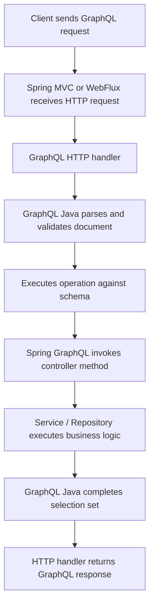

# Spring Boot Integration

Spring for GraphQL provides the integration layer between GraphQL Java and the Spring ecosystem. When used with Spring Boot, an application can automatically build the GraphQL runtime from SDL schemas, register field handler methods in Spring controllers, and expose a GraphQL endpoint on the application's HTTP server.

This lesson focuses on assembling those pieces into a working application: declaring dependencies, placing the schema in the right location, writing controllers, configuring endpoints, adding custom components, and testing. The examples use Java and Spring Boot 3.x; in practice, use a Spring for GraphQL version compatible with the Spring Boot version managed by your project.

## 1. Integration components

A Spring Boot application using Spring for GraphQL typically consists of the following components:

| Component | Role |
| --- | --- |
| Spring Boot auto-configuration | Creates and wires GraphQL beans based on dependencies, schemas, and application configuration. |
| GraphQL schema SDL | Declares root operations, types, fields, arguments, and scalars exposed by the API. |
| GraphQL Java | Parses, validates, and executes operations against the schema. |
| Spring GraphQL controller | Provides field handler methods via annotations such as `@QueryMapping`, `@MutationMapping`, and `@SchemaMapping`. |
| HTTP transport | Receives requests at the GraphQL endpoint and returns responses to clients. |
| Services and repositories | Contain business logic and data access; controllers invoke these components to resolve fields. |

High-level processing flow:



Spring Boot auto-configures the wiring, while the application still must provide the schema and logic to resolve the required fields. A single HTTP endpoint can serve multiple queries and mutations; each field in the schema is resolved via its corresponding mapping.

## 2. Declaring dependencies

For a Maven project using Spring Boot 3.x, declare the GraphQL starter and a web starter. Spring Boot manages compatible library versions via its parent or BOM, so you do not need to pin individual versions for each dependency.

```xml
<dependencies>
    <dependency>
        <groupId>org.springframework.boot</groupId>
        <artifactId>spring-boot-starter-graphql</artifactId>
    </dependency>

    <dependency>
        <groupId>org.springframework.boot</groupId>
        <artifactId>spring-boot-starter-web</artifactId>
    </dependency>

    <dependency>
        <groupId>org.springframework.boot</groupId>
        <artifactId>spring-boot-starter-test</artifactId>
        <scope>test</scope>
    </dependency>

    <dependency>
        <groupId>org.springframework.graphql</groupId>
        <artifactId>spring-graphql-test</artifactId>
        <scope>test</scope>
    </dependency>
</dependencies>
```

Purpose of each dependency:

- `spring-boot-starter-graphql` brings Spring for GraphQL and required GraphQL components into the application and enables auto-configuration when conditions match.
- `spring-boot-starter-web` provides the HTTP server based on Spring MVC and the servlet stack. If the application is built on the reactive stack, use `spring-boot-starter-webflux` instead of the MVC starter.
- `spring-boot-starter-test` provides the Spring and JUnit testing foundation; `spring-graphql-test` adds `GraphQlTester` to test operations and responses.

Do not include both MVC and WebFlux starters just to expose a GraphQL endpoint. Choose the web stack suited to your application's architecture. Spring for GraphQL supports both, though transport, server configuration, and some testing setups differ.

## 3. Directory structure and SDL schema

By default, Spring Boot looks for GraphQL schemas in the `graphql` resource directory. A simple layout:

```text
src/
├── main/
│   ├── java/
│   │   └── com/example/catalog/
│   │       ├── CatalogApplication.java
│   │       ├── graphql/
│   │       │   └── GreetingController.java
│   │       └── service/
│   │           └── GreetingService.java
│   └── resources/
│       ├── application.yml
│       └── graphql/
│           └── schema.graphqls
└── test/
    └── java/
        └── com/example/catalog/graphql/
            └── GreetingControllerTests.java
```

Schema files typically use `.graphqls` or `.gqls` extensions. You can split schemas into multiple files inside subdirectories; Spring Boot and Spring GraphQL merge discovered schema resources according to the configured locations.

Create `src/main/resources/graphql/schema.graphqls`:

```graphql
type Query {
    greeting(name: String! = "Spring"): String!
}
```

The schema declares a `greeting` field on the `Query` root type. The `name` argument has type `String!` and a default value of `Spring`. The field returns `String!`, meaning the result must be non-null.

GraphQL requires a root query type to serve data reads. When adding write operations, declare a `Mutation` root type; for event streams, declare a `Subscription` root type. The schema is the public API contract, so types and nullability should accurately reflect business guarantees.

## 4. Initializing the Spring Boot application

The main application class can keep the familiar Spring Boot structure:

```java
package com.example.catalog;

import org.springframework.boot.SpringApplication;
import org.springframework.boot.autoconfigure.SpringBootApplication;

@SpringBootApplication
public class CatalogApplication {

    public static void main(String[] args) {
        SpringApplication.run(CatalogApplication.class, args);
    }
}
```

When the application starts, component scanning discovers controllers and services in the current package and its subpackages. Spring Boot auto-configuration inspects the classpath, properties, and schemas to create the required GraphQL components.

Therefore, place the main class in the root package so controllers and services are scanned automatically. If a controller sits outside the component scan scope, the schema may load while field handler methods fail to register as expected.

## 5. Mapping schema fields with controllers

Spring for GraphQL uses dedicated annotations to connect schema fields to Java methods. For the `greeting` example, create a controller:

```java
package com.example.catalog.graphql;

import org.springframework.graphql.data.method.annotation.Argument;
import org.springframework.graphql.data.method.annotation.QueryMapping;
import org.springframework.stereotype.Controller;

@Controller
public class GreetingController {

    @QueryMapping
    public String greeting(@Argument("name") String name) {
        return "Hello, " + name + "!";
    }
}
```

Key points to note:

- Use `@Controller` to register the controller with Spring. This is a GraphQL controller, not a REST controller returning HTTP responses per route.
- `@QueryMapping` maps the method to the field of the same name on the `Query` root type. In this example, the `greeting` method handles the `Query.greeting` field.
- `@Argument` extracts the `name` argument from the GraphQL field and converts it to the matching Java type.
- The method's return value becomes the field result in the GraphQL response. The GraphQL engine continues resolving any remaining fields in the selection set.

You can specify the field name explicitly if the Java method name differs from the schema field name:

```java
@QueryMapping(name = "greeting")
public String getGreeting(@Argument("name") String personName) {
    return "Hello, " + personName + "!";
}
```

The argument name in `@Argument` must match the name declared in the schema. Specifying the name explicitly avoids depending on Java parameter names or compiler settings that retain parameter names.

### Separating business logic into a service

In a real application, controllers should act as adapters between GraphQL and the business layer. You can move the logic into a service:

```java
package com.example.catalog.service;

import org.springframework.stereotype.Service;

@Service
public class GreetingService {

    public String greet(String name) {
        return "Hello, " + name + "!";
    }
}
```

```java
package com.example.catalog.graphql;

import com.example.catalog.service.GreetingService;
import org.springframework.graphql.data.method.annotation.Argument;
import org.springframework.graphql.data.method.annotation.QueryMapping;
import org.springframework.stereotype.Controller;

@Controller
public class GreetingController {

    private final GreetingService greetingService;

    public GreetingController(GreetingService greetingService) {
        this.greetingService = greetingService;
    }

    @QueryMapping
    public String greeting(@Argument("name") String name) {
        return greetingService.greet(name);
    }
}
```

Constructor injection makes dependencies explicit, making testing and swapping implementations easier. Services can call repositories or external system clients without coupling controllers directly to persistence details.

## 6. Configuring endpoint and schema with application.yml

With Spring Boot, the default HTTP GraphQL endpoint is `/graphql`. You can declare it explicitly in `application.yml`:

```yaml
spring:
  application:
    name: catalog-api
  graphql:
    path: /graphql
```

With the default configuration, clients send requests to:

```http
POST http://localhost:8080/graphql
Content-Type: application/json
```

Body:

```json
{
  "query": "query Greeting($name: String!) { greeting(name: $name) }",
  "operationName": "Greeting",
  "variables": {
    "name": "Lan"
  }
}
```

Expected response:

```json
{
  "data": {
    "greeting": "Hello, Lan!"
  }
}
```

If you want to change the path, update `spring.graphql.path`, for example to `/api/graphql`. Clients and infrastructure configurations such as reverse proxies, gateways, or security matchers must use the same updated path.

### Changing the schema location

If schemas do not reside in the default directory, configure `spring.graphql.schema.locations` to specify search locations. For example:

```yaml
spring:
  graphql:
    schema:
      locations: classpath:graphql/**/
```

Multiple locations can be used when schemas are split across modules. Ensure resources are packaged onto the classpath when building the application; a schema that only exists in an IDE working directory may run locally yet fail when packaged or deployed.

## 7. Customizing the GraphQL runtime

Auto-configuration covers most common scenarios. When you need to register scalars, directives, or additional wiring, provide a `RuntimeWiringConfigurer` bean. Spring for GraphQL applies these configurers when building the GraphQL runtime from the schema.

Configuration skeleton example:

```java
package com.example.catalog.config;

import org.springframework.context.annotation.Bean;
import org.springframework.context.annotation.Configuration;
import org.springframework.graphql.execution.RuntimeWiringConfigurer;

@Configuration
public class GraphQlConfig {

    @Bean
    RuntimeWiringConfigurer runtimeWiringConfigurer() {
        return wiringBuilder -> {
            // Register additional scalars or wiring here.
        };
    }
}
```

This is the extension point for components that integrate with GraphQL Java. If a custom scalar is added to the schema, you must register its implementation so GraphQL knows how to parse inputs and serialize outputs. Declaring the scalar name in SDL alone is not enough.

Spring for GraphQL also provides other extension points such as interceptors, instrumentation, exception resolvers, and the DataLoader registry. Add them only when the application has a specific need; default configuration is usually sufficient to get basic queries running.

## 8. Resolving nested fields

A GraphQL request can select fields across multiple nested objects. Spring for GraphQL supports `@SchemaMapping` to handle fields on any type, not just the root `Query`.

Example schema:

```graphql
type Query {
    book(id: ID!): Book
}

type Book {
    id: ID!
    title: String!
    author: Author
}

type Author {
    id: ID!
    name: String!
}
```

Controller handling the root query:

```java
@Controller
public class BookController {

    private final BookService bookService;

    public BookController(BookService bookService) {
        this.bookService = bookService;
    }

    @QueryMapping
    public Book book(@Argument("id") String id) {
        return bookService.findById(id);
    }
}
```

If the `Book` object already has matching properties, GraphQL can use property access to retrieve those fields. When the author needs to be queried from a separate source, declare an explicit mapping:

```java
@Controller
public class BookAuthorController {

    private final AuthorService authorService;

    public BookAuthorController(AuthorService authorService) {
        this.authorService = authorService;
    }

    @SchemaMapping(typeName = "Book", field = "author")
    public Author author(Book book) {
        return authorService.findById(book.authorId());
    }
}
```

This method handles the `author` field on the `Book` type. The first parameter is the `Book` source object, from which the resolver extracts the details needed to look up the author.

If a query retrieves a list of many books and each book queries its author individually, the application can run into the N+1 problem. Spring for GraphQL integrates DataLoader and supports `@BatchMapping` to group field resolution into batches. This is an important optimization step when integrating GraphQL with databases or downstream services; measure actual queries before picking a batching strategy.

## 9. Mutation and Subscription in Boot applications

Spring Boot does not require separate HTTP endpoints per operation type. Queries and mutations are sent to the same GraphQL endpoint; the schema and operation document determine the operation kind.

Declaring a mutation:

```graphql
type Mutation {
    renameBook(id: ID!, title: String!): Book!
}
```

Mapping with `@MutationMapping`:

```java
@MutationMapping
public Book renameBook(
        @Argument("id") String id,
        @Argument("title") String title) {
    return bookService.rename(id, title);
}
```

For subscriptions, methods can return a publisher such as `Flux<T>`:

```graphql
type Subscription {
    bookUpdated: Book!
}
```

```java
@SubscriptionMapping
public Flux<Book> bookUpdated() {
    return bookEventService.bookUpdates();
}
```

Subscriptions require a streaming-capable transport such as Server-Sent Events (SSE), WebSocket, or RSocket, depending on the Spring GraphQL version and web stack configuration. Simply adding a `Subscription` field and a `@SubscriptionMapping` method is not enough for clients to receive events over standard HTTP request/response. Exact endpoint and transport dependencies depend on application configuration.

## 10. Testing with @GraphQlTest and GraphQlTester

Spring Boot provides `@GraphQlTest` for GraphQL slice testing. This annotation focuses on GraphQL controllers and related components, allowing you to verify schemas, mappings, and results without starting the full web server.

Example:

```java
package com.example.catalog.graphql;

import org.junit.jupiter.api.Test;
import org.springframework.beans.factory.annotation.Autowired;
import org.springframework.boot.test.autoconfigure.graphql.GraphQlTest;
import org.springframework.context.annotation.Import;
import org.springframework.graphql.test.tester.GraphQlTester;
import com.example.catalog.service.GreetingService;

@GraphQlTest(GreetingController.class)
@Import(GreetingService.class)
class GreetingControllerTests {

    @Autowired
    GraphQlTester graphQlTester;

    @Test
    void returnsGreeting() {
        graphQlTester.document("""
                query Greeting($name: String!) {
                    greeting(name: $name)
                }
                """)
            .variable("name", "Lan")
            .execute()
            .path("greeting")
            .entity(String.class)
            .isEqualTo("Hello, Lan!");
    }
}
```

The test sends a GraphQL document, supplies variables, and asserts a field in the response. If the controller depends on services, supply those dependencies in the test context, such as with a test configuration or mock bean suited to your Spring Boot version.

For integration tests over real HTTP, use `@SpringBootTest` with a web environment and a GraphQL tester bound to an HTTP client. This also verifies routing, HTTP transport, serialization, and application filters. Include both fast slice tests for mappings and integration tests for critical request flows.

## 11. Common integration errors

| Symptom | Possible cause | How to resolve |
| --- | --- | --- |
| Calling `/graphql` returns 404 | Missing web starter, endpoint path changed, or GraphQL HTTP handler not configured. | Check web dependencies, `spring.graphql.path`, and startup logs. |
| Application cannot find schema | File outside classpath or wrong directory/resource name. | Place schema in `src/main/resources/graphql/` or configure schema locations. |
| Schema loads, but field returns `null` | Missing mapping or source object does not provide the property. | Cross-check the field against `@QueryMapping`, `@SchemaMapping`, and returned data. |
| Controller method is not invoked | Controller outside component scan, wrong mapping annotation, or field mismatch with schema. | Check package, annotations, and field/argument names. |
| Argument receives wrong value or fails to bind | Argument name or Java type does not match schema. | Check `@Argument`, SDL types, and input structure. |
| Startup reports schema error | Invalid SDL syntax, duplicate type declarations, or invalid root operation. | Read startup error messages and fix the source schema. |
| Slow query when fetching nested objects | Resolver queries individually per object, causing N+1. | Use DataLoader or `@BatchMapping`, then re-measure query counts. |
| Subscription receives no events | Streaming transport not configured or client uses regular HTTP request/response. | Check WebSocket/RSocket transport and matching endpoint configuration. |

When debugging, check in order: dependencies and web stack, startup logs, whether the schema loaded, whether the endpoint receives requests, whether the document validates, and only then inspect resolvers and services. This layered approach narrows down issues faster.

## 12. Checklist when integrating into a project

Before adopting Spring for GraphQL in an application, verify:

1. The project uses compatible Spring Boot and Spring for GraphQL versions.
2. The GraphQL starter and exactly one appropriate web stack are included.
3. SDL schemas are packaged on the classpath and declare valid root operations.
4. Controllers are scanned by Spring and mapping methods match the schema.
5. Endpoint and schema locations are configured properly if using custom paths.
6. Nested fields have a clear data resolution strategy; query paths prone to N+1 consider batching.
7. Tests cover key mappings and HTTP integration flows.
8. Security, CORS, query limits, and error handling are configured according to deployment requirements.

Spring Boot accelerates initializing the GraphQL runtime and HTTP endpoint. Integration quality depends on clear schemas, focused mappings, separated services, and thorough testing across data paths. Once this foundation is solid, you can extend the application with DataLoaders, error handling, field-level security, and server-side query optimization.
