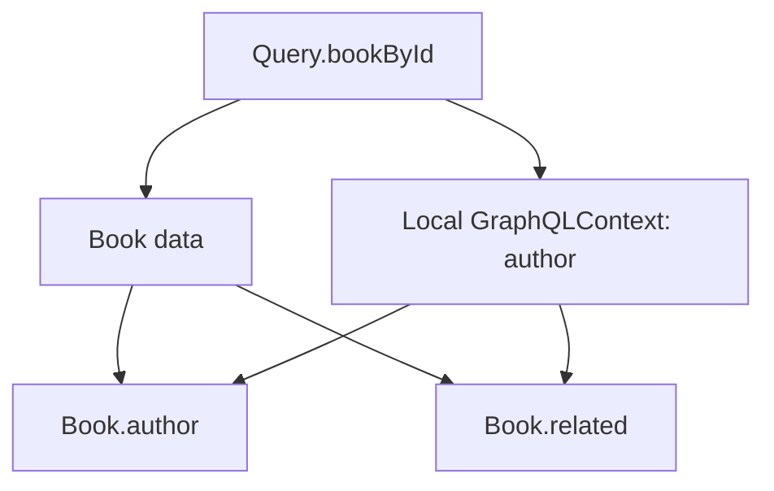

# @LocalContextValue

In a GraphQL query, a parent field resolver sometimes has already retrieved data that child fields also need. If each child field calls a service on its own to fetch that same data again, the application may generate unnecessary queries. Spring for GraphQL provides `@LocalContextValue` so a field resolver can read information passed down by the parent field within the scope of a single branch of the GraphQL tree.

Local context is created from the result of a parent resolver, typically via `DataFetcherResult<T>` and its `localContext` property. Child resolvers receive the value using `@LocalContextValue`. This enables sharing preloaded data, computed values, or branch-specific metadata without putting them into the shared context of the entire operation.

This lesson explains local context in GraphQL Java, how to create and pass local context from a parent field, how to read it with `@LocalContextValue`, how to handle missing values, the differences between local context and the main GraphQL context, along with testing examples and common mistakes.

## 1. What is local context?

GraphQL executes an operation following a field tree. A parent field resolver returns an object; GraphQL uses that object as the source for child fields. In addition to the source object, the parent resolver can pass a context object down to child resolvers.

Example schema:

```graphql
type Query {
  bookById(id: ID!): Book
}

type Book {
  id: ID!
  title: String!
  author: Author
  related: [Book!]!
}

type Author {
  id: ID!
  name: String!
}
```

Client query:

```graphql
query {
  bookById(id: "book-1") {
    title
    author {
      id
      name
    }
    related {
      id
      title
    }
  }
}
```

The `bookById` resolver can preload both the Book and the Author. It returns Book as the primary data and passes Author down to the child branch via local context. The `related` resolver can receive that Author without fetching it again:



Local context is supplementary data passed from a parent field down to that field's child fields. It is scoped to an execution branch, not a shared storage area for the entire GraphQL operation.

In GraphQL Java, a child DataFetcher reads local context via `DataFetchingEnvironment.getLocalContext()`. Spring for GraphQL provides `@LocalContextValue` to retrieve a named attribute from the local GraphQL context without accessing the environment directly.

## 2. Distinguishing main GraphQLContext and local context

Spring for GraphQL has two types of context with different scopes:

| Characteristic | Main GraphQLContext | Local context |
| --- | --- | --- |
| Scope | Entire GraphQL operation | One branch from a parent field down to child fields |
| Creation source | Execution input, WebGraphQlInterceptor, or execution components | Parent resolver returning `DataFetcherResult` with local context |
| How to read in controller | `@ContextValue` or `GraphQLContext` | `@LocalContextValue` |
| Purpose | Request-wide info such as correlation ID, principal, locale, or shared metadata | Preloaded data or metadata relevant only to a single branch |
| Child fields of the same parent | Not applicable | Share the local context provided by the parent field |

Main context example:

```java
@QueryMapping
public Book bookById(
        @Argument String id,
        @ContextValue("tenantId") String tenantId) {
    return bookService.findVisibleBook(id, tenantId);
}
```

Local context example:

```java
@SchemaMapping
public List<Book> related(
        Book book,
        @LocalContextValue("author") Author author) {
    return bookService.findRelatedByAuthor(book, author);
}
```

Do not use local context to replace request-wide information such as identity or tenant if multiple branches need that same data. Conversely, do not put all branch-specific data into the main context, as that clutters the shared context with unrelated state.

A parent field can pass the same local context to multiple child fields of its own, such as both `Book.author` and `Book.related`. However, local context created by one child field does not spread sideways to its siblings; it is only passed downward to that child's own child fields.

## 3. Creating local context with DataFetcherResult

A parent resolver can return `DataFetcherResult<T>` instead of returning only a domain object. `DataFetcherResult` contains the primary data and can also carry local context, errors, or extensions.

Example models:

```java
public record Book(
        String id,
        String title,
        String authorId) {
}

public record Author(
        String id,
        String name) {
}

public record BookAndAuthor(Book book, Author author) {
}
```

Service loading both Book and Author in a single use case:

```java
public BookAndAuthor findBookAndAuthor(String id) {
    Book book = bookRepository.findById(id);
    Author author = authorRepository.findById(book.authorId());
    return new BookAndAuthor(book, author);
}
```

Root resolver returning Book and passing Author via local context:

```java
@Controller
public class BookQueryController {

    private final BookService bookService;

    public BookQueryController(BookService bookService) {
        this.bookService = bookService;
    }

    @QueryMapping
    public DataFetcherResult<Book> bookById(@Argument String id) {
        BookAndAuthor result = bookService.findBookAndAuthor(id);

        GraphQLContext localContext = GraphQLContext.getDefault()
                .put("author", result.author());

        return DataFetcherResult.<Book>newResult()
                .data(result.book())
                .localContext(localContext)
                .build();
    }
}
```

Here:

- `data(result.book())` is the GraphQL Book object used to resolve child fields.
- `localContext(localContext)` passes a dedicated GraphQLContext down to Book's child fields.
- Key `author` stores the preloaded Author object.

`GraphQLContext.getDefault()` creates a new empty context. The example adds an attribute to that context and attaches it to `DataFetcherResult`; do not reuse a mutable local context as a singleton or store it in a controller field.

## 4. Reading local context with @LocalContextValue

Once the parent resolver passes the context, child resolvers can read the attribute:

```java
@Controller
public class BookFieldController {

    private final BookService bookService;

    public BookFieldController(BookService bookService) {
        this.bookService = bookService;
    }

    @SchemaMapping
    public Author author(
            Book book,
            @LocalContextValue("author") Author author) {
        return author;
    }

    @SchemaMapping
    public List<Book> related(
            Book book,
            @LocalContextValue("author") Author author) {
        return bookService.findRelatedBooks(book, author);
    }
}
```

`@LocalContextValue("author")` instructs Spring to look up the attribute named `author` from the local GraphQLContext and bind it to the Java type `Author`.

The annotation belongs to the package:

```java
org.springframework.graphql.data.method.annotation.LocalContextValue
```

It has two equivalent name attributes:

- `name`: attribute name in local context.
- `value`: alias for `name`.

The following two forms are equivalent:

```java
@LocalContextValue("author") Author author
```

```java
@LocalContextValue(name = "author") Author author
```

The key name must match the key stored in the context exactly. If the parent stores `author` but the child reads `bookAuthor`, Spring will not find the desired attribute.

## 5. Handling when local context has no value

By default, `required` on `@LocalContextValue` is `true`. If the attribute does not exist in local context, Spring raises an error when resolving the method argument.

You can mark the attribute as optional:

```java
@SchemaMapping
public List<Book> related(
        Book book,
        @LocalContextValue(value = "author", required = false) Author author) {

    if (author != null) {
        return bookService.findRelatedBooksByAuthor(book, author);
    }

    return bookService.findRelatedBooksByBook(book);
}
```

With `required = false`, the method receives `null` when the attribute is absent. This is appropriate when the same field can be reached from different branches or parent resolvers, only some of which provide local context.

If you want to represent absence explicitly in the type, you can use `Optional<Author>`:

```java
@SchemaMapping
public List<Book> related(
        Book book,
        @LocalContextValue(value = "author", required = false)
        Optional<Author> author) {

    return author
            .map(value -> bookService.findRelatedBooksByAuthor(book, value))
            .orElseGet(() -> bookService.findRelatedBooksByBook(book));
}
```

Pick a consistent convention for your codebase. Do not leave `required = true` if a parent field might not supply that key.

## 6. How is local context passed down to a child branch?

When a DataFetcher returns a `DataFetcherResult` with local context, GraphQL Java places that context into `DataFetchingEnvironment.getLocalContext()` for child fields.

Example:

```graphql
type Query {
  bookById(id: ID!): Book
  featuredBooks: [Book!]!
}

type Book {
  id: ID!
  author: Author
  related: [Book!]!
}
```

If `bookById` returns `DataFetcherResult<Book>` with a local context containing `author`, child fields underneath the `bookById` branch can read that key. The `featuredBooks` branch is a different root field and does not automatically receive the local context created by `bookById`.

Local context propagates along parent-child relationships:

- Parent resolver creates local context.
- Child field resolvers receive the parent's local context.
- A child resolver can return `DataFetcherResult` with a new local context for its own child fields.
- If a resolver does not supply a new local context, GraphQL Java keeps the parent's local context for the next child step.

Local context is not a global variable. It is not automatically shared across independent root fields or across different requests.

### Local context does not replace the source object

Source and local context are two distinct things:

| Value | How received | Role |
| --- | --- | --- |
| Source object | Unannotated Java parameter | The parent object the current field is resolving |
| Local context | `@LocalContextValue` | Supplementary data passed down by an ancestor resolver |

For example, a method can accept both:

```java
@SchemaMapping
public List<Book> related(
        Book book,
        @LocalContextValue("author") Author author) {
    return bookService.findRelatedBooks(book, author);
}
```

`book` is the current source; `author` is data passed down from an ancestor. Do not use local context in place of the source object, because GraphQL still needs the source to identify the object being resolved.

## 7. When should you use @LocalContextValue?

Local context is useful when a parent resolver already has data that several child resolvers in the same branch need to reuse.

### Reusing already-loaded data

A parent resolver may load both Book and Author in one use case:

```java
BookAndAuthor result = bookService.findBookAndAuthor(id);
```

It returns Book as `data` and Author as local context. Child resolvers reuse the Author already fetched instead of calling the repository again.

### Sharing computed results with child fields

A parent resolver can compute a derived value, such as:

- Visibility permissions for a group of fields based on the current resource.
- A dataset already filtered by status.
- Aggregated information serving multiple child fields.
- A look-ahead result computed from the selection set.

If multiple child fields need that same result, local context can avoid duplicate calculations or queries.

### Keeping metadata within the right branch

Some metadata is only meaningful for a single resource subtree. Local context keeps that metadata close to the fields that need it, rather than putting it into the main `GraphQLContext` and complicating the operation-wide context.

Do not use local context just to pass a simple value that the child can already get directly from the source object. Weigh the overhead of creating context against maintenance complexity.

## 8. When should you use @ContextValue instead of @LocalContextValue?

`@ContextValue` reads an attribute from the main `GraphQLContext`, while `@LocalContextValue` reads an attribute from the local context. Choose the annotation based on data scope:

```java
@SchemaMapping
public Author author(
        Book book,
        @ContextValue("tenantId") String tenantId,
        @LocalContextValue(value = "preloadedAuthor", required = false)
        Author preloadedAuthor) {

    if (preloadedAuthor != null) {
        return preloadedAuthor;
    }
    return authorService.findVisibleById(book.authorId(), tenantId);
}
```

In this example:

- `tenantId` is request-wide information and may be needed across many branches.
- `preloadedAuthor` is only passed down by the parent branch if it was preloaded.

Do not move tenant ID or principal into local context just because one field needs them. Authentication and data-partitioning information generally belong in the main context or Spring Security context so resolvers can apply them consistently.

## 9. Local context and DataFetcherResult

`DataFetcherResult<T>` does not only carry local context. It can also contain:

- `data`: primary data returned by the field.
- `localContext`: context intended for child fields.
- `errors`: GraphQL errors associated with the field result.
- `extensions`: metadata merged into the execution result.

Example using only data and local context:

```java
return DataFetcherResult.<Book>newResult()
        .data(book)
        .localContext(localContext)
        .build();
```

If local context is not needed, returning `Book` directly is usually simpler. Only use `DataFetcherResult` when you genuinely need metadata, local context, or errors.

### Combining with async return types

The type parameter of `DataFetcherResult<P>` can be a supported async type, such as `Mono<Book>`. If local context is already available when the method is called, you can return:

```java
@QueryMapping
public DataFetcherResult<Mono<Book>> bookById(@Argument String id) {
    Author preloadedAuthor = authorService.findFromRequestCache(id);

    GraphQLContext localContext = GraphQLContext.getDefault()
            .put("author", preloadedAuthor);

    return DataFetcherResult.<Mono<Book>>newResult()
            .data(bookService.findByIdReactive(id))
            .localContext(localContext)
            .build();
}
```

In this example, Book is loaded asynchronously via `Mono`, while local context is created before returning `DataFetcherResult`. If local context depends on an async result, design the pipeline so data and context are produced together in the same processing step; do not place a `Mono` into local context expecting `@LocalContextValue` to subscribe to it automatically. Do not call `block()` to unwrap a `Mono` in a WebFlux controller.

The name `findFromRequestCache` in the example is an illustrative method and assumes it always returns a valid `Author`. If `Author` can be absent, do not call `put` with a null value; only add the key when a value is present and declare the child parameter with `required = false`.

## 10. How do local context and DataLoader differ?

Both local context and DataLoader can help avoid reloading data, but they solve two different problems:

| Criterion | Local context | DataLoader |
| --- | --- | --- |
| Purpose | Pass supplementary data from parent to child fields | Batch multiple data load requests by key |
| Data source | Already fetched or computed by the parent resolver | Batch loader fetches data when keys are requested |
| Scope | Parent-child branch in the GraphQL tree | One GraphQL request and one DataLoader |
| How read | `@LocalContextValue` | `DataLoader.load(key)` |
| Handling N+1 | Can avoid duplicate fetches if the parent already has the needed data | Directly batches multiple fetches into a single batch |

For example, local context fits when the root resolver already fetches both Book and Author in the same use case. It passes Author down to child fields for reuse.

DataLoader fits when a query returns many Books, each Book has a different author ID, and the server needs to combine all author IDs into one bulk query. The parent resolver does not need to know the list of Authors upfront.

The two mechanisms can work together. A parent resolver can pass small metadata via local context; the child resolver uses that metadata to construct keys or decide how to invoke DataLoader. However, do not use local context as a substitute for batching when the actual problem is many parent objects needing to load distinct relations.

## 11. Local context and the request lifecycle

Local context is tied to the current GraphQL execution:

- The parent resolver creates local context for the field result.
- GraphQL passes that context down to child fields of the result.
- Child resolvers read the context via `@LocalContextValue`.
- Once the operation finishes, the context is not retained as shared state for the next request.

Create a fresh context for each field execution. Do not store local context in static fields, singleton mutable state, or controller instance fields. Controllers in Spring are typically singletons; holding request data in a controller field can expose one request's state to other requests.

`GraphQLContext` requires non-null keys and values. Before calling `put`, ensure the value is present. If a value can be absent, omit the key from the context or use a non-null value structure capable of representing that state.

Do not put overly large objects into local context if a child field only needs a small piece. The context should hold helpful supplementary data for the subtree, not a copy of the entire request or an entire database entity graph.

## 12. Security and sensitive data

Local context is internal data during GraphQL execution; it does not automatically become a field in the JSON response. Even so, child resolvers within the branch can read it, so you must control its contents and usage.

Some principles:

- Do not put passwords, access tokens, or credentials into local context.
- Do not treat the presence of an object in local context as proof that the user is authorized to access that object.
- Check authorization at the service/domain boundary based on the current principal and tenant.
- Only pass the fields or projections that child resolvers actually need.
- Do not use local context to share data across requests.
- Avoid logging entire local context objects; they may contain internal resource data.

For example, you might pass a permission decision computed for the right resource and current user, yet the service must still ensure that result corresponds to the right request, tenant, and target object. When permission conditions change or a child resolver can be invoked in another context, re-verify according to system policy.

## 13. Testing @LocalContextValue with GraphQlTester

Good tests should execute from the root field to verify that the parent resolver creates the local context and the child resolver receives the right attribute.

Example child controller:

```java
@Controller
public class BookFieldController {

    @SchemaMapping
    public Author author(
            Book book,
            @LocalContextValue("author") Author author) {
        return author;
    }
}
```

Test:

```java
@GraphQlTest({BookQueryController.class, BookFieldController.class})
class LocalContextValueTests {

    @Autowired
    GraphQlTester graphQlTester;

    @MockBean
    BookService bookService;

    @Test
    void passesAuthorFromParentLocalContextToChildField() {
        Book book = new Book("book-1", "Spring GraphQL", "author-1");
        Author author = new Author("author-1", "An Nguyen");
        given(bookService.findBookAndAuthor("book-1"))
                .willReturn(new BookAndAuthor(book, author));

        graphQlTester.document("""
                query {
                    bookById(id: "book-1") {
                        id
                        title
                        author {
                            id
                            name
                        }
                    }
                }
                """)
                .execute()
                .path("bookById.author.name")
                .entity(String.class)
                .isEqualTo("An Nguyen");

        then(bookService).should(times(1))
                .findBookAndAuthor("book-1");
    }
}
```

The example assumes `BookQueryController` constructs `DataFetcherResult<Book>` as shown earlier and calls `bookService.findBookAndAuthor`. Add imports, schema resources, and mock dependencies according to your project setup. Depending on your Spring Boot version, the mock bean annotation may be `@MockBean` or `@MockitoBean`.

### Scenarios to test

- Parent resolver sets the right key and right value type.
- Child resolver reads the expected value using `@LocalContextValue`.
- Missing key when `required = true` produces the expected error.
- Missing key when `required = false` allows fallback behavior.
- A root field with local context does not leak context into a sibling root field.
- A child resolver can pass a new local context down to its own child fields.
- Concurrent GraphQL requests do not share local context.
- Local context does not alter response data outside selected fields.

## 14. Common errors

| Symptom | Cause | How to fix |
| --- | --- | --- |
| Child resolver reports missing local context value | Parent did not return `DataFetcherResult` or did not set the key | Create local context in the parent and check key name |
| `@LocalContextValue` receives wrong type | Stored value is incompatible with the parameter type | Align the stored value type and Java parameter type |
| Resolver fails when reached from another root field | That branch has no local context | Use `required = false` and fallback if valid |
| Child field does not see new context | Parent returned a plain object instead of `DataFetcherResult` | Return `DataFetcherResult` with `.localContext(...)` |
| Confused with `@ContextValue` | Reading main context instead of local context | Pick the annotation matching the data scope |
| Data shared across requests | Storing context in static or singleton field | Create local context on each resolver invocation |
| Null value causes error on put | `GraphQLContext` does not accept null keys/values | Only put non-null values or represent state explicitly |
| Using local context to solve all N+1 cases | Local context does not batch keys automatically | Use DataLoader or `@BatchMapping` for batch loading |
| Child resolver relies on stale metadata | Local context was not updated for the new resource | Pass a new context from the appropriate resolver or reload data |

## 15. Principles for using @LocalContextValue

- Use `@LocalContextValue` to read an attribute from the parent field's local GraphQLContext.
- Create local context using `DataFetcherResult.localContext` in the parent resolver.
- Use `@ContextValue` for data belonging to the operation-wide main context.
- Use clear, consistent key names between writer and reader.
- Keep value types compatible with method parameters.
- Use `required = false` when a field can be reached from a branch that does not provide the attribute.
- Only pass data that child fields in the branch genuinely need.
- Create a fresh context per execution; do not store in singleton state.
- Do not use local context as a standalone authorization mechanism.
- Use DataLoader or `@BatchMapping` when multiple data-loading calls need to be batched.
- Test cases with context, missing context, and sibling branches.

## 16. Practice exercise

Build a library API to pass author data via local context:

1. Declare `Query.bookById`, `Book.author`, and `Book.related` in the SDL.
2. Create records `Book`, `Author`, and `BookAndAuthor`.
3. Write a service that loads Book and Author in a single use case.
4. Have `@QueryMapping` return `DataFetcherResult<Book>` with a local context containing the `author` key.
5. Write `@SchemaMapping` methods accepting `@LocalContextValue("author") Author`.
6. Use Author in the `related` resolver to find books by the same author.
7. Create another root query returning `Book` without local context; handle it with `required = false`.
8. Compare `@LocalContextValue` with `@ContextValue`.
9. Write a `GraphQlTester` test verifying the child resolver receives the right Author.
10. Verify that local context from one root field does not appear in a sibling root field.
11. Explain when DataLoader is needed instead of passing data through local context.

After the exercise, you should be able to explain where local context is created, which branch it follows, how Spring binds the key to a method parameter, and why it differs from the main `GraphQLContext`.

## 17. References

- [Spring for GraphQL — Annotated Controllers: Local Context](https://docs.spring.io/spring-graphql/reference/controllers.html#controllers.local-context)
- [Spring for GraphQL — LocalContextValue API](https://docs.spring.io/spring-graphql/docs/1.4.x/api/org/springframework/graphql/data/method/annotation/LocalContextValue.html)
- [GraphQL Java — DataFetchingEnvironment](https://javadoc.io/doc/com.graphql-java/graphql-java/latest/graphql/schema/DataFetchingEnvironment.html)
- [GraphQL Java — DataFetcherResult](https://javadoc.io/doc/com.graphql-java/graphql-java/latest/graphql/execution/DataFetcherResult.html)

Annotation signatures, method argument resolvers, and GraphQL Java APIs may change across Spring for GraphQL versions. When upgrading dependencies, check the reference documentation and Javadoc for the exact version your application uses.
