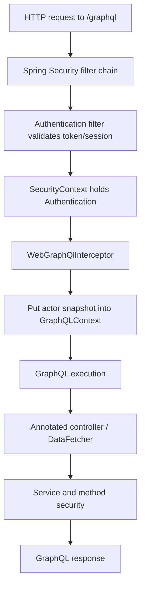

# SecurityContext in GraphQL context

Spring Security stores the authenticated identity and authorities of the caller in `SecurityContext`, typically accessed via `SecurityContextHolder` in Servlet applications or `ReactiveSecurityContextHolder` in WebFlux applications. Meanwhile, Spring for GraphQL provides `GraphQLContext` to pass per-execution data to resolvers and related processing components.

These two contexts are related, but they are not the same object and do not automatically replace each other. `SecurityContext` is the source of identity and authorities managed by Spring Security; `GraphQLContext` is the per-request/operation data area of GraphQL. When a resolver or batch loader needs actor information, tenant, or correlation ID, the application can transfer a safe snapshot from the security context into the GraphQL context using `WebGraphQlInterceptor`.

After this lesson, you will be able to:

- Distinguish `SecurityContext`, `SecurityContextHolder`, and `GraphQLContext`.
- Understand how Spring Security stores `Authentication` on Servlet and WebFlux.
- Pass authenticated user details into GraphQL context via an interceptor.
- Read context in annotated controllers using `@ContextValue` or `DataFetchingEnvironment`.
- Use method security to protect queries, mutations, and field resolvers.
- Avoid losing context when GraphQL executes asynchronously or uses DataLoaders.
- Handle multi-tenancy, subscriptions, and access control testing.

## 1. SecurityContext and GraphQLContext solve two different problems

Spring Security and Spring for GraphQL have two separate context mechanisms:

| Component | Role | Typical scope |
| --- | --- | --- |
| `SecurityContext` | Holds the `Authentication` of the authenticated caller | Request/security execution context |
| `SecurityContextHolder` | Provides access to `SecurityContext` in Servlet applications | Usually bound to a thread via the default strategy |
| `ReactiveSecurityContextHolder` | Accesses security context in Reactor Context | Reactive pipeline |
| `GraphQLContext` | Holds data serving a single GraphQL execution | Single GraphQL request/operation |

For example, `Authentication` can hold the principal, authorities, and authentication details. `GraphQLContext` can hold an actor snapshot consisting of subject ID, tenant ID, or correlation ID for resolvers to use while resolving fields.

Do not treat `GraphQLContext` as the place to authenticate users. Clients must never be allowed to send an arbitrary `GraphQLContext` map via GraphQL variables. The server creates and populates the context after the request passes through authentication.

## 2. Authentication flow of a GraphQL request

In a web application, a request to the GraphQL endpoint typically passes through the Spring Security filter chain before reaching Spring for GraphQL:



Exact steps may vary depending on Servlet vs. WebFlux, the authentication method, and application configuration. The key point is that the interceptor runs after the security layer has established the identity, and resolvers receive server-populated context data.

## 3. What does SecurityContext contain?

`SecurityContext` holds an `Authentication` object. `Authentication` typically provides:

- `getPrincipal()`: user identity, which may be a `UserDetails`, JWT principal, or custom principal type.
- `getName()`: identifying name of the user.
- `getAuthorities()`: permissions such as `BOOK_READ`, `BOOK_WRITE`, or roles converted into authorities.
- `isAuthenticated()`: authentication status of the object.

Do not confuse `Authentication` with data passed by the client in GraphQL input. For example, a mutation might accept `createdBy` or `userId`, but those fields cannot substitute for the identity authenticated by Spring Security.

Usually, there is no need to put the entire `Authentication` into GraphQL context. `Authentication` may contain sensitive principal details or credentials. Instead, create a minimal snapshot containing only the data resolvers actually need:

```java
public record CurrentActor(
        String subject,
        Set<String> authorities) {

    public static CurrentActor from(Authentication authentication) {
        Set<String> authorities = authentication.getAuthorities().stream()
                .map(GrantedAuthority::getAuthority)
                .collect(Collectors.toUnmodifiableSet());

        return new CurrentActor(authentication.getName(), authorities);
    }
}
```

This snapshot contains no passwords, bearer tokens, or credentials. If the application needs tenant ID, locale, or other attributes, only add verified values that are genuinely needed for GraphQL execution.

## 4. Differences between Servlet and WebFlux

In Servlet applications, Spring Security by default stores `SecurityContext` in a `ThreadLocal` via `SecurityContextHolder`. A security filter populates the context before request processing and clears it after the request finishes.

In WebFlux applications, security context is propagated through Reactor Context. Access it via `ReactiveSecurityContextHolder` rather than relying on `SecurityContextHolder` as an ordinary thread-local.

| Platform | Typical access pattern | Note |
| --- | --- | --- |
| Spring MVC / Servlet | `SecurityContextHolder.getContext()` | Context is bound to a thread by the default strategy |
| Spring WebFlux | `ReactiveSecurityContextHolder.getContext()` | Context follows the Reactor pipeline, not pinned to a thread |

Do not copy security context reading code verbatim from an MVC application into WebFlux. When switching to the reactive stack, review interceptors, executors, services, and context propagation.

## 5. Populating actor into GraphQLContext with WebGraphQlInterceptor

`WebGraphQlInterceptor` sits at the boundary between HTTP/WebSocket transport and GraphQL execution. It can add data to `ExecutionInput` before the operation runs.

First, define the context key and actor type:

```java
public final class GraphQlContextKeys {
    public static final String CURRENT_ACTOR = "currentActor";

    private GraphQlContextKeys() {
    }
}
```

In a Servlet application, read `Authentication` from `SecurityContextHolder`, create a snapshot, and put it into GraphQL context:

```java
@Component
public class ServletSecurityGraphQlInterceptor implements WebGraphQlInterceptor {

    @Override
    public Mono<WebGraphQlResponse> intercept(
            WebGraphQlRequest request,
            Chain chain) {

        Authentication authentication =
                SecurityContextHolder.getContext().getAuthentication();

        if (authentication != null
                && authentication.isAuthenticated()
                && !(authentication instanceof AnonymousAuthenticationToken)) {

            CurrentActor actor = CurrentActor.from(authentication);

            request.configureExecutionInput((input, builder) ->
                    builder.graphQLContext(context ->
                            context.put(GraphQlContextKeys.CURRENT_ACTOR, actor))
                            .build());
        }

        return chain.next(request);
    }
}
```

This interceptor is specifically an example for the Servlet stack. It assumes the Spring Security filter chain has already populated the context before the GraphQL handler processes the request. If the application uses a custom authentication filter or another transport mechanism, verify that the interceptor runs within the authenticated context scope.

Only place an actor snapshot into GraphQL context when a valid authentication exists. Anonymous requests may omit the `currentActor` key; resolvers should handle that case if the schema permits anonymous access.

## 6. Propagating context in WebFlux

With WebFlux, retrieve the security context from Reactor Context:

```java
@Component
public class ReactiveSecurityGraphQlInterceptor implements WebGraphQlInterceptor {

    @Override
    public Mono<WebGraphQlResponse> intercept(
            WebGraphQlRequest request,
            Chain chain) {

        return ReactiveSecurityContextHolder.getContext()
                .map(SecurityContext::getAuthentication)
                .filter(authentication -> authentication.isAuthenticated()
                        && !(authentication instanceof AnonymousAuthenticationToken))
                .map(CurrentActor::from)
                .doOnNext(actor ->
                    request.configureExecutionInput((input, builder) ->
                            builder.graphQLContext(context ->
                                    context.put(GraphQlContextKeys.CURRENT_ACTOR, actor))
                                    .build()))
                .then(Mono.defer(() -> chain.next(request)));
    }
}
```

If there is no authenticated principal, the interceptor still continues the GraphQL request without adding an actor. Resolvers or security policies decide which fields are allowed for anonymous access.

Within a single application, only register the interceptor matching the active web stack. Do not register both Servlet and WebFlux interceptors at the same time if they write the same context key and could run on the same request path.

## 7. Reading actor in an annotated controller

Spring for GraphQL provides `@ContextValue` to bind a value from `GraphQLContext` to a controller parameter:

```java
@Controller
public class BookController {

    private final BookService bookService;

    public BookController(BookService bookService) {
        this.bookService = bookService;
    }

    @QueryMapping
    public List<BookView> myBooks(
            @ContextValue(name = GraphQlContextKeys.CURRENT_ACTOR, required = false)
            CurrentActor actor) {

        if (actor == null) {
            throw new AccessDeniedException("Authentication is required");
        }

        return bookService.findVisibleTo(actor.subject());
    }
}
```

`required = false` lets the method receive `null` if the context key does not exist. This fits when the endpoint allows some anonymous operations while a specific field requires login.

If a field always requires an actor, you can keep `required = true` or use method security. However, do not rely solely on the presence of a context key to confirm authorization; context only provides the authenticated identity, while policies must be checked separately.

## 8. Reading GraphQLContext with DataFetchingEnvironment

When a resolver needs multiple context values or GraphQL Java APIs, it can accept `DataFetchingEnvironment`:

```java
@QueryMapping
public List<BookView> myBooks(DataFetchingEnvironment environment) {
    CurrentActor actor = environment.getGraphQlContext()
            .get(GraphQlContextKeys.CURRENT_ACTOR);

    if (actor == null) {
        throw new AccessDeniedException("Authentication is required");
    }

    return bookService.findVisibleTo(actor.subject());
}
```

`@ContextValue` is appropriate when only one or a few well-typed values are needed. `DataFetchingEnvironment` is useful when you also need access to the field definition, arguments, selection set, or GraphQL context. Either way, services should still receive application data such as actor ID or tenant ID rather than receiving `DataFetchingEnvironment` directly.

## 9. Protecting the GraphQL endpoint at the HTTP layer

GraphQL typically uses a single HTTP endpoint, such as `/graphql`, for many queries, mutations, and fields. Spring Security can protect the endpoint at the request level:

```java
@Configuration
@EnableMethodSecurity
public class SecurityConfiguration {

    @Bean
    SecurityFilterChain securityFilterChain(HttpSecurity http) throws Exception {
        return http
                .authorizeHttpRequests(authorize -> authorize
                        .requestMatchers("/graphql").authenticated()
                        .anyRequest().permitAll())
                .build();
    }
}
```

This example requires authentication for the `/graphql` endpoint. The specific login/token mechanism is configured per application, such as OAuth2 Resource Server with JWT or session authentication.

Request-level security is suited for coarse policies such as restricting the entire endpoint to logged-in users. It does not distinguish between the `books` field and the `adminReport` field inside the same GraphQL document. If per-operation or per-field authorization is needed, add authorization at the GraphQL/application layer.

Do not disable CSRF globally just because the application has a GraphQL endpoint. CSRF handling depends on the authentication mechanism: session/cookie and bearer token have different risks. Configure it according to the actual transport and credential model.

## 10. Authorizing operations and fields with method security

Enable method security with `@EnableMethodSecurity`, then protect application service or resolver methods with `@PreAuthorize`:

```java
@Service
public class BookService {

    @PreAuthorize("hasAuthority('BOOK_READ')")
    public List<BookView> findAll() {
        return bookRepository.findAllViews();
    }

    @PreAuthorize("hasAuthority('BOOK_WRITE')")
    @Transactional
    public BookView create(CreateBookCommand command) {
        BookEntity entity = BookEntity.from(command);
        BookEntity saved = bookRepository.save(entity);
        return bookMapper.toView(saved);
    }
}
```

The resolver calls the service as usual:

```java
@QueryMapping
public List<BookView> books() {
    return bookService.findAll();
}
```

If a specific field is sensitive, you can protect the dedicated use case called by the field resolver:

```java
@Service
public class BookAuditService {

    @PreAuthorize("hasAuthority('BOOK_AUDIT_READ')")
    public String internalNotes(String bookId) {
        return auditRepository.findNotesByBookId(bookId);
    }
}
```

Method security protects the logic regardless of whether it is invoked from GraphQL, REST, or another adapter, as long as the call goes through the Spring proxy. For permissions depending on a resource, tenant, or owner, check data relationships as well instead of checking only a general authority.

For reactive applications using WebFlux, enable reactive method security with `@EnableReactiveMethodSecurity` and keep protected methods returning reactive types such as `Mono` or `Flux`. `@EnableMethodSecurity` configures Servlet/imperative method security; do not assume it automatically substitutes for reactive configuration.

## 11. Do not trust client-supplied user IDs

A common security flaw is letting the client send a `userId` and using it as the caller's identity:

```graphql
query {
    privateBooks(userId: "user-100") {
        id
        title
    }
}
```

If the server does not check permissions, a user can swap the ID to read someone else's data. Instead, take the subject from the server-created actor snapshot:

```java
@QueryMapping
public List<BookView> myBooks(
        @ContextValue(name = GraphQlContextKeys.CURRENT_ACTOR) CurrentActor actor) {
    return bookService.findVisibleTo(actor.subject());
}
```

If a use case genuinely needs a target `userId`, the service must verify that the caller has permission to access that target. `GraphQLContext` does not make a value trustworthy simply because it is placed in a map; the origin and validation of the value determine its trustworthiness.

## 12. Multi-tenancy and request state

In a multi-tenant system, the actor snapshot can include a tenant verified from a token or server-side identity provider:

```java
public record CurrentActor(
        String subject,
        String tenantId,
        Set<String> authorities) {
}
```

The interceptor builds the snapshot from verified claims/principal. The resolver passes subject and tenant ID to the service:

```java
@QueryMapping
public List<BookView> books(
        @ContextValue(name = GraphQlContextKeys.CURRENT_ACTOR) CurrentActor actor) {
    return bookService.findByTenant(actor.tenantId());
}
```

Services/repositories must apply the tenant filter across every data-access path. Do not merely add tenant to GraphQL context and expect queries to be isolated automatically. Batch loaders and DataLoaders must also use the same tenant/security context when loading multiple resources.

Do not take tenant from a client argument unless it is an explicitly permitted tenant-switching feature and the server verifies the user has permission to switch to that tenant. Tenant IDs in tokens or sessions must also be verified according to application policy.

## 13. SecurityContext in asynchronous processing

GraphQL can resolve sibling fields in parallel, using `CompletableFuture`, DataLoader, or custom executors. In Servlet applications, `SecurityContextHolder` binds context to a thread by default; when work shifts to another thread, the context may no longer be present.

Do not assume code running inside `CompletableFuture.supplyAsync(...)` will always read the same `SecurityContextHolder` as the original resolver. If async work needs Spring Security context, configure appropriate context propagation, such as using `DelegatingSecurityContextExecutor`/`DelegatingSecurityContextExecutorService` for executors on the Servlet stack.

With WebFlux, keep security context in Reactor Context and avoid dispatching onto manually created threads without propagating context. Standard Reactor operators retain Reactor Context along the subscription; when using schedulers or external libraries, confirm that context propagation is supported.

One way to reduce thread-local reliance in resolvers is to place an immutable actor snapshot into `GraphQLContext`. GraphQL context travels with the execution and can be read from `DataFetchingEnvironment` or `@ContextValue`. However, method security still needs Spring Security context properly propagated if policies rely on `SecurityContextHolder` or `ReactiveSecurityContextHolder`.

## 14. DataLoaders and batch loaders must preserve security context

A batch loader can combine keys from multiple fields into one query. That does not remove authorization requirements. All keys in a batch belong to the same GraphQL execution, yet each resource may still belong to different tenants or permission scopes.

When a batch loader fetches data:

- Use the authenticated actor/tenant from the request context.
- Filter data by tenant or permissions in the bulk query.
- Do not treat client-sent keys as proof that the caller is allowed to read the resources.
- Avoid registering singleton DataLoaders with caches shared across users.
- If a mutation modifies data within the same request, update/clear caches with proper semantics.

DataLoader caches are typically request-scoped when registered through Spring for GraphQL's `BatchLoaderRegistry`. Never build a global cache for user-dependent results. A cache keyed without tenant or security dimensions can serve data from one permission scope to another request.

## 15. Subscriptions and authentication lifecycle

A subscription can live longer than a typical HTTP request. Over WebSocket, authentication is usually performed during handshake or via the transport's connection authentication mechanism. However, a subscription may continue running after a token expires, permissions are revoked, or a user is disabled.

Therefore, clarify:

- Whether authentication is verified at handshake, per operation, or per message.
- Which subscription operation an actor snapshot in GraphQL context belongs to.
- When a token expires or permissions are revoked, whether the subscription is closed or re-evaluated.
- Whether events emitted after a permission change are still permitted to be delivered.

Do not share a mutable `SecurityContext` across multiple subscriptions or multiple users. If policy requires immediate permission revocation, you cannot rely solely on a snapshot created once at handshake; you need a re-check or subscription termination mechanism.

## 16. Handling AccessDeniedException as a GraphQL error

When a user lacks permission, Spring Security may throw `AccessDeniedException`. GraphQL needs to translate this exception into a response error matching the API contract.

Example handler:

```java
@ControllerAdvice
public class GraphQlSecurityExceptionHandler {

    @GraphQlExceptionHandler
    public GraphQLError handleAccessDenied(AccessDeniedException exception) {
        return GraphqlErrorBuilder.newError()
                .errorType(ErrorType.FORBIDDEN)
                .message("You are not allowed to access this resource")
                .build();
    }
}
```

`ErrorType` names and error categorization should stay consistent with your application's API conventions. Do not return internal role names, policy expressions, sensitive token claims, or stack traces to the client. Server logs can retain full details for investigation.

If a denied field is non-null, an execution error can cause null propagation up to the parent field. Therefore, SDL nullability must reflect the intended semantics when the caller lacks permission. Do not use `null` to hide all authorization errors if the client needs to distinguish forbidden from non-existent data.

## 17. Testing SecurityContext and GraphQL context

You should test authentication, context propagation, and authorization separately:

1. Unauthenticated requests are rejected at the HTTP layer if the endpoint requires login.
2. Authenticated requests produce the right `CurrentActor` in GraphQL context.
3. Resolvers read the actor accurately via `@ContextValue` or `DataFetchingEnvironment`.
4. Users with `BOOK_READ` can read permitted fields.
5. Users lacking `BOOK_AUDIT_READ` cannot read sensitive fields.
6. User A cannot send User B's `userId` to read B's data.
7. Tenant A cannot read resources belonging to Tenant B.
8. Async resolvers and batch loaders receive the right request context.
9. Two independent requests do not share actor or DataLoader caches.
10. Subscriptions handle expired tokens or revoked permissions according to policy.

For services using method security, you can test with `@WithMockUser` or the corresponding test security context. For interceptors and transport, write integration tests through `WebGraphQlTester`/HTTP client to verify that the security filter chain, interceptor, and GraphQL execution work together properly. Unit tests calling resolvers directly are not enough to verify that context is propagated from the HTTP request.

## 18. Common mistakes

- **Confusing `SecurityContext` with `GraphQLContext`:** the two contexts have different lifecycles and purposes.
- **Assuming `SecurityContextHolder` automatically appears in `GraphQLContext`:** propagate it explicitly if resolvers need a snapshot in GraphQL context.
- **Using `SecurityContextHolder` in WebFlux:** the reactive stack requires `ReactiveSecurityContextHolder` and Reactor Context.
- **Putting full credentials into `GraphQLContext`:** can leak tokens or sensitive data; pass only a minimal actor snapshot.
- **Trusting `userId`/`tenantId` from GraphQL variables:** identity and tenant must be authenticated or validated by the server.
- **Only protecting the `/graphql` endpoint:** a single endpoint exposes many fields with different access policies; method/field authorization is still needed.
- **Assuming a field hidden by the UI is secure:** clients can send arbitrary GraphQL documents directly.
- **Losing ThreadLocal context on another executor:** configure context propagation or use an appropriate actor snapshot.
- **Using a global DataLoader cache:** can leak data across users/tenants.
- **Neglecting long-lived subscriptions:** authentication or permissions may change while a subscription remains active.
- **Returning overly detailed errors:** responses may expose internal policies, roles, or internal data.

## 19. Workflow for implementing SecurityContext in GraphQL

When a resolver needs the caller's identity or permissions, follow these steps:

1. Configure Spring Security to authenticate requests to the GraphQL endpoint.
2. Choose the security context access mechanism matching Servlet or WebFlux.
3. Identify which actor attributes resolvers and services need.
4. Create a minimal actor snapshot without credentials.
5. Use `WebGraphQlInterceptor` to place the snapshot into `GraphQLContext`.
6. Read context via `@ContextValue` or `DataFetchingEnvironment`.
7. Protect use cases and fields with method security/resource-level authorization.
8. Propagate tenant and security context properly to DataLoaders/batch loaders.
9. Configure context propagation for executors or reactive pipelines when needed.
10. Test anonymous, authenticated, forbidden, multi-tenant, async, and subscription cases.

`SecurityContext` is the source of identity and permissions managed by Spring Security; `GraphQLContext` is where data is passed along a single GraphQL execution. By placing a verified actor snapshot into GraphQL context via an interceptor, resolvers can use caller details without depending directly on thread-locals. Combining Servlet/WebFlux-appropriate context propagation, method security, and resource-level permission checks enables a GraphQL API to protect data consistently from root fields down to nested fields and batch loaders.

## References

- [Spring Security — SecurityContextHolder](https://docs.spring.io/spring-security/reference/servlet/authentication/architecture.html)
- [Spring Security — Reactive SecurityContext](https://docs.spring.io/spring-security/reference/reactive/authorization/method.html)
- [Spring for GraphQL — Web Interception](https://docs.spring.io/spring-graphql/reference/transports.html#web-interception)
- [Spring for GraphQL — GraphQL Context](https://docs.spring.io/spring-graphql/reference/request-execution.html)
- [Spring for GraphQL — Annotated Controllers and ContextValue](https://docs.spring.io/spring-graphql/reference/controllers.html)
- [Spring Security — Method Security](https://docs.spring.io/spring-security/reference/servlet/authorization/method-security.html)
