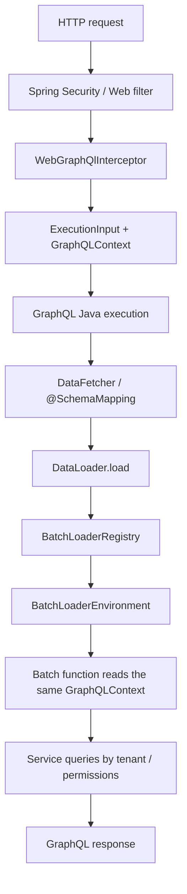

# Context propagation to DataLoader

## 1. Why does DataLoader need request context?

A GraphQL request typically passes through multiple components: HTTP transport, interceptor, GraphQL engine, data fetcher, DataLoader, and batch loading function. These components can run at different times or on different threads. If a batch loader needs to know the current tenant, logged-in user, locale, or correlation ID, the application must propagate that information to the right place.

For example, a query retrieves a list of books and the `Book.author` field is loaded using a DataLoader. Authors must be queried within the request's tenant scope. If the batch loader does not receive the tenant context, it may query the wrong data scope or fail to apply authorization rules.

Spring for GraphQL supports propagating context from the transport through GraphQL Java to data fetchers and batch loaders. This mechanism covers `GraphQLContext`, Reactor `Context` in WebFlux, and `ThreadLocal` with registered accessors in Spring MVC. `BatchLoaderRegistry` also ensures batch loading functions and `@BatchMapping` methods can access the same `GraphQLContext` as data fetchers.

## 2. Distinguishing context types

Context concepts are related, but they do not replace one another:

| Context type | Scope and purpose | Common ways to access |
| --- | --- | --- |
| `GraphQLContext` | Data shared within a single GraphQL execution, such as verified tenant, correlation ID, locale | `DataFetchingEnvironment.getGraphQlContext()`, `@ContextValue`, `BatchLoaderEnvironment.getContext()` |
| `BatchLoaderEnvironment` | Environment of a single batch invocation; contains `GraphQLContext` and per-key contexts | Second parameter of a mapped batch loader |
| Reactor `Context` | Data traveling along a reactive pipeline, independent of the current thread | `Mono.deferContextual`, `Flux.deferContextual` |
| `ThreadLocal` | Data bound to a thread, typically used by imperative libraries or Spring MVC | `ThreadLocal`, `SecurityContextHolder`, `RequestContextHolder` |
| Local context | Data passed only to a child field branch rather than the entire request | `DataFetcherResult.localContext`, `getLocalContext()`, and batch loader key contexts |

`GraphQLContext` is the clearest choice for data shared between resolvers and DataLoaders within the same execution. Reactor `Context` suits data that needs to follow a reactive pipeline. `ThreadLocal` can be preserved across thread switches when an appropriate context propagation mechanism and accessor are registered.

Do not confuse `GraphQLContext` with GraphQL variables. Variables are data sent by the client to execute an operation; context is server-attached data added to the request after receipt and authentication.

## 3. Context flow from HTTP to batch loader

With Spring Boot and Spring for GraphQL, the overall flow is as follows:



Main steps:

1. Security filters or transport interceptors determine trusted request information.
2. `WebGraphQlInterceptor` can add required information to `ExecutionInput` and `GraphQLContext`.
3. Data fetchers read context to process fields or submit keys to a DataLoader.
4. Spring for GraphQL registers DataLoaders per request through `BatchLoaderRegistry`.
5. The batch loading function receives `BatchLoaderEnvironment` and reads the same `GraphQLContext`.
6. Services apply tenant, authorization, and business rules when loading data.

DataLoaders do not need to re-receive every piece of information via GraphQL arguments. Context lets cross-cutting data flow without forcing the schema to expose internal server parameters.

## 4. Populating GraphQLContext with WebGraphQlInterceptor

`WebGraphQlInterceptor` runs before and after the GraphQL engine. It is the right place to validate requests, read transport details, and add server-side data to `ExecutionInput`.

For example, `TenantResolver` is an application component that retrieves the authenticated tenant from the security context and checks which tenant the request is allowed to access:

```java
import java.util.Collections;
import org.springframework.graphql.server.WebGraphQlInterceptor;
import org.springframework.graphql.server.WebGraphQlRequest;
import org.springframework.graphql.server.WebGraphQlResponse;
import org.springframework.stereotype.Component;
import reactor.core.publisher.Mono;

@Component
public class TenantGraphQlInterceptor implements WebGraphQlInterceptor {

    private final TenantResolver tenantResolver;

    public TenantGraphQlInterceptor(TenantResolver tenantResolver) {
        this.tenantResolver = tenantResolver;
    }

    @Override
    public Mono<WebGraphQlResponse> intercept(
            WebGraphQlRequest request, Chain chain) {

        String requestedTenant = request.getHeaders().getFirst("X-Tenant-Id");
        String tenantId = tenantResolver.resolveAuthorizedTenant(requestedTenant);

        request.configureExecutionInput((input, builder) ->
            builder.graphQLContext(
                Collections.singletonMap("tenantId", tenantId)
            ).build()
        );

        return chain.next(request);
    }
}
```

`TenantResolver` contains application-specific logic; it must confirm that the current user has permission to use that tenant. The `X-Tenant-Id` header is only a client-requested value, not proof of access permission. Never place a client-supplied header straight into context and use it as a security boundary.

The example above illustrates a single interceptor responsible for creating `tenantId`. If an application has multiple interceptors populating context, coordinate how writes happen so existing keys are preserved; avoid accidentally replacing the entire previous context with a single-entry map.

### Using the built-in interceptor for HTTP headers

If you only need to pass certain non-sensitive HTTP headers into context, Spring for GraphQL provides `HttpRequestHeaderInterceptor`:

```java
import org.springframework.context.annotation.Bean;
import org.springframework.context.annotation.Configuration;
import org.springframework.graphql.server.support.HttpRequestHeaderInterceptor;

@Configuration
public class GraphQlHeaderConfig {

    @Bean
    HttpRequestHeaderInterceptor correlationHeaderInterceptor() {
        return HttpRequestHeaderInterceptor.builder()
            .mapHeader("X-Correlation-Id")
            .build();
    }
}
```

Then controllers or batch mappings can read the value placed into context. Only map headers that are genuinely needed; do not copy all request headers into `GraphQLContext`.

## 5. Reading GraphQLContext in resolvers

In an annotation-based controller, context can be read in two ways.

**Using `@ContextValue`:**

```java
import org.springframework.graphql.data.method.annotation.ContextValue;
import org.springframework.graphql.data.method.annotation.QueryMapping;
import org.springframework.stereotype.Controller;

@Controller
public class BookQueryController {

    private final BookQueryService bookQueryService;

    public BookQueryController(BookQueryService bookQueryService) {
        this.bookQueryService = bookQueryService;
    }

    @QueryMapping
    public List<Book> books(@ContextValue("tenantId") String tenantId) {
        return bookQueryService.findAllByTenant(tenantId);
    }
}
```

**Receiving `GraphQLContext` directly:**

```java
import graphql.GraphQLContext;

@QueryMapping
public List<Book> books(GraphQLContext context) {
    String tenantId = context.get("tenantId");
    return bookQueryService.findAllByTenant(tenantId);
}
```

`@ContextValue` works best when the method only needs one or a few specific keys. Accepting `GraphQLContext` works best when the method needs many values or needs to pass context to another component. With `@ContextValue`, you can declare `required = false` or use `Optional` if a key is optional; by default, a missing key causes argument resolution to fail.

## 6. Reading context in a mapped batch loader

When registering a batch loader via `BatchLoaderRegistry`, the batch function receives `BatchLoaderEnvironment` as its second parameter. `environment.getContext()` returns the `GraphQLContext` of the same execution as the data fetcher.

Example loading authors by ID within a tenant scope:

```java
import graphql.GraphQLContext;
import java.util.Map;
import java.util.Set;
import org.springframework.context.annotation.Configuration;
import org.springframework.graphql.execution.BatchLoaderRegistry;
import reactor.core.publisher.Mono;

@Configuration
public class AuthorBatchLoaderConfig {

    public AuthorBatchLoaderConfig(
            BatchLoaderRegistry registry,
            AuthorQueryService authorQueryService) {

        registry.forTypePair(String.class, Author.class)
            .registerMappedBatchLoader((authorIds, environment) -> {
                GraphQLContext context = environment.getContext();
                String tenantId = context.get("tenantId");

                return authorQueryService.findAllByIdsAndTenant(
                    authorIds,
                    tenantId
                );
            });
    }
}
```

The service can be declared as:

```java
public interface AuthorQueryService {
    Mono<Map<String, Author>> findAllByIdsAndTenant(
        Set<String> authorIds,
        String tenantId);
}
```

Spring Boot's `BatchLoaderRegistry` registers DataLoaders per request and attaches the corresponding context to the batch loader. As a result, the batch function can use `tenantId` without adding tenant as a GraphQL argument on every relational field.

Do not create a global `DataLoaderRegistry` or share singleton DataLoaders across requests. Doing so can break context propagation integration and create a risk of cross-user data caching.

## 7. Passing context into `@BatchMapping`

`@BatchMapping` is a shortcut for batching a relational field. A `@BatchMapping` method can also receive `GraphQLContext`, `@ContextValue`, `BatchLoaderEnvironment`, and `Principal` when provided by Spring Security.

Example:

```java
import java.util.List;
import java.util.Map;
import java.util.Objects;
import java.util.Set;
import java.util.function.Function;
import java.util.stream.Collectors;
import org.springframework.graphql.data.method.annotation.BatchMapping;
import org.springframework.graphql.data.method.annotation.ContextValue;
import org.springframework.stereotype.Controller;
import reactor.core.publisher.Mono;

@Controller
public class BookBatchController {

    private final AuthorQueryService authorQueryService;

    public BookBatchController(AuthorQueryService authorQueryService) {
        this.authorQueryService = authorQueryService;
    }

    @BatchMapping(typeName = "Book", field = "author")
    public Mono<Map<Book, Author>> author(
            List<Book> books,
            @ContextValue("tenantId") String tenantId) {

        Set<String> authorIds = books.stream()
            .map(Book::authorId)
            .filter(Objects::nonNull)
            .collect(Collectors.toSet());

        return authorQueryService.findAllByIdsAndTenant(authorIds, tenantId)
            .map(authorsById -> books.stream()
                .filter(book -> book.authorId() != null
                    && authorsById.containsKey(book.authorId()))
                .collect(Collectors.toMap(
                    Function.identity(),
                    book -> authorsById.get(book.authorId())
                )));
    }
}
```

Spring for GraphQL retrieves `tenantId` from `BatchLoaderEnvironment`'s `GraphQLContext`, the same context seen by data fetchers. If the method needs multiple context values, it can accept `GraphQLContext` directly instead of multiple `@ContextValue` parameters.

`@BatchMapping` fits when batch logic is tied to one field and does not need extra per-invocation details from the parent call. If you need arguments, selection set, or per-call context from `DataLoader.load`, consider using `BatchLoaderRegistry` alongside a `@SchemaMapping` calling the DataLoader.

## 8. Why use BatchLoaderRegistry?

Spring for GraphQL recommends registering batch loading functions via `BatchLoaderRegistry`. This mechanism provides two key benefits:

1. DataLoaders are registered in a separate `DataLoaderRegistry` per request.
2. Batch loading functions and `@BatchMapping` methods can access the same `GraphQLContext` as data fetchers; Spring also integrates context propagation for them.

If you register DataLoaders directly into a `DataLoaderRegistry` yourself, the application must ensure lifecycle, context, and appropriate options on its own. Manual registration can miss the integration benefits provided by `BatchLoaderRegistry`.

Example registering via Spring:

```java
registry.forTypePair(String.class, Author.class)
    .registerMappedBatchLoader((authorIds, environment) -> {
        String tenantId = environment.getContext().get("tenantId");
        return authorQueryService.findAllByIdsAndTenant(authorIds, tenantId);
    });
```

Loaders are created per execution; the DataLoader cache is also scoped to the request. The same author ID within the same request can be reused, while a request from another tenant gets its own DataLoader and context.

## 9. Context propagation with Spring MVC and ThreadLocal

In Spring MVC, the initial request typically runs on a servlet thread. GraphQL Java may invoke data fetchers or batch loaders on different threads, especially when asynchronous processing is involved. A plain `ThreadLocal` does not automatically transfer values to a new thread.

Spring for GraphQL supports propagating `ThreadLocal` across thread switches using Micrometer Context Propagation. For each type of `ThreadLocal` that needs propagation, the application registers a `ThreadLocalAccessor`.

Example accessor for an application-defined `TenantContext`:

```java
import io.micrometer.context.ThreadLocalAccessor;

public class TenantThreadLocalAccessor implements ThreadLocalAccessor<String> {

    @Override
    public Object key() {
        return "tenantId";
    }

    @Override
    public String getValue() {
        return TenantContext.get();
    }

    @Override
    public void setValue(String tenantId) {
        TenantContext.set(tenantId);
    }

    @Override
    public void reset() {
        TenantContext.clear();
    }
}
```

Registering the accessor at application startup:

```java
import io.micrometer.context.ContextRegistry;
import org.springframework.context.annotation.Configuration;

@Configuration
public class ContextPropagationConfig {

    public ContextPropagationConfig() {
        ContextRegistry.getInstance()
            .registerThreadLocalAccessor(new TenantThreadLocalAccessor());
    }
}
```

The accessor must restore the value properly and reset it once the scope finishes to prevent data leaks between requests sharing threads. You can also register accessors via `ServiceLoader` instead of registering directly in configuration.

There is no need to create a `ThreadLocalAccessor` if the application does not use a custom `ThreadLocal`. For data needed by batch loaders, `GraphQLContext` is usually clearer because it is passed explicitly along the GraphQL execution.

## 10. Context propagation in Spring WebFlux and Reactor

In WebFlux, requests are processed through a reactive pipeline. Reactor `Context` carries data along the pipeline rather than binding to the current thread. Therefore, when a `Mono` switches threads or resumes later, context remains accessible via Reactor APIs.

Example reading a correlation ID from Reactor Context:

```java
public Mono<List<Book>> findBooks() {
    return Mono.deferContextual(contextView -> {
        String correlationId = contextView.getOrDefault(
            "correlationId", "unknown");

        return bookRepository.findAll()
            .collectList()
            .doOnNext(books -> log.debug(
                "Loaded {} books for request {}",
                books.size(), correlationId
            ));
    });
}
```

Spring for GraphQL supports propagating Reactor Context from the WebFlux request handling chain to reactive data fetchers and components invoked during GraphQL execution. If a batch loader needs a cross-cutting value, use `GraphQLContext` or Reactor Context according to purpose; never assume an arbitrary `ThreadLocal` is available on an event-loop thread.

In reactive code, avoid reading `ThreadLocal` directly inside `map` or `flatMap` if context propagation is not configured. Prefer `deferContextual` for Reactor Context and `GraphQLContext`/`@ContextValue` for GraphQL execution data.

## 11. Main GraphQLContext and local context

The main `GraphQLContext` is shared across the entire GraphQL execution. This suits tenant, authenticated principal, locale, or correlation ID. However, sometimes a parent field needs to pass data solely to one child field branch. In that case, use local context instead of adding everything to request-wide context.

A data fetcher can return `DataFetcherResult<T>` and attach local context:

```java
@QueryMapping
public DataFetcherResult<Book> book(@Argument String id) {
    Book book = bookQueryService.findById(id).orElse(null);

    return DataFetcherResult.<Book>newResult()
        .data(book)
        .localContext(Map.of("visibility", "internal"))
        .build();
}
```

Child fields can read local context via `@LocalContextValue` or `DataFetchingEnvironment.getLocalContext()`. When a DataLoader is called from a field with local context, `BatchLoaderEnvironment` can provide the key contexts corresponding to each load call.

Main context and local context have different scopes:

- Use the main `GraphQLContext` for data that applies throughout the request.
- Use local context for information that applies only to a specific child field branch.
- Do not use local context as a replacement for request-wide tenant/security context.
- If a batch needs different context per key, read and process key contexts per key instead of assuming a single value for the entire batch.

## 12. Security and data isolation when propagating context

Context propagation helps batch loaders receive the right request information, but context itself is not an authorization mechanism. Services and repositories must still enforce access checks on the server.

Key principles:

- Only place values in context that have been authenticated or validated per security policy.
- Never trust a tenant ID, role, or user ID taken directly from GraphQL variables or client-set HTTP headers.
- Batch queries must filter by tenant or access permissions, not just load by a list of IDs.
- Do not put access tokens, passwords, or unnecessary sensitive data into context.
- Never share a global DataLoader cache across multiple requests.
- If results depend on differing per-key permissions, design keys/cache scopes accordingly so results are never misused.
- Do not log the entire `GraphQLContext`; only log necessary metadata such as correlation ID.

For example, the service should accept both tenant ID and the set of author IDs:

```java
public Mono<Map<String, Author>> findAllByIdsAndTenant(
        Set<String> authorIds,
        String tenantId) {

    return authorRepository.findByTenantIdAndIdIn(tenantId, authorIds)
        .collectMap(Author::id);
}
```

Querying by both tenant and ID prevents a valid ID from another tenant from being returned simply because the client knows that identifier. Never load data globally and expect resolvers or clients to filter afterward.

## 13. Testing context propagation to DataLoader

Test the full flow from the transport interceptor to the batch service. `WebGraphQlTester` sends requests through `WebGraphQlHandler` and the `WebGraphQlInterceptor` chain, making it suitable for testing context added before the GraphQL engine executes.

Example creating a tester with a tenant header:

```java
WebGraphQlTester tester = WebGraphQlTester.builder(webGraphQlHandler)
    .headers(headers -> headers.set("X-Tenant-Id", "tenant-a"))
    .build();
```

`webGraphQlHandler` is the application's handler with `TenantGraphQlInterceptor` registered. `TenantResolver` in the test must confirm that `tenant-a` is permitted for the test principal.

Send a query with a field requiring DataLoader:

```java
tester.document("""
    query {
        books {
            id
            author {
                id
                name
            }
        }
    }
    """)
    .execute()
    .path("books[0].author.name")
    .entity(String.class)
    .isEqualTo("Nguyen An");
```

In addition to the response, use a spy or mock on `AuthorQueryService` to verify the batch function receives the right tenant ID. You should test:

- A request for tenant A loads only tenant A's data.
- A request for tenant B does not receive cached results from tenant A.
- `@ContextValue` and `BatchLoaderEnvironment.getContext()` read the same value.
- Context remains present when the batch function executes asynchronously.
- Missing context or invalid tenant is rejected according to policy.
- Batch queries still enforce authorization when IDs are provided by the client.
- Per-key local context is not confused with the main `GraphQLContext`.
- Multiple `load` calls within one request are batched and cached per request.

If testing `ExecutionGraphQlService` directly instead of the transport, configure `ExecutionInput`/`GraphQLContext` in the test yourself. To test interceptors, headers, or the WebFlux transport, use `WebGraphQlTester` or `HttpGraphQlTester` as appropriate.

## 14. Common errors when context fails to reach DataLoader

| Symptom | Possible cause | How to fix |
| --- | --- | --- |
| `@ContextValue` cannot find key | Interceptor did not write the key or key name mismatch | Check `GraphQLContext` and the name in `@ContextValue` |
| Resolver reads context but batch loader lacks it | DataLoader registered directly without `BatchLoaderRegistry`, or context not attached to execution | Use Spring-managed `BatchLoaderRegistry` and read `BatchLoaderEnvironment.getContext()` |
| Context disappears after switching threads in MVC | `ThreadLocal` has no accessor or accessor is not registered | Register `ThreadLocalAccessor` with `ContextRegistry` |
| Data lost in reactive pipeline | Reading `ThreadLocal` instead of Reactor Context or context not wired through pipeline | Use `deferContextual` and verify propagation from the WebFlux chain |
| Batch query queries wrong tenant | Using unvalidated client tenant or not passing tenant to repository | Put verified tenant in context and filter in service/repository |
| Data leaks across requests | Using singleton DataLoader or global cache | Use per-request DataLoader via `BatchLoaderRegistry` |
| Batch loader lacks per-key local context | Reading only main `GraphQLContext` when data varies by parent | Use `BatchLoaderEnvironment` and key contexts |
| Context loses keys when multiple interceptors exist | One interceptor overwrites context set by an earlier interceptor | Coordinate keys and avoid unintentionally replacing the context |
| Logs leak sensitive information | Logging the entire context or headers | Log only permitted, minimized metadata |

## 15. Context propagation implementation checklist

- [ ] Identify which data genuinely needs to be shared between resolvers and batch loaders.
- [ ] Use `GraphQLContext` for metadata belonging to the GraphQL execution.
- [ ] Put context into `ExecutionInput` via `WebGraphQlInterceptor` or the appropriate transport mechanism.
- [ ] Validate tenant/user/roles before placing them into context.
- [ ] Use `@ContextValue` or `GraphQLContext` in controllers.
- [ ] Register DataLoaders via `BatchLoaderRegistry`.
- [ ] Read context in mapped batch loaders via `BatchLoaderEnvironment.getContext()`.
- [ ] Use `@BatchMapping` with `@ContextValue` or `GraphQLContext` when appropriate.
- [ ] Only add a `ThreadLocalAccessor` when `ThreadLocal` must be propagated across threads in Spring MVC.
- [ ] Use Reactor Context for reactive pipeline data in WebFlux.
- [ ] Distinguish main context from local context based on data scope.
- [ ] Never share DataLoaders/caches across requests.
- [ ] Enforce authorization and tenant filtering in services/repositories.
- [ ] Test requests through the interceptor and confirm batch loaders receive the right context.

## Conclusion

Context propagation lets DataLoaders access required request details even though batch loading functions may run at a different time or on a different thread than the transport handler. In Spring for GraphQL, `BatchLoaderRegistry` is the recommended integration mechanism because it registers DataLoaders per request, provides the same `GraphQLContext` to batch loading functions and `@BatchMapping` methods, and supports context propagation.

Place verified server-side data into `GraphQLContext` via an interceptor, read it with `@ContextValue` or `BatchLoaderEnvironment.getContext()`, and use Reactor Context or `ThreadLocalAccessor` suited to your stack. Context only carries information; services and repositories must still enforce authorization and tenant filtering. Test both the response and the context values actually received by batch loaders to catch missing context or cross-request data leaks early.

## References

- [Spring for GraphQL — Request Execution: Context Propagation and BatchLoaderRegistry](https://docs.spring.io/spring-graphql/reference/request-execution.html)
- [Spring for GraphQL — Server Transports: WebGraphQlInterceptor](https://docs.spring.io/spring-graphql/reference/transports.html)
- [Spring for GraphQL — Annotated Controllers: Context and Batch Mapping](https://docs.spring.io/spring-graphql/reference/controllers.html)
- [Spring for GraphQL — Testing: WebGraphQlTester](https://docs.spring.io/spring-graphql/reference/testing.html)
- [Micrometer Context Propagation](https://docs.micrometer.io/context-propagation/reference/)
