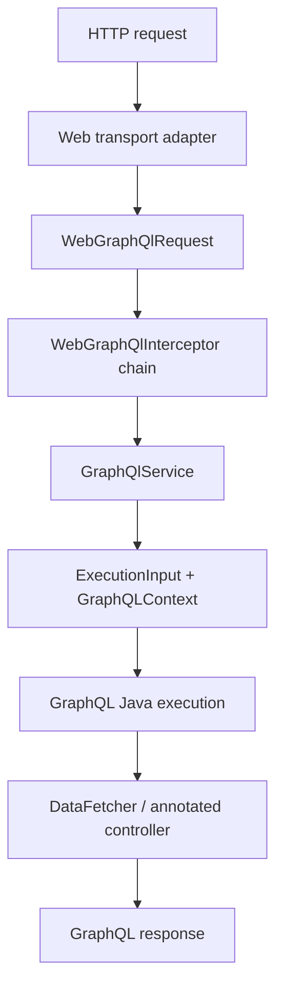

# WebGraphQlRequest and context

In Spring for GraphQL, a request passes through several layers before a resolver is invoked. The web layer receives transport information such as HTTP headers, cookies, URI, and remote address; the GraphQL layer executes the operation; resolvers and DataLoaders need access to per-request data such as tenant, locale, correlation ID, or authenticated user details.

`WebGraphQlRequest` provides request information at the web layer. `WebGraphQlInterceptor` allows reading, validating, and enriching data before the operation executes. To make that data usable in resolvers, applications typically transfer the required values into `ExecutionInput`'s `GraphQLContext`.

The key thing to remember is that the request object, GraphQL execution context, local context, and Reactor context serve different scopes. Understanding these boundaries accurately helps propagate request state safely, avoid `ThreadLocal` dependencies, and prevent sharing data across requests.

## 1. What is WebGraphQlRequest?

`WebGraphQlRequest` is Spring for GraphQL's abstraction representing a GraphQL request passing through the web layer. It provides the GraphQL document, operation name, variables, and transport-related details. Depending on the transport, the request can expose headers, cookies, URI, remote address, and attributes.

Commonly needed data at the web layer:

| Data | Example purpose |
| --- | --- |
| HTTP headers | Request ID, locale, tracing information, or transport-level tokens |
| Cookies | Session cookies or session information managed by the authentication mechanism |
| URI and method | Distinguishing endpoints or logging details |
| Remote address | Recording the connection source per proxy/network policy |
| Request attributes | Auxiliary data attached by adapters/interceptors during the request lifecycle |
| GraphQL document and variables | Operation body, operation name, and client-sent inputs |

`WebGraphQlRequest` belongs to the web layer. Resolvers should not depend directly on the HTTP request to read headers on every field. Read and validate transport information once in an interceptor, then transfer the normalized required data into the execution context.

## 2. Flow from web request to resolver

A GraphQL request over HTTP generally flows through components in this overall order:



The transport adapter turns the HTTP request into a `WebGraphQlRequest`. `WebGraphQlInterceptor` instances run before the operation executes and can read headers, validate metadata, add context, or process the response. Then `GraphQlService` executes the GraphQL document with the configured `ExecutionInput`.

In resolvers, Spring for GraphQL provides ways to read context such as `@ContextValue` or `DataFetchingEnvironment.getGraphQlContext()`. Resolvers receive data placed into execution context by interceptors without needing to know details of the original HTTP request.

## 3. WebGraphQlInterceptor

`WebGraphQlInterceptor` is Spring for GraphQL's web-layer extension point. It can inspect a request before forwarding it to the next interceptor or GraphQL service. Its primary method is reactive and returns `Mono<WebGraphQlResponse>`:

```java
public interface WebGraphQlInterceptor {
    Mono<WebGraphQlResponse> intercept(WebGraphQlRequest request, Chain chain);
}
```

An interceptor typically performs tasks such as:

- Reading request metadata like correlation ID or locale.
- Validating header formats and normalizing values.
- Placing verified data into `ExecutionInput`/`GraphQLContext`.
- Logging operation start and completion times.
- Applying common web-level rules before the request reaches GraphQL execution.
- Observing or transforming the response per application policy.

Example interceptor that generates a correlation ID if the client did not send one:

```java
@Component
public class RequestMetadataInterceptor implements WebGraphQlInterceptor {

    private static final String REQUEST_ID = "requestId";

    @Override
    public Mono<WebGraphQlResponse> intercept(
            WebGraphQlRequest request, Chain chain) {

        String requestId = request.getHeaders().getFirst("X-Request-Id");
        if (requestId == null || requestId.isBlank()) {
            requestId = UUID.randomUUID().toString();
        }

        String finalRequestId = requestId;
        request.configureExecutionInput((input, builder) ->
            builder.graphQLContext(context ->
                context.put(REQUEST_ID, finalRequestId)
            ).build()
        );

        return chain.next(request);
    }
}
```

`configureExecutionInput` lets you add configuration to `ExecutionInput` before GraphQL Java executes the operation. In the example, the correlation ID is placed into `GraphQLContext` under the key `requestId`. Resolvers, DataFetchers, or instrumentation can then read this value.

Interceptors must stay reactive. Do not call `.block()` on a `Mono` inside `intercept`; return `chain.next(request)` or chain appropriate reactive operators. Blocking can tie up an event-loop thread and stall the application.

## 4. Transferring request metadata into GraphQLContext

`GraphQLContext` is the data area tied to a GraphQL execution. It is suited for passing shared values that resolvers, instrumentation, or DataLoaders need within the same operation, such as:

- Correlation ID or trace ID.
- Verified tenant ID.
- Normalized locale.
- An immutable request metadata object.
- Policy details or feature flags determined for the execution.

You can group values into a record instead of adding many separate keys:

```java
public record RequestMetadata(
        String requestId,
        String tenantId,
        Locale locale) {
}
```

The interceptor reads web information, validates it, and constructs the metadata:

```java
@Component
public class RequestMetadataInterceptor implements WebGraphQlInterceptor {

    private static final String METADATA_KEY = "requestMetadata";

    private final TenantResolver tenantResolver;
    private final LocaleResolver localeResolver;

    public RequestMetadataInterceptor(
            TenantResolver tenantResolver,
            LocaleResolver localeResolver) {
        this.tenantResolver = tenantResolver;
        this.localeResolver = localeResolver;
    }

    @Override
    public Mono<WebGraphQlResponse> intercept(
            WebGraphQlRequest request, Chain chain) {

        String requestId = Optional.ofNullable(
                request.getHeaders().getFirst("X-Request-Id"))
            .filter(value -> !value.isBlank())
            .orElseGet(() -> UUID.randomUUID().toString());

        Locale locale = localeResolver.resolve(request.getHeaders());

        return tenantResolver.resolveAuthorizedTenant(request)
            .flatMap(tenantId -> {
                RequestMetadata metadata =
                    new RequestMetadata(requestId, tenantId, locale);

                request.configureExecutionInput((input, builder) ->
                    builder.graphQLContext(context ->
                        context.put(METADATA_KEY, metadata)
                    ).build()
                );

                return chain.next(request);
            });
    }
}
```

`TenantResolver` in this example is an application service responsible for determining the permitted tenant based on authenticated identity and access policies. Never treat `X-Tenant-Id` or any client-sent header as proof of access permission. A header can serve as input to select a tenant, but the server must verify the caller has permission for that tenant.

If the application uses a servlet/blocking stack, the tenant-resolving service can return synchronously; if using a reactive stack, keep the result as a `Mono` as shown. There is no need to turn a synchronous value into a reactive type just to add complexity.

## 5. Reading GraphQLContext in resolvers

There are two common ways to read data in the execution context.

### Using @ContextValue

Spring for GraphQL supports `@ContextValue` to bind a value by key from `GraphQLContext` to an annotated controller parameter:

```java
@Controller
public class BookQueryController {

    @QueryMapping
    public List<Book> books(
            @ContextValue("requestMetadata") RequestMetadata metadata) {
        return bookService.findVisibleBooks(
            metadata.tenantId(), metadata.locale());
    }
}
```

`@ContextValue` makes clear that the parameter comes from the GraphQL context, not from an argument passed by the client in the GraphQL document. If a key might be absent, you can mark the parameter optional via the annotation's `required` attribute and use an appropriate nullable type.

### Using DataFetchingEnvironment

When a resolver needs richer execution details or lower-level APIs, it can accept `DataFetchingEnvironment`:

```java
@QueryMapping
public List<Book> books(DataFetchingEnvironment environment) {
    RequestMetadata metadata = environment.getGraphQlContext()
        .get("requestMetadata");

    return bookService.findVisibleBooks(
        metadata.tenantId(), metadata.locale());
}
```

`getGraphQlContext()` returns the execution's context. Resolvers can read the same metadata added to `ExecutionInput` by the interceptor.

Do not confuse `GraphQLContext` with field arguments. `@Argument` and `@Arguments` extract data passed by the client for the field; `@ContextValue` extracts server-attached execution data. Clients cannot override a context key simply by adding a field or argument of the same name to a query.

## 6. Distinguishing request attributes, GraphQLContext, and local context

Different context types have different scopes:

| Mechanism | Scope | Purpose |
| --- | --- | --- |
| `WebGraphQlRequest` attributes | Web request/interceptor lifecycle | Auxiliary data between transport-layer components |
| `GraphQLContext` | Single GraphQL execution | Metadata shared across resolvers, instrumentation, and DataLoaders in the operation |
| Local context | Single child execution/field branch | Passing data from a parent resolver down to child resolvers |
| Reactor Context | Reactive subscriber chain | Propagating metadata across reactive steps without pinning to a fixed thread |
| Spring `SecurityContext` | Authenticated identity and authorities | Security mechanism managed by Spring Security |

Request attributes do not automatically become GraphQL context. If a resolver needs a value from a request attribute, an interceptor must explicitly transfer that value into `ExecutionInput`/`GraphQLContext`.

GraphQL Java's local context fits when only a child resolver branch needs data produced by a parent resolver. It is not a place to store operation-wide shared metadata. `DataFetcherResult` can carry local context to child fields; Spring for GraphQL provides `@LocalContextValue` to read that value in annotated controllers when needed.

Reactor Context is a Reactor mechanism, not `GraphQLContext`. It follows the reactive chain and may be used by reactive Spring Security. When resolvers or DataLoaders need data, decide clearly whether to read from GraphQL context or from security/reactive context; never assume all context types synchronize automatically.

## 7. Context and Spring Security

Authentication details must come from the server's security mechanism. Spring Security can authenticate the request before the GraphQL handler processes the operation. Resolvers can accept `Principal` or supported security parameters, while services enforce authorization by user, tenant, and resource.

Example resolver accepting `Principal`:

```java
@QueryMapping
public List<Book> myBooks(Principal principal) {
    return bookService.findByOwner(principal.getName());
}
```

If verified authentication info needs to be passed into `GraphQLContext`, take it from the Spring Security-managed security context or a trusted authentication component. Never copy a client-sent `userId` header into context and treat it as an authenticated identity.

`GraphQLContext` is a metadata carrier; it does not perform authorization itself. Even when a resolver receives `tenantId` from context, the service still needs to protect resource access per policy. Mutations modifying data must also enforce permissions on each resource, rather than relying on which fields the client selected.

With reactive Spring Security, `SecurityContext` is propagated through Reactor Context. Never assume `ThreadLocal`-based `SecurityContextHolder` always holds data when callbacks switch threads. Use the security context access method matching your active servlet or reactive stack and avoid rolling your own unsafe principal-passing mechanism.

## 8. Context in DataLoaders and batch loaders

DataLoaders often need the same request metadata to filter data by tenant or locale. With Spring for GraphQL, batch loaders registered via `BatchLoaderRegistry` can accept `BatchLoaderEnvironment` and access the execution's context via the corresponding API.

Conceptual example:

```java
registry.forTypePair(Long.class, Author.class)
    .registerMappedBatchLoader((authorIds, environment) -> {
        GraphQLContext context = environment.getContext();
        RequestMetadata metadata = context.get("requestMetadata");

        return authorService.findVisibleAuthors(
            metadata.tenantId(), authorIds);
    });
```

Batch queries must apply the same tenant filtering and authorization as single-item queries. Never load all authors and filter only in the controller after data has left the data access layer if doing so could expose unauthorized information.

DataLoaders cache by key within the execution scope. If the same ID can produce different results depending on tenant or locale, the key must include those factors or the loader must be constrained to a consistent scope. For example, a key can be a record `(tenantId, authorId)` instead of `authorId` alone.

## 9. Correlation ID propagation and logging

Correlation ID links logs across the web request, resolvers, services, and downstream calls. You can accept an ID from a header if valid, or generate a new ID in the interceptor. Then put the ID into `GraphQLContext` so resolvers and batch loaders can log with the same identifier.

Avoid logging entire GraphQL variables or headers if they may contain tokens, personal data, or payment details. Log only selected metadata, enforce length limits, and strip sensitive values.

If you want to place the correlation ID into MDC, remember that MDC typically relies on `ThreadLocal`. When work switches threads via `CompletableFuture` or Reactor schedulers, MDC is not always propagated automatically. Use an appropriate context propagation mechanism or read the correlation ID from `GraphQLContext` where logging occurs.

## 10. Interceptor chain and execution order

An application may register multiple `WebGraphQlInterceptor` beans, for example:

1. An interceptor that captures the correlation ID.
2. An interceptor that resolves tenant and locale metadata.
3. An interceptor that records metrics or tracing.
4. An interceptor that forwards the request to the GraphQL service.

Interceptors are arranged in a chain. Each interceptor decides whether to continue with `chain.next(request)` or terminate early with a response or error. Ordering matters when one interceptor depends on metadata produced by an earlier interceptor. Use Spring ordering mechanisms such as `@Order` when an explicit order is needed, and avoid having multiple interceptors overwrite the same context key.

Example timing-only interceptor:

```java
@Component
@Order(20)
public class GraphQlTimingInterceptor implements WebGraphQlInterceptor {

    private final MeterRegistry meterRegistry;

    public GraphQlTimingInterceptor(MeterRegistry meterRegistry) {
        this.meterRegistry = meterRegistry;
    }

    @Override
    public Mono<WebGraphQlResponse> intercept(
            WebGraphQlRequest request, Chain chain) {

        long start = System.nanoTime();
        return chain.next(request)
            .doFinally(signal -> meterRegistry.timer("graphql.web.request")
                .record(System.nanoTime() - start, TimeUnit.NANOSECONDS));
    }
}
```

Production metrics should attach tags with bounded cardinality, such as operation type or controlled operation names. Avoid using request ID, user ID, or raw queries as metric tags because they cause unbounded cardinality.

## 11. WebGraphQlRequest and WebSocket

`WebGraphQlRequest` belongs to the web abstraction, yet HTTP requests and WebSocket messages have different lifecycles. Over HTTP, each request typically carries one operation and its transport metadata. Over WebSocket, there is a connection lifecycle, a connection initialization step, and multiple operations may be sent over the same connection.

Spring for GraphQL provides dedicated WebSocket interceptors such as `WebSocketGraphQlInterceptor` to handle connection-level events, such as connection initialization and metadata sent when establishing the connection. Do not treat connection state and GraphQL execution context as a single scope:

- Connection state can persist across multiple operations on the same WebSocket.
- `GraphQLContext` should be bound to each execution so one operation's request state does not leak into the next operation.
- Authentication info may expire or be revoked while the WebSocket remains open; establish an appropriate re-validation policy.
- Data from connection initialization must still be authenticated and authorized before use.

If the application serves HTTP only, focus on `WebGraphQlInterceptor`. If subscriptions over WebSocket are enabled, design connection, operation, and event lifecycles separately; never store DataLoaders or request metadata in a singleton connection handler in a way that could mix data across operations.

## 12. Testing context and interceptors

Test both halves: the interceptor transferring metadata into execution context, and the resolver actually reading that metadata.

With `GraphQlTester`, you can test GraphQL execution and resolvers once the test configures the corresponding context. To test HTTP header reading, use a web-layer tester such as `HttpGraphQlTester` or `WebGraphQlTester`, or test `WebGraphQlHandler` directly with requests carrying headers.

A metadata verification operation can use a test-only field or a business resolver whose behavior depends on tenant/locale. Example testing an endpoint with a header:

```java
HttpGraphQlTester tester = HttpGraphQlTester.builder(webTestClient)
    .headers(headers -> headers.set("X-Request-Id", "test-request-01"))
    .build();
```

The exact builder API depends on the tester type and Spring for GraphQL version; the key point is that test requests must pass through the web interceptor so headers are read and placed into context.

Scenarios to include:

- Valid header value is transferred into `GraphQLContext`.
- Missing or blank header is handled by policy defaults.
- Malformed header is rejected or ignored in a controlled way.
- Tenant outside the principal's permissions is rejected.
- Resolvers and batch loaders read the same metadata within a single execution.
- Two parallel requests have independent contexts without overwriting each other's data.
- The interceptor does not block the reactive chain.
- WebSocket connection metadata is not confused with operation context.

## 13. Common errors

| Symptom | Cause | How to fix |
| --- | --- | --- |
| Resolver does not see context key | Interceptor did not call `configureExecutionInput` or used a different key | Check the key and ensure configuration happens before `chain.next` |
| `@ContextValue` fails to bind | Key does not exist or incompatible Java type | Check context and consider `required = false` if valid |
| Header is on request but absent from `GraphQLContext` | Request metadata is not automatically copied into execution context | Transfer values explicitly in the interceptor |
| Tenant from header accesses unauthorized data | Trusting client-sent header without verification | Verify tenant against principal and server-side policy |
| Request data leaks between operations | Using static/singleton mutable state or shared loaders | Use per-execution context and per-request DataLoaders |
| Context lost when async callback runs | Relying on `ThreadLocal` across thread switches | Pass metadata explicitly or configure context propagation |
| Reactive endpoint stalls | Calling `.block()` in an interceptor or callback | Keep the flow reactive and never block the event loop |
| MDC missing correlation ID | MDC not propagated across executor/reactor scheduler | Propagate context or read ID from `GraphQLContext` |
| WebSocket operation uses stale state | Confusing connection state with execution state | Create a dedicated context per operation and revalidate per policy |

## 14. Design principles for request context

Read transport data in `WebGraphQlInterceptor`, validate and normalize it before putting it into `GraphQLContext`. Put only values needed for execution into context, preferring a single immutable metadata object over many scattered mutable variables. Use `@ContextValue` for resolvers needing a specific value; use `DataFetchingEnvironment` when access to multiple execution components is needed.

Maintain clear boundaries between request attributes, `GraphQLContext`, local context, Reactor Context, and Spring `SecurityContext`. Never store request state in singletons or static fields. Never trust client headers as proof of authentication, never substitute context for authorization, and never share DataLoader caches outside an execution.

In Spring for GraphQL, `WebGraphQlRequest` represents the incoming web-layer request; `WebGraphQlInterceptor` is the right place to process request-wide metadata; `GraphQLContext` delivers verified metadata to resolvers and batch loaders. When state is passed within its proper scope, an application can support tenancy, localization, tracing, and security while keeping resolvers independent of transport details and safe under concurrent execution.
