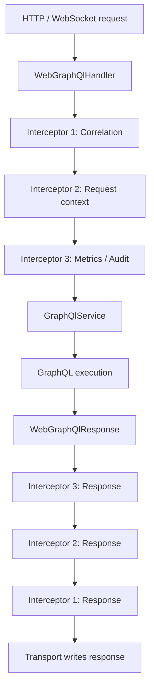

# Interceptor Chain in Spring for GraphQL

An interceptor chain is a sequence of components surrounding the processing of a GraphQL request. In Spring for GraphQL, `WebGraphQlInterceptor` allows an application to observe or customize a request before GraphQL execution begins, and then continue processing the response once downstream components complete.

Each interceptor can perform a distinct responsibility such as generating a correlation ID, putting an authenticated tenant into `GraphQLContext`, recording metrics, or validating request metadata. Interceptors are linked into a chain: the request flows forward in registration order, while the response flows backward through preceding interceptors. Understanding the forward and return directions helps organize middleware clearly and avoid duplicate processing, context overwriting, or dropped errors.

## 1. Where Does the Interceptor Chain Sit?

Spring for GraphQL decouples GraphQL processing from the transport. HTTP, WebSocket, or another suitable transport forwards the request to `WebGraphQlHandler`. The handler uses `GraphQlService` to execute the document against the schema and runs the configured `WebGraphQlInterceptor` instances.



`WebGraphQlInterceptor` is an extension point at the GraphQL request layer. It is not a resolver for a specific field, nor does it run once per field. An interceptor typically wraps the entire handling of a GraphQL request/operation passed to the handler.

## 2. The `WebGraphQlInterceptor` Interface

The interface resides in the `org.springframework.graphql.server` package and has one main method:

```java
public interface WebGraphQlInterceptor {

    Mono<WebGraphQlResponse> intercept(
            WebGraphQlRequest request,
            Chain chain);
}
```

`WebGraphQlRequest` holds server-layer GraphQL request information, such as the document, operation name, variables, headers, and attributes. `Chain` represents the next interceptor or the final execution step. `Mono<WebGraphQlResponse>` represents the asynchronous response.

A minimal interceptor:

```java
import org.springframework.graphql.server.WebGraphQlInterceptor;
import org.springframework.graphql.server.WebGraphQlRequest;
import org.springframework.graphql.server.WebGraphQlResponse;
import org.springframework.stereotype.Component;
import reactor.core.publisher.Mono;

@Component
public class RequestLoggingInterceptor implements WebGraphQlInterceptor {

    @Override
    public Mono<WebGraphQlResponse> intercept(
            WebGraphQlRequest request, Chain chain) {

        log.info("GraphQL operation: {}", request.getOperationName());

        return chain.next(request)
                .doOnNext(response -> log.info(
                        "GraphQL response contains {} error(s)",
                        response.getErrors().size()));
    }
}
```

This example assumes the application already has a logger `log`. `chain.next(request)` passes the request to the next interceptor or the GraphQL service if this is the last interceptor. `doOnNext` observes the response when it is emitted; it does not modify the response.

## 3. Request and Response Ordering

Suppose a chain has three interceptors A, B, and C:

```text
Request:   A -> B -> C -> GraphQlService
Response:  A <- B <- C <- GraphQlService
```

A receives the request first, then calls `chain.next(request)` to pass it to B. B passes it to C. C invokes the GraphQL service. When the service produces a response, C processes the response first, then B, and finally A.

This model resembles wrapping a function call:

```java
return chain.next(request)
        .map(response -> transformResponse(response));
```

Code before `chain.next` is suitable for preparing the request. Operators attached after `chain.next` are suitable for observing or transforming the asynchronous result. If interceptor A needs to measure the total time from receiving the request until the response returns, it can start a timer before `chain.next` and record the result in `doFinally`.

## 4. Registering Multiple Interceptors

Each interceptor can be declared as a separate Spring bean:

```java
import org.springframework.core.Ordered;
import org.springframework.core.annotation.Order;
import org.springframework.graphql.server.WebGraphQlInterceptor;
import org.springframework.stereotype.Component;

@Component
@Order(Ordered.HIGHEST_PRECEDENCE)
class CorrelationIdInterceptor implements WebGraphQlInterceptor {
    // ...
}

@Component
@Order(10)
class TenantContextInterceptor implements WebGraphQlInterceptor {
    // ...
}

@Component
@Order(20)
class MetricsInterceptor implements WebGraphQlInterceptor {
    // ...
}
```

When Spring collects interceptor beans in order, lower order values are applied first. `Ordered.HIGHEST_PRECEDENCE` places the interceptor at the start of the list. With manual `WebGraphQlHandler` configuration, ordering also depends on the order in which interceptors are added to the builder.

It is best to order by responsibility:

1. Correlation/tracing: generate or validate the correlation ID so subsequent steps can log with the same ID.
2. Request context: determine the authenticated tenant, locale, or metadata.
3. Audit/metrics: record the request and response, including GraphQL errors.

This is a reference order. If metrics need to measure the time spent by the context interceptor as well, place metrics outside the context interceptor so it encompasses that duration. Determine the order based on the data each interceptor needs to observe.

## 5. Customizing Requests with `configureExecutionInput`

A common task for an interceptor is placing request metadata into `GraphQLContext`. `WebGraphQlRequest.configureExecutionInput` allows customizing `ExecutionInput` before GraphQL Java executes the operation.

Example of generating a correlation ID and adding it to the context:

```java
import java.util.UUID;
import org.springframework.graphql.server.WebGraphQlInterceptor;
import org.springframework.graphql.server.WebGraphQlRequest;
import org.springframework.graphql.server.WebGraphQlResponse;
import org.springframework.stereotype.Component;
import reactor.core.publisher.Mono;

@Component
public class CorrelationIdInterceptor implements WebGraphQlInterceptor {

    @Override
    public Mono<WebGraphQlResponse> intercept(
            WebGraphQlRequest request, Chain chain) {

        String correlationId = request.getHeaders().getFirst("X-Correlation-Id");
        if (correlationId == null || correlationId.isBlank()) {
            correlationId = UUID.randomUUID().toString();
        }

        String requestCorrelationId = correlationId;
        request.configureExecutionInput((input, builder) ->
                builder.graphQLContext(context ->
                        context.put("correlationId", requestCorrelationId))
                        .build());

        return chain.next(request);
    }
}
```

The value is assigned to `requestCorrelationId` so the lambda uses an effectively final variable. Resolvers can read the value via `@ContextValue("correlationId")` or `DataFetchingEnvironment.getGraphQlContext()`.

A correlation ID from a header is only for linking logs/traces. When accepting a client-sent value, validate its length and allowed character set before logging to prevent log injection or abnormal values. For requests without a valid ID, the server can generate one itself.

## 6. Putting Tenant and Principal into GraphQLContext

An interceptor can work with Spring Security to obtain the authenticated identity, determine the tenant the user is permitted to access, and put that metadata into the execution context.

```java
import org.springframework.graphql.server.WebGraphQlInterceptor;
import org.springframework.graphql.server.WebGraphQlRequest;
import org.springframework.graphql.server.WebGraphQlResponse;
import org.springframework.stereotype.Component;
import reactor.core.publisher.Mono;

@Component
public class TenantContextInterceptor implements WebGraphQlInterceptor {

    private final TenantResolver tenantResolver;

    public TenantContextInterceptor(TenantResolver tenantResolver) {
        this.tenantResolver = tenantResolver;
    }

    @Override
    public Mono<WebGraphQlResponse> intercept(
            WebGraphQlRequest request, Chain chain) {

        return tenantResolver.resolveAuthorizedTenant(request)
                .flatMap(tenantId -> {
                    request.configureExecutionInput((input, builder) ->
                            builder.graphQLContext(context ->
                                    context.put("tenantId", tenantId))
                                    .build());
                    return chain.next(request);
                });
    }
}
```

This example assumes `TenantResolver.resolveAuthorizedTenant` returns `Mono<String>` and only emits the tenant after verifying the caller has access rights. If the resolver is a synchronous API, that step can run before `chain.next` and then continue the chain. Never take a tenant from a header or GraphQL argument and treat it as trusted data without checking permissions.

Resolvers can use the context:

```java
@QueryMapping
public List<Book> books(@ContextValue("tenantId") String tenantId) {
    return bookService.findBooksForTenant(tenantId);
}
```

For DataLoaders registered via `BatchLoaderRegistry`, the GraphQL execution context can be accessed in `BatchLoaderEnvironment`. Thus, query resolvers and batch loaders can use the same verified tenant.

## 7. Avoiding Overwriting ExecutionInput Configuration Across Interceptors

When multiple interceptors need to add metadata, agree on how to coordinate `configureExecutionInput`. Do not assume that multiple calls to the configuration API will always merge automatically as intended across all versions.

An easily controlled approach is consolidating context values in a dedicated interceptor, or providing a shared configuration mechanism to merge changes onto the same `ExecutionInput.Builder`. Each interceptor should write to its own key with a stable naming convention, and avoid replacing the entire `GraphQLContext` when only adding a value.

Example of a context with multiple metadata entries:

```java
request.configureExecutionInput((input, builder) ->
        builder.graphQLContext(context -> {
            context.put("correlationId", correlationId);
            context.put("tenantId", tenantId);
            context.put("requestLocale", locale);
        }).build());
```

If an application has multiple independent interceptors that modify `ExecutionInput`, verify how `WebGraphQlRequest` composes configurers in the Spring for GraphQL version in use and write an integration test for all interceptors running together.

## 8. Observing the Response When the Chain Returns

After `chain.next(request)`, an interceptor can observe the response or reactive errors:

```java
@Override
public Mono<WebGraphQlResponse> intercept(
        WebGraphQlRequest request, Chain chain) {

    long startedAt = System.nanoTime();

    return chain.next(request)
            .doOnNext(response -> {
                int errorCount = response.getErrors().size();
                metrics.recordGraphQlResponse(
                        request.getOperationName(), errorCount);
            })
            .doOnError(error ->
                    metrics.recordGraphQlFailure(request.getOperationName()))
            .doFinally(signal -> {
                long elapsedNanos = System.nanoTime() - startedAt;
                metrics.recordGraphQlDuration(
                        request.getOperationName(), elapsedNanos, signal.name());
            });
}
```

This example assumes the application has a `metrics` service. `response.getErrors()` indicates the GraphQL errors represented in the response. `doOnError` observes reactive errors that cause the publisher to terminate with an error; this differs from GraphQL execution errors, which may be included in `response.getErrors()` alongside partial `data`.

Do not log query variables or sensitive response data by default. Only log the operation name, correlation ID, duration, error count, and permitted metadata. If detailed auditing is needed, determine which data is allowed to be stored and the appropriate retention period.

## 9. Interceptors Do Not Replace Other Extension Points

Spring for GraphQL has many extension points. Choosing the right layer keeps code understandable and avoids stuffing all logic into the interceptor chain.

| Need | Appropriate Extension Point |
| --- | --- |
| Handling GraphQL request/response at the operation level | `WebGraphQlInterceptor` |
| HTTP authentication, header validation, or transport-layer policies | Spring Security filter chain, WebFilter, or corresponding servlet filter |
| Checking permissions on a method/field | Spring Security method security, e.g. `@PreAuthorize` |
| Mapping exceptions thrown during resolver execution | `@GraphQlExceptionHandler`, `@ControllerAdvice`, or `DataFetcherExceptionResolver` |
| Deep hooks into the GraphQL Java execution lifecycle | GraphQL Java `Instrumentation` |
| Providing data for a field | `@QueryMapping`, `@MutationMapping`, `@SchemaMapping`, `@BatchMapping` |

For example, an interceptor can put the principal/tenant into `GraphQLContext`, but deciding whether a user is allowed to edit a specific book should still be checked in the service or field-protecting method. A single request can contain multiple fields with different access permissions.

## 10. Error Handling in the Interceptor Chain

Three scenarios should be distinguished:

1. The request is invalid before GraphQL execution begins, for example when required metadata is missing.
2. GraphQL execution runs, but a resolver throws an error; the GraphQL response may contain partial `data` and an `errors` list.
3. The reactive chain terminates with an error outside the GraphQL response, for example when an interceptor or downstream infrastructure throws an exception not converted into a `WebGraphQlResponse`.

`@GraphQlExceptionHandler` and `DataFetcherExceptionResolver` mainly handle exceptions during data fetcher execution. Do not assume they automatically convert every pre-execution exception in an interceptor into a GraphQL error.

If an interceptor emits `Mono.error(...)`, the reactive error may be translated into a transport-layer error depending on how the handler/transport handles it. For HTTP authentication, use Spring Security at the transport layer. For field authorization, use method security or checks in the service. If actively short-circuiting a GraphQL request and creating an error response, use the response API appropriate for your Spring for GraphQL version, preserve the HTTP/GraphQL error contract, and test through the actual transport.

Do not swallow errors by replacing every exception with `Mono.empty()` or an empty success response. That makes it hard for clients to distinguish a failed request from a valid query with no data.

## 11. Short-Circuiting and Conditions for Calling `chain.next`

A normal interceptor should call `chain.next(request)` exactly once and return the publisher so the framework manages subscription. Do not call `subscribe()` or `block()` manually inside an interceptor.

In special cases, an interceptor may decide not to pass the request down the chain, such as a request-level policy rejecting an operation before execution. This is short-circuiting. When doing so, the interceptor must return a result conforming to the `WebGraphQlResponse` and transport contract, and clearly log that the request was blocked.

Common implementation mistakes:

- Calling `chain.next(request)` twice, causing the same operation to potentially execute twice.
- Calling `subscribe()` manually, breaking chain lifecycle and error propagation.
- Calling `block()`, causing blocking, which is especially dangerous on reactive event-loop threads.
- Catching and ignoring exceptions, causing errors to disappear from both responses and logs.
- Short-circuiting with a response that violates the contract, causing clients to receive an invalid payload.

## 12. Avoiding Shared State in Singleton Interceptors

Interceptor beans are typically singletons. Do not store request-specific information in mutable fields:

```java
// Don't: concurrent requests can overwrite each other's values.
private String currentTenantId;
```

Keep request data in local variables, `WebGraphQlRequest` attributes, or the appropriate `GraphQLContext`. Do not arbitrarily use `ThreadLocal` to pass metadata in a reactive pipeline because steps can run on different threads.

If multiple interceptors need to coordinate, use explicit keys/attributes or a request-scoped context customizer. Do not store `Principal`, tenant, or variables in static fields or singleton state for subsequent requests.

## 13. Testing the Interceptor Chain

Both request order and response order should be tested. A test can use mock interceptors that record events before and after calling `chain.next`:

```text
Expected event order:
  A-before
  B-before
  C-before
  GraphQL-execution
  C-after
  B-after
  A-after
```

Integration tests should verify:

1. Interceptors are registered in the right order according to `@Order` or builder order.
2. The first interceptor runs first on the request path and last on the response path.
3. Request metadata is placed into `GraphQLContext` and the resolver reads the expected value.
4. Two concurrent requests with different tenants do not share context.
5. Responses with GraphQL errors still flow back through every interceptor that called `chain.next`.
6. Reactive errors are observed and not swallowed.
7. Short-circuiting does not invoke the service and returns an appropriate response if used by the application.
8. There is no blocking or manual subscribing in the chain.

With `WebGraphQlTester`, you can test at the `WebGraphQlHandler` layer to include interceptors. If you need to verify HTTP headers, WebSocket handshakes, or specific transport behavior, use the transport-appropriate tester or an integration test against the actual endpoint. `GraphQlTester` at the execution layer does not automatically verify the full HTTP filter chain.

## 14. Common Pitfalls

| Symptom | Possible Cause | Resolution |
| --- | --- | --- |
| Interceptor does not run | Bean is not registered with `WebGraphQlHandler` or a custom handler bypasses beans | Check how the handler is created and how interceptors are registered. |
| Unexpected execution order | `@Order` does not apply in manual registration or order values are incorrect | Check builder order and Spring ordered beans. |
| Context is missing in resolver | `configureExecutionInput` was not called in time or keys are inconsistent | Add context before `chain.next` and use constants for keys. |
| One interceptor's context is lost after another | Multiple configurers modifying ExecutionInput are not composed as expected | Consolidate configuration or verify composition behavior for your version. |
| Metrics do not record GraphQL errors | Using only `doOnError` without checking `response.getErrors()` | Observe both GraphQL errors in the response and reactive errors. |
| Interceptor exception returned as transport error | Confusing interceptor exceptions with GraphQL execution errors | Handle auth at the transport layer or build a GraphQL response per contract. |
| Request is executed twice | Calling `chain.next` multiple times | Call it once and compose operators on the same publisher. |
| Tenant data gets mixed up | Storing tenant in a singleton field or ThreadLocal | Use per-request GraphQLContext and test concurrent requests. |

## 15. Interceptor Chain Design Checklist

1. Use `WebGraphQlInterceptor` for logic wrapping GraphQL requests/responses.
2. Separate each interceptor by a single responsibility such as correlation, context, audit, or metrics.
3. Clearly define request order and reverse response order.
4. Use `@Order` on interceptor beans when Spring manages the list; verify ordering when creating the handler manually.
5. Call `chain.next(request)` exactly once in the normal flow.
6. Use `configureExecutionInput` to put necessary metadata into `GraphQLContext`.
7. Do not trust client-supplied tenant or identity without authentication and authorization checks.
8. Coordinate ExecutionInput changes so they do not overwrite each other's context.
9. Observe both `response.getErrors()` and reactive errors from the publisher.
10. Use the right extension point for transport security, field authorization, and exception mapping.
11. Do not call `block()`, manually `subscribe()`, or store request state in singleton mutable fields.
12. Test ordering, context propagation, errors, concurrency, and short-circuiting through the actual handler/transport.

An interceptor chain standardizes shared tasks around GraphQL requests without forcing controllers to repeat infrastructure logic. By separating interceptors by responsibility, setting the right order, passing metadata through `GraphQLContext`, and preserving the reactive lifecycle, an application can add tracing, tenant context, auditing, and metrics consistently. Field access and business authorization decisions still belong in their dedicated layers.

References: [Spring for GraphQL — Interception](https://docs.spring.io/spring-graphql/reference/transports.html#server-interception) and [Spring for GraphQL — WebGraphQlInterceptor API](https://docs.spring.io/spring-graphql/docs/current/api/org/springframework/graphql/server/WebGraphQlInterceptor.html).
