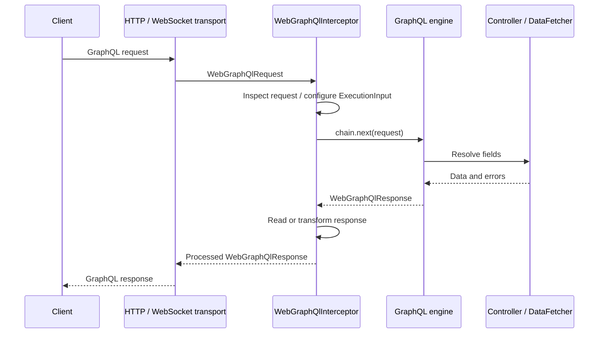

# `WebGraphQlResponse` in Spring for GraphQL

`WebGraphQlResponse` is the object representing the GraphQL result at the web transport layer of Spring for GraphQL. It allows interceptors to read execution results, inspect `data`, `errors`, `extensions`, add HTTP response headers, or create a new response with an adjusted `ExecutionResult`.

Within a request, `WebGraphQlInterceptor` can process information before the GraphQL engine runs and continue processing `WebGraphQlResponse` after `chain.next(request)` completes. This is an appropriate place to attach a request ID to the response, add metadata to `extensions`, normalize certain request-level errors, or set response headers.

`WebGraphQlResponse` does not replace resolvers, `DataFetcherExceptionResolver`, or Spring Security. It handles results at the transport boundary; business rules and data access permissions must still be enforced at the appropriate layers.

## Where Does `WebGraphQlResponse` Sit in the Request Lifecycle?

Spring for GraphQL supports web transports such as HTTP and WebSocket. These transports pass requests through the `WebGraphQlInterceptor` chain, then to `ExecutionGraphQlService`, which invokes the GraphQL Java engine. Once the engine finishes, the response flows back through the interceptor chain so each interceptor can observe or adjust the result.



The response is typically handled using `map` or `doOnNext` on the `Mono<WebGraphQlResponse>` returned by `chain.next(request)`:

```java
@Override
public Mono<WebGraphQlResponse> intercept(
        WebGraphQlRequest request, Chain chain) {
    return chain.next(request)
            .map(response -> {
                // Read or create a new response here
                return response;
            });
}
```

`map` is suitable when you need to create a new response via `response.transform(...)`. `doOnNext` is suitable for intentional side effects, such as adding an HTTP header to the response headers. Never call `block()` inside an interceptor because it will block the reactive flow.

## What Data Can Be Read from the Response?

`WebGraphQlResponse` inherits the capabilities of `ExecutionGraphQlResponse` and `GraphQlResponse`. Commonly used methods include:

| Method | Meaning |
| --- | --- |
| `getData()` | Retrieve the GraphQL data section in the response. |
| `getErrors()` | Retrieve the list of GraphQL errors. |
| `getExtensions()` | Retrieve metadata in the `extensions` section of the GraphQL response. |
| `getExecutionResult()` | Retrieve the underlying GraphQL Java `ExecutionResult`. |
| `getExecutionInput()` | Retrieve the `ExecutionInput` used to execute the operation. |
| `isValid()` | Indicates whether the result has a non-null `data` key. |
| `toMap()` | Convert the response into a map following the GraphQL response structure. |
| `getResponseHeaders()` | Retrieve the HTTP headers to be added to the HTTP response. |
| `transform(...)` | Create a new response after adjusting `ExecutionResult`. |

`isValid()` does not mean the operation had no errors. GraphQL can return partial data alongside `errors`; when `data` is non-null, `isValid()` can still be true. If the goal is to check whether errors occurred, inspect `getErrors().isEmpty()`.

In Spring for GraphQL, `getErrors()` returns `ResponseError` instances for reading errors according to Spring's response model. If you need to work directly with GraphQL Java's `GraphQLError`—for instance, passing an error list into `WebGraphQlResponse.Builder.errors(...)`—retrieve the list from `response.getExecutionResult().getErrors()`.

Example of reading data and errors:

```java
return chain.next(request).map(response -> {
    Object data = response.getData();
    var errors = response.getErrors();
    Map<Object, Object> extensions = response.getExtensions();

    log.debug("GraphQL response valid={}, errorCount={}",
            response.isValid(), errors.size());

    return response;
});
```

When logging, only record the information needed for tracking. Do not log full `data`, variables, tokens, or personal data without appropriate protection policies.

## Adding Metadata to GraphQL `extensions`

A GraphQL response can contain `extensions` to carry additional server-defined metadata, such as a request ID, correlation ID, or API version information. `extensions` resides in the GraphQL body and is distinct from HTTP response headers.

Example of adding a request ID while preserving existing extensions:

```java
import java.util.LinkedHashMap;
import java.util.Map;

return chain.next(request).map(response -> {
    Map<Object, Object> extensions = new LinkedHashMap<>();
    if (response.getExtensions() != null) {
        extensions.putAll(response.getExtensions());
    }
    extensions.put("requestId", requestId);

    return response.transform(builder ->
            builder.extensions(extensions).build());
});
```

`transform` creates a new `WebGraphQlResponse` with an updated `ExecutionResult`. The code copies existing extensions before adding `requestId`, avoiding accidentally overwriting metadata provided by the GraphQL engine or another component.

The response body may look like:

```json
{
  "data": {
    "book": {
      "id": "book-10",
      "title": "Spring in Practice"
    }
  },
  "extensions": {
    "requestId": "8a73f5c2-9b7d-4c3d-a15f-42d9c2e10c11"
  }
}
```

Clients can read `extensions.requestId` to provide a reference code when reporting errors. Do not put sensitive information, stack traces, tokens, or internal details into extensions because the client receives all of this content.

## Adding HTTP Response Headers

`WebGraphQlResponse` provides `getResponseHeaders()` to add headers to the HTTP response. Example of attaching a request ID to a header:

```java
import org.springframework.http.HttpHeaders;

return chain.next(request).doOnNext(response -> {
    response.getResponseHeaders().set("X-Request-Id", requestId);
});
```

The HTTP transport includes this header in the response returned to the client. You can use `add` if you need to append a value without replacing existing values, or `set` to assign a single value.

### Adding Cookies

You can build a `ResponseCookie` and write it to the `Set-Cookie` header:

```java
import org.springframework.http.HttpHeaders;
import org.springframework.http.ResponseCookie;

return chain.next(request).doOnNext(response -> {
    ResponseCookie cookie = ResponseCookie.from("sessionHint", "active")
            .httpOnly(true)
            .secure(true)
            .sameSite("Lax")
            .path("/")
            .build();

    response.getResponseHeaders().add(
            HttpHeaders.SET_COOKIE, cookie.toString());
});
```

This is only a syntax example. Cookie values, domain, expiration, `SameSite`, `Secure`, and `HttpOnly` must match your session model and deployment environment. Do not fabricate authentication cookies from arbitrary values or overwrite security cookies managed by Spring Security.

### WebSocket Limitations

`getResponseHeaders()` is meant for HTTP responses. With GraphQL over WebSocket, the HTTP handshake has already completed before the client sends individual GraphQL operations. Therefore, you cannot use `WebGraphQlResponse.getResponseHeaders()` to add a separate HTTP header for each GraphQL message over WebSocket.

If you need to pass metadata for a WebSocket operation, use GraphQL `extensions` or an appropriate payload/protocol mechanism. Handshake headers must be handled during connection establishment or via the corresponding WebSocket interceptor.

## Reading GraphQLContext in the Response Phase

An interceptor can read the `ExecutionInput` associated with the response. This is useful when the request phase added a value to the GraphQL context and the response phase needs to reuse it, such as a correlation ID:

```java
return chain.next(request).doOnNext(response -> {
    String requestId = response.getExecutionInput()
            .getGraphQLContext()
            .get("requestId");

    if (requestId != null) {
        response.getResponseHeaders().set("X-Request-Id", requestId);
    }
});
```

The context value can be set before calling `chain.next` using `request.configureExecutionInput(...)`. Example of an interceptor generating a server-side ID:

```java
String requestId = UUID.randomUUID().toString();
request.configureExecutionInput((input, builder) ->
        builder.graphQLContext(Map.of("requestId", requestId)).build());

return chain.next(request).doOnNext(response ->
        response.getResponseHeaders().set("X-Request-Id", requestId));
```

Do not trust a client-sent request ID if it is used as a security identifier. You may accept a correlation ID from the client to link traces, but you must validate its format and clearly distinguish it from server-generated IDs.

## Complete Interceptor Example in Spring Boot

Spring Boot automatically registers beans implementing `WebGraphQlInterceptor` with the web transport. You can declare a bean to add a request ID to the GraphQL context, HTTP response header, and GraphQL extensions:

```java
import java.util.LinkedHashMap;
import java.util.Map;
import java.util.UUID;

import org.springframework.context.annotation.Bean;
import org.springframework.context.annotation.Configuration;
import org.springframework.graphql.server.WebGraphQlInterceptor;

@Configuration(proxyBeanMethods = false)
public class GraphQlInterceptorConfiguration {

    @Bean
    WebGraphQlInterceptor responseMetadataInterceptor() {
        return (request, chain) -> {
            String requestId = UUID.randomUUID().toString();

            request.configureExecutionInput((input, builder) ->
                    builder.graphQLContext(Map.of("requestId", requestId)).build());

            return chain.next(request).map(response -> {
                Map<Object, Object> extensions = new LinkedHashMap<>();
                if (response.getExtensions() != null) {
                    extensions.putAll(response.getExtensions());
                }
                extensions.put("requestId", requestId);

                response.getResponseHeaders().set("X-Request-Id", requestId);

                return response.transform(builder ->
                        builder.extensions(extensions).build());
            });
        };
    }
}
```

The interceptor above generates a server-side request ID, puts it into the GraphQL context so components handling the operation can read it, and then adds the same ID to `extensions` and the HTTP header. If the application has multiple interceptors, you can use `@Order` to define their order; ordering must be consistent when an interceptor depends on data created by a preceding interceptor.

In an application not using Spring Boot auto-configuration, you must manually register the interceptor with `WebGraphQlHandler` via the handler's builder. There is no need to create the handler manually if Spring Boot already configures the web transport and picks up interceptor beans.

## Modifying `data`, `errors`, and `extensions`

`WebGraphQlResponse.transform(...)` allows updating the `ExecutionResult` portion. The builder provides operations such as `data(...)`, `errors(...)`, and `extensions(...)`, then `build()` to produce a new response.

Example of adding an extension:

```java
return response.transform(builder ->
        builder.extensions(extensions).build());
```

You can use the same mechanism to replace the list of GraphQL errors after inspecting and normalizing them:

```java
import graphql.GraphQLError;
import graphql.GraphqlErrorBuilder;
import java.util.List;

List<GraphQLError> sanitizedErrors = response.getExecutionResult().getErrors().stream()
        .map(error -> GraphqlErrorBuilder.newError()
                .message("Unable to process GraphQL request")
                .locations(error.getLocations())
                .path(error.getPath())
                .build())
        .toList();

return response.transform(builder ->
        builder.errors(sanitizedErrors).build());
```

The example above illustrates replacing the message while preserving locations and path so clients still know where the error occurred. If the application needs to keep `extensions`, error classification, or other metadata, selectively copy safe values before building the new error. Do not mechanically strip all error information, as clients and monitoring tools may need stable error codes.

Do not modify `data` in an interceptor as a substitute for authorization. If a user is not allowed to read a field, the resolver or service must deny access before the data enters the result. Post-processing the response to remove fields can hide permission design flaws and lose information needed for null propagation.

## Handling Request-Level Errors with a Response Interceptor

Not all GraphQL errors originate from a DataFetcher. Parse or validation errors occur before GraphQL invokes resolvers. Therefore, `DataFetcherExceptionResolver` cannot handle these request-level errors.

An interceptor can inspect `response.getErrors()` after `chain.next` completes and normalize request-level errors according to API policy. For example, it can add a generic error code to `extensions` or alter the public message while preserving `locations` and other safe details.

Do not rely solely on `response.isValid()` to conclude a request has no errors. By definition, `isValid()` reflects whether the result has a non-null `data` key; a response with partial data and one or more execution errors can still be valid in this sense. If you want to determine whether a response has errors, inspect the `getErrors()` list.

`DataFetcherExceptionResolver` remains the right place to handle exceptions from resolvers/services. A response interceptor is better suited for request-level errors or normalizing the overall response. The two mechanisms complement each other.

## Distinguishing GraphQL Response Body from HTTP Response

A GraphQL response body typically consists of `data`, `errors`, and `extensions`. An HTTP response also has a status code, headers, and other transport properties. `WebGraphQlResponse` exposes both the GraphQL view and response headers, but they should not be confused as the same kind of metadata.

| Component | Example | Appropriate Handling Place |
| --- | --- | --- |
| GraphQL data | `data.book.title` | Resolvers and GraphQL execution. |
| GraphQL errors | `errors[].message`, `path`, `locations` | DataFetcher exception resolver or response interceptor for request-level errors. |
| GraphQL extensions | `extensions.requestId` | `WebGraphQlResponse.transform(...)`. |
| HTTP response header | `X-Request-Id`, `Set-Cookie` | `response.getResponseHeaders()`. |
| HTTP status | 200, 400, 401, 500 | Web transport, security filters, and handlers following GraphQL over HTTP rules. |

With GraphQL over HTTP, once a request is successfully parsed and validated, errors occurring during execution are typically represented in `errors` within the GraphQL body and the HTTP status is usually 200. The status for parse/validation errors also depends on the media type and the GraphQL over HTTP rules applied by the transport. Do not automatically turn every response with GraphQL errors into HTTP 500; clients need to be able to receive partial data and errors together.

`WebGraphQlResponse` has `getResponseHeaders()` for adding headers, but does not offer a general API to arbitrarily set HTTP status codes for every transport type. If you need to change the status for a special case, configure it at the appropriate handler/transport layer and follow the protocol in use.

## Interceptors Applying to HTTP and WebSocket

`WebGraphQlInterceptor` is invoked for GraphQL requests over HTTP and WebSocket. Some operations work identically on both transports:

- Reading available request information.
- Configuring `ExecutionInput` and GraphQL context.
- Observing `data`, `errors`, and `extensions`.
- Transforming the GraphQL `ExecutionResult`.

HTTP-dependent operations such as adding `X-Request-Id` or `Set-Cookie` only make sense for HTTP responses. With WebSocket, the handshake has already finished before individual GraphQL operations are processed; using response headers per operation will not behave like HTTP.

If you need dedicated callbacks for the WebSocket connection lifecycle, initialization messages, or subscription cancellation, refer to `WebSocketGraphQlInterceptor`, which is the WebSocket-specific extension of `WebGraphQlInterceptor`.

## Testing a Response Interceptor

Tests should verify both the GraphQL body and HTTP metadata. `GraphQlTester` is well suited for checking `data`, `errors`, and `extensions`. For HTTP headers, use transport tests such as `WebTestClient` for WebFlux or `MockMvc` for Spring MVC.

Scenarios that should be checked:

- Successful responses preserve `data` and include the request ID in `extensions`.
- The HTTP response contains `X-Request-Id` matching the request.
- Existing `extensions` are not overwritten when adding new metadata.
- Responses with partial data and errors preserve both parts.
- `isValid()` is not mistakenly used as an empty-error-list check.
- Request parse/validation errors are handled properly if the interceptor normalizes errors.
- Error path and locations are preserved when changing the message.
- Headers are not assumed to be sent per operation over WebSocket.
- Multiple interceptors execute in the right order and do not overwrite each other's metadata.
- No sensitive data appears in the response body, headers, or logs.

Example of verifying an extension with `GraphQlTester`:

```java
graphQlTester.document("""
        query {
          book(id: "book-10") {
            id
          }
        }
        """)
        .execute()
        .path("extensions.requestId")
        .entity(String.class)
        .satisfies(requestId -> assertThat(requestId).isNotBlank());
```

To verify headers, send the request through an HTTP test client and assert `X-Request-Id` in the response headers. If a test only uses a tester not bound to an HTTP transport, it may not observe headers that the transport is responsible for writing to the network.

## Common Pitfalls

| Symptom | Cause | Resolution |
| --- | --- | --- |
| Header added but client does not receive it | Using WebSocket or the interceptor runs on a transport without a corresponding HTTP response. | Only use `getResponseHeaders()` for HTTP; use extensions for per-operation metadata. |
| Old `extensions` are lost | Creating a new map without copying existing extensions. | Copy `getExtensions()` before adding new keys. |
| Response was transformed but client does not see it | Calling `transform` without returning the new response from `map`. | Return the result of `response.transform(...)`. |
| `isValid()` is true yet response still has errors | Misunderstanding valid as meaning error-free. | Check `getErrors().isEmpty()` when checking for errors. |
| DataFetcherExceptionResolver does not handle validation errors | The error happens before resolvers are invoked. | Use a response interceptor to inspect and normalize request-level errors. |
| Partial data disappears after normalizing errors | Transforming the response without preserving data or logic replaces the whole ExecutionResult. | Only update the necessary fields, keeping the rest intact. |
| Request ID is inconsistent between logs and response | Generating IDs in multiple layers or overwriting context. | Create one ID in the request phase and reuse it across context, extension, and header. |
| Internal details leaked in extensions or headers | Putting exceptions, tokens, or sensitive data into metadata. | Only expose reference codes and safe information. |

## Key Takeaways

`WebGraphQlResponse` is the web-transport-layer result after the GraphQL engine executes an operation. You can read `data`, `errors`, `extensions`, and `ExecutionInput`, use `transform(...)` to create a new response, or use `getResponseHeaders()` to add HTTP headers.

`extensions` belongs to the GraphQL response body; `getResponseHeaders()` is for HTTP responses and does not produce separate headers per WebSocket message. `transform` updates `ExecutionResult` through builders such as `data`, `errors`, and `extensions`. `isValid()` only indicates that data is non-null, not that the response is free of errors.

In Spring Boot, declare a `WebGraphQlInterceptor` bean to process responses after `chain.next(request)`. Use interceptors for metadata, correlation IDs, and request-level error normalization; use resolvers/services for business logic and authorization. Test both the GraphQL body and HTTP headers to verify the response works correctly over the actual transport.

## References

- [Spring for GraphQL — Server Transports and Interception](https://docs.spring.io/spring-graphql/reference/transports.html)
- [Spring for GraphQL — `WebGraphQlResponse` API](https://docs.spring.io/spring-graphql/docs/current/api/org/springframework/graphql/server/WebGraphQlResponse.html)
- [Spring Boot — Spring for GraphQL](https://docs.spring.io/spring-boot/reference/web/spring-graphql.html)
