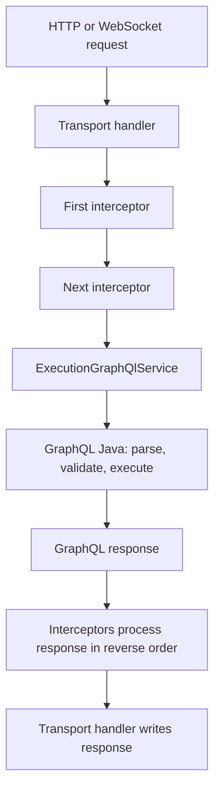

# GraphQlInterceptor

An interceptor is an extension point that allows a Spring for GraphQL application to observe or adjust requests and responses around GraphQL execution. Interceptors are commonly used to pass transport information into `GraphQLContext`, attach correlation IDs, add HTTP response headers, record processing duration, or normalize certain request-level errors.

In Spring for GraphQL, the specific API name depends on the transport. For HTTP and WebSocket, the main interceptor is `WebGraphQlInterceptor`; WebSocket also has `WebSocketGraphQlInterceptor`. For RSocket, Spring provides `RSocketQlInterceptor`. Therefore, when referring generally to GraphQL interceptors, you need to identify which transport the request uses to select the right extension point.

## 1. Where Does the Interceptor Sit in the Processing Flow?

The HTTP and WebSocket handlers pass requests through the `WebGraphQlInterceptor` chain before calling `ExecutionGraphQlService` to run GraphQL Java. An interceptor can run logic before forwarding the request and continue processing the response after the rest of the chain completes.



For example, the first interceptor can read the `X-Request-Id` header, put its value into the GraphQL context, and call the next interceptor. After GraphQL execution completes, another interceptor can read data in the response and add a response header.

An interceptor does not replace a resolver. Resolvers are responsible for providing data for fields; interceptors handle cross-cutting request or transport concerns that apply across many operations and resolvers.

## 2. WebGraphQlInterceptor Is the API for HTTP and WebSocket

`WebGraphQlInterceptor` belongs to the `org.springframework.graphql.server` package. The interface has one main method:

```java
Mono<WebGraphQlResponse> intercept(
    WebGraphQlRequest request,
    WebGraphQlInterceptor.Chain chain
);
```

Where:

- `WebGraphQlRequest` provides the GraphQL request information and corresponding transport information, such as HTTP headers.
- `Chain` represents the rest of the interceptor chain and the GraphQL execution step.
- `chain.next(request)` forwards the request to the next interceptor or `ExecutionGraphQlService` and returns `Mono<WebGraphQlResponse>`.
- `WebGraphQlResponse` lets you read the execution result and adjust certain response information, such as HTTP response headers.

`Mono` is Project Reactor's reactive type. Both Spring MVC and Spring WebFlux applications use this interceptor API; do not call `block()` or manually `subscribe()` inside an interceptor to wait for results. Return and compose the `Mono` so the framework manages the asynchronous lifecycle.

## 3. Creating and Registering an Interceptor in Spring Boot

In a Spring Boot application using `spring-boot-starter-graphql`, you can declare an interceptor as a Spring bean. Boot will include `WebGraphQlInterceptor` beans in the web transport chain.

Example of an interceptor that captures a request ID from a header:

```java
package com.example.graphql.config;

import java.util.Map;

import reactor.core.publisher.Mono;
import org.springframework.core.annotation.Order;
import org.springframework.graphql.server.WebGraphQlInterceptor;
import org.springframework.graphql.server.WebGraphQlRequest;
import org.springframework.graphql.server.WebGraphQlResponse;
import org.springframework.stereotype.Component;

@Component
@Order(10)
public class RequestIdInterceptor implements WebGraphQlInterceptor {

    @Override
    public Mono<WebGraphQlResponse> intercept(
            WebGraphQlRequest request, Chain chain) {

        String requestId = request.getHeaders().getFirst("X-Request-Id");

        if (requestId != null && !requestId.isBlank()) {
            request.configureExecutionInput((input, builder) ->
                builder.graphQLContext(Map.of("requestId", requestId)).build()
            );
        }

        return chain.next(request);
    }
}
```

`@Component` registers the interceptor in the application context. `@Order(10)` specifies the relative order among interceptor beans; Spring for GraphQL retrieves them in sorted order. If no special ordering is needed, you can use a default order value or implement `Ordered`.

In production code, coordinate adding data to `GraphQLContext` with other context sources in the application to avoid overwriting already-set keys. Choose clearly namespaced keys, such as `requestId` or `tenantContext`.

## 4. Putting HTTP Headers into GraphQLContext

An application often needs to pass information from the HTTP request to GraphQL resolvers. For example, a correlation ID, locale, or authenticated tenant can be placed into `GraphQLContext`.

Spring for GraphQL includes a built-in `HttpRequestHeaderInterceptor` to copy selected HTTP headers into the GraphQL context. You can register it as a bean:

```java
import org.springframework.context.annotation.Bean;
import org.springframework.context.annotation.Configuration;
import org.springframework.graphql.server.support.HttpRequestHeaderInterceptor;

@Configuration
public class GraphQlInterceptorConfiguration {

    @Bean
    HttpRequestHeaderInterceptor requestHeaderInterceptor() {
        return HttpRequestHeaderInterceptor.builder()
            .mapHeader("X-Request-Id")
            .build();
    }
}
```

Then the controller reads the value via `@ContextValue`:

```java
import org.springframework.graphql.data.method.annotation.ContextValue;
import org.springframework.graphql.data.method.annotation.QueryMapping;
import org.springframework.stereotype.Controller;

@Controller
public class RequestInfoController {

    @QueryMapping
    public String requestId(@ContextValue("X-Request-Id") String requestId) {
        return requestId;
    }
}
```

The context key name must match the key that the interceptor writes to the context according to the configuration of the version in use. With the built-in header interceptor, check the builder API and key conventions in the Spring for GraphQL version managed by your project. If you need to rename or transform values, writing a custom `WebGraphQlInterceptor` is more flexible.

Do not treat every client-sent header as trusted data. Tenant, role, or user ID headers can be spoofed if not authenticated by a gateway or the application. For authorization data, obtain identity from Spring Security's `Principal`/`SecurityContext` or a trusted server-side source.

## 5. Reading GraphQLContext in Resolvers

Once an interceptor puts data into `GraphQLContext`, resolvers can accept the context directly or use `@ContextValue`.

Example of receiving a context key:

```java
@QueryMapping
public Dashboard dashboard(@ContextValue("requestId") String requestId) {
    return dashboardService.load(requestId);
}
```

Or accessing the full `GraphQLContext`:

```java
import graphql.GraphQLContext;

@QueryMapping
public Dashboard dashboard(GraphQLContext context) {
    String requestId = context.get("requestId");
    return dashboardService.load(requestId);
}
```

`GraphQLContext` is meant for shared data within a single GraphQL execution. It is suited for request information such as correlation ID, verified tenant, locale, or server-generated metadata. Do not use it as global state shared across multiple requests.

When a context value may be absent, use a nullable type or provide a default value and check explicitly. If a resolver requires a mandatory tenant, reject the request when the context is unauthenticated instead of proceeding with an unverified default tenant.

## 6. Adding HTTP Response Headers After GraphQL Execution

An interceptor can continue processing the response after `chain.next(request)`. Example of adding a response header so clients can correlate the request:

```java
import org.springframework.http.HttpHeaders;

@Component
public class ResponseRequestIdInterceptor implements WebGraphQlInterceptor {

    @Override
    public Mono<WebGraphQlResponse> intercept(
            WebGraphQlRequest request, Chain chain) {

        String requestId = request.getHeaders().getFirst("X-Request-Id");

        return chain.next(request).doOnNext(response -> {
            if (requestId != null && !requestId.isBlank()) {
                response.getResponseHeaders()
                    .add("X-Request-Id", requestId);
            }
        });
    }
}
```

`doOnNext` performs a side effect when the response is emitted. If you need to transform the response or create a new one, use operators such as `map` and the `response.transform(...)` API as appropriate. Do not arbitrarily alter GraphQL `data` because doing so can break the schema contract or distort data semantics.

Another case is when a controller writes a value into `GraphQLContext` and the interceptor reads it after execution completes to build a cookie or header. This is useful when response metadata depends on processing results, though cookie policies, `Secure`, `HttpOnly`, `SameSite`, and domain/path must be clearly defined in a real application.

## 7. Observing and Transforming GraphQL Errors

An interceptor can read `WebGraphQlResponse` to observe errors after the GraphQL engine processes the operation. This is useful for document validation errors, since some errors occur before resolvers run and do not go through `DataFetcherExceptionResolver`.

Example of inspecting the response:

```java
return chain.next(request).map(response -> {
    if (response.isValid()) {
        return response;
    }

    // Log or normalize errors according to application policy.
    return response;
});
```

`isValid()` helps distinguish responses with a valid data result under the API's criteria from responses containing only request/validation errors. When transforming errors, you can create a new list of `GraphQLError` instances and use `response.transform(builder -> builder.errors(errors).build())`.

Do not remove errors or rewrite messages in a way that misleads the client into thinking the operation succeeded. Keep error codes stable, avoid exposing stack traces or internal details in public messages, and preserve necessary details such as error path/extensions if clients rely on them.

Separating responsibilities:

- `DataFetcherExceptionResolver` handles exceptions thrown during resolver/field execution.
- `WebGraphQlInterceptor` observes request/response at the web transport level, including validation errors before resolvers run.
- The Spring Security filter chain handles authentication and protects HTTP endpoints at the web security layer.

Do not cram all business validation or resolver exception handling into an interceptor.

## 8. Interceptor Chain and Execution Order

An application can have multiple interceptors with distinct roles:

1. An interceptor that inspects transport metadata and generates a correlation ID.
2. An interceptor that puts authenticated context into GraphQL execution.
3. An interceptor that measures duration and records metrics.
4. An interceptor that handles response headers or normalizes errors.

Interceptors are invoked in configured order before execution; post-`chain.next` logic runs as the response flows backward through the chain. This resembles the middleware/decorator pattern.

Example:

```java
@Component
@Order(1)
public class CorrelationInterceptor implements WebGraphQlInterceptor {
    // Generate or validate correlation ID before execution.
}

@Component
@Order(2)
public class MetricsInterceptor implements WebGraphQlInterceptor {
    // Measure duration and record result after execution.
}
```

Set explicit ordering when an interceptor depends on data produced by an earlier one. Avoid having multiple interceptors modify the same context key or the same response header with conflicting rules.

Each interceptor usually calls `chain.next(request)` exactly once to continue processing. If intentionally blocking a request and returning early, ensure the response complies with the GraphQL contract and does not bypass required security checks. Do not call `chain.next` multiple times for the same request unless the API and use case are specifically designed for it.

## 9. WebSocketGraphQlInterceptor

`WebSocketGraphQlInterceptor` extends `WebGraphQlInterceptor`. In addition to intercepting individual GraphQL requests over WebSocket, it provides callbacks for connection lifecycle and client subscription cancellation.

WebSocket differs from HTTP in that a connection can be long-lived and carry multiple operations/subscriptions. Therefore, an application may need to handle:

- Authenticating when the client sends a `connection_init` message.
- Attaching principal/security context information for subsequent requests on the connection.
- Tracking when a connection starts or ends.
- Handling client cancellation for an active subscription.

Spring for GraphQL includes built-in `AuthenticationWebSocketInterceptor` implementations for Spring MVC and WebFlux to extract authentication information from the `connection_init` payload and propagate `SecurityContext` to subsequent requests.

At most one `WebSocketGraphQlInterceptor` can exist in a chain. When an application needs multiple WebSocket behaviors, combine that logic into a single WebSocket interceptor and use other `WebGraphQlInterceptor` instances for general handling.

Do not assume HTTP request headers from the handshake automatically change per operation on the connection. Authentication and metadata must be tied to the WebSocket lifecycle according to the protocol and the application's refresh/revocation policies.

## 10. Interceptors for RSocket

For GraphQL running over RSocket, Spring provides `RSocketQlInterceptor` to intercept requests before and after GraphQL Java executes. Its purpose is similar to `WebGraphQlInterceptor`: customizing `ExecutionInput`, and observing or transforming `ExecutionResult`.

RSocket has its own interaction model. Queries and mutations typically use request-response, while subscriptions use request-stream. Therefore, `WebGraphQlInterceptor` cannot be used directly in place of an RSocket interceptor; use the extension point matching the transport.

If an application only serves GraphQL over HTTP/WebSocket, there is no need to configure an RSocket interceptor. Add it only when the system actually enables the RSocket transport and has suitable cross-cutting requirements.

## 11. How Do Interceptors, Filters, and Resolvers Differ?

| Component | Scope | Example Tasks |
| --- | --- | --- |
| Servlet/WebFlux filter | HTTP request before entering the handler | CORS, security chain, general web request handling |
| `WebGraphQlInterceptor` | GraphQL request/response over HTTP or WebSocket | Passing headers into GraphQLContext, response headers, request timing |
| `RSocketQlInterceptor` | GraphQL request/response over RSocket | Context and results for RSocket operations |
| `@QueryMapping` / `@SchemaMapping` | A specific field in the schema | Fetching data or executing field logic |
| `DataFetcherExceptionResolver` | Exceptions from field execution | Converting exceptions into GraphQL errors |
| GraphQL Java Instrumentation | Internal steps of engine execution | Deep monitoring or intervention in parse, validation, and execution |

Choose the extension point based on where you need to intervene. For example, validating an HTTP bearer token usually fits Spring Security; putting a request ID into GraphQLContext fits `WebGraphQlInterceptor`; handling domain errors of `Book.author` fits a resolver or exception resolver.

## 12. Logging, Metrics, and Security

An interceptor is a convenient place to record request duration, operation name, request ID, and overall outcome. However, GraphQL requests may contain sensitive variables such as emails, access tokens, payment information, or personal data.

Some principles:

- Log operation name, correlation ID, processing duration, and error count when needed; avoid logging full documents/variables.
- If logging queries for debugging is necessary, filter or mask sensitive values and apply appropriate retention limits.
- Never log raw access tokens, cookies, session IDs, or authentication credentials in GraphQLContext logs.
- Never trust tenant IDs, roles, or user IDs merely because they appear in HTTP headers.
- Use Spring Security for authentication and authorization; interceptors only forward verified information into the execution context when needed.
- Never let exceptions inside an interceptor leak internal details or accidentally turn a security failure into a success response.
- For WebSocket, limit connections and subscriptions, and handle cancellation and credential revocation across the connection lifecycle.

If you need timeouts for GraphQL requests over web transports, Spring for GraphQL provides `TimeoutWebGraphQlInterceptor`. You can configure this interceptor as a bean with an appropriate duration so requests exceeding the limit are cancelled. Choose the timeout based on query characteristics and SLAs; a value that is too low can cut off valid operations, while a value that is too high fails to protect resources effectively.

## 13. Testing Interceptors

Interceptors are transport-layer logic, so tests must go through the appropriate handler to verify the chain is actually applied. A unit test on the `intercept` method can mock `Chain`, but integration tests via `WebGraphQlHandler` or HTTP tests with `WebTestClient` verify both bean registration and transport behavior.

Example scenarios to test:

- Request headers are transferred into `GraphQLContext` and controllers read them via `@ContextValue`.
- Missing or blank headers do not cause unexpected request failures.
- Response headers are added after GraphQL execution completes.
- The interceptor calls the chain exactly once and does not block the reactive pipeline.
- The interceptor preserves `data` and `errors` when only observing the response.
- Pre-resolver validation errors are still logged/normalized properly.
- Multiple interceptors execute in the order specified by `@Order`.
- WebSocket connection initialization, cancellation, and authentication are tested separately if the application supports WebSocket.
- RSocket interceptors are tested through the RSocket handler if the application uses RSocket.

In tests using `GraphQlTester` at the execution service level, web transport interceptors may not run. Choose `WebGraphQlTester` or the corresponding HTTP/WebSocket test when the goal is testing `WebGraphQlInterceptor`.

## 14. Common Pitfalls

| Symptom | Possible Cause | Resolution |
| --- | --- | --- |
| Interceptor is not called | Bean is not registered or a different transport is in use | Check component scan, beans, and handler transport |
| `@ContextValue` receives null | Context key mismatch or interceptor did not configure execution input | Check key names and chain ordering |
| Response header does not appear | Modifying response before chain completes or using wrong response headers API | Perform after `chain.next` and check HTTP handler |
| Request is executed twice | Calling `chain.next` multiple times | Continue the chain only once per normal request |
| MVC request hangs | Calling `block()` or manually subscribing inside interceptor | Compose `Mono` and return the pipeline |
| Validation errors not handled by resolver | Validation happens before field execution | Observe `WebGraphQlResponse` in interceptor if needed |
| WebSocket auth not applied to later operations | SecurityContext not bound to connection/request lifecycle | Use an appropriate `WebSocketGraphQlInterceptor` |
| Tenant data is leaked | Trusting client-sent headers or caching context at wrong scope | Verify tenant server-side and keep context per-request |
| Logs contain sensitive data | Logging full query/variables/headers | Mask or omit sensitive data from logs |

## 15. Interceptor Implementation Checklist

- Have you identified whether the transport is HTTP, WebSocket, or RSocket?
- Have you chosen the right interface: `WebGraphQlInterceptor`, `WebSocketGraphQlInterceptor`, or `RSocketQlInterceptor`?
- Is the interceptor registered as a bean or added to the handler chain?
- Is interceptor ordering defined when dependencies exist?
- Do context keys have clear names and avoid overwriting other data?
- Is header data verified before being used for tenant/authorization?
- Is `chain.next(request)` called properly without blocking the reactive pipeline?
- Do response headers and error transformations preserve the GraphQL contract?
- Does logging avoid exposing query variables or authentication details?
- Have tests been run through the right transport to verify the interceptor?

Interceptors in Spring for GraphQL are extension points at the boundary between transport and GraphQL execution. For HTTP/WebSocket, `WebGraphQlInterceptor` lets you read requests, customize `ExecutionInput`, pass data into `GraphQLContext`, and process responses after execution; WebSocket has an extended interceptor for connection lifecycle, while RSocket has its own API. Choosing the right interceptor for the transport, keeping the pipeline reactive, validating input data, and testing through the right handler ensure cross-cutting concerns such as correlation, context, headers, and metrics operate consistently without burdening resolvers with responsibilities that do not belong to them.

## References

- [Spring for GraphQL — Server Transports and Interception](https://docs.spring.io/spring-graphql/reference/transports.html)
- [Spring for GraphQL — WebGraphQlInterceptor API](https://docs.spring.io/spring-graphql/docs/current/api/org/springframework/graphql/server/WebGraphQlInterceptor.html)
- [Spring Boot — Spring for GraphQL](https://docs.spring.io/spring-boot/reference/web/spring-graphql.html)
