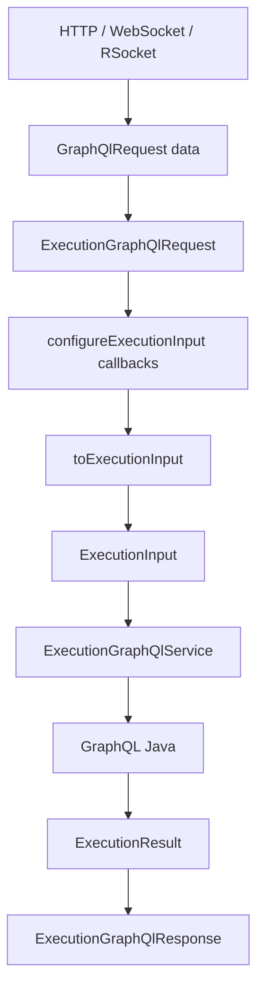

# ExecutionGraphQlRequest

## 1. What Is `ExecutionGraphQlRequest`?

In Spring for GraphQL, a request needs to carry the operation information the client wants to execute along with additional data for GraphQL Java to run that operation. `GraphQlRequest` defines the core data such as the GraphQL document, operation name, variables, and extensions. `ExecutionGraphQlRequest` extends this contract for the server side by adding the ability to prepare `ExecutionInput` before passing the request into GraphQL Java.

In other words, `ExecutionGraphQlRequest` is the abstraction connecting a Spring for GraphQL request with the `graphql.ExecutionInput` object that GraphQL Java uses to execute. It is not a GraphQL schema, resolver, or HTTP endpoint. It carries the input data and customizations required for a single GraphQL execution.

The interface resides in the `org.springframework.graphql` package:

```java
import org.springframework.graphql.ExecutionGraphQlRequest;
```

Common implementations include:

- `DefaultExecutionGraphQlRequest`: the default implementation for server-side execution.
- `WebGraphQlRequest`: a request over HTTP or WebSocket, adding transport information such as URI and HTTP headers.
- `WebSocketGraphQlRequest`: a request associated with a GraphQL over WebSocket message.
- `RSocketGraphQlRequest`: a request coming from the RSocket transport.

These implementations all retain the common GraphQL request data, while adding transport-specific information.

## 2. Distinguishing `GraphQlRequest` and `ExecutionGraphQlRequest`

`GraphQlRequest` describes the content of an operation. `ExecutionGraphQlRequest` adds what is needed to execute that operation on the server.

| Component | `GraphQlRequest` | `ExecutionGraphQlRequest` |
| --- | --- | --- |
| GraphQL document | Yes | Inherited |
| Operation name | Yes | Inherited |
| Variables | Yes | Inherited |
| Protocol extensions | Yes | Inherited |
| Convert to `Map` per GraphQL over HTTP/WebSocket | Yes | Inherited |
| Transport request ID | Not a general responsibility | Yes |
| Request locale | Not a general responsibility | May be present |
| Customize `ExecutionInput` | No | Yes |
| Create `ExecutionInput` for GraphQL Java | No | Yes |

For example, a request may contain a document:

```graphql
query BookById($id: ID!) {
    book(id: $id) {
        id
        title
    }
}
```

and variables:

```json
{
  "id": "book-42"
}
```

`GraphQlRequest` holds the document and variables. When the request is used to invoke GraphQL Java, `ExecutionGraphQlRequest` can also add an execution ID, locale, and other values to `ExecutionInput`.

## 3. Key Properties of the Request

Because `ExecutionGraphQlRequest` extends `GraphQlRequest`, it provides the following core information:

| Method | Meaning |
| --- | --- |
| `getDocument()` | GraphQL document containing operations, selection sets, and fragments |
| `getOperationName()` | Name of the operation to run when the document contains multiple operations |
| `getVariables()` | Map of variable values for the operation |
| `getExtensions()` | Protocol- or implementation-specific extension metadata |
| `toMap()` | Converts the request into a map following the GraphQL over HTTP/WebSocket format |
| `getId()` | ID assigned to the request by the transport |
| `getExecutionId()` | Configured `ExecutionId` to pass into GraphQL Java, if set |
| `getLocale()` | Locale provided by the transport, if present |

`getOperationName()` may be null if the request has only one operation or the client did not supply a name. `getVariables()` may be empty. `getExtensions()` is typically used for client- or protocol-specific metadata; it should not be confused with `extensions` in the GraphQL response.

`getId()` and `getExecutionId()` have similar purposes but are not identical. `getId()` is the ID provided by the transport; `getExecutionId()` is the actual ID configured for the GraphQL run. If not overridden, the transport ID is typically used as the basis for the execution ID.

## 4. Flow from Request to `ExecutionInput`

When the server receives a GraphQL request, Spring for GraphQL creates an implementation of `ExecutionGraphQlRequest`. The request is used to build `ExecutionInput`, after which `ExecutionGraphQlService` passes the input to GraphQL Java.



`ExecutionGraphQlRequest` does not run the operation itself. It prepares the input data. `ExecutionGraphQlService` is responsible for calling GraphQL Java and returning the response.

In principle, `toExecutionInput()` performs two tasks:

1. Initializes `ExecutionInput` from the request's document, operation name, variables, extensions, execution ID, and locale.
2. Applies customization functions registered via `configureExecutionInput(...)`.

This allows server-side layers to add metadata or adjust execution without rebuilding the entire `ExecutionInput` manually.

## 5. Customizing `ExecutionInput` with `configureExecutionInput`

`configureExecutionInput` is the most important extension point of `ExecutionGraphQlRequest`. The method accepts a `BiFunction` with:

- `ExecutionInput`: the input initialized from the request.
- `ExecutionInput.Builder`: the builder to modify or add configuration.

The function must return `ExecutionInput` after calling `build()`.

Example of adding tenant and correlation ID to `GraphQLContext`:

```java
request.configureExecutionInput((input, builder) ->
    builder.graphQLContext(context -> {
        context.put("tenantId", tenantId);
        if (correlationId != null) {
            context.put("correlationId", correlationId);
        }
    }).build()
);
```

Afterward, resolvers can read values using `GraphQLContext` or `@ContextValue`:

```java
@QueryMapping
public List<Book> books(@ContextValue("tenantId") String tenantId) {
    return bookQueryService.findAllByTenant(tenantId);
}
```

The context is suited for server-side data needed within the same execution, such as an authenticated tenant, principal, display locale, or correlation ID. Do not put client-declared values directly into the context and treat them as trusted data.

### Avoiding Accidental Context Overwrites

When multiple components customize `ExecutionInput`, use the builder to add needed keys and avoid replacing data set by earlier components. If multiple callbacks modify the same property, agree on ordering and conventions so the final result does not depend on unpredictable configuration.

Do not construct a brand-new `ExecutionInput` from document and variables when you only need to add context. Doing so easily drops the execution ID, locale, extensions, or values already prepared by Spring.

## 6. Creating a Default Request and Calling `ExecutionGraphQlService`

When an application needs to call the GraphQL execution service directly, it can create a `DefaultExecutionGraphQlRequest`:

```java
import java.util.Locale;
import java.util.Map;
import org.springframework.graphql.ExecutionGraphQlRequest;
import org.springframework.graphql.ExecutionGraphQlResponse;
import org.springframework.graphql.support.DefaultExecutionGraphQlRequest;
import org.springframework.graphql.ExecutionGraphQlService;
import reactor.core.publisher.Mono;

public class InternalGraphQlExecutor {

    private final ExecutionGraphQlService executionGraphQlService;

    public InternalGraphQlExecutor(
            ExecutionGraphQlService executionGraphQlService) {
        this.executionGraphQlService = executionGraphQlService;
    }

    public Mono<ExecutionGraphQlResponse> findBook(String tenantId) {
        String document = """
            query BookById($id: ID!) {
                book(id: $id) {
                    id
                    title
                }
            }
            """;

        ExecutionGraphQlRequest request = new DefaultExecutionGraphQlRequest(
            document,
            "BookById",
            Map.of("id", "book-42"),
            Map.of(),
            "internal-request-42",
            Locale.US
        );

        request.configureExecutionInput((input, builder) ->
            builder.graphQLContext(context -> context.put("tenantId", tenantId))
                .build()
        );

        return executionGraphQlService.execute(request);
    }
}
```

`DefaultExecutionGraphQlRequest` takes document, operation name, variables, extensions, request ID, and locale. `ExecutionGraphQlService.execute(...)` returns `Mono<ExecutionGraphQlResponse>`, because execution may involve asynchronous or reactive data fetchers.

This is an internal invocation example to illustrate the abstraction. In a normal web application, Spring Boot already configures the transport and `ExecutionGraphQlService`; there is no need to create requests manually and call the service instead of an HTTP endpoint if clients can already call the GraphQL endpoint.

## 7. `WebGraphQlRequest` Is the Implementation with Transport Information

`WebGraphQlRequest` extends `DefaultExecutionGraphQlRequest` and implements `ExecutionGraphQlRequest`. In addition to document, operation name, and variables, it provides HTTP or WebSocket handshake information such as:

- Request URI.
- HTTP headers.
- Cookies.
- Remote address if present.
- Request or WebSocket session attributes.

For example, an interceptor can read a correlation ID from a header and add it to `ExecutionInput`:

```java
import org.springframework.graphql.server.WebGraphQlInterceptor;
import org.springframework.graphql.server.WebGraphQlRequest;
import org.springframework.graphql.server.WebGraphQlResponse;
import org.springframework.stereotype.Component;
import reactor.core.publisher.Mono;

@Component
public class CorrelationIdInterceptor implements WebGraphQlInterceptor {

    @Override
    public Mono<WebGraphQlResponse> intercept(
            WebGraphQlRequest request, Chain chain) {

        String correlationId = request.getHeaders()
            .getFirst("X-Correlation-Id");

        request.configureExecutionInput((input, builder) ->
            builder.graphQLContext(context -> {
                if (correlationId != null) {
                    context.put("correlationId", correlationId);
                }
            }).build()
        );

        return chain.next(request);
    }
}
```

`WebGraphQlInterceptor` is the abstraction for HTTP/WebSocket transports. It receives `WebGraphQlRequest`, allowing transport details to be read and `configureExecutionInput` to be called before the request reaches the execution service.

If code only needs to work with document, variables, and execution input without depending on HTTP headers, accept the appropriate `ExecutionGraphQlRequest` or `GraphQlRequest` type. Do not cast to `WebGraphQlRequest` if requests may come from RSocket or another transport.

## 8. Execution ID and Request Traceability

GraphQL Java uses `ExecutionId` to identify an execution run. `ExecutionGraphQlRequest` provides:

- `getId()`: the ID assigned by the transport.
- `executionId(ExecutionId)`: configures an execution ID different from the transport ID.
- `getExecutionId()`: reads the configured execution ID.

Example of overriding the execution ID:

```java
import graphql.execution.ExecutionId;

request.executionId(ExecutionId.generate());
```

If not overridden, the transport ID is used as the basis for the execution ID. This ID is placed in `ExecutionInput` and can be used by instrumentation, logs, or error handling to correlate information from the same execution.

When the application already has a trace ID or correlation ID from a gateway, consider using the same value or storing it in `GraphQLContext`. Only override the execution ID when a clear convention exists; never reuse a fixed ID across multiple requests as that destroys the ability to distinguish execution runs.

## 9. Request Locale

`ExecutionGraphQlRequest.getLocale()` returns the locale provided by the transport, if available. The locale can be used by scalars, formatters, or business logic that needs language/region formatting.

Example of checking the locale:

```java
Locale locale = request.getLocale();

if (locale == null) {
    locale = Locale.getDefault();
}
```

Locale does not automatically translate GraphQL data or messages. The application must actively use it in resolvers, formatters, or appropriate exception resolvers. If locale needs to be used across multiple layers, it can be put into `GraphQLContext` inside `configureExecutionInput`.

Do not read locale from an arbitrary GraphQL variable if the application already has locale rules at the transport or user profile level. Standardize the source of precedence so responses are not formatted inconsistently.

## 10. `ExecutionGraphQlService` and `ExecutionGraphQlResponse`

`ExecutionGraphQlService` is Spring for GraphQL's abstraction for invoking GraphQL Java. Its main method is:

```java
Mono<ExecutionGraphQlResponse> execute(ExecutionGraphQlRequest request);
```

`ExecutionGraphQlResponse` wraps the result from GraphQL Java and provides:

- `getExecutionInput()`: the actual `ExecutionInput` created from the request and passed to GraphQL.
- `getExecutionResult()`: the `ExecutionResult` returned by GraphQL Java.
- `GraphQlResponse` methods such as `getData()`, `getErrors()`, `getExtensions()`, and `toMap()`.

This is useful when inspecting execution configuration or integrating with server-side components. For example, in instrumentation or tests, you can compare the context attached to the request with the actual context in `ExecutionInput`.

Normally, an application should let Spring Boot configure `DefaultExecutionGraphQlService` together with `GraphQlSource`. Only replace the service when there are special requirements for how requests are executed or when integrating a custom execution pipeline.

## 11. Operation Constraints by Transport

A GraphQL document can contain Query, Mutation, or Subscription, but not every transport supports every operation type. For example:

- HTTP GET is a safe method and must not be used to execute a Mutation.
- HTTP POST supports Query and Mutation; subscriptions require an appropriate streaming transport.
- WebSocket supports subscriptions and can also handle single-response requests.
- RSocket has its own execution rules according to its interaction model.

Spring for GraphQL can pass operation restrictions from the transport to the request for the execution layer to enforce. Therefore, do not manually construct requests or modify `ExecutionInput` to bypass transport safety constraints. If an application builds a custom transport, explicitly define allowed operation types and check them before execution.

API details for restricting operations may vary across Spring for GraphQL versions. Check `DefaultExecutionGraphQlRequest` and the transport handler of the exact dependency version in use before configuring manually.

## 12. Testing Requests and Execution Input

Two testing layers are commonly used:

1. `ExecutionGraphQlServiceTester`: invokes the execution service directly, suitable for testing schema, resolvers, and execution input without a transport.
2. `WebGraphQlTester`: runs requests through `WebGraphQlHandler` and the `WebGraphQlInterceptor` chain, suitable for testing headers, interceptors, and transport-added context.

Example of testing the execution service directly:

```java
ExecutionGraphQlServiceTester tester =
    ExecutionGraphQlServiceTester.create(executionGraphQlService);

tester.document("""
    query BookById($id: ID!) {
        book(id: $id) {
            id
            title
        }
    }
    """)
    .variable("id", "book-42")
    .execute()
    .path("book.id")
    .entity(String.class)
    .isEqualTo("book-42");
```

If you need to test `configureExecutionInput`, you can create the tester using a builder and configure `ExecutionInput` before execution:

```java
ExecutionGraphQlServiceTester tester =
    ExecutionGraphQlServiceTester.builder(executionGraphQlService)
        .configureExecutionInput((input, builder) ->
            builder.graphQLContext(context ->
                context.put("tenantId", "tenant-a")
            ).build()
        )
        .build();
```

To verify an interceptor actually receives headers and writes context, use `WebGraphQlTester`:

```java
WebGraphQlTester tester = WebGraphQlTester.builder(webGraphQlHandler)
    .headers(headers -> headers.set("X-Correlation-Id", "trace-42"))
    .build();
```

`webGraphQlHandler` must be configured with the interceptor under test. Use a spy or test resolver to verify `correlationId` is present in the execution context.

## 13. Common Pitfalls When Working with ExecutionGraphQlRequest

| Symptom | Possible Cause | Resolution |
| --- | --- | --- |
| Resolver does not see context | `configureExecutionInput` not called or context key mismatch | Check callback and key name in resolver |
| Variables do not reach resolver | Created request with wrong variables map or missing variable | Check `getVariables()` and variable names in the document |
| Wrong operation executed in multi-operation document | `operationName` is missing or incorrect | Provide a valid operation name |
| Execution ID is not as expected | Transport ID and execution ID confused | Check `getId()`, `getExecutionId()`, and where `executionId(...)` is called |
| Locale has no value | Transport does not provide locale | Define a fallback or put locale from user preference into context |
| Cannot read headers from request | Using generic `ExecutionGraphQlRequest` type or request bypasses web transport | Use `WebGraphQlRequest` in web interceptor and check transport |
| Customization drops other context | Builder configured to replace instead of add | Add keys on the existing builder, coordinate callbacks across interceptors |
| Calling GraphQL Java directly skips Spring config | Bypassing `ExecutionGraphQlService` or configured GraphQlSource | Use the Spring-managed execution service when resolver, wiring, and exception handling integration is needed |
| Test does not run interceptor | Using `ExecutionGraphQlServiceTester` when intending to test transport | Use `WebGraphQlTester` with `WebGraphQlHandler` |
| Mutation runs over GET | Transport or custom request ignores method limits | Keep operation rules per transport and test invalid requests |

## 14. Checklist for Using ExecutionGraphQlRequest

- [ ] Distinguish GraphQL request data from execution-specific data.
- [ ] Supply document, operation name, and variables accurately.
- [ ] Use `DefaultExecutionGraphQlRequest` for server-side execution not tied to HTTP-specific data.
- [ ] Use `WebGraphQlRequest` when URI, headers, cookies, or attributes are needed.
- [ ] Use `configureExecutionInput` to add context or execution metadata.
- [ ] Do not rebuild `ExecutionInput` from scratch when only adding a few values.
- [ ] Understand the difference between transport ID and `ExecutionId`.
- [ ] Handle locale according to a consistent rule.
- [ ] Execute requests through `ExecutionGraphQlService` when Spring's execution pipeline is needed.
- [ ] Preserve operation restrictions imposed by the transport.
- [ ] Use `ExecutionGraphQlServiceTester` for execution-level tests.
- [ ] Use `WebGraphQlTester` when needing to verify interceptors and transport metadata.

## Conclusion

`ExecutionGraphQlRequest` is the server-side abstraction extending `GraphQlRequest` to prepare `ExecutionInput` for GraphQL Java. It holds the document, operation name, variables, and extensions, while supporting execution ID, locale, and input customization callbacks. `toExecutionInput()` creates the input from request data and then applies customizations registered with `configureExecutionInput(...)`.

In Spring for GraphQL, `DefaultExecutionGraphQlRequest` suits HTTP-independent execution, whereas `WebGraphQlRequest` adds transport details so interceptors can read URI, headers, and cookies. `ExecutionGraphQlService` executes the request and returns `ExecutionGraphQlResponse`. When testing, use `ExecutionGraphQlServiceTester` for the execution pipeline and `WebGraphQlTester` for interceptors/transport. Understanding these classes helps add context, tracing, and execution metadata while preserving clear boundaries between request data, transport data, and GraphQL Java input.

## References

- [Spring for GraphQL — `ExecutionGraphQlRequest` API](https://docs.spring.io/spring-graphql/docs/current/api/org/springframework/graphql/ExecutionGraphQlRequest.html)
- [Spring for GraphQL — `DefaultExecutionGraphQlRequest` API](https://docs.spring.io/spring-graphql/docs/current/api/org/springframework/graphql/support/DefaultExecutionGraphQlRequest.html)
- [Spring for GraphQL — `ExecutionGraphQlService` API](https://docs.spring.io/spring-graphql/docs/current/api/org/springframework/graphql/ExecutionGraphQlService.html)
- [Spring for GraphQL — Server Transports and Interception](https://docs.spring.io/spring-graphql/reference/transports.html)
- [Spring for GraphQL — Testing](https://docs.spring.io/spring-graphql/reference/testing.html)
