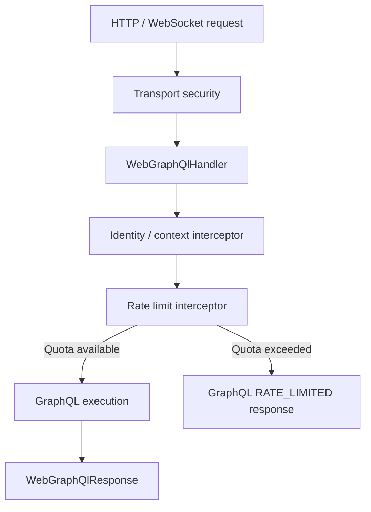

# Rate Limiting in Spring for GraphQL Interceptors

Rate limiting restricts the number of requests a client can send within a time period. With GraphQL, a single HTTP request can ask for many fields, aliases, or nested relationships, so limiting the number of requests is a necessary layer of protection but not enough on its own to control execution cost.

Spring for GraphQL provides `WebGraphQlInterceptor` to inspect requests before the GraphQL engine runs. You can use an interceptor to determine client identity, consume quota, allow the request to proceed, or return a GraphQL error when the limit is exceeded. For systems running multiple instances, counters must use a shared store such as Redis or a distributed rate limiter; an in-memory counter in a single JVM is only suitable for single-instance environments or supplemental per-node limits.

## 1. Where Does Rate Limiting Sit in the Request Flow?

The HTTP and WebSocket transports of Spring for GraphQL pass GraphQL requests through `WebGraphQlHandler`. The handler runs the interceptor chain before `ExecutionGraphQlService`, after which GraphQL Java parses, validates, and executes the operation.



A rate limiter placed in an interceptor can use GraphQL request metadata such as operation name, document, request attributes, and context prepared by earlier interceptors. It can reject requests before resolvers or DataFetchers run, thereby reducing load on the business layer and database.

Rate limiting can also be placed at an API gateway, reverse proxy, or HTTP filter. Those layers are suited for limiting raw requests by IP, API key, or path before the GraphQL body is parsed. An interceptor is more suitable when the policy needs GraphQL identity, operation type, or authenticated metadata. Many systems combine both layers.

## 2. Identifying Who the Quota Applies To

Rate limiting needs a stable key to group requests belonging to the same client. Common options:

| Subject | Suggested Key | When Appropriate |
| --- | --- | --- |
| Authenticated user | `user:{userId}` | Personal APIs or applications with clear user identity. |
| API client | `client:{clientId}` | Server-to-server integrations using API keys/OAuth clients. |
| Tenant/organization | `tenant:{tenantId}` | Limiting total resources for a single tenant. |
| User within tenant | `tenant:{tenantId}:user:{userId}` | Needing per-user quotas while maintaining tenant isolation. |
| Unauthenticated user | IP verified via trusted proxy | Public or login endpoints. |

Do not use an arbitrary header like `X-User-Id` as identity if clients can set that header themselves. Obtain the principal or API client from Spring Security, a verified token, or an attribute written to the request by a trusted gateway. When using IP, configure trusted proxies properly; never blindly trust `X-Forwarded-For` from the Internet.

A `RateLimitKeyResolver` helps separate identity resolution from the interceptor:

```java
import org.springframework.graphql.server.WebGraphQlRequest;
import reactor.core.publisher.Mono;

public interface RateLimitKeyResolver {
    Mono<String> resolveKey(WebGraphQlRequest request);
}
```

Implementations of this interface should return a normalized key from the principal, API key, or trusted client address. For anonymous requests, an IP-based key can be returned. If identity cannot be determined and the endpoint does not allow anonymous access, reject according to security policy instead of dumping all requests into a shared key like `unknown`.

## 3. Choosing a Rate Limiting Algorithm

Some commonly used algorithms:

| Algorithm | How It Works | Characteristics |
| --- | --- | --- |
| Fixed window | Counts requests in fixed time windows | Simple, but can allow large bursts at window boundaries. |
| Sliding window | Counts requests in a rolling window or approximation | Smoother than fixed window; requires storing more timestamps or auxiliary counters. |
| Token bucket | Tokens refill at a rate; each request consumes tokens | Allows bounded bursts and controls average rate. |
| Leaky bucket | Requests are processed at a steady rate or queued | Helps smooth load, but requires managing queues and latency. |

Token bucket is a popular choice for APIs. For example, a bucket has a capacity of 60 tokens and refills 60 tokens per minute. A client can send a burst of up to 60 requests when the bucket is full; afterward, tokens refill gradually over time. Each request is allowed when tokens remain.

Rate limits should specify both parameters: bucket capacity (burst capacity) and refill rate. Simply stating "60 requests/minute" may leave unclear whether a client can send 60 requests at once or must spread them evenly.

## 4. Implementing a Token Bucket with Bucket4j

You can use Bucket4j to avoid writing a token bucket algorithm from scratch. Add the Bucket4j module matching your project's JDK version and dependency management; the example below uses the Bucket4j 8.x API. Use Caffeine to evict buckets that are no longer accessed, avoiding unbounded key retention in long-running applications.

Example service limiting each key to 60 requests per minute:

```java
import java.time.Duration;

import com.github.benmanes.caffeine.cache.Cache;
import com.github.benmanes.caffeine.cache.Caffeine;
import io.github.bucket4j.Bucket;
import io.github.bucket4j.ConsumptionProbe;
import org.springframework.stereotype.Service;

@Service
public class GraphQlRateLimiter {

    private static final long CAPACITY = 60;
    private static final Duration REFILL_PERIOD = Duration.ofMinutes(1);

    private final Cache<String, Bucket> buckets = Caffeine.newBuilder()
            .maximumSize(100_000)
            .expireAfterAccess(Duration.ofHours(1))
            .build();

    public RateLimitDecision tryAcquire(String key) {
        Bucket bucket = buckets.get(key, ignored -> newBucket());
        ConsumptionProbe probe = bucket.tryConsumeAndReturnRemaining(1);

        Duration retryAfter = probe.isConsumed()
                ? Duration.ZERO
                : Duration.ofNanos(probe.getNanosToWaitForRefill());

        return new RateLimitDecision(
                probe.isConsumed(), probe.getRemainingTokens(), retryAfter);
    }

    private Bucket newBucket() {
        return Bucket.builder()
                .addLimit(limit -> limit.capacity(CAPACITY)
                        .refillGreedy(CAPACITY, REFILL_PERIOD))
                .build();
    }
}
```

Decision object:

```java
import java.time.Duration;

public record RateLimitDecision(
        boolean allowed,
        long remainingTokens,
        Duration retryAfter) {
}
```

`tryConsumeAndReturnRemaining(1)` both attempts to take one token and returns the remaining token count along with the wait time until the next token is available. Bucket4j synchronizes token consumption within a bucket, so multiple concurrent requests for the same key cannot consume the same depleted token.

Caffeine bounds the number of retained buckets and evicts inactive buckets after one hour. This is an in-memory example for a single JVM. When running multiple instances, each node maintains its own bucket map and the effective total quota scales by the number of nodes. Do not use this setup as a shared quota for a production cluster.

## 5. Writing `WebGraphQlInterceptor` to Block Requests

The interceptor resolves the rate-limit key, consumes a token, and only calls `chain.next(request)` when the request is allowed:

```java
import java.util.Map;

import graphql.ExecutionResult;
import graphql.GraphQLError;
import graphql.GraphqlErrorBuilder;
import org.springframework.core.annotation.Order;
import org.springframework.graphql.server.WebGraphQlInterceptor;
import org.springframework.graphql.server.WebGraphQlRequest;
import org.springframework.graphql.server.WebGraphQlResponse;
import org.springframework.graphql.support.DefaultExecutionGraphQlResponse;
import org.springframework.http.HttpHeaders;
import org.springframework.stereotype.Component;
import reactor.core.publisher.Mono;

@Component
@Order(50)
public class GraphQlRateLimitInterceptor implements WebGraphQlInterceptor {

    private final RateLimitKeyResolver keyResolver;
    private final GraphQlRateLimiter rateLimiter;

    public GraphQlRateLimitInterceptor(
            RateLimitKeyResolver keyResolver,
            GraphQlRateLimiter rateLimiter) {
        this.keyResolver = keyResolver;
        this.rateLimiter = rateLimiter;
    }

    @Override
    public Mono<WebGraphQlResponse> intercept(
            WebGraphQlRequest request, Chain chain) {

        return keyResolver.resolveKey(request)
                .switchIfEmpty(Mono.error(
                        new IllegalStateException("Rate limit identity is unavailable")))
                .flatMap(key -> {
                    RateLimitDecision decision = rateLimiter.tryAcquire(key);

                    if (!decision.allowed()) {
                        return Mono.just(rejectedResponse(request, decision));
                    }

                    return chain.next(request)
                            .doOnNext(response -> {
                                response.getResponseHeaders().set(
                                        "X-RateLimit-Limit", "60");
                                response.getResponseHeaders().set(
                                        "X-RateLimit-Remaining",
                                        Long.toString(decision.remainingTokens()));
                            });
                });
    }

    private WebGraphQlResponse rejectedResponse(
            WebGraphQlRequest request, RateLimitDecision decision) {

        long retryAfterSeconds = Math.max(1,
                decision.retryAfter().getSeconds()
                        + (decision.retryAfter().getNano() > 0 ? 1 : 0));
        GraphQLError error = GraphqlErrorBuilder.newError()
                .message("Rate limit exceeded")
                .extensions(Map.of(
                        "code", "RATE_LIMITED",
                        "retryAfterSeconds", retryAfterSeconds))
                .build();

        ExecutionResult result = ExecutionResult.newExecutionResult()
                .data(null)
                .errors(java.util.List.of(error))
                .build();

        WebGraphQlResponse response = new WebGraphQlResponse(
                new DefaultExecutionGraphQlResponse(
                        request.toExecutionInput(), result));

        response.getResponseHeaders().set(
                HttpHeaders.RETRY_AFTER, Long.toString(retryAfterSeconds));
        response.getResponseHeaders().set("X-RateLimit-Limit", "60");
        response.getResponseHeaders().set("X-RateLimit-Remaining", "0");
        return response;
    }
}
```

This example uses the `WebGraphQlResponse` and `DefaultExecutionGraphQlResponse` APIs to build a GraphQL response with `data: null` and an error carrying the `RATE_LIMITED` extension code. `request.toExecutionInput()` preserves the execution input prepared by the request and any preceding interceptors. If your project uses a different Spring for GraphQL version, verify constructors/APIs against your dependency version.

`@Order(50)` is just an example. Place the rate-limit interceptor after authentication or identity-context interceptors if `RateLimitKeyResolver` depends on metadata added by those components. Place it before expensive interceptors or before GraphQL execution to reject requests early.

## 6. GraphQL Errors Differ from HTTP 429

The snippet above returns a GraphQL response with a `RATE_LIMITED` error and a `Retry-After` header. It does not automatically set the HTTP status to `429 Too Many Requests`: `WebGraphQlResponse` provides response headers and execution results, not a general API to change the HTTP status.

Example of the body received by the client:

```json
{
  "data": null,
  "errors": [
    {
      "message": "Rate limit exceeded",
      "extensions": {
        "code": "RATE_LIMITED",
        "retryAfterSeconds": 12
      }
    }
  ]
}
```

For HTTP, if the API contract requires status `429`, enforce coarse rate limits at an API gateway, Spring WebFlux `WebFilter`, or Servlet Filter before the request reaches the GraphQL handler. Another approach is customizing the transport handler in a manner appropriate for the application. Do not assume that merely adding a `Retry-After` header to `WebGraphQlResponse` turns the status into 429.

For WebSocket, each GraphQL operation passes through the interceptor, but HTTP headers on `WebGraphQlResponse` are not a channel for returning per-message headers after the handshake has completed. Use GraphQL error extensions such as `code` and `retryAfterSeconds` so clients know the operation was rate-limited.

## 7. Distinguishing Request Quota from Query Cost

A simple GraphQL request and a request with hundreds of nested fields have vastly different costs. If every request consumes only one token, a client can still send a handful of extremely heavy queries and cause heavy load.

Combine rate limiting with other safeguards:

- Query depth limits to restrict nesting depth of relationships.
- Query complexity/cost analysis to estimate the number of fields or amount of data loaded.
- Page size limits on list fields.
- Timeouts for requests that execute too long.
- Request body size limits and alias/field count limits per policy.
- Authorization and access restrictions on sensitive fields.

You can calculate token cost by operation category or analyzed complexity. For example, a small query consumes 1 token, a medium query consumes 5 tokens, and a heavy query consumes 20 tokens. Classification should rely on the parsed/validated GraphQL document or a server-side cost estimator; never use the client-supplied `operationName` as the sole basis since clients can name operations arbitrarily.

## 8. Rate Limiting by Operation and Plan

Different clients may have different quotas depending on subscription plan or API tier:

| Plan | Example Quota | Policy |
| --- | --- | --- |
| Anonymous | 10 requests/minute/IP | Protects public endpoints. |
| Standard | 60 tokens/minute/user | Suitable for typical applications. |
| Premium | 300 tokens/minute/user | Allows higher load per contract. |
| Internal service | Dedicated quota per client ID | For authenticated service-to-service traffic. |

These numbers are only examples. Actual quotas should reflect system capacity, SLAs, operation cost, and client agreements.

You can construct keys from identity and policy:

```java
String bucketKey = identity.clientId() + ":" + policy.name();
```

If separate quotas are needed for queries, mutations, or subscriptions, classify operations using the parser/AST and server-side policies. Never trust the `operationName` field as a security grouping; it is only a client-provided label. For operations with many aliases or expensive fields, compute complexity instead of just counting operation names.

## 9. Using Redis or a Gateway for Multiple Instances

In-memory rate limiters have limitations:

- Each JVM maintains its own counters, so multiple nodes do not share quotas.
- Restarting the application loses bucket state.
- A load balancer can route requests from the same user to different nodes.
- Autoscaling changes the effective total quota if every node enforces the same local limit.

For a production cluster, choose one of these approaches:

1. Use Bucket4j with an appropriate distributed backend, such as a Redis integration supported by your Bucket4j version.
2. Use an atomic Redis script/transaction to check and update tokens/windows in a single operation.
3. Place coarse-grained rate limiting at the API gateway, then use the interceptor for per-user, per-tenant, or per-operation quotas.

Never implement Redis using separate `GET` and `SET` commands without atomicity; two concurrent requests could both see remaining quota and both be allowed. Use atomic operations, Lua scripts, appropriate transactions/locking, or a library that already handles concurrency.

When the rate-limit store is unavailable, decide between fail-open or fail-closed based on risk level. For sensitive endpoints or operations that can incur high cost, fail-closed or falling back to a local emergency limit may be appropriate. For lower-risk APIs, fail-open can preserve availability. Record metrics and emit alerts whenever fallback occurs.

## 10. Subscriptions and WebSockets Need Separate Quotas

A subscription typically sends only one request at the start, yet can keep the connection open and emit events for a long time. Therefore, request rate limiting only controls how often operations are opened—it does not control active subscriptions or event rates.

Consider adding:

- Maximum concurrent subscriptions per user/client/tenant.
- Maximum concurrent WebSocket connections.
- Limits on the frequency of opening new subscriptions.
- Limits on event emission rate or emitted payload volume.
- Cancelling subscriptions when the principal expires or permissions are revoked.
- Limiting subscription lifetime if required by business rules.

Spring for GraphQL provides `WebSocketGraphQlInterceptor` with callbacks tied to connection lifecycle and starting/ending subscriptions. You can use this extension point for connection-level quotas, while `WebGraphQlInterceptor` continues controlling individual GraphQL requests/operations sent over the connection.

Do not consume a request token for every server-emitted event if your goal is limiting open operations; event throughput needs its own quota at the publisher or event service.

## 11. Interceptor Ordering and Interaction with Other Protection Layers

A reference ordering:

| Order | Component | Purpose |
| --- | --- | --- |
| 1 | Spring Security / transport authentication | Authenticates HTTP or WebSocket connections. |
| 2 | Identity/context interceptor | Places verified principal, tenant, or client ID into context. |
| 3 | Rate-limit interceptor | Checks and consumes quota before GraphQL execution. |
| 4 | Metrics/tracing interceptor | Measures execution duration and outcomes per policy. |
| 5 | GraphQL execution | Parses, validates, and invokes resolvers. |

The exact order depends on the data each interceptor needs. If metrics must also record rate-limited requests, place metrics outside the rate limiter so it observes blocked responses too. If metrics only measure GraphQL execution time, place it inside.

Rate limiting does not replace authentication, authorization, CSRF protection for cookie-based HTTP transports, query complexity limits, or database quotas. It is one traffic-control layer among multiple layers of defense.

## 12. Testing the Rate Limiter

Test the limiter algorithm and interceptor behavior separately:

- Token bucket unit test: allows the full initial tokens, rejects when tokens are exhausted, allows again after refill.
- Concurrency test: multiple threads sharing the same key do not exceed available tokens.
- Identity test: two different users or tenants have separate buckets when required by policy.
- Interceptor test: allowed requests invoke `chain.next`; rate-limited requests do not invoke GraphQL execution.
- Response test: error extensions include code `RATE_LIMITED`, reasonable retry duration, and headers are added for HTTP.
- WebSocket test: clients receive a GraphQL error for limited operations; connection/subscription quotas work properly.
- Distributed test: multiple application instances consume a single shared quota in Redis/backend.

Example of testing the interceptor at the GraphQL response level using `GraphQlTester` configured via `WebGraphQlHandler`:

```java
@Test
void requestOverLimitReturnsRateLimitedError() {
    graphQlTester.document("{ books { id } }")
            .execute()
            .errors()
            .satisfy(errors -> assertThat(errors)
                    .anyMatch(error -> "RATE_LIMITED".equals(
                            error.getExtensions().get("code"))));
}
```

The test assumes the rate limiter is configured to reject the test identity and `graphQlTester` invokes the handler containing the interceptor. You can add a verify check on a mock service to confirm resolvers do not run when rejected.

## 13. Common Pitfalls

| Symptom | Cause | Resolution |
| --- | --- | --- |
| Each node has its own quota | Using an in-memory map in a cluster | Use Redis/distributed backend or gateway-level quota. |
| Users can spoof quota keys | Trusting client-sent user ID headers | Use authenticated principal/API client or IP via trusted proxy. |
| Heavy requests still slip through | Only counting request numbers without query cost | Combine depth, complexity, page size, and timeouts. |
| Request is blocked but client doesn't know when to retry | No retry metadata returned | Return `Retry-After` for HTTP and `retryAfterSeconds` in GraphQL extensions. |
| HTTP response lacks status 429 | Only adding an error to `WebGraphQlResponse` | Use gateway/WebFilter/Servlet Filter if the contract requires HTTP 429. |
| Subscriptions create long-term load despite low request quota | Only limiting operation starts | Limit active subscriptions, connections, and event throughput separately. |
| Bucket map grows indefinitely | Inactive keys never expire | Use an evicting cache or distributed store with TTL. |
| Concurrent requests exceed quota together | Non-atomic counter updates | Use thread-safe buckets or atomic updates in Redis. |

## 14. Implementation Checklist

1. Define quotas by user, API client, tenant, or trusted IP.
2. Obtain identity from verified authentication/gateway; do not trust arbitrary headers.
3. Choose an algorithm and explicitly define both burst capacity and refill rate.
4. Use `WebGraphQlInterceptor` to block before GraphQL execution runs.
5. Return a GraphQL error with a stable code and retry information.
6. If HTTP 429 is required, enforce it at the gateway or an appropriate transport filter.
7. Use Redis/distributed backend when shared quotas across multiple instances are needed.
8. Combine with query complexity, depth, pagination, and timeout controls.
9. Limit active subscriptions and event throughput separately for WebSocket.
10. Test concurrency, multiple identities, error responses, and distributed quotas.
11. Monitor blocked request counts, quota store latency, and fallback status.
12. Explicitly decide fail-open vs. fail-closed behavior when the rate-limit store fails.

`WebGraphQlInterceptor` is the right place to enforce GraphQL-context-aware quotas before resolvers run. Token buckets balance average rate and bursts; identity keys ensure quotas apply to the right client; error responses inform GraphQL clients when requests are limited. For multi-instance production environments, use distributed counters and combine rate limiting with query cost, timeouts, pagination, and dedicated subscription quotas.

References: [Spring for GraphQL — Server Transports and Interception](https://docs.spring.io/spring-graphql/reference/transports.html#server-interception), [Spring for GraphQL — Request Execution and Timeout](https://docs.spring.io/spring-graphql/reference/request-execution.html), and [Bucket4j documentation](https://bucket4j.com/).
