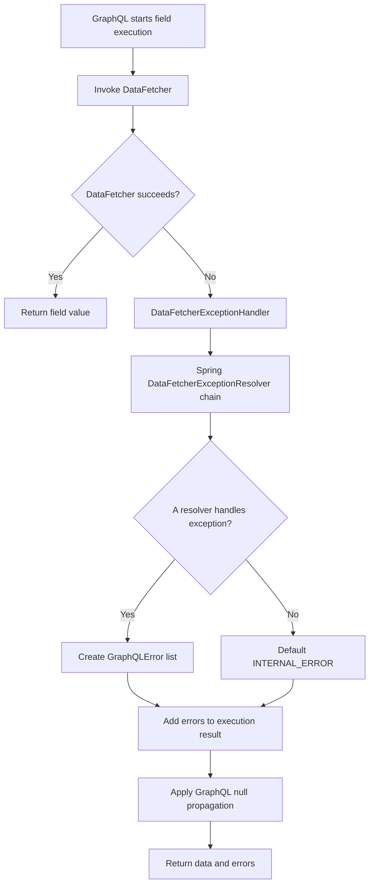

# DataFetchingException

During GraphQL execution, each field is resolved by a DataFetcher. A DataFetcher may read data from a database, call another service, check permissions, or run business logic. Those operations can fail and throw exceptions. Spring for GraphQL provides the **data fetching exception resolution** mechanism to convert exceptions into structured GraphQL errors, helping clients understand which field failed and enabling the application to control what information is returned.

At the center of this mechanism is `DataFetcherExceptionResolver`. A resolver receives the exception along with the `DataFetchingEnvironment` of the failing field, then decides whether to convert the exception into one or more `GraphQLError` instances. Spring for GraphQL provides `DataFetcherExceptionResolverAdapter` to simplify synchronous implementations, supports chaining multiple resolvers in order, and offers standard error categories through `ErrorType`.

This lesson covers the exception lifecycle in data fetching, how to write resolvers, creating errors attached to the exact field path, error classification, handling multiple resolvers, how Spring Boot registers resolvers, and the boundary between data fetching errors and request errors or Subscription errors.

## 1. What is a data fetching exception?

A GraphQL operation can request multiple fields:

```graphql
query {
  bookById(id: "book-1") {
    id
    title
    author {
      id
      name
    }
    reviews {
      rating
    }
  }
}
```

GraphQL invokes a DataFetcher for each field that needs to be resolved. For example:

- `Query.bookById` calls BookService.
- `Book.author` calls AuthorService.
- `Book.reviews` calls ReviewService.

A DataFetcher can encounter various errors:

| Source | Example exception |
| --- | --- |
| Resource not found | `BookNotFoundException` |
| Insufficient permissions | `AccessDeniedException` |
| Invalid input data at business layer | `InvalidBookFilterException` |
| Database or dependent service failure | `DataAccessException`, client exception |
| Unexpected programming error | `NullPointerException`, `IllegalStateException` |

If an exception escapes a DataFetcher, GraphQL Java calls `DataFetcherExceptionHandler` to convert it into a `GraphQLError` in the response. Spring for GraphQL registers a default handler and provides the `DataFetcherExceptionResolver` contract for applications to customize the mapping.

In this lesson, the term *data fetching exception* refers to an exception raised while GraphQL is executing a DataFetcher. It is not the name of a single exception class.

## 2. Exception handling lifecycle

The basic processing flow:



Steps:

1. GraphQL invokes the DataFetcher for the requested field.
2. The DataFetcher returns a value or throws an exception.
3. GraphQL Java forwards the exception to the DataFetcher exception handler.
4. The Spring handler calls each registered `DataFetcherExceptionResolver` in order.
5. A matching resolver constructs a list of GraphQL errors.
6. If no resolver handles it, Spring uses the default `INTERNAL_ERROR` error.
7. GraphQL applies schema nullability and builds the response.

An exception resolver does not decide the entire response on its own. It only provides the error objects for the failing field. The GraphQL engine remains responsible for determining `data`, `errors`, `path`, and null propagation.

## 3. GraphQLError in the response

A response can contain data from successful fields alongside errors from failing fields:

```json
{
  "data": {
    "bookById": {
      "id": "book-1",
      "title": "Spring for GraphQL",
      "author": null
    }
  },
  "errors": [
    {
      "message": "Author not found",
      "path": ["bookById", "author"],
      "extensions": {
        "classification": "NOT_FOUND",
        "code": "AUTHOR_NOT_FOUND"
      }
    }
  ]
}
```

Common properties of `GraphQLError`:

- `message`: a message intended for the client.
- `locations`: the field location in the GraphQL document, if determinable.
- `path`: the path to the failing field, including aliases or list indices if present.
- `extensions`: additional metadata such as error code, classification, or correlation information.

For data fetching errors, `path` is very helpful because the client knows which field failed in a response that may contain many fields. Create errors using `GraphqlErrorBuilder.newError(environment)` so the builder obtains coordinates and path from the right `DataFetchingEnvironment`.

Do not hard-code paths like `["bookById", "author"]`. A query can change aliases, nest fields deeper, or invoke fields inside a list. The environment already holds the exact execution information.

## 4. DataFetcherExceptionResolver

`DataFetcherExceptionResolver` is Spring for GraphQL's contract for handling exceptions from DataFetchers. The interface is located in the package:

```java
org.springframework.graphql.execution.DataFetcherExceptionResolver
```

The primary method has the signature:

```java
Mono<List<GraphQLError>> resolveException(
        Throwable exception,
        DataFetchingEnvironment environment);
```

Parameters:

- `exception`: the exception thrown by the DataFetcher.
- `environment`: the field execution context, including source, arguments, field definition, path, and GraphQL context.

The resolver returns a `Mono<List<GraphQLError>>`. How the Mono completes carries an important meaning:

| Result | Meaning |
| --- | --- |
| Emits a list with errors | Handled the exception and added those errors to the response |
| Emits an empty list | Handled the exception but intentionally added no GraphQL error |
| Completes empty, without emitting a list | Unresolved; allows the next resolver to try |
| Emits an error signal | The resolver itself failed; should not be used to report business errors |

Distinguishing an empty list from an empty Mono:

- `Mono.just(List.of())` means the exception was handled by the resolver, adding no errors to the response.
- `Mono.empty()` means the resolver did not handle the exception; Spring continues down the resolver chain.

If a resolver does not recognize an exception, leave it unresolved. Do not return an empty list just to ignore an error, because the client will see no error and the field may simply remain null in a way that is hard to diagnose.

## 5. DataFetcherExceptionResolverAdapter

In many cases, exception mapping logic is synchronous. `DataFetcherExceptionResolverAdapter` is a convenience class that implements the asynchronous contract and lets you override synchronous methods:

- `resolveToSingleError(Throwable, DataFetchingEnvironment)`: maps one exception to one GraphQL error.
- `resolveToMultipleErrors(Throwable, DataFetchingEnvironment)`: maps one exception to multiple GraphQL errors.

The class belongs to the package:

```java
org.springframework.graphql.execution.DataFetcherExceptionResolverAdapter
```

Example domain exception:

```java
public class BookNotFoundException extends RuntimeException {

    public BookNotFoundException(String id) {
        super("Book not found: " + id);
    }
}
```

Resolver:

```java
@Component
public class BookExceptionResolver extends DataFetcherExceptionResolverAdapter {

    @Override
    protected GraphQLError resolveToSingleError(
            Throwable exception,
            DataFetchingEnvironment environment) {

        if (exception instanceof BookNotFoundException) {
            return GraphqlErrorBuilder.newError(environment)
                    .errorType(ErrorType.NOT_FOUND)
                    .message("Book not found")
                    .build();
        }

        return null;
    }
}
```

In this example:

- If the exception is `BookNotFoundException`, the resolver returns a GraphQL error with classification `NOT_FOUND`.
- `GraphqlErrorBuilder.newError(environment)` binds the error to the currently executing field.
- `message("Book not found")` does not leak the ID or internal details.
- Returning `null` means the resolver does not handle this exception.

There is no need to override `resolveException` in typical cases. The adapter already converts results from the protected methods to the `Mono<List<GraphQLError>>` contract.

## 6. Classifying errors with ErrorType

Spring for GraphQL provides `ErrorType` to classify common errors arising in a DataFetcher:

| ErrorType | Meaning | Example |
| --- | --- | --- |
| `BAD_REQUEST` | DataFetcher cannot or will not accept the data due to a client-side error | Invalid business filter |
| `UNAUTHORIZED` | Missing valid authentication credentials | Invalid token or not logged in |
| `FORBIDDEN` | User is authenticated but not allowed to access | Not allowed to view a book belonging to another tenant |
| `NOT_FOUND` | Data not found or existence should not be disclosed | Book not found |
| `INTERNAL_ERROR` | Unexpected internal error | Unexpected database or code failure |

`ErrorType` implements GraphQL `ErrorClassification`. Clients can read the classification in `extensions` and decide how to display or handle it. Treat classification as part of the API contract, so choose stable and consistent error groups.

Do not use `INTERNAL_ERROR` for every error. For a known business error such as a missing resource, return `NOT_FOUND`. Conversely, do not assign `BAD_REQUEST` to database failures or programming bugs.

## 7. Adding error codes and metadata

`ErrorType` classifies errors at a general level. An application can add its own error code so clients can distinguish cases within the same category:

```java
if (exception instanceof BookNotFoundException) {
    return GraphqlErrorBuilder.newError(environment)
            .errorType(ErrorType.NOT_FOUND)
            .message("Book not found")
            .extensions(Map.of(
                    "code", "BOOK_NOT_FOUND",
                    "resource", "Book"))
            .build();
}
```

Example response:

```json
{
  "errors": [
    {
      "message": "Book not found",
      "path": ["bookById"],
      "extensions": {
        "classification": "NOT_FOUND",
        "code": "BOOK_NOT_FOUND",
        "resource": "Book"
      }
    }
  ]
}
```

Design error codes according to clear conventions:

- Use stable codes that do not depend on Java class names.
- Do not embed dynamic messages into codes.
- Include only metadata that clients actually need.
- Do not put SQL, stack traces, raw exception content, or infrastructure details into extensions.
- Do not put personal data or secrets into messages.

Clients should rely on code/category for machine-readable logic; `message` is primarily for users or client-side logs.

## 8. Handling multiple exception types in one resolver

A single resolver can map multiple domain exceptions:

```java
@Component
public class DomainExceptionResolver extends DataFetcherExceptionResolverAdapter {

    @Override
    protected GraphQLError resolveToSingleError(
            Throwable exception,
            DataFetchingEnvironment environment) {

        if (exception instanceof BookNotFoundException) {
            return GraphqlErrorBuilder.newError(environment)
                    .errorType(ErrorType.NOT_FOUND)
                    .message("Book not found")
                    .extensions(Map.of("code", "BOOK_NOT_FOUND"))
                    .build();
        }

        if (exception instanceof InvalidBookFilterException) {
            return GraphqlErrorBuilder.newError(environment)
                    .errorType(ErrorType.BAD_REQUEST)
                    .message("Book filter is invalid")
                    .extensions(Map.of("code", "INVALID_BOOK_FILTER"))
                    .build();
        }

        if (exception instanceof AccessDeniedException) {
            return GraphqlErrorBuilder.newError(environment)
                    .errorType(ErrorType.FORBIDDEN)
                    .message("You are not allowed to access this book")
                    .extensions(Map.of("code", "BOOK_ACCESS_DENIED"))
                    .build();
        }

        return null;
    }
}
```

This snippet maps only known exceptions. For any other exception, it returns null so the next resolver or the default handler processes it. Do not map every Throwable to a generic business error, as that hides programming bugs.

In a real application, you can split resolvers by bounded context or exception group for maintainability. Avoid creating one giant resolver containing every error across all modules.

## 9. Mapping one exception to multiple GraphQL errors

A single exception can represent multiple data violations. For example, a business validation step might detect multiple validation errors at once. In that case, you can override `resolveToMultipleErrors`:

```java
@Component
public class BookValidationExceptionResolver extends DataFetcherExceptionResolverAdapter {

    @Override
    protected List<GraphQLError> resolveToMultipleErrors(
            Throwable exception,
            DataFetchingEnvironment environment) {

        if (!(exception instanceof BookValidationException validationException)) {
            return null;
        }

        return validationException.violations().stream()
                .map(violation -> GraphqlErrorBuilder.newError(environment)
                        .errorType(ErrorType.BAD_REQUEST)
                        .message(violation.message())
                        .extensions(Map.of(
                                "code", "BOOK_VALIDATION_FAILED",
                                "field", violation.field()))
                        .build())
                .toList();
    }
}
```

All errors are created in the same DataFetcher environment, so they all attach to the currently executing field. If you want to point to a specific input location, put the input field name into `extensions` as shown in the example. Do not confuse the GraphQL response path with the path to a property inside an input object: `path` indicates the path to the currently executing GraphQL field.

## 10. Resolver chain and execution order

Spring for GraphQL allows registering multiple `DataFetcherExceptionResolver` beans. They are called sequentially until one resolver emits a list of GraphQL errors, including an empty list.

For example:

```text
DataFetcher exception
        |
        v
BookNotFoundResolver
        |
        | unresolved
        v
SecurityExceptionResolver
        |
        | unresolved
        v
DatabaseExceptionResolver
        |
        | unresolved
        v
Default INTERNAL_ERROR
```

A resolver should handle only the exception group it understands:

- If it recognizes the exception and wants to return errors: emit a list containing the errors.
- If it recognizes the exception and intentionally returns no errors: emit an empty list, used only when that behavior is deliberate.
- If it does not recognize the exception: return unresolved so the next resolver can try.

Resolver order matters when multiple resolvers can handle the same exception. Place specialized resolvers before general ones. If you need absolute control over ordering, configure the explicit list on the `GraphQlSource` builder.

## 11. Asynchronous resolvers

`DataFetcherExceptionResolver` is a reactive contract. When you need to call another service to decide how to map an error, you can implement it directly and return `Mono<List<GraphQLError>>`:

```java
@Component
public class AsyncExceptionResolver implements DataFetcherExceptionResolver {

    private final ErrorCatalog errorCatalog;

    public AsyncExceptionResolver(ErrorCatalog errorCatalog) {
        this.errorCatalog = errorCatalog;
    }

    @Override
    public Mono<List<GraphQLError>> resolveException(
            Throwable exception,
            DataFetchingEnvironment environment) {

        if (!(exception instanceof ExternalServiceException serviceException)) {
            return Mono.empty();
        }

        return errorCatalog.findPublicMessage(serviceException.code())
                .map(message -> List.of(
                        GraphqlErrorBuilder.newError(environment)
                                .errorType(ErrorType.INTERNAL_ERROR)
                                .message(message)
                                .extensions(Map.of("code", "DEPENDENCY_FAILURE"))
                                .build()));
    }
}
```

If the exception falls outside the resolver's scope, return `Mono.empty()` so the next resolver handles it. If the lookup succeeds and returns an error list, the exception is considered handled.

If an asynchronous lookup can complete empty, define the behavior explicitly. You can use `switchIfEmpty` to produce a fallback error or return an empty list if policy allows ignoring the error. Do not let the resolver complete empty unintentionally, as the exception will then be treated as unresolved.

Do not call `block()` inside a reactive resolver. Blocking threads defeats the purpose of reactive execution and can cause deadlocks or thread exhaustion in WebFlux.

## 12. Registering resolvers in Spring Boot

With the Spring Boot GraphQL starter, beans of type `DataFetcherExceptionResolver` are automatically detected and registered with `GraphQlSource`. Therefore, declaring the resolver as a Spring bean is usually sufficient:

```java
@Component
public class BookExceptionResolver extends DataFetcherExceptionResolverAdapter {
    // Override resolveToSingleError or resolveToMultipleErrors.
}
```

If the application builds `GraphQlSource` manually or does not use Boot auto-configuration, you can register resolvers on the builder:

```java
GraphQlSource.Builder<?> builder = GraphQlSource.schemaResourceBuilder()
        .schemaResources(schemaResources)
        .exceptionResolvers(List.of(
                bookExceptionResolver,
                securityExceptionResolver));

GraphQlSource graphQlSource = builder.build();
```

The `exceptionResolvers(List<DataFetcherExceptionResolver>)` method adds resolvers to be invoked when a DataFetcher throws an exception. The order in the list is the order in which handling is attempted.

Do not register a second `DataFetcherExceptionHandler` just to alter one error type. GraphQL Java accepts only one exception handler per execution strategy; Spring already provides a handler integrated with the resolver chain. Extend via `DataFetcherExceptionResolver` to preserve the default mechanism.

## 13. When to use @GraphQlExceptionHandler?

Spring for GraphQL has two common approaches for handling exceptions:

| Mechanism | Appropriate scope |
| --- | --- |
| `@GraphQlExceptionHandler` | Exceptions raised from annotated controller methods |
| `DataFetcherExceptionResolver` | Exceptions from DataFetchers in general, including manually registered DataFetchers |

Example exception handler for an annotated controller:

```java
@ControllerAdvice
public class BookControllerAdvice {

    @GraphQlExceptionHandler
    public GraphQLError handle(
            BookNotFoundException exception,
            DataFetchingEnvironment environment) {

        return GraphqlErrorBuilder.newError(environment)
                .errorType(ErrorType.NOT_FOUND)
                .message("Book not found")
                .build();
    }
}
```

Spring applies exception handler methods to controller invocations. If an application primarily uses annotated controllers, this approach is often concise and offers flexible method arguments similar to schema mappings.

`DataFetcherExceptionResolver` is suited when you need a shared policy for DataFetchers not based on controller methods, or when configuring the resolver chain at the `GraphQlSource` layer. Choose a clear single owner for each exception group to avoid duplicate or unpredictable mappings.

## 14. Request errors are not data fetching errors

`DataFetcherExceptionResolver` is only invoked when a DataFetcher has executed and thrown an exception. It does not handle errors that occur before GraphQL starts executing fields.

| Stage | Example | Appropriate mechanism |
| --- | --- | --- |
| Parse request | Invalid GraphQL syntax | GraphQL engine / transport interceptor |
| Validate document | Non-existent field or wrong type | GraphQL engine / transport interceptor |
| Input coercion | Variable fails scalar conversion or missing non-null input | GraphQL engine |
| Data fetching | Resolver throws an exception | `DataFetcherExceptionResolver` or `@GraphQlExceptionHandler` |
| Subscription publisher | Publisher emits an error after subscribing | `SubscriptionExceptionResolver` |

Request errors usually have `data: null` and errors without a field path because no field DataFetcher has executed yet. If you want to customize the format of request-level errors, you can use `WebGraphQlInterceptor` to inspect or transform `ExecutionResult`.

For Subscriptions, the DataFetcher initially only creates a `Publisher`. Afterwards, the transport subscribes and the `Publisher` may emit an error signal. `DataFetcherExceptionResolver` cannot handle errors emitted after the DataFetcher has returned the `Publisher`; use `SubscriptionExceptionResolver` for that case.

## 15. Default handling when no resolver claims the exception

If all resolvers return unresolved, Spring for GraphQL classifies the exception as `INTERNAL_ERROR` and returns a generic message containing the execution ID from `DataFetchingEnvironment`.

The default message is kept opaque to avoid exposing implementation details to clients. Unhandled exceptions are logged at the ERROR level along with the execution ID so the server can locate the corresponding log entry. Exceptions handled by a resolver are logged at the DEBUG level.

Example of what a client might receive:

```json
{
  "data": {
    "bookById": null
  },
  "errors": [
    {
      "message": "INTERNAL_ERROR for <execution-id>",
      "path": ["bookById"],
      "extensions": {
        "classification": "INTERNAL_ERROR"
      }
    }
  ]
}
```

The actual message is generated by the Spring for GraphQL version; the example above only illustrates its generic nature. When investigating an error, use the execution ID in the response to correlate with server logs. Do not send stack traces to clients for error reporting.

If an exception can be handled safely and has business meaning, add a specific resolver. If you do not know how to classify it, let the default handler return `INTERNAL_ERROR` and keep details in server-side logs.

## 16. Null propagation and partial responses

When a DataFetcher throws an exception, the field has no successful value and GraphQL treats that field as null along with an error. The final result depends on nullability in the SDL.

Nullable field:

```graphql
type Book {
  author: Author
  title: String!
}
```

If the `author` resolver fails, GraphQL can return `author: null` while still preserving `title`.

Non-null field:

```graphql
type Book {
  author: Author!
  title: String!
}
```

If the `author` resolver fails, null violates the non-null contract. GraphQL bubbles null up to the nearest nullable parent, potentially losing larger portions of the response.

`DataFetcherExceptionResolver` does not automatically choose a fallback object for a field. If you want to return fallback data without emitting a GraphQL error, handle the exception in the service or DataFetcher and deliberately return the fallback value. Do not return an empty error list in a resolver as a way to provide fallback data; the field still has no result.

## 17. Security when creating GraphQL errors

The original exception may contain data that should not be made public:

- SQL statements or table names.
- Internal URLs and service connection details.
- Tokens, credentials, or headers.
- File paths on the server.
- Stack traces and internal class names.
- Personal data or information belonging to another tenant.

When constructing a GraphQL error:

- Write short, stable, client-appropriate messages.
- Use error codes for client-side logic handling.
- Add only truly necessary metadata to extensions.
- Log detailed exceptions on the server with controlled access.
- Do not echo `exception.getMessage()` directly if the message could contain internal details.
- For authorization errors, consider returning `NOT_FOUND` if policy requires not disclosing whether a resource exists.

Do not let clients distinguish between an existing forbidden resource and a non-existent one if doing so leaks sensitive information. Error classification is an API security policy decision, not merely renaming an exception.

## 18. Testing DataFetcherExceptionResolver

Test through a GraphQL operation to verify that exceptions from resolvers are converted into errors with the right path and classification.

Example resolver:

```java
@QueryMapping
public Book bookById(@Argument String id) {
    return bookService.findById(id);
}
```

Test:

```java
@GraphQlTest(BookQueryController.class)
@Import(BookExceptionResolver.class)
class BookDataFetchingExceptionTests {

    @Autowired
    GraphQlTester graphQlTester;

    @MockBean
    BookService bookService;

    @Test
    void mapsBookNotFoundToNotFoundGraphQlError() {
        given(bookService.findById("missing"))
                .willThrow(new BookNotFoundException("missing"));

        graphQlTester.document("""
                query {
                    bookById(id: "missing") {
                        id
                        title
                    }
                }
                """)
                .execute()
                .errors()
                .satisfy(errors -> {
                    assertThat(errors).hasSize(1);
                    assertThat(errors.get(0).getPath())
                            .isEqualTo("bookById");
                    assertThat(errors.get(0).getExtensions())
                            .containsEntry("classification", "NOT_FOUND");
                });
    }
}
```

The example explicitly imports `BookExceptionResolver` into the test slice to ensure the resolver is registered in the test's GraphQL source. Depending on your Spring Boot version, `@MockitoBean` may be used instead of `@MockBean`.

Tests should also verify that data from independent fields can still be returned when another field fails, if the schema permits partial responses.

### Scenarios to test

- Domain exceptions map to the expected `ErrorType` and code.
- Exceptions outside the resolver's scope are left unresolved.
- The resolver chain advances to the next resolver upon receiving `Mono.empty()`.
- A resolver emitting an empty list is treated as having handled the exception.
- Error paths are accurate when fields have aliases or appear inside lists.
- Nullable and non-null fields apply null propagation correctly.
- Messages and extensions do not contain stack traces, SQL, or secrets.
- Failures from async DataFetchers are mapped properly.
- Request parse/validation errors do not go through `DataFetcherExceptionResolver`.
- Subscription publisher errors are handled by the dedicated subscription mechanism.

## 19. Common pitfalls

| Symptom | Cause | Solution |
| --- | --- | --- |
| Resolver is not invoked | Bean not detected or not registered with GraphQlSource | Check component scan, Boot starter, or builder |
| Exception still becomes INTERNAL_ERROR | Resolver returned unresolved or did not match the exception type | Check the actual exception and mapping logic |
| Next resolver is not called | Previous resolver emitted an empty list | Emit an empty list only when intentionally handling the exception |
| Incorrect error path | Hard-coded path | Use `GraphqlErrorBuilder.newError(environment)` |
| Client sees SQL or stack trace | Returning exception message directly | Build a public message and log details server-side |
| Entire parent object lost | Failing field is declared non-null | Review schema nullability |
| Resolver does not handle parse errors | Error occurred before DataFetcher execution | Use a request/transport interceptor if needed |
| Resolver does not handle Subscription stream errors | Publisher emitted error after DataFetcher returned | Use `SubscriptionExceptionResolver` |
| Field is null with no error | Resolver emitted an empty list or code swallowed the exception | Verify handling policy and suppress errors only intentionally |
| Error lacks a stable error code | Relying solely on message or exception class | Standardize codes in extensions |

## 20. Design principles for DataFetchingException

- Treat data fetching exceptions as exceptions raised during DataFetcher execution, not a single specific exception class.
- Use `DataFetcherExceptionResolver` to map exceptions at the DataFetcher layer.
- Use `DataFetcherExceptionResolverAdapter` when mapping logic is synchronous.
- Return unresolved when a resolver does not recognize an exception.
- Distinguish `Mono.empty()` from `Mono.just(List.of())`.
- Use `GraphqlErrorBuilder.newError(environment)` to preserve accurate field coordinates and path.
- Choose an `ErrorType` that reflects the true nature of the error.
- Add stable error codes to extensions when clients need automated handling.
- Never return raw exception messages, SQL, or stack traces directly to clients.
- Order specialized resolvers before general ones.
- Use `@GraphQlExceptionHandler` for annotated controller invocations when appropriate.
- Use `WebGraphQlInterceptor` for request-level errors and `SubscriptionExceptionResolver` for Subscription publisher errors.
- Design nullability so that a single field failure does not discard more data than necessary.
- Test error paths, classification, resolver chains, partial responses, and security.

## 21. Practice exercise

Build a library GraphQL API with domain errors:

1. Declare Query.bookById and Book.author in the SDL.
2. Create `BookNotFoundException`, `BookAccessDeniedException`, and `InvalidBookFilterException`.
3. Write a `DataFetcherExceptionResolverAdapter` mapping these exceptions to `NOT_FOUND`, `FORBIDDEN`, and `BAD_REQUEST`.
4. Create distinct error codes in extensions for each case.
5. Use `GraphqlErrorBuilder.newError(environment)` to preserve the exact field path.
6. Add another resolver that handles only search service exceptions; verify the resolver chain order.
7. Try returning `null` from a resolver and distinguish it from throwing an exception.
8. Change a field from nullable to non-null and observe null propagation.
9. Write `GraphQlTester` tests verifying error path, classification, and code.
10. Trigger a GraphQL syntax error and confirm it is not handled by DataFetcherExceptionResolver.
11. Explain how to handle errors from a Subscription publisher.

After this exercise, you should understand how exceptions travel from a DataFetcher to a GraphQL response, know how to select the right resolver, and create a stable error contract for clients.

## 22. References

- [Spring for GraphQL — Request Execution: Exceptions](https://docs.spring.io/spring-graphql/reference/request-execution.html)
- [Spring for GraphQL — DataFetcherExceptionResolver API](https://docs.spring.io/spring-graphql/docs/1.4.x/api/org/springframework/graphql/execution/DataFetcherExceptionResolver.html)
- [Spring for GraphQL — DataFetcherExceptionResolverAdapter API](https://docs.spring.io/spring-graphql/docs/1.4.x/api/org/springframework/graphql/execution/DataFetcherExceptionResolverAdapter.html)
- [Spring for GraphQL — ErrorType API](https://docs.spring.io/spring-graphql/docs/1.4.x/api/org/springframework/graphql/execution/ErrorType.html)
- [Spring for GraphQL — GraphQlSource.Builder API](https://docs.spring.io/spring-graphql/docs/1.4.x/api/org/springframework/graphql/execution/GraphQlSource.Builder.html)

Details of the resolver contract, error classification, and auto-configuration may vary across Spring for GraphQL versions. When upgrading dependencies, verify the reference documentation and Javadoc matching the version managed by Spring Boot.
