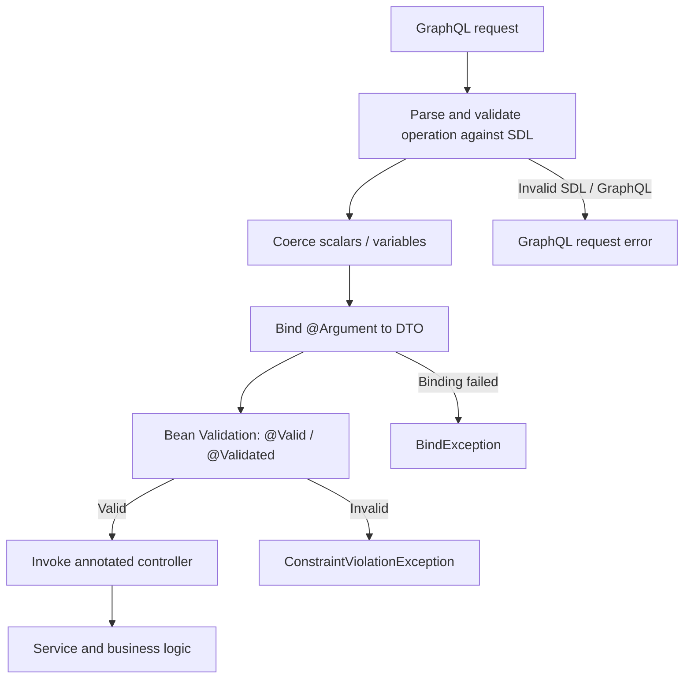

# Bean Validation in Annotated Controllers

A GraphQL schema checks the structure and types of input data, but it cannot express all business rules. For example, `title: String!` only requires a non-`null` string; it still allows an empty string or a string containing only whitespace. **Bean Validation** adds constraints such as `@NotBlank`, `@Size`, `@Email`, `@Positive`, and custom rules for the input received by a controller.

Spring for GraphQL integrates Bean Validation with annotated controllers. When the application has a Bean Validation `Validator`, `AnnotatedControllerConfigurer` can validate method parameters before invoking the handler. For an input object, mark the parameter with `@Valid`; if validation groups are needed, use Spring's `@Validated`.

## At which step does validation happen?

A GraphQL input typically goes through the following steps:

1. GraphQL parses the operation and validates the operation against the SDL.
2. GraphQL coerces variables and scalar inputs according to the declared types.
3. Spring for GraphQL binds the argument to a Java parameter, such as converting an input object into a DTO.
4. Bean Validation checks the constraints on parameters or object graphs marked for validation.
5. Only when the above steps succeed is the controller method invoked and the data passed to the service.



Three groups of errors need to be distinguished:

| Error group | Example | Where is it handled? |
| --- | --- | --- |
| GraphQL schema/coercion | Missing `String!` argument, passing a string into `Int`. | Detected by the GraphQL engine before invoking the controller. |
| Argument binding | Unable to convert the argument structure to a DTO or unable to bind a property. | Spring argument binder; may raise `BindException`. |
| Bean Validation | Empty string, malformed email, negative quantity. | Checked by the Validator before invoking the handler; errors are converted into `ConstraintViolationException`. |

Bean Validation does not replace SDL. SDL defines the API shape and data types; Bean Validation defines additional constraints on the bound data.

## Adding the dependency and configuring the Validator

With Spring Boot, add the validation starter alongside the GraphQL starter:

```kotlin
dependencies {
    implementation("org.springframework.boot:spring-boot-starter-graphql")
    implementation("org.springframework.boot:spring-boot-starter-validation")
}
```

Or with Maven:

```xml
<dependency>
    <groupId>org.springframework.boot</groupId>
    <artifactId>spring-boot-starter-graphql</artifactId>
</dependency>
<dependency>
    <groupId>org.springframework.boot</groupId>
    <artifactId>spring-boot-starter-validation</artifactId>
</dependency>
```

`spring-boot-starter-validation` brings the Bean Validation API and a compatible implementation into the application. With Spring Boot 3 and above, use the `jakarta.validation.*` namespace; older Spring Boot 2 projects use `javax.validation.*`. Do not mix the two namespaces in the same model.

Spring Boot usually auto-configures a validator bean, commonly `LocalValidatorFactoryBean`. Spring for GraphQL's `AnnotatedControllerConfigurer` detects the validator in the application context and enables validation support for annotated controllers. If the application configures the validator manually, ensure that the bean is registered in the Spring context:

```java
import org.springframework.validation.beanvalidation.LocalValidatorFactoryBean;

@Configuration
public class ValidationConfiguration {

    @Bean
    LocalValidatorFactoryBean validator() {
        return new LocalValidatorFactoryBean();
    }
}
```

Manual bean declaration is only necessary when the application lacks corresponding auto-configuration or needs to customize the validator. Avoid unintentionally registering multiple validator beans because that can make validation configuration unpredictable.

## Declaring constraints on an input DTO

Suppose the API allows creating a book:

```graphql
input CreateBookInput {
  title: String!
  isbn: String!
  authorId: ID!
}

type Mutation {
  createBook(input: CreateBookInput!): Book!
}
```

The SDL guarantees that `input`, `title`, `isbn`, and `authorId` are neither omitted nor `null` at the Non-Null positions. However, the schema still allows `title` to be `""` and does not know whether the ISBN matches the business format.

The Java DTO can declare constraints:

```java
import jakarta.validation.constraints.NotBlank;
import jakarta.validation.constraints.Pattern;
import jakarta.validation.constraints.Size;

public record CreateBookInput(
        @NotBlank(message = "Title must not be blank")
        @Size(max = 200, message = "Title must be at most 200 characters")
        String title,

        @NotBlank(message = "ISBN must not be blank")
        @Pattern(
                regexp = "^[0-9Xx-]{10,17}$",
                message = "ISBN format is invalid")
        String isbn,

        @NotBlank(message = "Author must be selected")
        String authorId) {
}
```

`ID` is received as a string in the DTO to keep the identifier as an opaque value. The service will convert or look up the ID according to the application's persistence model. `@NotBlank` only checks that the string has content; the service still needs to verify that the author exists and that the user has permission to reference that author.

Common constraints:

| Constraint | Purpose |
| --- | --- |
| `@NotNull` | Value must not be null. |
| `@NotBlank` | String must not be null, empty, or whitespace-only. |
| `@NotEmpty` | String, collection, or map must not be null and must not be empty. |
| `@Size(min, max)` | Limits string length or collection/map element count. |
| `@Email` | Checks basic email format. |
| `@Pattern` | Validates a string against a regular expression. |
| `@Positive`, `@PositiveOrZero` | Constrains a number to be positive or non-negative. |
| `@Min`, `@Max` | Limits integer values. |
| `@DecimalMin`, `@DecimalMax` | Limits decimal values. |

Do not use `@NotNull` as a replacement for `@NotBlank`: an empty string is still non-null. Similarly, `@Email` does not prove that the email address actually exists or belongs to the user.

## Enabling validation with `@Valid`

In an annotated controller, place `@Valid` on the parameter receiving the input object:

```java
import jakarta.validation.Valid;
import org.springframework.graphql.data.method.annotation.Argument;
import org.springframework.graphql.data.method.annotation.MutationMapping;
import org.springframework.stereotype.Controller;

@Controller
public class BookMutationController {

    private final BookService bookService;

    public BookMutationController(BookService bookService) {
        this.bookService = bookService;
    }

    @MutationMapping
    public Book createBook(
            @Argument("input") @Valid CreateBookInput input) {
        return bookService.create(input);
    }
}
```

When the client sends the `createBook` mutation, Spring binds the `input` argument to `CreateBookInput`, then runs Bean Validation before calling `createBook`. If any constraint is violated, the controller is not invoked and the exception is routed into the GraphQL error handling mechanism.

`@Valid` is the standard Jakarta Bean Validation annotation. It triggers validation of the object and cascades to nested properties that are also marked with `@Valid`. Simply declaring constraints on the DTO without activating validation on the controller parameter is not enough to ensure those constraints run at the GraphQL boundary.

Validation is not only for Mutations. It can be used with `@Argument` parameters of Queries or `@SchemaMapping` when the input has constraints. However, data read from the client and data written into the system often have different validation policies.

Validation in annotated controllers focuses on method parameters before the handler is called. Do not assume Spring automatically runs Bean Validation on the object returned by a resolver; if output data needs to be checked, call the validator or verify invariants explicitly in the service/domain layer.

## Validation for nested objects and collections

Bean Validation only descends into child objects when that property is marked with `@Valid`. For example, an input with an address and a list of contacts:

```java
import jakarta.validation.Valid;
import jakarta.validation.constraints.NotBlank;
import jakarta.validation.constraints.NotNull;
import jakarta.validation.constraints.Size;
import java.util.List;

public record AddressInput(
        @NotBlank String street,
        @NotBlank String city,
        @NotBlank String postalCode) {
}

public record ContactInput(
        @NotBlank String type,
        @NotBlank String value) {
}

public record PublisherInput(
        @NotBlank String name,
        @NotNull @Valid AddressInput address,
        @Size(max = 5) List<@NotNull @Valid ContactInput> contacts) {
}
```

In this example:

- `@Valid AddressInput` activates validation for the constraints inside the address.
- `@Size(max = 5)` limits the number of contacts.
- `@NotNull` on the collection element disallows null elements.
- `@Valid` on the collection element activates validation for each `ContactInput`.

The same approach can be applied to multi-level nested inputs. Design the SDL and DTOs consistently so that GraphQL can bind the data before the validator checks it.

## Using `@Validated` and validation groups

There are cases where the same DTO is used for both creation and update, but with different rules. For example, when creating a book, `id` must not be provided; when updating, `id` is required.

Bean Validation supports validation groups. You can define groups and have them extend `Default` so that constraints without an explicit group still run:

```java
import jakarta.validation.constraints.NotBlank;
import jakarta.validation.constraints.NotNull;
import jakarta.validation.constraints.Null;
import jakarta.validation.groups.Default;

public interface Create extends Default {
}

public interface Update extends Default {
}

public record SaveBookInput(
        @Null(groups = Create.class)
        @NotNull(groups = Update.class)
        String id,

        @NotBlank
        String title) {
}
```

The corresponding SDL can declare `id` as nullable to distinguish create and update operations:

```graphql
input SaveBookInput {
  id: ID
  title: String!
}
```

Use Spring's `@Validated` to select the group for each handler:

```java
import org.springframework.validation.annotation.Validated;

@MutationMapping
public Book createBook(
        @Argument("input") @Validated(Create.class) SaveBookInput input) {
    return bookService.create(input);
}

@MutationMapping
public Book updateBook(
        @Argument("input") @Validated(Update.class) SaveBookInput input) {
    return bookService.update(input);
}
```

`@Validated` allows specifying validation groups; `@Valid` uses the default group. Having `Create` and `Update` extend `Default` ensures the `@NotBlank` constraint on `title` is still applied alongside the selected group.

Do not create too many groups just to describe every small case. If the create and update inputs differ significantly, two separate DTOs can be easier to understand and safer than one DTO with many groups.

## Multi-field level constraints

Some rules depend on multiple properties, such as `startDate` must be before `endDate`, or exactly one of `email` and `phone` must be provided. You can use a class-level constraint with a custom `ConstraintValidator` to validate the entire DTO.

Conceptual example:

```java
@ValidDateRange
public record BookingInput(
        @NotNull LocalDate startDate,
        @NotNull LocalDate endDate) {
}
```

`@ValidDateRange` is a custom constraint defined by the application. Its validator receives the entire `BookingInput`, checks `startDate` and `endDate`, and returns whether it is valid or invalid. When reporting an error, attach the violation to the appropriate field if possible so the client knows which data to fix.

Do not cram every business rule into regular expressions or complex custom validators. Rules that require database queries, permission checks, or depend on current state belong in the service/domain layer.

## Handling validation errors as GraphQL errors

When Bean Validation fails, Spring for GraphQL raises `ConstraintViolationException`. For argument binding errors, `GraphQlArgumentBinder` may raise `BindException`. You can use `@GraphQlExceptionHandler` in a controller or `@ControllerAdvice` to convert them into structured GraphQL errors.

Example global exception handler:

```java
import graphql.GraphQLError;
import graphql.GraphqlErrorBuilder;
import java.util.List;
import java.util.Map;
import jakarta.validation.ConstraintViolationException;
import org.springframework.graphql.data.method.annotation.GraphQlExceptionHandler;
import org.springframework.graphql.execution.ErrorType;
import org.springframework.validation.BindException;
import org.springframework.web.bind.annotation.ControllerAdvice;

@ControllerAdvice
public class GraphQlValidationExceptionHandler {

    @GraphQlExceptionHandler
    public GraphQLError handleValidation(
            GraphqlErrorBuilder<?> errorBuilder,
            ConstraintViolationException ex) {

        List<Map<String, String>> violations = ex.getConstraintViolations()
                .stream()
                .map(violation -> Map.of(
                        "field", violation.getPropertyPath().toString(),
                        "message", violation.getMessage()))
                .toList();

        return errorBuilder
                .errorType(ErrorType.BAD_REQUEST)
                .message("Invalid input data")
                .extensions(Map.of(
                        "code", "VALIDATION_ERROR",
                        "violations", violations))
                .build();
    }

    @GraphQlExceptionHandler
    public GraphQLError handleBinding(
            GraphqlErrorBuilder<?> errorBuilder,
            BindException ex) {

        List<Map<String, String>> violations = ex.getFieldErrors()
                .stream()
                .map(error -> Map.of(
                        "field", error.getField(),
                        "message", error.getDefaultMessage() == null
                                ? "Invalid value"
                                : error.getDefaultMessage()))
                .toList();

        return errorBuilder
                .errorType(ErrorType.BAD_REQUEST)
                .message("Unable to read input data")
                .extensions(Map.of(
                        "code", "ARGUMENT_BINDING_ERROR",
                        "violations", violations))
                .build();
    }
}
```

`GraphqlErrorBuilder` is prepared by Spring with information about the field being executed. `ErrorType.BAD_REQUEST` and `extensions.code` help the client classify the error. `violations` provides the field path and a concise message for the UI to display.

In production, only expose messages designed for API consumers. Do not return invalid input values, stack traces, internal class names, or database details. If a property path contains inappropriate implementation details, map it to the public GraphQL field name.

For validation errors belonging to a single controller only, you can place `@GraphQlExceptionHandler` directly inside that controller. Place it in `@ControllerAdvice` when you want to apply a common policy across multiple controllers.

`@GraphQlExceptionHandler` handles exceptions raised from annotated controller invocations. If the application registers DataFetchers manually via GraphQL Java or `RuntimeWiringConfigurer`, use an appropriate `DataFetcherExceptionResolver` to handle exceptions from those DataFetchers.

## Example response when validation fails

Suppose the client sends a `title` containing only whitespace. The resolver does not run; GraphQL returns an error according to the structure defined by the exception handler:

```json
{
  "errors": [
    {
      "message": "Invalid input data",
      "extensions": {
        "classification": "BAD_REQUEST",
        "code": "VALIDATION_ERROR",
        "violations": [
          {
            "field": "createBook.input.title",
            "message": "Title must not be blank"
          }
        ]
      }
    }
  ],
  "data": {
    "createBook": null
  }
}
```

This is an illustrative response example. The actual path in `ConstraintViolation` depends on the method signature, parameter names, and framework version. Clients should rely on `extensions.code` and the normalized violation list rather than hardcoding a dependency on the full internal property path string.

## Distinguishing validation errors from business errors

Bean Validation is suitable for rules that can be checked directly on the input data:

- Required strings, length, email format, or identifier format.
- Quantities that must be positive or within a range.
- Non-empty lists that do not exceed the allowed number of elements.
- Fields that have logical relationships with each other within the same input object.

The service/domain layer is suitable for rules that require understanding system state:

- Whether an ISBN or email already exists in the database.
- Whether the author actually exists and is active.
- Whether the user has permission to create a book in the current tenant.
- Whether the current order status allows transitioning to the next step.
- Whether the quota is sufficient to perform the operation.

You can create custom constraints to check certain data via a service, but avoid turning validators into a place that runs database queries for every field. That easily creates excessive queries, depends on transactions, and makes testing harder. Critical invariants still need to be enforced in the domain/service and database.

## Validation does not replace authorization

Validation answers whether the data has the right format and satisfies the conditions. Authorization answers whether the caller is allowed to perform the operation on that resource.

For example, an `authorId` having a valid format and existing does not prove that the user has permission to assign that author to the book. The controller or service needs to check the principal, tenant, and resource scope. Do not put access control into `@Pattern`, `@Positive`, or format constraints.

## Testing Bean Validation with `GraphQlTester`

Tests need to verify both the error response and that the controller/service is not called when the input is invalid. For example:

```java
@Test
void rejectsBlankTitleBeforeCallingService() {
    graphQlTester.document("""
        mutation {
          createBook(input: {
            title: "   "
            isbn: "9780132350884"
            authorId: "42"
          }) {
            id
          }
        }
        """)
        .execute()
        .errors()
        .satisfy(errors -> {
            assertThat(errors).anySatisfy(error ->
                    assertThat(error.getMessage())
                            .contains("Invalid input data"));
        });

    verifyNoInteractions(bookService);
}
```

The test assumes the exception handler returns the message as in the example and the service is a mock. If the GraphQL field returns Non-Null, the error may cause the parent field or root data to become null according to null propagation rules; therefore, tests should focus on the error code/message and verifying that the service is not invoked.

Cases that should be tested:

- Empty strings and whitespace-only strings.
- Values exceeding `@Size` or `@Max` limits.
- Invalid patterns and nested objects violating constraints.
- Collections with null elements or invalid child elements.
- Validation groups for create and update.
- Argument binding failures distinguished from constraint violations.
- SDL rejecting mistyped inputs before the controller runs.
- Responses not leaking sensitive values or internal information.
- Service not being invoked when validation fails.

You can test the validator individually using `jakarta.validation.Validator` for each DTO, but you still need at least one GraphQL integration test to verify that `@Valid` is triggered by the annotated controller.

## Common errors

| Symptom | Cause | How to fix |
| --- | --- | --- |
| Constraints declared but do not run | Missing validator bean or controller parameter is not marked `@Valid`/`@Validated`. | Add the validation starter, check the Validator bean and the annotation on the method parameter. |
| `@NotBlank` does not reject empty strings | Only `@NotNull` was used, or validation was not enabled. | Use `@NotBlank` and check `@Valid`. |
| Constraints in child object do not run | Nested property does not have `@Valid`. | Mark cascade validation on the field or collection element. |
| Binding error confused with validation error | Argument binder fails to create the DTO before the validator runs. | Handle `BindException` separately from `ConstraintViolationException`. |
| Validation group skips default constraints | Selected group does not include `Default`. | Have the group extend `Default` or assign the constraints to the corresponding group. |
| Client receives stack trace or internal data | Exception handler returns the raw exception message. | Normalize the message and only expose necessary field paths and error codes. |
| Validation succeeds but mutation still fails | Rule requires database or business state. | Check in the service/domain layer and database. |
| Mixing up `javax.validation` with `jakarta.validation` | Dependency namespace is incompatible with the current Spring Boot version. | Spring Boot 3+ uses `jakarta.validation`; older projects use the corresponding namespace. |

## Key takeaways

Bean Validation adds simple business constraints onto data that GraphQL has already type-checked and Spring has bound into DTOs. In annotated controllers, add a validator bean and mark input parameters with `@Valid`; use `@Validated` when validation groups are needed. `@Valid` also needs to be placed on child objects or collection elements to cascade validation.

Failed validation produces `ConstraintViolationException`; argument binding errors may produce `BindException`. Use `@GraphQlExceptionHandler` or `@ControllerAdvice` to convert them into GraphQL errors with clear error codes and violation lists. SDL remains responsible for structural/coercion checks; the service/domain layer remains responsible for business rules requiring system state and authorization.

## References

- [Spring for GraphQL — Annotated Controllers: Validation](https://docs.spring.io/spring-graphql/reference/controllers.html#controllers.validation)
- [Spring for GraphQL — Exception Handling](https://docs.spring.io/spring-graphql/reference/controllers.html#controllers.exceptions)
- [Spring Boot — Validation](https://docs.spring.io/spring-boot/reference/io/validation.html)
- [Jakarta Bean Validation](https://jakarta.ee/specifications/bean-validation/)
