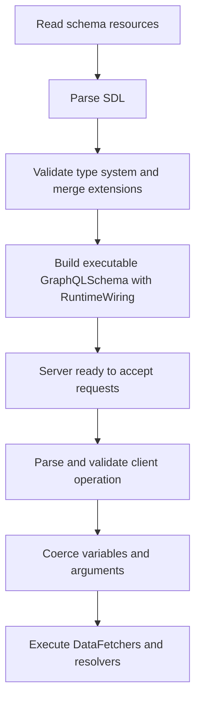

# GraphQL Schema Validation

A GraphQL schema is the type-system contract describing the types, fields, arguments, inputs, directives, and operations that the server supports. Before a GraphQL server can process requests, the SDL schema must be parsed and validated. A schema can be syntactically valid yet still invalid at the type-system level—for example, an argument using an output object type, an object failing to implement all fields of an interface, or a union containing a scalar.

In Spring for GraphQL, Spring Boot loads SDL files, and GraphQL Java parses and builds the executable schema together with runtime wiring. If the schema is invalid, the application typically fails immediately at startup. Once the schema is built, each GraphQL operation from a client undergoes a separate validation step to check whether the document conforms to the schema. These two phases serve different purposes and need to be tested separately.

After this lesson, you will be able to:

- Distinguish SDL parsing, schema validation, operation validation, and input coercion.
- Understand validity rules for root types, objects, scalars, enums, interfaces, unions, and input objects.
- Identify errors caused by type references, fields, arguments, directives, and type extensions.
- Understand how Spring for GraphQL / GraphQL Java detects errors when building the schema.
- Verify the schema via the application context, introspection, and GraphQlTester.
- Organize schema checks in CI to catch errors before deployment.

## 1. What is schema validation?

Schema validation is the step that checks whether a GraphQL schema obeys the rules of the GraphQL type system. The schema defines what the server can return and accept; validation ensures those definitions are consistent and can be executed by the GraphQL engine.

Valid schema example:

```graphql
type Query {
    book(id: ID!): Book
}

type Book {
    id: ID!
    title: String!
}
```

Type-system error example:

```graphql
type Query {
    createBook(input: Book!): Book
}

type Book {
    id: ID!
    title: String!
}
```

`Book` is an output object type. The `input` argument requires an input type, such as a scalar, enum, or input object. The SDL above can be parsed syntactically, yet cannot form a valid schema.

Schema validation catches structural and type errors before the server serves requests, preventing clients from being the first to discover an unexecutable schema.

## 2. Four stages to distinguish

In a Spring for GraphQL application, four stages can be distinguished:



| Stage | What does it check? | Error example |
| --- | --- | --- |
| SDL parsing | Syntax of schema files | Missing `}`, invalid syntax declaration |
| Schema/type-system validation | Consistency of types and definitions | Argument uses `Book` instead of `BookInput` |
| Operation validation | Whether client query/mutation is valid against built schema | Client queries non-existent field `titel` |
| Input coercion | Whether variables and arguments convert to declared types | Sending a string into an `Int!` argument |

Schema validation happens when the server builds the schema. Operation validation and input coercion happen per request. A valid schema does not guarantee every client query is valid; conversely, a syntactically valid query still cannot run if the server's schema is invalid.

## 3. Root operation types

An executable schema must have a query root type that is an object type. By convention, if no explicit `schema` definition is declared, GraphQL uses the name `Query` as the query root type.

```graphql
type Query {
    health: String!
}
```

Root type names can be declared explicitly:

```graphql
schema {
    query: RootQuery
    mutation: RootMutation
}

type RootQuery {
    health: String!
}

type RootMutation {
    resetCache: Boolean!
}
```

Mutation and subscription root types are optional. If declared, they must also be valid object types. Interfaces, unions, scalars, or input objects cannot be used as root operation types.

Common errors:

- Missing query root type.
- `schema { query: Query }` without defining an object type `Query`.
- Root type declared as a scalar or interface.
- Declaring a root operation type pointing to a non-existent type name.

## 4. Type names, field names, and reserved names

Type and field names must follow GraphQL naming rules. Within the same type, there cannot be two fields with the same name; within the same input object, there cannot be two duplicate input field names. Type definitions cannot collide by name in the combined schema.

Names starting with `__` are reserved for the introspection system. Applications should not declare custom types, fields, arguments, or enum values starting with two underscores.

Invalid example:

```graphql
type Book {
    id: ID!
    title: String!
    title: String
    __internalCode: String
}
```

Here `title` is declared twice and `__internalCode` uses a reserved prefix. Choose distinct field names without duplicates and without using the introspection namespace.

## 5. Output types and input types

GraphQL divides types by how they are used:

- **Output types** can appear in a field's return position: scalars, enums, objects, interfaces, and unions.
- **Input types** can appear in arguments or input object fields: scalars, enums, and input objects.

Objects, interfaces, and unions are output types; they cannot be used directly as arguments or input fields. Conversely, input objects cannot be used as field return types.

Valid example:

```graphql
input CreateBookInput {
    title: String!
    authorId: ID!
}

type Book {
    id: ID!
    title: String!
}

type Mutation {
    createBook(input: CreateBookInput!): Book!
}
```

Invalid example:

```graphql
type Query {
    findBook(filter: Book): Book
}
```

`Book` is an output object type, so it cannot be used as the `filter` argument. Declare `BookFilterInput` when passing search criteria.

## 6. Rules for object types and fields

An object type must have at least one field. Each field has an output type as its return type and can have arguments with valid input types.

```graphql
type Book {
    id: ID!
    title: String!
    publishedYear: Int
    author: Author
}
```

In this example:

- `id` and `title` are non-null output fields.
- `publishedYear` is a nullable scalar field.
- `author` is a nullable object field.

Invalid example using an input type as output:

```graphql
input BookInput {
    title: String!
}

type Query {
    book: BookInput
}
```

`BookInput` may only be used in input positions. Create an output object type `Book` to return data.

Fields can return list or non-null wrappers:

```graphql
type Query {
    books: [Book!]!
}
```

The `[]` and `!` wrappers do not change the underlying type category: the inner element must still be an output type. Similarly, argument lists must contain input types.

## 7. Rules for input objects

Input objects contain fields used to accept data from clients:

```graphql
input CreateBookInput {
    title: String!
    authorId: ID!
    publishedYear: Int
}
```

An input object must have at least one field. Fields inside it may only use input types; they must not reference output objects, interfaces, or unions.

Another error is a reference cycle consisting solely of single non-null fields, making it impossible to construct any finite input value. For example:

```graphql
input CategoryInput {
    parent: CategoryInput!
}
```

This definition has no way to terminate the `parent` chain because every node requires another parent node. You can break the mandatory cycle with nullable or list types:

```graphql
input CategoryInput {
    parent: CategoryInput
}
```

Or:

```graphql
input CategoryInput {
    children: [CategoryInput!]!
}
```

Reference cycles on output objects are usually valid, such as `Book.author` and `Author.books`; the special rule above applies to chains of non-null singular input fields, not every cyclic relationship in the schema.

## 8. Scalars and enums

GraphQL has standard scalars `Int`, `Float`, `String`, `Boolean`, and `ID`. Scalars are used for both input and output. If a custom scalar is declared, the schema needs a corresponding runtime implementation to parse input and serialize output.

```graphql
scalar DateTime

type Book {
    createdAt: DateTime!
}

input CreateBookInput {
    publishedAt: DateTime
}
```

In Spring for GraphQL, custom scalars are typically registered via runtime wiring using `RuntimeWiringConfigurer` or the corresponding scalar configuration mechanism. Declaring `scalar DateTime` in SDL only creates the scalar name; it does not automatically define how to convert Java `Instant` to an ISO-8601 string.

An enum must have at least one enum value, and values within the same enum must have unique names:

```graphql
enum BookStatus {
    DRAFT
    PUBLISHED
    ARCHIVED
}
```

Enum values can be used as input or output. Do not use enum values starting with `__`.

## 9. Interfaces must be fully implemented by objects

An interface defines shared fields that implementing object types must provide:

```graphql
interface Node {
    id: ID!
}

type Book implements Node {
    id: ID!
    title: String!
}

type Author implements Node {
    id: ID!
    name: String!
}
```

`Book` and `Author` must have an `id` field with a return type compatible with the interface. If the interface has arguments, the object must provide the required arguments with matching types. An object may add its own optional arguments, but must not make the implemented field less compatible.

Invalid example:

```graphql
interface Node {
    id: ID!
}

type Book implements Node {
    id: String!
    title: String!
}
```

`String!` is not a valid return type to implement `id: ID!`. Keep the exact type or use a more specific return type allowed by GraphQL's covariance rules.

When an object type implements an interface, the schema must declare `implements Node`. Having a Java class with an `id()` method does not automatically create the interface relationship in the GraphQL schema.

## 10. Unions contain only object types

A union represents one of several object types that may appear at a given position:

```graphql
union SearchResult = Book | Author
```

Union members must be object types. Do not include scalars, enums, input objects, or interfaces in the member list.

Invalid example:

```graphql
union SearchResult = Book | String
```

`String` is a scalar and therefore cannot be a union member. Create an object wrapper if you need to represent a string result alongside other object types.

A union needs at least one member and members must be distinct. If the schema extends a union using `extend union`, the added members must also be valid object types and must not duplicate existing members.

## 11. Arguments, default values, and input coercion

Field arguments must use input types. Argument names within the same field must be unique. Default values must be compatible with the declared type and must be constant values in SDL; GraphQL variables cannot be used as defaults in schema definitions.

```graphql
type Query {
    books(limit: Int = 20, status: BookStatus): [Book!]!
}
```

`limit` is a nullable `Int` with a default of `20`. If the client omits the argument, GraphQL uses the default. If the client sends null, the default does not replace null because the argument allows null.

This is a valid operation example:

```graphql
query Books($limit: Int = 10) {
    books(limit: $limit) {
        id
        title
    }
}
```

However, if the client sends a string for `$limit`, input coercion fails before the resolver runs. This is an operation request error, not a schema validation error.

For partial updates, consider omitted/null/default semantics before declaring defaults on input fields. A default can turn an omitted field into a concrete value during coercion, leaving the service unable to tell that the client wanted to keep the existing data unchanged.

## 12. Directive definitions and directive usages

A directive definition declares a custom directive, its arguments, and the allowed locations where it may be used:

```graphql
directive @uppercase on FIELD_DEFINITION

type Query {
    greeting: String! @uppercase
}
```

Directive usage must match a declared location. For example, `@uppercase` only allows `FIELD_DEFINITION`, so it cannot be used on an operation or argument definition.

If a directive has arguments, those arguments must use valid input types and supplied values must be compatible:

```graphql
directive @length(max: Int!) on FIELD_DEFINITION

type Book {
    title: String! @length(max: 120)
}
```

GraphQL has standard directives such as `@include`, `@skip`, `@deprecated`, and `@specifiedBy`. Some implementations or extended versions may support additional directives; check the GraphQL Java / Spring for GraphQL version your project uses. Do not redeclare standard directive names in ways that conflict with system definitions.

Schema validation checks directive definitions and valid locations. For a custom directive to actually alter runtime behavior, the application must also implement the corresponding wiring/logic; successful SDL parsing alone does not make a directive execute.

## 13. Type extensions and multi-file schemas

Spring for GraphQL commonly loads multiple SDL files and merges them into one schema. When adding fields to an existing type, use `extend type`:

```graphql
# root.graphqls
type Query {
    health: String!
}
```

```graphql
# books.graphqls
type Book {
    id: ID!
    title: String!
}

extend type Query {
    books: [Book!]!
}
```

`extend type Query` requires the base `Query` type to exist in the combined schema. If an extension references an undefined type, or two files define conflicting fields with the same name, schema building will fail.

Common mistakes when splitting files:

- Defining `type Query` multiple times instead of one base type and extensions.
- Using `extend type` while forgetting to define the base type.
- Declaring the same field repeatedly across files.
- Two modules declaring types with the same name for different purposes.
- An extension adding incompatible arguments or fields to an existing definition.

Placing files in different directories does not create namespaces for GraphQL types. All resources are loaded into a unified schema and must have non-conflicting type/field names.

## 14. A valid schema does not mean every resolver is implemented

Schema validation checks the type system; it does not prove every field has correct business logic. GraphQL Java can use a default property data fetcher to read properties from source objects. Therefore, a field without an explicit `@SchemaMapping` can still work if the source object has a matching getter/property.

Conversely, an application can start up with a valid schema yet have a field return null or fail at runtime because:

- There is no corresponding property on the source object.
- No resolver was registered for a field needing custom logic.
- `@SchemaMapping` uses the wrong `typeName` or `field`.
- `TypeResolver` fails to map an interface/union to an object type.
- A custom scalar lacks a runtime coercing implementation.
- A service/repository or runtime dependency fails.

Therefore, distinguish schema validation from mapping/runtime testing. A valid schema is a necessary condition; integration tests confirm that the schema, runtime wiring, and resolvers work together.

## 15. When does Spring for GraphQL validate the schema?

With Spring Boot, schema resources are loaded when the application creates `GraphQlSource`. GraphQL Java parses the SDL, combines type definitions and runtime wiring, and builds an executable `GraphQLSchema`. If the SDL has syntax errors, inconsistent types, or missing required runtime wiring, initialization can fail and the application context will not finish starting.

Schema location properties determine which files are loaded, while file extensions determine recognized suffixes. For example, default configuration typically looks for `.graphqls` and `.gqls` under `classpath:graphql/**/`.

When the application fails to start, inspect the logs in order:

1. Did the resource location find the schema files?
2. Do the files have the right extension and were they packaged?
3. Can the SDL be parsed?
4. Are type references, fields, and arguments valid?
5. Are interfaces, unions, input objects, and extensions consistent?
6. Does runtime wiring have the required custom scalars or components?

Do not treat a schema build error as if it were a GraphQL query error from a client. The server is not ready to accept operations if the executable schema has not been built successfully.

## 16. Testing the schema at application startup

An integration test starting the Spring application context can confirm that the schema loads and builds successfully:

```java
@SpringBootTest
class GraphQlSchemaTests {

    @Autowired
    GraphQlTester graphQlTester;

    @Test
    void schemaIsAvailable() {
        graphQlTester.document("""
                query {
                    __schema {
                        queryType {
                            name
                        }
                    }
                }
                """)
            .execute()
            .path("__schema.queryType.name")
            .entity(String.class)
            .isEqualTo("Query");
    }
}
```

This test assumes the application's query root type is named `Query` and introspection is enabled. If the schema uses a different root type, the assertion must match the configured name. If production disables introspection, you can enable it for the test profile or verify the schema through a representative business operation.

The test snippet assumes the test context already provides an appropriate `GraphQlTester`. With `@GraphQlTest`, Spring Boot can configure a tester for the GraphQL slice; with a full `@SpringBootTest`, configure the tester matching the transport under test, such as `HttpGraphQlTester` from `WebTestClient` or a tester bound to `ExecutionGraphQlService`.

`@SpringBootTest` starts the application context; if the SDL schema is invalid, the test will fail before the test method runs. The introspection query provides additional evidence that the schema was built and the root type has the expected name.

## 17. Testing operation validation separately

Once the schema is valid, you can verify that an invalid operation is rejected before any resolver runs:

```java
@Test
void rejectsUnknownField() {
    graphQlTester.document("""
            query {
                book(id: "book-42") {
                    titel
                }
            }
            """)
        .execute()
        .errors()
        .satisfy(errors -> {
            assertThat(errors).isNotEmpty();
            assertThat(errors.get(0).getMessage())
                    .contains("Cannot query field");
        });
}
```

This is an operation validation test, not a schema validation test. It verifies that the GraphQL server already has a schema and rejects a document querying a non-existent field. If you need to ensure the resolver is not invoked, use a mock/spy service to verify zero invocations.

Tests should cover:

- Non-existent fields.
- Non-existent or mistyped arguments.
- Missing non-null variables.
- Variables that cannot be coerced to scalar/enum.
- Mismatched fragment type conditions.
- Directives used in wrong locations or missing required arguments.

## 18. Schema checking in CI

A CI pipeline can verify the schema across layers:

1. Build/test the application context to verify SDL parsing and executable schema building.
2. Run integration tests for representative queries/mutations.
3. Check introspection or schema snapshots if the project manages contracts.
4. Compare the new schema against the released version to detect breaking changes.
5. Inspect packaged artifacts to make sure SDL files are included in the JAR/container.

Schema validation at startup only confirms that the current schema is self-consistent. It does not automatically detect every breaking change compared to older clients. For instance, deleting a field, making an argument non-null, or changing a return type can still produce a valid schema while breaking existing clients. If backward compatibility is needed, add a schema diff/contract compatibility step in CI.

Do not validate the schema merely by opening a single SDL file in isolation if the real application loads multiple resources. Check the combined schema after merging all files and runtime wiring.

## 19. Common schema validation errors

| Error | Cause | Fix |
| --- | --- | --- |
| No query root type | Missing `Query` or schema definition points to wrong name | Declare a valid query root object |
| Argument uses an object type | Using an output type in an input position | Create an appropriate scalar/enum/input object |
| Input field uses an object type | Input object references an output type | Create a dedicated input type |
| Object does not implement all interface fields | Missing field or incompatible type | Add fields and fix signatures |
| Union contains scalar/interface | Member is not an object type | List object types only |
| Duplicate type/field/enum value | SDL files have conflicting names | Rename or merge definitions |
| Extension has no base type | Using `extend type` without declaring base type | Add base definition or fix extension |
| Input object has non-null singular cycle | No way to terminate required input chain | Add nullable/list boundary |
| Directive used in wrong location | Directive application is not in an allowed location | Fix definition or usage location |
| Custom scalar missing runtime wiring | SDL has scalar without coercing implementation | Register scalar implementation |
| Schema valid but field fails at runtime | Mapping, resolver, or service is missing/wrong | Add integration tests and fix runtime wiring |

When encountering errors, read the original GraphQL Java message and identify whether the error belongs to parsing, schema validation, or runtime wiring. Avoid randomly editing multiple files since a single type reference error can produce cascading error messages.

## 20. GraphQL schema verification workflow

When adding or changing SDL in Spring for GraphQL, follow these steps:

1. Define root operation types and ensure the query root is an object type.
2. Verify all output fields use output types; all arguments/input fields use input types.
3. Verify type, field, argument, and enum value names are not duplicated.
4. Verify objects implement interfaces completely and with compatible signatures.
5. Verify unions contain only valid object types.
6. Verify input objects, default values, and circular references.
7. Verify directive definitions, arguments, and locations.
8. Verify type extensions and conflicts when merging multiple SDL files.
9. Register required custom scalars and runtime wiring.
10. Boot the application context to verify the executable schema builds successfully.
11. Use introspection or representative queries to verify the schema is exposed properly.
12. Test operation validation, input coercion, and compatibility in CI.

GraphQL schema validation ensures the SDL forms a consistent type system before the server accepts requests. In Spring for GraphQL, this occurs when GraphQL Java builds the executable schema from schema resources and runtime wiring. Distinguish it from per-request operation validation and input coercion. By checking root types, input/output positions, interfaces, unions, directives, type extensions, and custom scalars—while booting the application and testing the combined schema in CI—GraphQL contract errors are caught early and diagnosed more easily.

## References

- [GraphQL Specification — Type System](https://spec.graphql.org/October2021/#sec-Type-System)
- [GraphQL Specification — Validation](https://spec.graphql.org/October2021/#sec-Validation)
- [GraphQL Specification — Input Objects](https://spec.graphql.org/October2021/#sec-Input-Objects)
- [Spring for GraphQL — Request Execution and Schema](https://docs.spring.io/spring-graphql/reference/request-execution.html)
- [Spring Boot — Spring for GraphQL](https://docs.spring.io/spring-boot/reference/web/spring-graphql.html)
- [GraphQL Java — Schema Generation](https://www.graphql-java.com/documentation/schema/)
