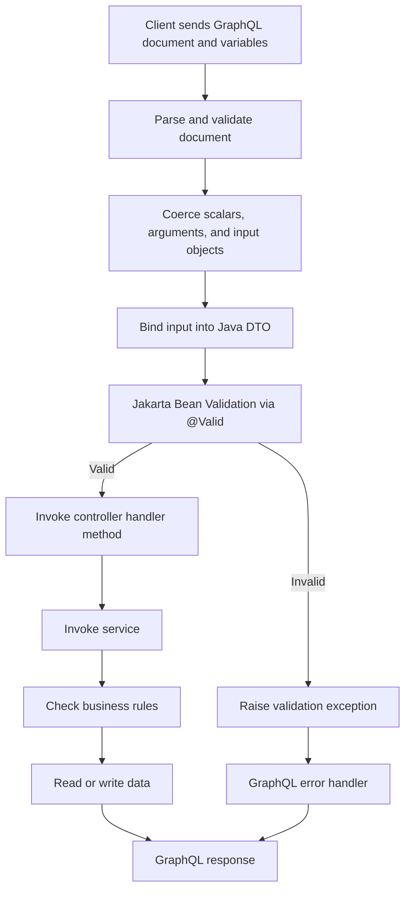

# Validation Before Calling Services

In a GraphQL mutation, client-supplied data should be checked before the controller forwards the command to the service. Spring for GraphQL supports combining GraphQL input coercion with Jakarta Bean Validation to detect malformed or constraint-violating data right at the controller boundary.

When an `@Argument` parameter is marked with `@Valid`, Spring for GraphQL can validate the input object before calling the handler method. If the data is invalid, the resolver method is not executed, so the service call inside the method does not happen either. This fits rules such as non-blank strings, well-formed emails, bounded quantities, or valid nested objects.

Validation in controllers does not replace business checks in services. Conditions depending on existing data, user permissions, resource state, or consistency across multiple operations still need to be enforced at the business and database layers.

## 1. Checking steps before the service runs

A mutation can go through multiple validation layers before the service is called:



Each step addresses a distinct kind of problem:

- GraphQL parsing and document validation check operation syntax, fields, arguments, and selection sets.
- Input coercion checks whether values can be converted to the declared GraphQL types.
- Binding converts inputs into Java parameters.
- Bean Validation checks constraints on DTOs such as `@NotBlank`, `@Email`, `@Size`, or `@Min`.
- The service checks business rules requiring system state or multiple related records.

If the Bean Validation step fails, Spring does not call the handler method. Therefore, the service invoked inside the method does not run either. This is important when you want to ensure input data is checked before any business side effects occur.

## 2. Declaring inputs in GraphQL SDL

Suppose the API allows creating a book:

```graphql
input CreateBookInput {
    title: String!
    isbn: String!
    description: String
    publishedYear: Int
    pageCount: Int!
}

type Mutation {
    createBook(input: CreateBookInput!): Book!
}

type Book {
    id: ID!
    title: String!
    isbn: String!
    description: String
    publishedYear: Int
    pageCount: Int!
}
```

SDL already guarantees several basic conditions:

- `input` must not be null.
- `title`, `isbn`, and `pageCount` must be provided and non-null.
- `description` and `publishedYear` may be null or omitted.
- `pageCount` must be coercible to GraphQL `Int`.

However, `String!` only guarantees a non-null value. It still accepts empty strings `""` or whitespace-only strings. Likewise, `Int!` does not guarantee `pageCount` is greater than 0. Those constraints need to be checked at the application layer.

## 3. Adding Jakarta Bean Validation

With Spring Boot 3 and above, use Jakarta Bean Validation and add a validation implementation to the runtime classpath. Common Maven dependency:

```xml
<dependency>
    <groupId>org.springframework.boot</groupId>
    <artifactId>spring-boot-starter-validation</artifactId>
</dependency>
```

In older Spring Boot 2 projects, the validation package may belong to `javax.validation`; use the namespace matching your platform version.

Create a DTO with constraints:

```java
package com.example.graphql.book;

import jakarta.validation.constraints.Max;
import jakarta.validation.constraints.Min;
import jakarta.validation.constraints.NotBlank;
import jakarta.validation.constraints.NotNull;
import jakarta.validation.constraints.Pattern;
import jakarta.validation.constraints.Size;

public record CreateBookInput(
    @NotBlank(message = "Title must not be blank")
    @Size(max = 200, message = "Title must be at most 200 characters")
    String title,

    @NotBlank(message = "ISBN must not be blank")
    @Pattern(
        regexp = "[0-9Xx-]{10,17}",
        message = "ISBN format is invalid"
    )
    String isbn,

    @Size(max = 2000, message = "Description is too long")
    String description,

    @Min(value = 1000, message = "Published year is invalid")
    @Max(value = 2100, message = "Published year is invalid")
    Integer publishedYear,

    @NotNull(message = "Page count is required")
    @Min(value = 1, message = "Page count must be greater than zero")
    @Max(value = 10000, message = "Page count is too large")
    Integer pageCount
) {}
```

Some commonly used constraints:

| Constraint | Effect |
| --- | --- |
| `@NotNull` | Value must not be null |
| `@NotBlank` | String must have a non-whitespace character |
| `@NotEmpty` | String or collection must not be empty |
| `@Size(min, max)` | Limits string length or element count |
| `@Min`, `@Max` | Limits numeric values |
| `@Positive`, `@PositiveOrZero` | Requires positive or non-negative numbers |
| `@Email` | Checks email format |
| `@Pattern` | Validates a string against a regular expression |

Choose constraints that match the intended semantics. For example, `@NotEmpty` still accepts a string containing only spaces; `@NotBlank` rejects that case. `@Pattern` only checks format against a regular expression—it does not prove the ISBN has a valid checksum or was officially issued.

## 4. Enabling validation on @Argument with @Valid

In an annotated controller, mark the `@Argument` parameter with `@Valid`:

```java
package com.example.graphql.book;

import jakarta.validation.Valid;
import org.springframework.graphql.data.method.annotation.Argument;
import org.springframework.graphql.data.method.annotation.MutationMapping;
import org.springframework.stereotype.Controller;

@Controller
public class BookMutationController {

    private final BookService bookService;

    public BookMutationController(BookService bookService) {
        this.bookService = bookService;
    }

    @MutationMapping
    public BookView createBook(
            @Argument("input") @Valid CreateBookInput input) {
        return bookService.create(input);
    }
}
```

When Spring for GraphQL binds the `input` argument into `CreateBookInput`, Bean Validation runs before `createBook` is called. If a constraint fails, a validation exception is raised and `bookService.create(input)` does not execute.

There is no need to write repetitive `if (input.title() == null)` or `if (input.pageCount() <= 0)` checks in the controller when constraints already express those rules. The controller focuses on receiving valid input and passing the command down to the service.

If input can be null per SDL yet business logic requires it, declare `@NotNull` on the parameter or change the SDL to `CreateBookInput!`. In the example above, the SDL already uses `CreateBookInput!`, so GraphQL rejects null before the controller is called.

## 5. What happens when validation fails?

Suppose the client sends the mutation:

```graphql
mutation CreateBook($input: CreateBookInput!) {
    createBook(input: $input) {
        id
        title
    }
}
```

Invalid variables:

```json
{
  "input": {
    "title": "   ",
    "isbn": "abc",
    "pageCount": 0
  }
}
```

Bean Validation detects:

- `title` fails `@NotBlank`.
- `isbn` does not match `@Pattern`.
- `pageCount` fails `@Min(1)`.

The handler method `createBook` is not invoked. Therefore, the service performs no insert, publishes no events, and causes no business side effects from this method.

This is the difference between automatic validation on arguments and manual checks inside the controller. Writing `if` checks after the method has started running risks calling the service before invalid input is caught if code ordering is not maintained. Using `@Valid` ensures constraints are enforced at the argument-receiving boundary.

## 6. Validation for nested input objects

A GraphQL input object can contain another input object. For validation to continue into child objects, use `@Valid` on nested properties.

SDL:

```graphql
input AddressInput {
    street: String!
    city: String!
    postalCode: String!
}

input CreateCustomerInput {
    name: String!
    address: AddressInput!
}
```

DTO:

```java
public record AddressInput(
    @NotBlank String street,
    @NotBlank String city,
    @NotBlank
    @Pattern(regexp = "[0-9]{5,6}")
    String postalCode
) {}

public record CreateCustomerInput(
    @NotBlank String name,
    @NotNull @Valid AddressInput address
) {}
```

`@Valid` on `address` instructs the validator to continue checking constraints on `AddressInput`. Without `@Valid`, constraints inside the child object might not cascade from the parent object. `@NotNull` ensures the address property is non-null at the Bean Validation layer; SDL `AddressInput!` also expresses the non-null requirement at the GraphQL layer.

Multiple nesting levels are possible, but keep the input model easy to understand and avoid overly deep structures that make data hard for clients to build and hard for the server to validate.

## 7. Checking multiple fields together

Some rules depend on relationships between multiple properties, such as the end date being after the start date or password confirmation matching the primary password. You can create a class-level constraint with a custom Jakarta Validation annotation.

DTO example:

```java
@ValidDateRange
public record BookingInput(
    @NotNull LocalDate startDate,
    @NotNull LocalDate endDate
) {}
```

`@ValidDateRange` is an application-defined annotation with a validator that receives the entire `BookingInput`. The validator compares the two dates, then emits a violation if `endDate` is not after `startDate`.

For errors that should attach to a specific field, a custom validator can build the corresponding property path. This helps the client know which input to fix. Pure cross-field rules suit Bean Validation; rules depending on database state should be checked in the service.

## 8. Distinguishing Bean Validation and business validation

Not every rule belongs in a DTO. Identify the source of information the rule depends on.

| Check type | Example | Appropriate place |
| --- | --- | --- |
| GraphQL types and nullability | `ID!`, `Int!`, valid enum | GraphQL schema and input coercion |
| Input structure | Non-empty string, valid email format, number in range | Bean Validation on DTO |
| Cross-field relationship within input | Start date before end date | Class-level Bean Validation or dedicated validator |
| Data state | ISBN already in use, customer ID exists | Service/domain layer |
| Access permissions | User is allowed to create a book in this library | Authorization/service layer |
| Concurrent consistency | Two requests registering the same ISBN simultaneously | Database constraints and transactions |

For example, checking whether an ISBN has the right format can use `@Pattern`. Checking whether the ISBN already exists requires querying data. Putting a repository query inside a custom Bean Validation validator couples validation to the database and can still leave race conditions. Two concurrent requests could both pass the check before writing.

Keep state-dependent rules in the service/domain and use database unique constraints to protect final invariants. Controller validation rejects malformed inputs before the service runs; it does not replace transactions or database constraints.

## 9. Structuring validation errors as GraphQL errors

When validation is enabled with `@Valid` on an argument, Spring for GraphQL can raise `BindException` if the input fails to satisfy constraints. You can use `@GraphQlExceptionHandler` in a controller or `@ControllerAdvice` to convert the exception into a GraphQL error.

Global handler example:

```java
package com.example.graphql.error;

import java.util.List;
import java.util.Map;

import graphql.GraphQLError;
import graphql.GraphqlErrorBuilder;
import graphql.schema.DataFetchingEnvironment;
import org.springframework.graphql.data.method.annotation.GraphQlExceptionHandler;
import org.springframework.graphql.execution.ErrorType;
import org.springframework.validation.BindException;
import org.springframework.validation.FieldError;
import org.springframework.web.bind.annotation.ControllerAdvice;

@ControllerAdvice
public class GraphQlValidationAdvice {

    @GraphQlExceptionHandler
    public GraphQLError handleValidation(
            BindException exception,
            DataFetchingEnvironment environment) {

        List<Map<String, String>> fieldErrors =
            exception.getBindingResult().getFieldErrors().stream()
                .map(this::toFieldError)
                .toList();

        return GraphqlErrorBuilder.newError(environment)
            .errorType(ErrorType.BAD_REQUEST)
            .message("Invalid input data.")
            .extensions(Map.of(
                "code", "VALIDATION_ERROR",
                "fieldErrors", fieldErrors
            ))
            .build();
    }

    private Map<String, String> toFieldError(FieldError error) {
        return Map.of(
            "field", error.getField(),
            "message", error.getDefaultMessage() == null
                ? "Invalid value."
                : error.getDefaultMessage()
        );
    }
}
```

The handler puts only field names and configured messages into `extensions`. Do not include `rejectedValue` in responses because invalid values may contain passwords, tokens, or personal data. For multilingual applications, use a message source to return messages matching the request's locale.

`BindException` here represents an argument binding/validation error. If the application uses method validation at another layer—for example, constraints directly on a method or service method—the exception type may differ depending on configuration and Spring version. Handle the exact exception raised at that boundary rather than assuming all validation produces the same exception type.

## 10. GraphQL errors or userErrors payloads?

There are two common ways to represent validation failures to clients:

**GraphQL error:** suitable when `@Valid` automatically rejects an argument before the handler method runs. The exception handler converts `BindException` into an error with `extensions.code` and a list of field errors. The resolver does not run and the service is not called.

**`userErrors` payload:** suitable when a validation failure is a business outcome the mutation wants to return as part of the response. In that case, the controller or a dedicated validation layer collects errors and returns a payload containing `userErrors`; do not let `@Valid` throw an exception before the method has a chance to build the payload.

Payload example:

```graphql
type UserError {
    field: String
    code: String!
    message: String!
}

type CreateBookPayload {
    book: Book
    userErrors: [UserError!]!
}

type Mutation {
    createBook(input: CreateBookInput!): CreateBookPayload!
}
```

Do not mix both contracts for the same kind of error without a clear reason. Clients need to know which cases appear in `errors` and which appear in `data.createBook.userErrors`.

## 11. Validation groups and create/update flows

One DTO can be used across multiple operations with each operation having different rule sets. For instance, on creation, ISBN is required; on a partial update, ISBN may be omitted.

Jakarta Bean Validation supports validation groups to apply constraints contextually:

```java
public interface Create {}
public interface Update {}

public record BookInput(
    @NotBlank(groups = Create.class)
    String title,

    @NotBlank(groups = Create.class)
    String isbn,

    @Size(max = 200, groups = {Create.class, Update.class})
    String description
) {}
```

You can use `@Validated(Create.class)` or `@Validated(Update.class)` when the corresponding method/argument validation configuration supports group selection. With annotated controllers, check how resolvers apply validation hints in the Spring for GraphQL version you use; plain `@Valid` uses the default group. If two operations have substantially different input semantics, two separate DTOs are usually easier to understand and less error-prone than one DTO with many groups.

## 12. Testing that the service is not called on invalid input

An important part of this lesson is verifying not only that the response contains errors, but that the service truly is not invoked. You can use `GraphQlTester` together with Mockito.

Illustrative test example:

```java
import static org.assertj.core.api.Assertions.assertThat;
import static org.mockito.Mockito.verifyNoInteractions;

import org.junit.jupiter.api.Test;
import org.springframework.beans.factory.annotation.Autowired;
import org.springframework.boot.test.autoconfigure.graphql.GraphQlTest;
import org.springframework.boot.test.mock.mockito.MockBean;
import org.springframework.graphql.test.tester.GraphQlTester;

@GraphQlTest(BookMutationController.class)
class BookMutationValidationTest {

    @Autowired
    GraphQlTester graphQlTester;

    @MockBean
    BookService bookService;

    @Test
    void rejectsInvalidInputBeforeCallingService() {
        graphQlTester.document("""
                mutation {
                    createBook(input: {
                        title: "   "
                        isbn: "invalid"
                        pageCount: 0
                    }) {
                        id
                    }
                }
                """)
            .execute()
            .errors()
            .satisfy(errors -> assertThat(errors).isNotEmpty());

        verifyNoInteractions(bookService);
    }
}
```

The test snippet uses `@MockBean` to provide a `BookService` mock in the test context. With newer Spring Boot versions, use the corresponding replacement annotation if `@MockBean` is deprecated. If the controller has other dependencies, provide mocks for them as well.

Include a control test with valid input to verify the service is invoked exactly once with the bound DTO. That way, the tests prove both branches: invalid input is blocked before the service and valid input is forwarded to the service.

## 13. Common errors

| Symptom | Possible cause | How to fix |
| --- | --- | --- |
| `@Valid` does not run | Missing validation provider or missing annotation on argument | Add the validation starter and place `@Valid` next to `@Argument` |
| Space-only strings still pass | Used `@NotEmpty` or only declared `String!` | Use `@NotBlank` |
| Child object constraints do not run | Missing `@Valid` on nested property | Enable cascade validation |
| Service is still called with invalid input | Validation placed after service call or not enabled | Use argument validation before the handler and test with verify |
| Validation exception is not caught | Handler expects wrong exception type or wrong scope | Check the actual exception and `@GraphQlExceptionHandler` scope |
| Client receives sensitive data | Returning `rejectedValue` or raw exception message | Return only field, code, and safe message |
| Duplicate data despite unique validation | Checking only before insert | Add unique constraints and handle conflicts in the service |
| Shared DTO has too many groups | Create/update rules differ | Use validation groups or separate DTOs |
| Errors appear in `errors` instead of payload | `@Valid` stops handler before building payload | Choose an explicit error contract or validate explicitly to build `userErrors` |

## 14. Pre-service validation checklist

- Has the SDL declared the right input types, scalars, and nullability?
- Do DTOs have constraints accurately reflecting structural rules?
- Is `spring-boot-starter-validation` on the runtime classpath?
- Is the `@Argument` parameter marked with `@Valid`?
- Do nested objects have `@Valid` for cascade validation?
- Are rules requiring database or security checks placed in the service/domain layer?
- Does the handler method invoke the service only after arguments are valid?
- Do validation errors have safe messages and stable error codes?
- Has the API clearly chosen between GraphQL `errors` and `userErrors` payloads?
- Do tests verify the service is not called when input is invalid and is called when input is valid?
- Does the database still protect critical invariants under concurrent requests?

Validation before calling services lets Spring for GraphQL block invalid input right at the controller boundary. The GraphQL schema checks types and nullability; Jakarta Bean Validation checks DTO structure via `@Valid`; services continue enforcing state- and permission-dependent business rules; and the database preserves final consistency constraints. When responsibilities are divided cleanly and tests verify that services do not execute on invalid inputs, mutations become safer, more predictable, and easier to maintain.
