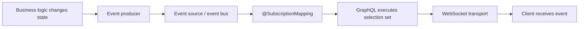
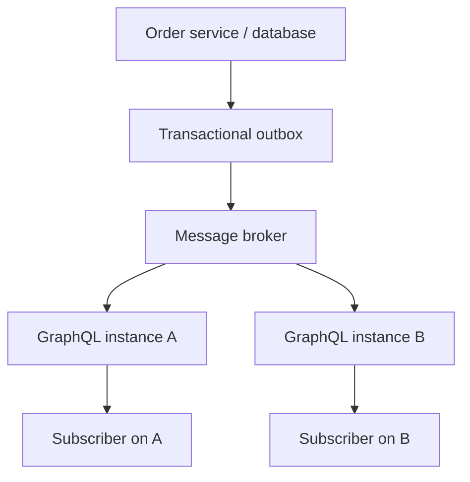

# Subscription event source in Spring for GraphQL

In GraphQL, Subscriptions allow clients to register to receive new results whenever an event occurs. A `@SubscriptionMapping` method typically returns a `Publisher<T>` such as Reactor's `Flux<T>`. This Publisher is the **event source**: it supplies values over time so GraphQL can execute the selection set and send each result back to the client.

Spring for GraphQL handles wiring the Publisher into Subscription execution. The application still decides where events originate, how to filter by resource, how to distribute to each subscriber, and how to release resources when the client unsubscribes. An event source can be an in-memory stream, a Spring application event, a message broker, or an external streaming service.

## Where does the event source sit in a Subscription architecture?

A subscription typically consists of three parts:

- **Event producer:** where business events originate, such as an order changing status or inventory updating.
- **Event source:** supplies a `Publisher` per subscription, filtering or transforming events into GraphQL payloads.
- **GraphQL Subscription resolver:** the `@SubscriptionMapping` method returning the Publisher to the GraphQL runtime.

A transport such as WebSocket is responsible for delivering execution results to the client. The transport does not generate business events itself, nor does it replace the event source.



For example, when order `ORD-1001` transitions from `PAID` to `PACKING`, the producer emits an event. The event source delivers that event to subscribers watching the order. GraphQL returns only the fields selected by the client, such as `orderId`, `status`, and `changedAt`.

## Declaring a Subscription in SDL

The schema defines the field clients can subscribe to and the payload type emitted for each event:

```graphql
type OrderStatusChanged {
  eventId: ID!
  orderId: ID!
  previousStatus: String
  status: String!
  changedAt: String!
}

type Subscription {
  orderStatusChanged(orderId: ID!): OrderStatusChanged!
}
```

A client subscribes to watch an order:

```graphql
subscription WatchOrder($orderId: ID!) {
  orderStatusChanged(orderId: $orderId) {
    eventId
    orderId
    previousStatus
    status
    changedAt
  }
}
```

A Subscription operation selects one top-level field. When the event source emits a payload, GraphQL executes the selection set against that payload and produces an execution result. This repeats until the Publisher completes, errors, or the subscription is cancelled.

## Defining the event and event source service

Model the event with a dedicated data type. For example, using a Java record:

```java
import java.time.Instant;

public record OrderStatusChanged(
        String eventId,
        String tenantId,
        String orderId,
        String previousStatus,
        String status,
        Instant changedAt) {
}
```

`tenantId` is internal metadata used to filter events within a tenant scope; there is no need to expose this field in the GraphQL SDL if clients do not need to read it.

The event source should expose a method returning a Publisher based on subscription criteria:

```java
import reactor.core.publisher.Flux;

public interface OrderEventSource {
    Flux<OrderStatusChanged> eventsForOrder(String tenantId, String orderId);
}
```

This interface decouples the controller from the underlying event delivery technology. An implementation can use a Reactor sink in a simple application or read from Kafka/RabbitMQ in a distributed system. The controller only needs to know how to obtain the event stream.

## In-memory event source using Reactor Sinks

For demos or single-instance applications, you can use `Sinks.Many<T>` as the event emitter and `Flux` as the stream for subscribers:

```java
import org.springframework.stereotype.Component;
import reactor.core.publisher.Flux;
import reactor.core.publisher.Sinks;

@Component
public class InMemoryOrderEventSource implements OrderEventSource {

    private final Sinks.Many<OrderStatusChanged> sink =
            Sinks.many().multicast().onBackpressureBuffer();

    @Override
    public Flux<OrderStatusChanged> eventsForOrder(String tenantId, String orderId) {
        return sink.asFlux()
                .filter(event -> event.tenantId().equals(tenantId))
                .filter(event -> event.orderId().equals(orderId));
    }

    public Sinks.EmitResult publish(OrderStatusChanged event) {
        return sink.tryEmitNext(event);
    }
}
```

`multicast()` distributes events to active subscribers. `asFlux()` creates a reactive view for controllers or services to consume. `filter` retains events matching both `tenantId` and `orderId` for the current subscription.

This snippet is a simple event source for learning and experimentation. An in-memory sink lives only inside a single JVM; when the application restarts, past events are lost. If running multiple instances, a subscriber connected to instance A will not automatically receive events emitted on instance B. Production systems need an event broker or shared distribution mechanism when scaling across multiple nodes.

### Checking emission results when publishing events

Do not ignore the result returned by `tryEmitNext`. `Sinks.EmitResult` indicates whether emission succeeded or failed—for example, due to having no subscribers per sink settings, the sink already having terminated, or non-serialized concurrent emit calls.

In production, avoid blindly throwing an exception back into the business update flow just because one subscriber is temporarily slow or has disconnected. Define an event publishing policy: retry, queue, write to an outbox, log/record metrics, or forward to a broker. Also ensure concurrent emitting threads are handled under an appropriate concurrency policy; `tryEmitNext` can return a serialization error under concurrent emission.

### Choosing sink types and buffering policies

Reactor provides several sink types with different semantics. Your choice affects subscribers and load handling:

| Source type | Characteristics | When suitable |
| --- | --- | --- |
| `multicast().onBackpressureBuffer()` | Emits to multiple subscribers, with buffering for slow subscribers subject to sink limits/configuration. | Fan-out events in demos or internal streams with explicit buffering policies. |
| `multicast().directBestEffort()` | Prioritizes subscribers with active demand; slow subscribers may miss items. | Only when dropping intermediate events is acceptable. |
| `replay().limit(n)` | New subscribers can receive the last `n` items. | Demos needing short in-memory replay, not durable storage. |
| `unicast()` | A single subscriber consumes a single stream. | Dedicated source for one consumer, not multi-client broadcast. |

Do not choose `directBestEffort` if every state change must be delivered. Do not treat an in-memory replay sink as a durable event log. Buffers must have bounds and an overflow policy; otherwise, slow subscribers can increase memory usage or cause producer failures.

## Emitting events from the business flow

The event source must be connected to where business state changes. For example, a service updates an order and then publishes an event:

```java
import java.time.Instant;
import java.util.UUID;
import org.springframework.stereotype.Service;
import org.springframework.transaction.annotation.Transactional;
import reactor.core.publisher.Sinks;

@Service
public class OrderService {

    private final OrderRepository orderRepository;
    private final InMemoryOrderEventSource eventSource;

    public OrderService(
            OrderRepository orderRepository,
            InMemoryOrderEventSource eventSource) {
        this.orderRepository = orderRepository;
        this.eventSource = eventSource;
    }

    @Transactional
    public Order changeStatus(String orderId, String nextStatus) {
        Order order = orderRepository.findById(orderId).orElseThrow();
        String previousStatus = order.getStatus();
        order.setStatus(nextStatus);

        Order saved = orderRepository.save(order);
        Sinks.EmitResult emitResult = eventSource.publish(new OrderStatusChanged(
                UUID.randomUUID().toString(),
                saved.getTenantId(),
                saved.getId(),
                previousStatus,
                saved.getStatus(),
                Instant.now()));
        if (emitResult.isFailure()) {
            // Demo: log failure. Production requires retry/outbox/broker as needed.
        }

        return saved;
    }
}
```

The example above is easy to follow, but there is a caveat: the event is published before the transaction commits. If the transaction rolls back after emitting, subscribers could receive a status that was never committed to the database.

For systems requiring consistency, publish events only after the transaction commits. You can use `@TransactionalEventListener(phase = TransactionPhase.AFTER_COMMIT)` to forward domain events to the event source after commit, or use a Transactional Outbox when high reliability between database and broker is needed.

### Publishing only after transaction commit

The service can publish an application event inside the transaction:

Below is the method body inside a service that has injected `ApplicationEventPublisher`:

```java
@Transactional
public Order changeStatus(String orderId, String nextStatus) {
    Order order = orderRepository.findById(orderId).orElseThrow();
    String previousStatus = order.getStatus();
    order.setStatus(nextStatus);

    Order saved = orderRepository.save(order);
    applicationEventPublisher.publishEvent(new OrderStatusChanged(
            UUID.randomUUID().toString(),
            saved.getTenantId(),
            saved.getId(),
            previousStatus,
            saved.getStatus(),
            Instant.now()));

    return saved;
}
```

The listener forwards the event to the sink only after commit:

```java
import org.springframework.stereotype.Component;
import org.springframework.transaction.event.TransactionPhase;
import org.springframework.transaction.event.TransactionalEventListener;
import org.slf4j.Logger;
import org.slf4j.LoggerFactory;
import reactor.core.publisher.Sinks;

@Component
public class OrderEventForwarder {

    private static final Logger log = LoggerFactory.getLogger(OrderEventForwarder.class);

    private final InMemoryOrderEventSource eventSource;

    public OrderEventForwarder(InMemoryOrderEventSource eventSource) {
        this.eventSource = eventSource;
    }

    @TransactionalEventListener(phase = TransactionPhase.AFTER_COMMIT)
    public void onOrderStatusChanged(OrderStatusChanged event) {
        Sinks.EmitResult result = eventSource.publish(event);
        if (result.isFailure()) {
            log.error("Could not publish order event {}: {}", event.eventId(), result);
            // Production: retry or record for replay from outbox/broker.
        }
    }
}
```

By default, `@TransactionalEventListener` runs only when an active transaction exists and completes according to the chosen phase. If events must survive even when the process crashes right after commit before the listener publishes to the sink, an in-memory application event is still insufficient; a Transactional Outbox and durable broker are more appropriate.

## Connecting the event source to `@SubscriptionMapping`

The controller receives subscription arguments, verifies access permissions, and returns the stream from the event source:

```java
import java.security.Principal;
import org.springframework.graphql.data.method.annotation.Argument;
import org.springframework.graphql.data.method.annotation.SubscriptionMapping;
import org.springframework.stereotype.Controller;
import reactor.core.publisher.Flux;

@Controller
public class OrderSubscriptionController {

    private final OrderEventSource eventSource;
    private final OrderAuthorizationService authorizationService;

    public OrderSubscriptionController(
            OrderEventSource eventSource,
            OrderAuthorizationService authorizationService) {
        this.eventSource = eventSource;
        this.authorizationService = authorizationService;
    }

    @SubscriptionMapping
    public Flux<OrderStatusChanged> orderStatusChanged(
            @Argument("orderId") String orderId,
            Principal principal) {

        authorizationService.checkCanReadOrder(principal, orderId);
        String tenantId = authorizationService.tenantFor(principal);
        return eventSource.eventsForOrder(tenantId, orderId);
    }
}
```

Spring for GraphQL uses the `Publisher` returned from the method as the source for the Subscription field. `@SubscriptionMapping` infers the field name from the method name by default; you can specify the name explicitly if the schema uses a different name.

Checking permissions before returning the `Publisher` immediately rejects unauthorized subscriptions. If permissions can be revoked while the stream is active, you need a policy for revalidation, timeouts, or terminating the subscription when permissions change.

## Filtering events per subscriber

Each subscription may watch a different resource, tenant, or event type. The event source must ensure a subscriber receives only events within its authorized scope.

With a shared sink, the example filters by `orderId` inside `eventsForOrder`. In multi-tenant applications, filtering must include the authenticated tenant from the principal or server context—never treat a client-supplied tenant ID as proof of authorization:

In the example, `OrderStatusChanged` carries an internal `tenantId`, and `eventsForOrder` filters by both tenant and order ID. The controller obtains the tenant from the authenticated identity after checking permissions. Another option is creating separate channels/topics per tenant or using broker subscription filters to reduce the number of events dispatched to each subscriber.

Do not broadcast full sensitive events to every client and rely solely on the GraphQL selection set to hide fields. The selection set determines which fields are serialized; it is not an authorization mechanism. Access rights must be verified before emitting payloads or inside resolvers of sensitive fields.

### One shared sink or one source per key?

A single shared sink is easy to implement, but each subscriber may have to receive and filter out many unrelated events. As event volume grows, per-subscriber filtering cost scales with total traffic.

Common scaling approaches:

- Partition events by `orderId`, tenant, or event type.
- Create publishers per key and manage their lifecycle when the first subscriber registers and the last subscriber cancels.
- Use broker topics/partitions and consumer subscriptions tailored to your distribution model.
- Push filtering down to the event source or broker instead of broadcasting and filtering everything inside the JVM.

If you maintain a map of sinks by key, remove entries when no subscribers remain and handle races between registration, cancellation, and publishing. Never let a map of Publishers grow indefinitely across every ID ever seen.

## Hot publishers, cold publishers, and multiple subscribers

Understanding hot vs. cold helps predict which events a client receives:

| Publisher type | Behavior | Consequence for Subscription |
| --- | --- | --- |
| Cold | Each subscription can create an independent stream or read operation. | Each client can have its own data source. |
| Hot | Events are emitted independently of individual subscribers. | Clients receive only events emitted while subscribed, unless the source supports replay. |

Reactor `Sinks.Many` is commonly used to build hot sources. A `Flux` built with `Flux.defer` or per-subscription read operations can create a cold source. Choose based on business requirements: live status dashboards usually accept hot streams; workflows needing past history should rely on an event log or history query API.

Subscriptions do not automatically replay events that occurred before the client subscribed. If you need to synchronize initial state and then receive continuous updates, design an explicit flow—for instance, a Query fetching a snapshot with a sequence number followed by a Subscription receiving events with a sequence greater than the snapshot. Handle gaps and duplicates between the two steps.

## Multiple instances and message brokers

An in-memory event source works only when producer and subscriber live in the same process. In multi-instance systems, the event source needs a shared distribution mechanism.

Example architecture:



Kafka, RabbitMQ, or an equivalent pub/sub system can act as the distribution layer. An event source adapter reads events from the broker and returns a Publisher for the subscription. Choose appropriate consumer semantics: each GraphQL instance needs a copy of events to fan out to local subscribers, or use a subscription group/consumer strategy designed for that routing model.

Do not configure a single competing consumer group if the goal is for every GraphQL instance to receive every event for its local subscribers. With Kafka, consumers in the same group split partitions among members; to broadcast across multiple instances, use separate group/consumer strategies or an appropriate fan-out layer.

A broker also does not solve authorization on its own. The event source must still verify tenant, resource, and subscriber identity before delivering data.

## Event ordering, duplicates, and replay

The event source must define delivery semantics:

- **Ordering:** do events for the same order need strict ordering? If so, partition by order ID or use sequence numbers.
- **Duplicates:** a broker may redeliver events. Payloads should include an `eventId` so the client or service can identify already-processed events.
- **Replay:** if a client reconnects, it may need a cursor/sequence to resume reading from the last received position.
- **Delivery guarantee:** at-most-once, at-least-once, or business-level exactly-once? Never claim exactly-once solely because GraphQL Subscriptions are used.

GraphQL Subscriptions are a mechanism for delivering results to clients, not a durable message log. If replay is needed, the event source must support reading from a cursor or broker offset; the schema can accept `afterEventId` or `afterSequence` so clients can request resumption.

Example schema supporting a cursor:

```graphql
type Subscription {
  orderStatusChanged(
    orderId: ID!
    afterEventId: ID
  ): OrderStatusChanged!
}
```

The resolver can pass the cursor to the event source to emit only events after that position. Define behavior when the cursor is expired or does not exist, and prevent missing events between the initial snapshot and stream subscription.

## Backpressure and slow subscribers

Event producers may emit faster than subscribers can receive or process. If the event source buffers without bounds, a slow subscriber can cause memory usage to grow continuously.

Common policies:

- **Bounded buffer:** hold events up to a limit; when full, reject, drop, or error according to policy.
- **Drop:** discard events when the subscriber cannot keep up; appropriate only when intermediate events are non-critical.
- **Latest:** keep only the latest state; suited for dashboards that need only the current snapshot.
- **Disconnect:** close the slow subscription and let the client reconnect/replay from a cursor.
- **Durable queue:** store events in a broker so consumers read at their own pace.

Do not use `onBackpressureBuffer` assuming the buffer is infinite and can never fill up. Do not use `latest` or drop for financial events, auditing, or workflows requiring complete history. The policy must follow data requirements.

## Cancellation and cleanup

When a client cancels an operation or closes the connection, the GraphQL runtime cancels the subscription stream. The event source must propagate cancellation back to the source to release resources.

Resources that may need cleanup:

- Listeners registered on an event bus.
- Broker consumers or subscription handles.
- Timers, polling tasks, or connections to streaming services.
- Entries in a per-key publisher map.
- Per-subscriber buffers.

With Reactor, you can observe lifecycle events with `doFinally`:

```java
public Flux<OrderStatusChanged> eventsForOrder(String orderId) {
    return createOrderStream(orderId)
            .doFinally(signal -> releaseSubscriberResources(orderId, signal));
}
```

With callback APIs, `Flux.create` or `Flux.push` should register `sink.onCancel(...)`/`sink.onDispose(...)` to remove listeners. In Kotlin Flow, `callbackFlow` and `awaitClose` serve the same role. Never register a listener before the Publisher is subscribed and forget to remove it when the client leaves.

If multiple subscribers share a common source, cancelling one subscriber must not close the shared source while other subscribers still need it. Cleanup must be scoped per subscription or use appropriate reference counting.

## Error handling and stream completion

An event source can conclude in three ways:

- **Emit event:** emits a payload for GraphQL to produce an execution result.
- **Complete:** source finishes normally; the client receives no more events from that operation.
- **Error:** source signals an error; GraphQL terminates the stream and the client receives error details over the transport.

Distinguish source errors from having no events yet. An open stream that has not emitted an event is neither an error nor a `null` payload. If the event source encounters a transient broker error, you can retry inside the service or terminate the stream so the client reconnects; the choice depends on semantics and replay capabilities.

Do not expose exception messages from brokers, SQL, or infrastructure details. Use Spring for GraphQL's error-handling mechanisms to standardize errors before sending them to clients.

## Testing event sources and Subscriptions

Test the event source in isolation and run integration tests through GraphQL:

**Event source tests** verify:

- The Publisher emits events when the producer calls publish.
- Filtering by order ID or tenant works correctly.
- Multiple subscribers receive the right events under the chosen semantics.
- Events are not delivered to out-of-scope subscribers.
- `tryEmitNext` failures are handled.
- When a subscriber cancels, listeners and resources are cleaned up.
- Buffer overflow, source errors, and completion behave deterministically.

You can use Reactor `StepVerifier` to test streams:

```java
import static org.assertj.core.api.Assertions.assertThat;
import reactor.core.publisher.Sinks;
import reactor.test.StepVerifier;

@Test
void emitsOnlyEventsForRequestedOrder() {
    Flux<OrderStatusChanged> events = eventSource.eventsForOrder("TENANT-A", "ORD-1001");

    StepVerifier.create(events)
            .then(() -> {
                assertThat(eventSource.publish(event("TENANT-A", "ORD-2002", "SHIPPED")))
                        .isEqualTo(Sinks.EmitResult.OK);
                assertThat(eventSource.publish(event("TENANT-A", "ORD-1001", "PACKING")))
                        .isEqualTo(Sinks.EmitResult.OK);
            })
            .assertNext(event -> {
                assertThat(event.orderId()).isEqualTo("ORD-1001");
                assertThat(event.status()).isEqualTo("PACKING");
            })
            .thenCancel()
            .verify();
}
```

This is an illustrative test for an in-memory multicast sink; the `event(...)` fixture is a test-defined factory. For sinks with different buffer or subscriber-demand semantics, subscribe before publishing and verify emit results explicitly.

**GraphQL Subscription tests** should verify:

- The client subscribes to the right field name and arguments are bound properly.
- The event source emits multiple events and GraphQL returns only selected fields.
- Unauthorized users are rejected before subscribing to the source.
- Other tenants or orders do not leak events.
- When the client sends complete/cancel, the source releases resources.
- Errors from the event source terminate the operation per contract.
- WebSocket reconnection and cursor/replay work properly if supported by the application.

With Spring for GraphQL, use `WebSocketGraphQlTester` to test over the WebSocket transport. Unit tests that merely invoke `@SubscriptionMapping` directly do not prove that transport, protocol, and cancellation lifecycle work end-to-end.

## Common mistakes

| Symptom | Cause | Resolution |
| --- | --- | --- |
| Client subscribes but receives no events | Producer is not publishing to the right event source or subscriber is connected to another instance. | Check wiring and use a shared broker in multi-instance deployments. |
| Client receives events for another order | Event source lacks resource or tenant filtering. | Filter by authenticated identity/scope on the server. |
| Events before subscribing are lost | Using a hot Publisher without replay. | Use an event log/cursor or provide a snapshot Query. |
| Slow subscriber increases memory | Unbounded buffer or missing overflow policy. | Bound buffers, drop intentionally, or use a durable broker. |
| One client cancelling breaks streams for others | Cleanup closes the shared multicast source. | Manage cancellation per subscriber with reference counting. |
| Events emitted even though transaction rolled back | Published before commit. | Publish after commit or use a Transactional Outbox. |
| Events lost across multiple instances | Sink lives only within a single JVM. | Use a broker or shared event distribution layer. |
| Events out of order or duplicated | Broker/consumer lacks partition keys or event IDs. | Use sequence numbers, partition by resource, and deduplicate. |
| `tryEmitNext` returns failure | Sink has terminated, has no subscribers under current semantics, or concurrent emits occurred. | Check `EmitResult`, serialize producers, and define a retry/error policy. |

## Key takeaways

An event source is a Publisher that supplies events to a GraphQL Subscription field. Producers emit domain events; the event source filters and distributes them; `@SubscriptionMapping` returns the Publisher to the GraphQL runtime; and a transport such as WebSocket delivers each execution result to the client.

Reactor `Sinks.Many` works well for demos or single-JVM fan-out, but it lacks persistence and does not automatically share events across multiple instances. Systems requiring reliability should emit events after transaction commit, consider a Transactional Outbox and broker, and design ordering, deduplication, replay, backpressure, and cancellation carefully. Always enforce resource/tenant authorization before distributing events, and test both the event source and the full GraphQL Subscription lifecycle.

## References

- [Spring for GraphQL — Subscription](https://docs.spring.io/spring-graphql/reference/transports.html)
- [Spring for GraphQL — Annotated Controllers](https://docs.spring.io/spring-graphql/reference/controllers.html)
- [Project Reactor — Sinks](https://projectreactor.io/docs/core/release/reference/coreFeatures/sinks.html)
- [Spring Framework — Transaction-bound Events](https://docs.spring.io/spring-framework/reference/data-access/transaction/event.html)
