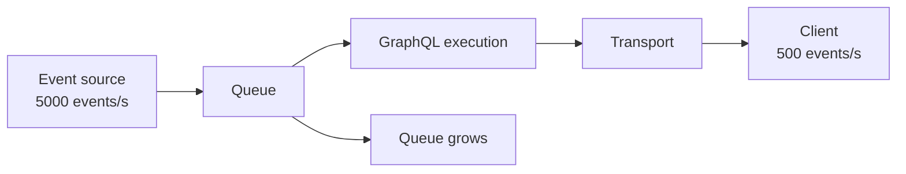
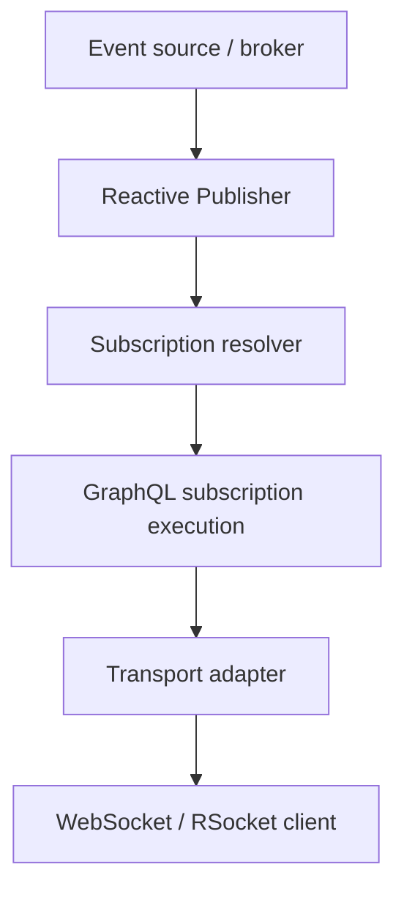
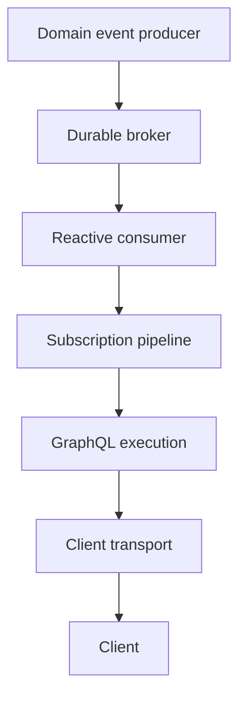

# Backpressure in subscriptions

A GraphQL subscription creates a result stream that can emit many events over the duration of a client's subscription. If the event source emits faster than the subscriber can process or transmit data, the system can accumulate queues, increase memory usage, raise latency, or be forced to drop data. Backpressure is the mechanism for regulating emission speed between publisher and subscriber so that no component is forced to handle more data than it can cope with.

Spring for GraphQL supports subscriptions via a reactive `Publisher`, typically a `Flux` in Reactor applications. When a resolver returns a publisher, GraphQL Java executes the selection set for each event and emits the corresponding execution results. Backpressure helps manage data flow inside the reactive pipeline, though end-to-end effectiveness also depends on the transport, broker, and how each layer propagates demand.

After this lesson, you will be able to:

- Understand demand and backpressure in Reactive Streams.
- Implement subscriptions returning `Flux` in Spring for GraphQL.
- Recognize slow subscribers and signs of overload.
- Choose among demand propagation, buffering, dropping, keeping latest, and rate limiting.
- Design bounded queues and overflow policies.
- Manage cancellation, cleanup, and the subscription lifecycle.
- Integrate hot event sources, brokers, and asynchronous processing pipelines.
- Test backpressure with Reactor Test and transport-level tests.

## 1. Subscriptions create a data stream

A Query normally returns a single result per execution. A Subscription registers to receive results emitted over time—such as order status changes, market price updates, or edits to a document.

SDL may declare:

```graphql
type Subscription {
    orderStatusChanged(orderId: ID!): OrderEvent!
}

type OrderEvent {
    orderId: ID!
    status: String!
    occurredAt: String!
}
```

A Spring for GraphQL resolver returns `Flux<OrderEvent>`:

```java
@Controller
public class OrderSubscriptionController {

    private final OrderEventService eventService;

    public OrderSubscriptionController(OrderEventService eventService) {
        this.eventService = eventService;
    }

    @SubscriptionMapping
    public Flux<OrderEvent> orderStatusChanged(
            @Argument String orderId) {
        return eventService.eventsFor(orderId);
    }
}
```

The subscription method is invoked when the client initiates the operation. The publisher then emits multiple events; for each event, GraphQL executes the selection set and produces a corresponding GraphQL result. The client can continue receiving events until the stream completes, errors, or is cancelled.

## 2. What is backpressure?

In Reactive Streams, the subscriber tells the publisher how many items it is ready to receive using demand. The subscriber calls `request(n)` to request at most `n` items. The publisher must not emit more items than have been requested.

Example of a subscriber requesting items incrementally:

```text
Subscriber                 Publisher
    |                          |
    |------ request(1) ------->|
    |<------- onNext(A) -------|
    |                          |
    |------ request(2) ------->|
    |<------- onNext(B) -------|
    |<------- onNext(C) -------|
```

Demand is the count of items the subscriber is ready to receive, not a per-second rate. When the subscriber has not requested more items, the publisher must hold back, throttle, or apply an appropriate policy instead of pushing data beyond demand.

In Reactor, `Flux` and `Mono` implement Reactive Streams. Operators such as `map`, `filter`, `concatMap`, and many others can propagate demand upstream. This forms the basis for pipeline load regulation.

## 3. Why do subscriptions need backpressure?

Suppose an event source emits 5,000 events per second, while the client or processing pipeline can only consume 500 events per second. If the server keeps every event in memory, the backlog grows by roughly 4,500 events per second.



Consequences can include:

- Memory grows steadily because the queue cannot be drained fast enough.
- Latency rises; events arrive at the client too late to remain useful.
- Multiple concurrent subscriptions amplify resource pressure rapidly.
- Threads, connections, or broker consumers stay occupied longer.
- When the process runs out of memory or queues overflow, other requests can also be impacted.

Backpressure helps the system regulate in-flight data volume. However, it does not automatically decide which events are critical, whether data may be dropped, or whether it must be stored for replay. Those decisions belong to business policy and the event source.

## 4. Backpressure in the Spring for GraphQL flow

The subscription processing flow can be visualized as follows:



Layers that can participate in flow regulation:

1. **Event source:** a broker or service may support demand, prefetch, pause/resume, or replay.
2. **Reactive pipeline:** Reactor propagates demand and provides buffer/drop/limit operators.
3. **GraphQL execution:** each event is turned into an execution result per the selection set.
4. **Transport:** WebSocket or RSocket delivers results to the client and has its own buffering behavior.
5. **Client:** decodes, updates UI, or processes data.

Reactive Streams demand applies between components participating in Reactive Streams. Do not assume every GraphQL transport gives client applications a per-event `request(n)` API. For example, the common GraphQL over WebSocket protocol uses subscribe/next/complete messages and does not define a separate demand frame. Therefore, end-to-end backpressure must be verified against the actual transport, adapter, and broker.

## 5. Natural demand propagation

When the event source is a publisher capable of honoring demand, the simplest approach is to keep the pipeline reactive and avoid turning it into an uncontrolled push stream:

```java
@SubscriptionMapping
public Flux<OrderEvent> orderStatusChanged(@Argument String orderId) {
    return eventService.eventsFor(orderId)
            .map(this::toPublicEvent)
            .limitRate(32);
}
```

`limitRate(32)` tunes how Reactor requests data from upstream in smaller chunks, helping control how much demand is forwarded. It is not a per-second rate limit and does not mean the client only receives at most 32 events for the entire subscription.

If the source genuinely supports backpressure, demand can propagate from the subscriber through operators back to the source. When downstream slows down, upstream is asked for fewer items or pauses emission.

Not every source supports throttling. A callback from an external system or a hot event bus may emit independently of demand; in those cases, an explicit queue/overflow policy is required.

## 6. Rate limiting and demand limiting are different

These two goals are frequently confused:

| Mechanism | What does it control? | Example |
| --- | --- | --- |
| Backpressure/demand | Number of items a subscriber is ready to receive | `request(10)` |
| `limitRate` | Chunk size/cadence of requests sent upstream | `limitRate(32)` |
| Rate limiting | Number of events or requests in a time window | Maximum 100 events/second |
| Sampling/throttling | Selecting or limiting events over time | `sample(Duration.ofMillis(100))` |

`limitRate` does not replace a rate limiter. If you need to cap events per tenant or per user, use a dedicated rate-limiting policy. If you need to send the latest state periodically, sampling or coalescing may fit better than queuing every event.

## 7. Slow subscribers and handling strategies

When a source cannot slow down to match demand, the server must decide how to handle events arriving faster than downstream can consume. Common strategies:

| Strategy | Behavior | Suitable for |
| --- | --- | --- |
| Buffer | Holds events waiting to be processed | Events that must be retained within memory limits |
| Drop | Discards events when downstream is not ready | Telemetry or data that can afford loss |
| Latest | Keeps only the latest pending value | Snapshot state, continuously changing values |
| Error on overflow | Terminates stream when queue is full | Cannot safely continue if data is lost |
| Source flow control | Pauses or slows down the source | Brokers/producers supporting pause/resume or demand |

No single strategy fits every subscription. For example, dropping a location update event may be acceptable if a newer event carries the full state; dropping a payment confirmation event is likely unacceptable.

## 8. Bounded buffers

For hot sources that cannot pause, you can use a buffer with a maximum capacity and choose the overflow behavior:

```java
@SubscriptionMapping
public Flux<OrderEvent> orderStatusChanged(@Argument String orderId) {
    return eventService.hotEventsFor(orderId)
            .onBackpressureBuffer(
                    256,
                    dropped -> metrics.increment("subscription.buffer.overflow"),
                    BufferOverflowStrategy.ERROR)
            .doFinally(signal -> log.debug(
                    "Order subscription finished: {}", signal));
}
```

This operator buffers up to 256 items. When the limit is exceeded, the `ERROR` strategy terminates the stream with an overflow error instead of letting memory grow without bound. The application should map and log that error according to the subscription contract.

`onBackpressureBuffer` is a buffering boundary: the operator may request items from upstream regardless of downstream demand and hold incoming items in a queue. Thus, adding a buffer does not mean upstream is throttled. A bounded capacity and an overflow policy are mandatory to protect memory.

Never use an unbounded buffer for subscriptions that may stay open for hours or days. A slow or disconnected client must not be allowed to grow a queue forever.

## 9. Dropping events when stale data has no value

If each event is a full state update and newer events supersede older ones, you can drop events when downstream cannot keep up:

```java
@SubscriptionMapping
public Flux<PriceSnapshot> priceUpdates(@Argument String symbol) {
    return marketDataService.liveSnapshots(symbol)
            .onBackpressureDrop(dropped ->
                    metrics.increment("subscription.price.dropped"));
}
```

`onBackpressureDrop` discards incoming items while downstream has no demand and can invoke a callback to record them. This suits snapshots or telemetry where the goal is near-real-time state.

Do not use drop if each event carries a delta change that must be applied sequentially, such as `balance += 10`. Dropping a delta leaves the client's state incorrect. For deltas, you must retain events, replay from a durable source, or send a full snapshot for client resynchronization.

## 10. Keeping only the latest event

When the client only needs the most recent state, `onBackpressureLatest()` retains only the latest value while downstream is not ready:

```java
@SubscriptionMapping
public Flux<DashboardState> dashboardState(@Argument String dashboardId) {
    return dashboardService.stateChanges(dashboardId)
            .onBackpressureLatest();
}
```

If downstream is slow and multiple new states arrive, older waiting states are replaced by newer ones. When downstream requests more, it receives the latest retained state.

This strategy suits self-contained snapshots, such as current temperature, device status, or continuously updated processing progress. It does not suit event logs, transactions, or command sequences where every item must be processed.

## 11. Understanding order and placement of backpressure operators

Where you place an operator affects where data is buffered and where demand is regulated.

Example:

```java
source
    .limitRate(32)
    .map(this::transform);
```

The pipeline can propagate regulated demand back to `source` if `source` supports Reactive Streams.

Meanwhile:

```java
hotSource
    .onBackpressureBuffer(256, onOverflow, BufferOverflowStrategy.ERROR)
    .limitRate(32);
```

The buffer acts as a boundary absorbing data from the hot source and may request from upstream independently of downstream demand. `limitRate` after the buffer regulates how the consumer pulls items from the buffer, but does not slow down the hot source itself. When designing a pipeline, identify clearly which operator protects the source, which holds the queue, and which only shapes downstream demand.

Do not stack backpressure operators by trial and error. Characterize the source rate, consumption capacity, memory limits, and dropped-data policy before choosing the pipeline.

## 12. Buffering, prefetch, and concurrent processing

Some operators prefetch or process concurrently. When using `flatMap`, max concurrency of inner publishers and prefetch influence how much work is in flight:

```java
return eventService.eventsFor(orderId)
        .flatMap(this::enrichAsync, 8);
```

This example caps concurrent active inner publishers at 8. If event order must be preserved, use `concatMap`:

```java
return eventService.eventsFor(orderId)
        .concatMap(this::enrichAsync);
```

`flatMap` can complete results out of input order; `concatMap` serializes processing and preserves order but may reduce throughput. Choose based on business requirements.

Never allow unbounded concurrent processing in a pipeline. When each event calls an external service or queries a database, high concurrency can overload downstream dependencies even when the input queue is bounded.

## 13. Hot and cold event sources

A **cold publisher** typically creates or starts separate work for each subscriber. For instance, a `Flux` reading data on demand or `Flux.interval` creating an independent schedule per subscription.

A **hot publisher** emits events regardless of whether a subscriber is consuming. Examples include device callbacks, event buses, or a shared sink. New subscribers may receive only events emitted from the time they subscribe, depending on source semantics.

This distinction directly affects backpressure:

- Cold sources can usually honor demand by producing data on demand.
- Hot sources may not stop when a subscriber is slow; they require buffering, dropping, keeping latest, or dedicated flow control.
- A hot source shared across multiple subscribers needs a policy for the slowest subscriber, per-subscriber queues, or appropriate multicast semantics.

Do not share a single global mutable queue across all subscriptions without bounds and isolation. One slow subscriber should not exhaust resources for every other subscriber.

## 14. Connecting brokers and durable event sources

For critical events, an in-process memory queue cannot prevent data loss during server restarts or client disconnects. Consider durable event sources supporting replay, offsets, or acknowledgments.

Example architecture:



When the broker supports flow control, configure reasonable prefetch/consumer demand and pause/resume under load. In partitioned systems, pausing a partition or consumer requires considering its impact on other subscriptions.

If clients need to catch up on events after reconnecting, design a cursor/offset or resume token with authorization checks. GraphQL subscription transports do not automatically guarantee replay after a disconnect. Retention, acknowledgment, and replay policies belong to the broker/service.

Do not acknowledge a message as processed merely because the event was pushed into an in-memory queue if business rules require durable processing. Define clearly when acknowledgment happens and what occurs if GraphQL execution or transport fails.

## 15. Cancellation and subscription lifecycle

A subscription can terminate when:

- The client sends an operation complete/cancel message per the transport protocol.
- The WebSocket or RSocket connection closes.
- The publisher emits `onComplete`.
- The publisher emits `onError`.
- The server proactively cancels due to timeout, authorization, or resource limits.

When a subscription is cancelled, the reactive pipeline should stop consuming events and release listeners, queues, broker consumers, or related resources.

Example:

```java
@SubscriptionMapping
public Flux<OrderEvent> orderStatusChanged(@Argument String orderId) {
    return eventService.eventsFor(orderId)
            .doFinally(signal -> {
                if (signal == SignalType.CANCEL) {
                    metrics.increment("subscription.cancelled");
                }
            });
}
```

`doFinally` runs when the stream completes, errors, or is cancelled. The example only records cancellation; if `eventService` registers a per-subscription listener or consumer, its publisher must remove that exact registration upon cancellation. Do not release resources keyed only by `orderId` if multiple subscribers can watch the same order concurrently.

Do not use a singleton boolean or mutable field to represent the state of all subscribers. Each subscription operation needs its own lifecycle and resources or an explicitly managed sharing mechanism.

## 16. Timeouts, heartbeats, and stalled subscribers

A subscription may emit no events for a long time while still remaining healthy. Distinguish a legitimately idle stream from a dead connection or stalled consumer.

Common measures:

- Configure heartbeat/ping-pong on the WebSocket transport if supported.
- Set source or operation timeouts according to business requirements.
- Track latency from when an event is emitted to when it is sent/consumed.
- Limit concurrent subscriptions per user or tenant.
- Cancel subscriptions when authentication expires or permissions are revoked per policy.
- Release queues and consumers when connections close.

Do not apply short timeouts indiscriminately to all subscriptions, as a stream with no events for several minutes may be completely normal. Timeouts must reflect the semantics of each data stream and transport.

## 17. Overflow errors and stream error handling

When a buffer fills up and the policy is `ERROR`, the publisher emits an error and the subscription ends. The client receives an execution/stream error according to how the transport conveys it. The application should log the overflow cause to indicate the system is emitting faster than consumption capacity.

You can map internal errors into meaningful exceptions:

```java
public class SubscriptionOverflowException extends RuntimeException {
    public SubscriptionOverflowException() {
        super("Subscription event buffer is full");
    }
}
```

If using an overflow callback, proactively emit metrics and log non-sensitive metadata. Never log full event payloads if events contain private data.

`onErrorResume` can turn certain recoverable errors into a fallback state or publisher, but avoid silently converting every error into an empty stream. If a stream has lost events or is no longer consistent, terminating with a clear error is usually safer than sending misleading data.

## 18. Observability for backpressure

To tell whether subscriptions are overloaded, measure the source, pipeline, and transport. Useful metrics:

| Metric | What to observe |
| --- | --- |
| Active subscriptions | Number of active subscriptions |
| Event rate in/out | Rate of incoming events vs. processed events |
| Queue size | Number of events waiting in buffers |
| Buffer overflow | Count of times queues hit their limit |
| Dropped/latest replaced | Number of events dropped or superseded |
| End-to-end lag | Time from `occurredAt` until emission |
| Cancellation count | Number of subscriptions cancelled by client or server |
| Processing latency | Time to enrich/resolve each event |
| Error rate | Source, GraphQL execution, and transport errors |

Do not use user IDs, tokens, or sensitive data as high-cardinality metric labels. If per-tenant analysis is needed, use controlled labels or appropriately sampled logs/traces.

## 19. Testing backpressure with StepVerifier

Reactor Test provides `StepVerifier` to simulate a subscriber requesting data in batches. Example testing an initial demand of 0:

```java
Flux<Integer> source = Flux.range(1, 3);

StepVerifier.create(source, 0)
        .thenRequest(1)
        .expectNext(1)
        .thenRequest(2)
        .expectNext(2, 3)
        .verifyComplete();
```

This test confirms that the source does not emit before demand is signaled and emits the exact number of requested items.

Testing a drop policy with `TestPublisher`, simulating a source emitting independently of downstream demand:

```java
TestPublisher<Integer> publisher = TestPublisher.create();
Flux<Integer> flux = publisher.flux().onBackpressureDrop();

StepVerifier.create(flux, 0)
        .then(() -> publisher.next(1, 2, 3))
        .thenRequest(1)
        .then(() -> publisher.next(4))
        .expectNext(4)
        .thenCancel()
        .verify();
```

This test illustrates a publisher emitting while downstream has no demand; items arriving without demand are dropped, while an item emitted after demand is granted can be forwarded. Depending on `TestPublisher` configuration and Reactor version, you may need an appropriate non-compliant mode to simulate a hot source that ignores demand.

In addition to pipeline unit tests, run integration tests over a real transport to verify cancellation, errors, reconnection, and adapter buffering.

## 20. Common mistakes

- **Assuming backpressure solves every event source automatically:** hot sources may ignore demand; buffering/dropping/flow control is needed.
- **Using unbounded buffers:** slow subscribers cause memory to grow without limit.
- **Not defining an overflow policy:** full queues lead to errors or unpredictable behavior.
- **Dropping transactional events:** losing a delta can corrupt business state.
- **Using latest for event logs:** intermediate events are overwritten and cannot be recovered from that stream.
- **Confusing `limitRate` with a rate limiter:** `limitRate` regulates demand, not events per second.
- **Adding a buffer and thinking upstream is throttled:** a buffer may request from upstream independently of downstream demand.
- **Unbounded concurrent processing:** too many inner publishers overload databases or external services.
- **Ignoring cancellation:** listeners, consumers, and queues persist after the client disconnects.
- **Not distinguishing transport errors from GraphQL execution errors:** clients may lose the connection without receiving a final GraphQL error.
- **Using in-memory queues for events requiring replay:** process restarts lose unsent data.
- **Not measuring queue/lag/drops:** makes it hard to spot slow subscribers and causes of overload.

## 21. Workflow for designing subscription backpressure

When implementing a subscription that emits continuous events, follow these steps:

1. Determine whether events are replaceable snapshots or an event log that must be kept intact.
2. Measure expected source rate, processing rate, and concurrent subscription count.
3. Prefer reactive sources that support demand whenever possible.
4. For hot sources, choose bounded buffering, drop, latest, or error based on data semantics.
5. Bound prefetch, concurrency, and batch sizes in processing stages.
6. Verify backpressure propagation across the actual transport and broker.
7. Handle cancellation to release listeners, queues, and consumers.
8. For critical events, use a durable broker, offsets/cursors, and replay instead of relying solely on process memory.
9. Monitor queue size, overflows, dropped events, lag, latency, and active subscriptions.
10. Test demand, overflow, cancellation, slow consumers, and reconnection.

Backpressure lets a subscription regulate in-flight event volume to match pipeline consumption capacity. In Spring for GraphQL, resolvers return `Flux` so GraphQL executes each event, while Reactor provides demand and buffer/drop/latest strategies. When the source cannot slow down, queues must be bounded and overflow policies must match data semantics. Combining cancellation, broker flow control, observability, and slow-subscriber testing keeps subscriptions stable when event rates spike or clients process slowly.

## References

- [Spring for GraphQL — Subscription](https://docs.spring.io/spring-graphql/reference/request-execution.html#execution-subscriptions)
- [Spring for GraphQL — WebSocket Transport](https://docs.spring.io/spring-graphql/reference/transports.html#transports.websocket)
- [Reactive Streams Specification](https://www.reactive-streams.org/)
- [Project Reactor — Backpressure](https://projectreactor.io/docs/core/release/reference/coreFeatures/backpressure.html)
- [Project Reactor — Flux API](https://projectreactor.io/docs/core/release/api/reactor/core/publisher/Flux.html)
- [Reactor Test — StepVerifier](https://projectreactor.io/docs/test/release/api/reactor/test/StepVerifier.html)
