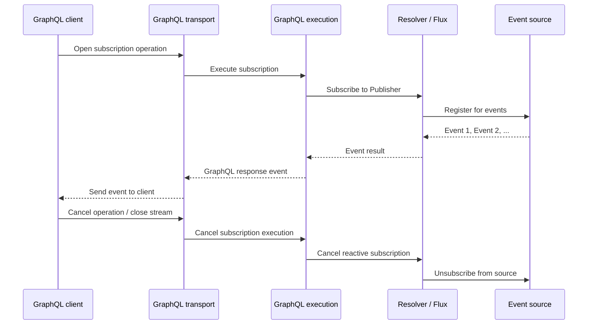

# Cancelling subscriptions

In GraphQL, a subscription creates an event stream from the server to the client. Because the stream can continue emitting data for a long time, the client needs a way to stop it when the user leaves the screen, closes a dashboard, or no longer needs updates. Cancelling a subscription means terminating an active registration and releasing the resources attached to that subscription.

With Spring for GraphQL, subscriptions are typically represented by a `Publisher` such as Reactor's `Flux`. When the client cancels the operation or disconnects, the cancellation signal must propagate backward through the reactive chain to the data source. Controllers and services can observe this signal to stop listening to a message broker, close listeners, or clean up resources.

## 1. Lifecycle of a subscription

Unlike a query that returns one result and ends, a subscription keeps a stream active until one of the following occurs:

- The client proactively cancels the operation.
- The transport connection is closed or dropped.
- The publisher completes naturally.
- The publisher emits an error and terminates.
- The server proactively terminates the source according to application policy.

Example schema for tracking stock prices:

```graphql
type Subscription {
    priceUpdates(symbol: String!): PriceUpdate!
}

type PriceUpdate {
    symbol: String!
    price: Float!
    changedAt: String!
}
```

The client opens a subscription:

```graphql
subscription WatchPrice($symbol: String!) {
    priceUpdates(symbol: $symbol) {
        symbol
        price
        changedAt
    }
}
```

Each event from the server produces a GraphQL result for the `priceUpdates` field. The stream continues until it is cancelled, completes, or errors.

## 2. Mapping subscriptions with @SubscriptionMapping

In Spring for GraphQL, `@SubscriptionMapping` maps a controller method to a field on the `Subscription` root type. The method usually returns a reactive publisher.

```java
package com.example.graphql.market;

import org.springframework.graphql.data.method.annotation.Argument;
import org.springframework.graphql.data.method.annotation.SubscriptionMapping;
import org.springframework.stereotype.Controller;
import org.slf4j.Logger;
import org.slf4j.LoggerFactory;
import reactor.core.publisher.Flux;

@Controller
public class MarketSubscriptionController {

    private static final Logger log =
        LoggerFactory.getLogger(MarketSubscriptionController.class);

    private final PriceService priceService;

    public MarketSubscriptionController(PriceService priceService) {
        this.priceService = priceService;
    }

    @SubscriptionMapping
    public Flux<PriceUpdate> priceUpdates(
            @Argument("symbol") String symbol) {
        return priceService.priceUpdates(symbol);
    }
}
```

Spring for GraphQL connects the returned publisher to GraphQL subscription execution. There is no need to issue a separate HTTP request per event; a single subscription operation maintains the result stream over the configured transport.

`@SubscriptionMapping` targets a field on the `Subscription` root type. If nested fields need to resolve data for each event, they can be combined with regular field resolvers, while the root stream lifecycle still begins at the subscription mapping.

## 3. Client-side cancellation of a subscription operation

How cancellation works depends on the transport the client is using.

**WebSocket:** the client sends an operation-termination message according to the GraphQL over WebSocket protocol (commonly called `complete`). Terminating one operation does not necessarily close the entire WebSocket connection. Other subscription operations on the same connection can keep running.

**Server-Sent Events (SSE):** the client stops receiving the stream by aborting the request or closing the HTTP connection holding the event stream. The server detects the cancelled connection and cancels the corresponding publisher when the transport propagates cancellation down to execution.

For example, in a UI, when a component no longer needs data, the client should unsubscribe/dispose the subscription handle or cancel the active stream. Merely hiding a component or stopping rendering does not guarantee the server receives a cancellation signal.

Cancelling a subscription operates on a single active operation. Do not close the entire WebSocket if the client only wants to stop one stream, unless the application genuinely intends to end the connection.

## 4. Propagating cancellation through the reactive chain

In Reactive Streams, a subscriber can call `cancel()` on the subscription to ask the publisher to stop emitting data. In Reactor, operators such as `map`, `filter`, `doOnNext`, and standard chains propagate cancellation upstream.

General flow:



When cancellation reaches the source, the source can stop producing data dedicated to that client. Whether work actually stops depends on whether the publisher and source adapter support cancellation. A wrapper that drops cancellation or a non-interruptible blocking call can leave underlying work running even after the client has left.

## 5. Observing cancellation with doOnCancel

Reactor provides `doOnCancel` to run an action when the subscriber cancels the stream. You can use it to log, increment metrics, or ask a service to stop a listener.

```java
import org.springframework.graphql.data.method.annotation.Argument;
import org.springframework.graphql.data.method.annotation.SubscriptionMapping;
import org.springframework.stereotype.Controller;
import org.slf4j.Logger;
import org.slf4j.LoggerFactory;
import reactor.core.publisher.Flux;

@Controller
public class MarketSubscriptionController {

    private static final Logger log =
        LoggerFactory.getLogger(MarketSubscriptionController.class);

    private final PriceService priceService;

    public MarketSubscriptionController(PriceService priceService) {
        this.priceService = priceService;
    }

    @SubscriptionMapping
    public Flux<PriceUpdate> priceUpdates(
            @Argument("symbol") String symbol) {

        return priceService.priceUpdates(symbol)
            .doOnCancel(() ->
                log.info("Price subscription cancelled: {}", symbol)
            );
    }
}
```

The illustrative snippet assumes logger `log` is declared in the controller. `doOnCancel` runs only when downstream sends a cancellation signal. It does not run when the publisher completes naturally or terminates with an error.

Do not use `doOnCancel` as the sole cleanup site if resources must be released across all three outcomes: cancel, complete, and error. When every termination path must be handled, consider `doFinally` or resource operators such as `using`/`usingWhen`.

## 6. Cleaning up resources with doFinally

`doFinally` receives a `SignalType` indicating whether the stream ended via `CANCEL`, `ON_COMPLETE`, or `ON_ERROR`. You can use it to record the termination reason and perform general cleanup.

```java
import reactor.core.publisher.SignalType;

@SubscriptionMapping
public Flux<PriceUpdate> priceUpdates(
        @Argument("symbol") String symbol) {

    return priceService.priceUpdates(symbol)
        .doFinally(signalType -> {
            if (signalType == SignalType.CANCEL) {
                log.info("Client cancelled price stream: {}", symbol);
            } else if (signalType == SignalType.ON_COMPLETE) {
                log.info("Price stream completed: {}", symbol);
            } else if (signalType == SignalType.ON_ERROR) {
                log.warn("Price stream failed: {}", symbol);
            }
        });
}
```

`doFinally` is useful for telemetry and lightweight cleanup. If releasing resources is asynchronous or can fail, use an appropriate resource-management mechanism instead of running blocking work inside the termination callback.

Do not assume cleanup callbacks always run on the exact same thread as the controller. Reactive chains can switch threads; cleanup should be safe for the executing thread and must not rely on unsynchronized shared mutable state.

## 7. Using `using` for per-subscription resource management

When each client creates a dedicated listener to an event broker or data source, the resource must be acquired on subscribe and closed when the stream ends—including when the client cancels.

Example assuming `PriceFeedHandle` has an `events()` method returning `Flux<PriceUpdate>` and `close()` to detach the listener from the broker:

```java
public Flux<PriceUpdate> priceUpdates(String symbol) {
    return Flux.using(
        () -> priceFeed.open(symbol),
        PriceFeedHandle::events,
        PriceFeedHandle::close
    );
}
```

`Flux.using` ties resource lifecycle to the reactive subscription. When downstream cancels, completes, or errors, the disposer runs to close the handle. This reduces the risk of forgetting to remove a listener on one of the termination branches.

If opening or closing the resource is asynchronous, use `Flux.usingWhen` with corresponding cleanup publishers. Choose the operator based on the actual source API and ensure cleanup is never skipped on cancel.

Avoid writing code like:

```java
public Flux<PriceUpdate> priceUpdates(String symbol) {
    priceFeed.register(symbol);
    return priceFeed.events(symbol);
}
```

Without a listener-removal mechanism tied to the publisher's lifecycle, each subscription can leave an active registration behind after the client cancels. Over time, listener count grows and causes a resource leak.

## 8. Do not call subscribe manually in the controller

A resolver should return the publisher for Spring for GraphQL to manage. Never call `subscribe()` manually inside the controller:

```java
// Avoid: creates a subscription detached from GraphQL execution.
@SubscriptionMapping
public Flux<PriceUpdate> priceUpdates(String symbol) {
    priceService.priceUpdates(symbol).subscribe();
    return priceService.priceUpdates(symbol);
}
```

The code above can create two independent streams: one subscribed manually and another subscribed by the GraphQL runtime. When the client cancels the operation, only the GraphQL-managed stream is affected; the manually subscribed stream can keep running and holding resources.

Return the `Flux` or `Publisher` directly:

```java
@SubscriptionMapping
public Flux<PriceUpdate> priceUpdates(@Argument String symbol) {
    return priceService.priceUpdates(symbol);
}
```

Spring for GraphQL will manage the subscription lifecycle through the returned publisher.

## 9. Distinguishing cancelling one subscriber from stopping a shared source

Not every publisher is dedicated to a single client. A source can be shared across multiple subscribers—for example, a hot stream broadcasting market prices to many connections.

When one client cancels its subscription:

- That subscriber should stop receiving events.
- Listeners or resources specific to that client should be removed.
- The shared source should stop only when no subscribers remain or according to source management policy.

Do not shut down the entire broker/topic inside each client's `doOnCancel` if multiple clients share the source. Doing so would disrupt other users' subscriptions.

For shared streams, separate child subscription lifecycles from the underlying source lifecycle. You can use `share`, `publish().refCount()`, or broker subscriber management depending on your design, provided you understand the connection and cancellation conditions of the chosen operator.

## 10. Cancelling subscriptions vs. errors or completion

Cancellation differs from completion and errors:

| Termination | Initiated by | Reactive signal | Behavior |
| --- | --- | --- | --- |
| Cancel | Client or downstream | `cancel()` | Requests stopping events and releasing resources |
| Complete | Publisher/server | `onComplete` | Stream ends normally |
| Error | Publisher/server | `onError` | Stream ends due to an error |

If the server emits a finite publisher, such as `Flux.take(10)`, the stream completes after 10 events. The client does not need to send unsubscribe to end it. If the source emits an error, the stream terminates with `onError`; the client may re-subscribe per its own retry policy.

`doOnCancel` reflects cancellation only. `doFinally` observes all three outcomes. Regardless of which operator is used, never treat cancel as a transaction rollback: side effects that occurred prior to cancellation are not automatically undone.

## 11. Authorization and revocation in long-lived subscriptions

A subscription can live longer than an ordinary request. Therefore, define authorization policies at two points:

- **At start:** authenticate the client, verify permission to open the subscription, and validate parameters such as symbol or tenant.
- **During event emission:** if permissions can change while the stream is active, filter data or terminate the stream when access is revoked.

Do not check permissions only once if security requirements mandate that permission revocation take effect immediately on active streams. Conversely, you do not always need a database permission query for every event if policy allows a permission snapshot at subscribe time; decide based on business requirements.

When detecting that a client no longer has access, the server can complete the publisher or emit an error according to the error contract. Once the stream ends, the client must start a new subscription after permissions are restored.

Do not include tokens, cookies, or credentials in cancellation logs. You may log the operation ID, sanitized user/tenant ID per logging policy, and a safe termination reason.

## 12. Testing cancellation

Test at two levels: reactive publisher/service and GraphQL subscription over transport.

### 12.1. Testing the publisher with StepVerifier

Example of a continuous source recording when it is cancelled:

```java
import java.time.Duration;
import java.util.concurrent.atomic.AtomicBoolean;

import static org.assertj.core.api.Assertions.assertThat;

import org.junit.jupiter.api.Test;
import reactor.core.publisher.SignalType;
import reactor.core.publisher.Flux;
import reactor.test.StepVerifier;

class PriceServiceTest {

    @Test
    void releasesResourceWhenSubscriberCancels() {
        AtomicBoolean closed = new AtomicBoolean();

        Flux<Long> stream = Flux.interval(Duration.ofMillis(10))
            .doFinally(signal -> {
                if (signal == SignalType.CANCEL) {
                    closed.set(true);
                }
            });

        StepVerifier.create(stream)
            .expectNext(0L)
            .thenCancel()
            .verify();

        assertThat(closed.get()).isTrue();
    }
}
```

The illustrative test requires importing `SignalType` and `assertThat` from AssertJ. It verifies that cancellation reaches the publisher and the cleanup callback executes. With real resources, verify that handles/listeners have been closed or removed from the broker.

### 12.2. Testing GraphQL subscriptions over transport

You can use `GraphQlTester` in a subscription-capable mode, such as a tester connected over WebSocket, to open an operation and cancel the event stream:

```java
Flux<PriceUpdate> updates = graphQlTester
    .document("""
        subscription {
            priceUpdates(symbol: "ACME") {
                symbol
                price
            }
        }
        """)
    .executeSubscription()
    .toFlux("priceUpdates", PriceUpdate.class);

StepVerifier.create(updates)
    .expectNextCount(1)
    .thenCancel()
    .verify();
```

This snippet assumes `graphQlTester` is configured with a tester supporting a subscription transport and the server has an event source. In WebSocket tests, verify that after `thenCancel()`, the server received operation termination and subscriber resources were released. A test running `StepVerifier` solely on a service `Flux` does not prove WebSocket/SSE transport propagates cancellation correctly; write integration tests for the deployed transport.

## 13. Common mistakes when cancelling subscriptions

| Symptom | Possible cause | Resolution |
| --- | --- | --- |
| Client stops displaying UI, but server still emits events | UI only stopped rendering without unsubscribing | Cancel the operation/subscription handle when the component unmounts |
| Broker listener remains after client disconnects | Publisher does not tie cleanup to cancellation | Use `using`, `usingWhen`, `doFinally`, or a suitable disposer |
| One client cancelling causes other clients to lose data | Cleanup shuts down a shared source instead of per-subscriber state | Manage subscriber lifecycle and shared publisher separately |
| Resources keep running after cancel | Blocking source or adapter does not propagate cancellation | Use cancellable/non-blocking APIs and verify propagation |
| Cleanup does not run when stream completes | Using `doOnCancel` only | Use `doFinally` or a resource operator for complete/error/cancel |
| Two streams run after one subscribe | Controller calls `subscribe()` manually and also returns publisher | Never subscribe manually inside resolvers |
| Termination reason is unknown | Not inspecting signal type | Record `CANCEL`, `ON_COMPLETE`, `ON_ERROR` |
| WebSocket stays open after cancelling one operation | Only the operation ended; connection is shared | This is normal behavior; close the connection only when ending the entire session |

## 14. Checklist for implementing subscription cancellation

- Does the subscription resolver return a `Publisher`/`Flux` managed by the GraphQL runtime?
- Does the client unsubscribe the operation when the stream is no longer needed?
- Does the transport in use propagate cancellation when the operation or connection ends?
- Does the reactive chain propagate cancellation to the event source?
- Are per-subscriber listeners, connections, and resources closed upon cancel?
- Does cleanup also handle complete and error when required?
- Does the controller avoid calling `subscribe()` manually?
- Does a shared publisher protect other subscribers when one client cancels?
- Are permissions checked at startup and during the stream when policy requires?
- Do tests verify cancellation at both the service and transport layers?
- Do logs/metrics record cancellation without leaking credentials?

Subscription cancellation is part of the reactive stream lifecycle. The client terminates the operation over the transport, Spring for GraphQL cancels the corresponding publisher, and cancellation must propagate to the data source to detach listeners, close connections, or stop subscriber-specific work. Use `doOnCancel`, `doFinally`, or `using`/`usingWhen` depending on the resource type; avoid manual `subscribe()` in controllers and never shut down a shared source when only one client leaves. Testing both the publisher and the transport ensures subscriptions leave no dangling resources after clients cancel.
