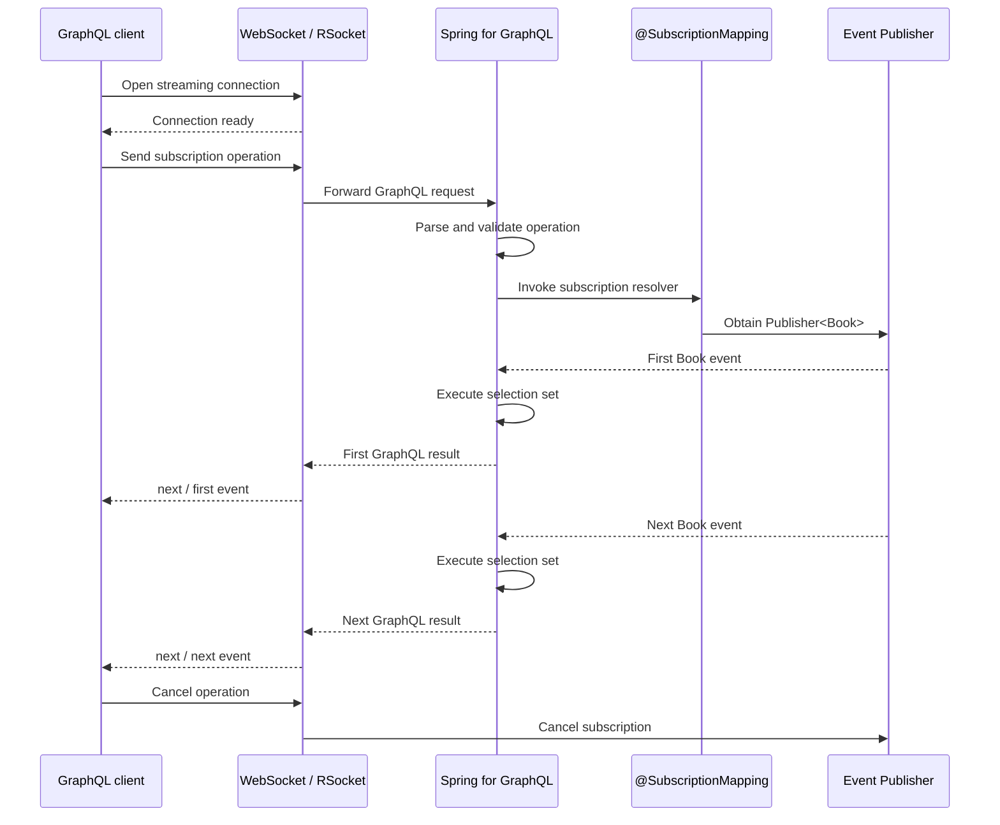

# Subscription lifecycle

## 1. What is a Subscription?

A Query normally returns a single result per call. A Mutation performs a data-modifying operation and also returns the result of that operation. A Subscription is used when a client wants to receive multiple results over time as the server emits new events.

For example, an admin dashboard wants to receive a notification whenever a new book is created. Instead of repeatedly sending Queries to poll whether a new book exists, the client opens a Subscription and keeps a streaming connection to receive events:

```graphql
type Subscription {
    bookAdded: Book!
}

type Book {
    id: ID!
    title: String!
}
```

The client subscribes:

```graphql
subscription OnBookAdded {
    bookAdded {
        id
        title
    }
}
```

When a new book is emitted, the client receives a GraphQL result containing that book's data. When the next event occurs, the client receives the next result on the same Subscription.

In Spring for GraphQL, a subscription field is typically mapped with `@SubscriptionMapping`. The resolver method returns a Reactive Streams `Publisher<T>`, usually `Flux<T>`, representing the event stream.

## 2. Distinguishing a Subscription operation from a Reactive Streams Subscription

The two concepts share similar names but belong to different layers:

| Concept | Role |
| --- | --- |
| GraphQL Subscription operation | Operation in a GraphQL document requesting the server to send multiple results per event |
| Reactive Streams `Publisher<T>` | Asynchronous item producer on the Java side |
| Reactive Streams `Subscription` | Object controlling item demand and cancellation between Subscriber and Publisher |
| Spring `@SubscriptionMapping` | Annotation mapping a field on the `Subscription` root type to a controller method |

A GraphQL Subscription is not an SDL data type named `Publisher`. SDL declares the field returning a regular GraphQL type such as `Book!`; the Java resolver returns `Publisher<Book>` to supply multiple values over time.

Reactive Streams `Subscription` manages the relationship between publisher and subscriber in Java. GraphQL Subscription manages an operation and the GraphQL results sent to the client over a streaming transport. Spring for GraphQL bridges these two layers.

## 3. Overall lifecycle of a Subscription

A Subscription typically goes through the following stages:

1. The client establishes a streaming transport, typically WebSocket or RSocket.
2. The client sends the GraphQL Subscription operation along with variables and operation name.
3. The server parses the document, validates it against the schema, identifies the root subscription field, and invokes the resolver.
4. The resolver returns a `Publisher` as the event source.
5. Each item emitted by the Publisher becomes the source event for one execution of the Subscription's selection set.
6. The server sends each GraphQL execution result to the client.
7. When the Publisher completes, the server terminates the operation. When the client cancels or the transport closes, the subscription is cancelled and associated resources are released.



A transport connection can outlive a single Subscription operation. A client can run multiple operations on the same WebSocket connection and cancel each operation individually.

## 4. Declaring the Subscription root in SDL

The schema must have a `Subscription` root type and at least one subscription field:

```graphql
type Query {
    books: [Book!]!
}

type Mutation {
    createBook(input: CreateBookInput!): Book!
}

type Subscription {
    bookAdded: Book!
}

type Book {
    id: ID!
    title: String!
}
```

In this example, `bookAdded` is the single field of the sample operation. GraphQL requires a Subscription operation to have one root execution field. Child fields such as `id` and `title` belong to the selection set of `Book`, not additional Subscription root fields.

The field's return type in SDL describes the value of each event. For example, `Book!` means every event must provide a non-null `Book`. It does not mean the entire stream can emit only one book.

If an event might fail to carry a valid object, review the event model and nullability. Do not declare `Book!` and emit `null` for an event, as GraphQL will produce a non-null error for that execution.

## 5. Mapping a Subscription with `@SubscriptionMapping`

Spring for GraphQL provides `@SubscriptionMapping` to map a method to a field on the `Subscription` root type:

```java
import org.springframework.graphql.data.method.annotation.SubscriptionMapping;
import org.springframework.stereotype.Controller;
import reactor.core.publisher.Flux;

@Controller
public class BookSubscriptionController {

    private final BookEventPublisher bookEventPublisher;

    public BookSubscriptionController(BookEventPublisher bookEventPublisher) {
        this.bookEventPublisher = bookEventPublisher;
    }

    @SubscriptionMapping
    public Flux<Book> bookAdded() {
        return bookEventPublisher.bookAdded();
    }
}
```

The method name `bookAdded` is used as the field name if no explicit name is specified. You can use `@SubscriptionMapping(name = "bookAdded")` to make the mapping explicit.

`@SubscriptionMapping` is the specialized annotation for the `Subscription` root. Do not use `@QueryMapping` for subscription fields. The method must return a compatible `Publisher`, such as `Flux<Book>` or `Mono<Book>`.

`Flux<Book>` can emit many events. `Mono<Book>` emits at most one event and completes, so it is only appropriate when business logic genuinely requires a single asynchronous emission rather than a long-lived stream.

## 6. Each event produces a GraphQL execution result

When a subscription resolver returns `Flux<Book>`, GraphQL does not send raw Java objects directly to the client. Each `Book` item serves as the source event for the root subscription field. GraphQL executes the selection set on that event, invokes any required field resolvers, and produces a GraphQL response result.

Example client request:

```graphql
subscription {
    bookAdded {
        id
        title
        author {
            id
            name
        }
    }
}
```

For each emitted `Book`:

- GraphQL reads `id` and `title` from the event object or property data fetcher.
- GraphQL resolves the `author` field via its corresponding mapping.
- Field errors, if any, are recorded in `errors` of that event's execution result.
- The result containing `data` and possibly `errors` is sent as one message on the Subscription stream.

Thus, a single Subscription operation can produce multiple response results. Each result corresponds to one event, rather than one giant JSON response containing the entire event history.

## 7. Creating an event source with Reactor `Sinks.Many`

In a real application, events may come from a message broker, domain events, or another service. To illustrate a simple in-process emitter within the same application, you can use Reactor `Sinks.Many`:

```java
import org.springframework.stereotype.Component;
import reactor.core.publisher.Flux;
import reactor.core.publisher.Sinks;

@Component
public class BookEventPublisher {

    private final Sinks.Many<Book> sink =
        Sinks.many().multicast().onBackpressureBuffer();

    public Flux<Book> bookAdded() {
        return sink.asFlux();
    }

    public void publish(Book book) {
        Sinks.EmitResult result = sink.tryEmitNext(book);

        if (result.isFailure()) {
            // Log or apply an appropriate retry / event handling policy.
            throw new IllegalStateException(
                "Cannot emit Book event: " + result
            );
        }
    }
}
```

`Sinks.Many` is a proactive emitter. Services can call `publish(book)` when a new book is created, while listening Subscriptions receive events via `asFlux()`.

This example uses `multicast()` to deliver events to active subscribers. New subscribers do not automatically receive all historical events. If business logic requires replay or history persistence, choose a bounded replay strategy or read events from a durable event store/message broker.

Never ignore `Sinks.EmitResult`. Emitting can fail when there are no subscribers, the sink has terminated, or concurrent emission contention occurs depending on sink configuration. The application must decide whether to log, retry, persist durably, or accept dropping the event per business requirements.

## 8. Cold Publisher and Hot Publisher

A Subscription source can be a cold or hot publisher:

| Characteristic | Cold Publisher | Hot Publisher |
| --- | --- | --- |
| Starts emitting | When subscribed | Can emit independently of subscribers |
| Data across subscribers | Each subscriber can have its own stream | Multiple subscribers can receive live emitted events together |
| Examples | `Flux.defer`, per-subscriber stream queries | `Sinks.Many`, event bus, message broker topic |
| Late subscribers | Can start from the beginning depending on source | Usually receive events only from subscription time unless replay exists |
| Suitable cases | Streams tailored per individual client | Shared events such as new orders or system status |

Cold publisher example:

```java
public Flux<Book> recentBooks() {
    return Flux.defer(() -> bookService.streamRecentBooks());
}
```

Each time a subscriber subscribes, `Flux.defer` calls the service again to create a new stream. If the service opens a database cursor or calls a remote API, each Subscription can allocate its own resource.

An example of a hot publisher is `Sinks.Many` from the previous section. All active subscribers listen to that same event source. Decide explicitly whether to replay past events to new subscribers and bound buffers if subscribers process slowly.

Do not use a single global publisher when data per subscriber needs user or tenant filtering without a safe routing/filtering step. Filter events by each Subscription's permissions or segregate event sources by access scope.

## 9. Transport and WebSocket protocol

Subscriptions require a transport capable of delivering multiple results over a long period. In Spring for GraphQL, WebSocket is a common choice; RSocket also supports suitable streaming interaction models. A standard HTTP request-response is insufficient to sustain a long-lived event stream.

With WebSocket, Spring for GraphQL supports the GraphQL over WebSocket protocol `graphql-transport-ws`. The basic message flow includes:

| Message | Direction | Meaning |
| --- | --- | --- |
| `connection_init` | Client → Server | Initializes the GraphQL connection, optionally carrying an auth payload |
| `connection_ack` | Server → Client | Server accepts connection initialization |
| `subscribe` | Client → Server | Starts a GraphQL operation with operation ID and payload |
| `next` | Server → Client | Sends a GraphQL execution result of a Subscription |
| `error` | Server → Client | Reports an operation/protocol error per protocol rules |
| `complete` | Bidirectional | Server finishes the operation or client requests cancelling the operation |
| `ping` / `pong` | Bidirectional | Checks and maintains connection liveness |

A single WebSocket connection can carry multiple operations with different IDs. When the client sends `complete` for one operation, the server cancels that operation's stream; the connection can keep serving other operations.

Example WebSocket endpoint configuration in Spring Boot:

```yaml
spring:
  graphql:
    websocket:
      path: /graphql
```

The client must connect to the right endpoint and negotiate a compatible protocol. When using a client library, verify it supports `graphql-transport-ws`; some legacy libraries use the `graphql-ws` protocol with a different message format.

## 10. Authentication and authorization in Subscriptions

A Subscription can live much longer than a regular HTTP request, so distinguish connection authentication, operation authorization, and per-event authorization.

- **Connection authentication:** identify the user during the WebSocket handshake or via connection initialization payload. Never trust client-sent payloads before verifying tokens.
- **Operation authorization:** verify whether the user is allowed to open that Subscription field when the operation begins.
- **Event authorization:** if access rights can change or events contain data across multiple scopes, verify permissions/tenant per event before emitting to the client.
- **Connection lifecycle:** when a token expires, a user is locked, or a session is revoked, the application needs a policy to terminate open operations.

Example of filtering events by authenticated tenant:

```java
@SubscriptionMapping
public Flux<Book> bookAdded(@ContextValue("tenantId") String tenantId) {
    return bookEventPublisher.bookAdded()
        .filter(book -> tenantId.equals(book.tenantId()));
}
```

This example assumes `tenantId` is placed into `GraphQLContext` from the authenticated principal and `Book` has a tenant attribute. In real applications, filter inside the service/event source by tenant to avoid loading or dispatching out-of-scope data.

Method security such as `@PreAuthorize` on a subscription resolver generally protects opening the stream. It does not automatically re-run permission checks for every emitted event. If permissions can be revoked while the stream stays open, enforce per-event checks or proactively cancel subscriptions per security policy.

Do not use user IDs or tenant IDs from GraphQL variables as the sole basis for filtering data. Access scope values must come from an authenticated security context.

## 11. Context and state of a Subscription

A Subscription operation may need to retain information such as tenant, principal, locale, or correlation ID throughout its active lifetime. Spring for GraphQL lets you place server-side data into `GraphQLContext` and read it in resolvers via `@ContextValue` or `GraphQLContext`.

Example:

```java
@SubscriptionMapping
public Flux<Book> bookAdded(
        @ContextValue("tenantId") String tenantId,
        @ContextValue("correlationId") String correlationId) {

    return bookEventPublisher.bookAddedForTenant(tenantId)
        .doOnNext(book -> log.debug(
            "Delivering book {} for request {}",
            book.id(), correlationId
        ));
}
```

The GraphQL execution context and WebSocket connection attributes are two distinct scopes. One connection can run multiple operations; each operation has its own GraphQL request and context. If you need authentication info from the connection, retrieve it from the server-verified principal or session metadata and place it into the operation's context.

Never store per-user mutable state in fields of a singleton controller. Controllers are typically managed by Spring as singletons, so per-Subscription data must live in the operation's context or dedicated publisher to avoid cross-user leaks.

## 12. Completion, cancellation, and releasing resources

A Subscription can terminate in several ways:

1. **Publisher completes:** the event source finishes and calls `onComplete`; the server ends the operation and notifies the client of completion.
2. **Client cancels:** the client sends a `complete` message for the operation; the server cancels the corresponding Reactive Streams subscription.
3. **Transport disconnects:** the WebSocket or RSocket connection closes; operations tied to that connection are cancelled.
4. **Publisher errors:** the event source signals `onError`; the operation ends per GraphQL/transport error handling.
5. **Server policy:** the server proactively terminates the operation due to timeout, resource limits, or revoked access.

The publisher must support cancellation to release resources such as database cursors, message consumers, or listeners. You can attach cleanup to the reactive pipeline:

```java
public Flux<Book> watchBooks(String tenantId) {
    return eventSource.streamBooks(tenantId)
        .doFinally(signalType ->
            log.debug("Book stream ended: {}", signalType)
        );
}
```

`doFinally` is invoked when the stream completes, errors, or is cancelled. If the publisher opens closeable resources, use appropriate resource-management APIs such as `using`/`usingWhen` or the message broker client's cleanup mechanism.

Do not subscribe manually inside a resolver and do not store subscription handles in a global variable to control multiple clients. Return the publisher to Spring for GraphQL so its lifecycle remains bound to the operation and transport.

## 13. Backpressure and slow subscribers

Reactive Streams provides backpressure so a subscriber can regulate how many items it can receive. However, a GraphQL WebSocket client may read slower than the event source emits. If the system does not bound buffering, memory usage can grow over time.

When designing a Subscription, determine:

- Whether the event source supports backpressure.
- Whether buffering is used, and what the buffer limit is.
- When the buffer is full, whether the system drops, rejects, retries, or persists events durably.
- Whether multiple events can be coalesced into one latest snapshot.
- Whether pagination or change notifications should be used so clients re-fetch current data via Query.

With `Sinks.Many`, select a sink matching your multicast, replay, and backpressure policies. Never use an unbounded buffer for an event stream that can grow indefinitely. If critical events cannot be lost, use a message broker or event store with persistence and consumer offsets rather than relying solely on an in-memory sink.

Subscriptions should not become an unbounded pipe for every data mutation. Cap emission frequency, payload size, and concurrent subscription counts according to server capacity.

## 14. Errors in the Subscription lifecycle

Errors can arise before the stream begins or while emitting events:

| Stage | Example | Required behavior |
| --- | --- | --- |
| Parse/validation of operation | Syntax error, non-existent field, multiple root fields selected | Return GraphQL errors; do not open an event stream |
| Resolver initialization | User unauthorized or unable to create Publisher | Reject operation initialization and return an appropriate error |
| Publisher emitting | Event source hits an infrastructure error and signals `onError` | Terminate stream per error handling policy; log internal cause |
| Executing a field of an event | Child field resolver fails while processing a `Book` | That event's GraphQL result may contain partial `data` and `errors` |
| Transport | WebSocket closes or protocol error | Cancel affected operations and release resources |
| Authorization change | User loses permissions while stream is open | Filter events or cancel operation per policy |

A child-field execution error for one event differs from a terminal Publisher error. Field errors can be represented in that event's GraphQL result while the source Publisher continues emitting later events. By contrast, when the Publisher emits `onError`, the source stream has terminated and will not continue emitting normal events.

Do not swallow publisher errors and replace them with `Flux.empty()` if the client needs to know the stream failed. Doing so disguises an error as normal completion and loses diagnostic visibility.

## 15. Emitting Subscription events after Mutation commit

A common scenario is a Mutation creating data and a Subscription notifying clients. Do not emit events before the database transaction commits successfully, because clients might receive an object whose transaction is later rolled back.

You can use domain events and `@TransactionalEventListener` in the `AFTER_COMMIT` phase:

```java
@Component
public class BookCreatedListener {

    private final BookEventPublisher publisher;

    public BookCreatedListener(BookEventPublisher publisher) {
        this.publisher = publisher;
    }

    @TransactionalEventListener(phase = TransactionPhase.AFTER_COMMIT)
    public void onBookCreated(BookCreated event) {
        publisher.publish(event.book());
    }
}
```

The book-creation service publishes the domain event inside the transaction:

```java
@Transactional
public Book createBook(CreateBookInput input) {
    Book saved = bookRepository.save(Book.create(input));
    eventPublisher.publishEvent(new BookCreated(saved));
    return saved;
}
```

`@TransactionalEventListener(AFTER_COMMIT)` fires only after the transaction commits. This pattern fits in-memory events within a single instance. If the application runs multiple instances or events must never be lost if the process stops, use a transactional outbox or durable message broker instead of emitting only through `Sinks.Many`.

## 16. Testing Subscriptions with StepVerifier

You can test a Publisher at the service layer using Reactor `StepVerifier`. Example:

```java
import java.time.Duration;
import org.junit.jupiter.api.Test;
import reactor.core.publisher.Flux;
import reactor.test.StepVerifier;

class BookEventPublisherTests {

    @Test
    void emitsBooksAndCompletes() {
        Flux<Book> events = Flux.just(
            new Book("b1", "GraphQL Basics", "t1"),
            new Book("b2", "Spring GraphQL", "t1")
        );

        StepVerifier.create(events)
            .expectNextMatches(book -> book.id().equals("b1"))
            .expectNextMatches(book -> book.id().equals("b2"))
            .verifyComplete();
    }
}
```

This is a standalone publisher test. It verifies event ordering and completion signals, but does not exercise the GraphQL schema, resolver, or transport.

## 17. Testing GraphQL Subscriptions over WebSocket

To test the entire flow, use `WebSocketGraphQlTester` with a configured WebSocket endpoint. Example operation:

```java
Flux<Book> events = tester.document("""
    subscription {
        bookAdded {
            id
            title
        }
    }
    """)
    .executeSubscription()
    .toFlux(Book.class);

StepVerifier.create(events)
    .expectNextMatches(book -> book.id().equals("b1"))
    .thenCancel()
    .verify(Duration.ofSeconds(5));
```

`tester` is a `WebSocketGraphQlTester` configured with the target URL, WebSocket client, and handshake. The test fixture must emit event `b1` after the operation is registered; after the first event, `thenCancel()` tests client stream cancellation.

Additional scenarios to test:

- A single Subscription receives multiple events in emission order.
- Two clients each receive only events within their user/tenant scope.
- Whether new subscribers receive past events matches the cold/hot/replay policy.
- Publisher completion and errors are handled properly.
- Client cancellation cleans up listeners or consumers.
- WebSocket disconnection cancels active operations.
- Per-event field resolvers produce the expected responses, including partial data and errors.
- One WebSocket connection can run multiple independent operations.
- Token expiration or permission revocation is handled per policy.

## 18. Common mistakes when implementing Subscriptions

| Symptom | Possible cause | Resolution |
| --- | --- | --- |
| Resolver is not called | Used `@QueryMapping` or method name mismatches `Subscription` | Use `@SubscriptionMapping` and check against SDL |
| Subscription returns only one event and stops | Resolver returns `Mono<T>` or source completes after one value | Use `Flux<T>` when a multi-event stream is needed |
| Client receives no events | Streaming transport not configured or client uses wrong WebSocket subprotocol | Check endpoint and `graphql-transport-ws` |
| Events missed when client connects late | Using a hot publisher without replay | Choose replay/event store if history is required |
| Memory grows continuously | Unbounded buffer or slow subscribers | Bound buffers, apply backpressure, and limit subscriptions |
| Client still receives data after cancel | Publisher does not propagate cancellation or has external side effects | Check `doFinally`, cleanup, and event source |
| User receives another tenant's events | Missing server-side security context filtering | Authenticate tenant and filter inside service/source |
| Event emitted before transaction commit | Published directly inside transaction | Use `AFTER_COMMIT` or transactional outbox |
| Publisher error turned into normal completion | Improper use of `onErrorComplete` or `Flux.empty()` | Preserve error signals and standardize error handling |
| Two Subscriptions affect each other | Storing mutable state or subscription handles in a singleton | Keep state per operation and use independent publishers |

## 19. Subscription lifecycle checklist

- [ ] Schema has a `Subscription` root and appropriate event fields.
- [ ] Client operations select only one root subscription field.
- [ ] Resolver uses `@SubscriptionMapping` and returns `Publisher<T>`.
- [ ] Each event is processed into one GraphQL execution result.
- [ ] A suitable streaming transport is chosen, typically WebSocket or RSocket.
- [ ] WebSocket client and server share the `graphql-transport-ws` protocol.
- [ ] Connection lifecycle is distinguished from operation lifecycle.
- [ ] Connection and operation are authenticated before emitting events.
- [ ] Tenant/authorization filtering runs per event when business rules require it.
- [ ] Cold/hot publisher choice and replay policy are explicit.
- [ ] Backpressure, buffering, and subscription limits are handled.
- [ ] Publisher supports cancellation and resource cleanup.
- [ ] Setup errors, per-event field errors, and terminal publisher errors are distinguished.
- [ ] Events are emitted after transaction commit.
- [ ] Publisher is tested with `StepVerifier` and transport with `WebSocketGraphQlTester`.

## Conclusion

Subscriptions in Spring for GraphQL create a stream of GraphQL results backed by a `Publisher<T>`. `@SubscriptionMapping` maps a root subscription field; the resolver returns a `Flux` or another publisher as the event source. Each emitted item is used by GraphQL to execute the selection set and produce a separate response delivered to the client over a streaming transport.

The lifecycle covers far more than opening the stream. Applications must manage transport connections, operations, authentication, event authorization, backpressure, publisher completion/errors, and cancellation. Choose cold or hot publishers based on how events are distributed, emit notifications after transaction commit, release resources when clients cancel, and test both the Publisher and the WebSocket transport. When these pieces are designed clearly, Subscriptions deliver real-time updates while keeping load and data scope under control.

## References

- [Spring for GraphQL — Annotated Controllers: Subscription Mapping](https://docs.spring.io/spring-graphql/reference/controllers.html)
- [Spring for GraphQL — Server Transports: WebSocket](https://docs.spring.io/spring-graphql/reference/transports.html)
- [Spring for GraphQL — Testing: WebSocketGraphQlTester](https://docs.spring.io/spring-graphql/reference/testing.html)
- [GraphQL Specification — Subscription](https://spec.graphql.org/October2021/#sec-Subscription)
- [Reactive Streams Specification](https://www.reactive-streams.org/)
- [Project Reactor — Sinks](https://projectreactor.io/docs/core/release/reference/coreFeatures/sinks.html)
