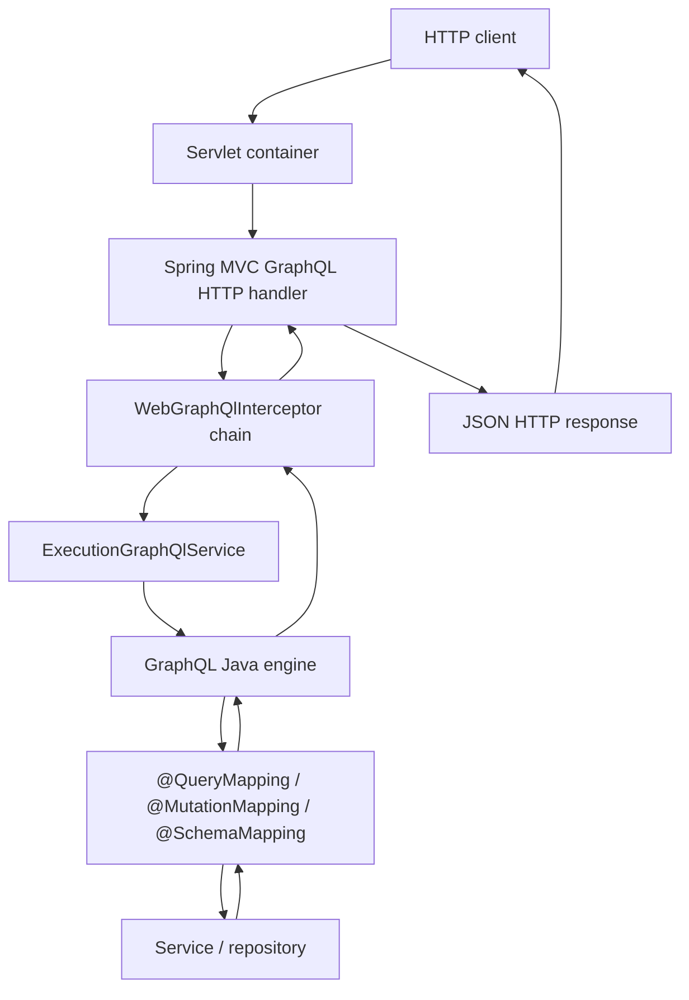

# Spring MVC transport in Spring for GraphQL

Spring for GraphQL does not depend on a specific web framework. When an application runs on Spring MVC, GraphQL requests are received through the servlet stack and forwarded to the GraphQL engine to execute the schema, resolvers, and DataFetchers. Spring Boot auto-configures the default HTTP endpoint at `POST /graphql` when `spring-boot-starter-graphql` and `spring-boot-starter-web` are present.

Spring MVC transport fits traditional servlet applications, especially when the system uses Spring MVC, Spring Security, and synchronous persistence libraries like JDBC/JPA. The transport is responsible for receiving HTTP requests, converting JSON into GraphQL requests, invoking the GraphQL processing chain, and writing responses back to the client. Resolvers remain the place where business logic lives; the `/graphql` endpoint does not need a separate REST controller for each Query or Mutation.

## Where does Spring MVC fit in the architecture?

A Spring for GraphQL application typically has the following layers:

- **HTTP transport:** receives requests at the `/graphql` endpoint, reads the JSON body, and creates a GraphQL request.
- **WebGraphQlHandler and interceptor chain:** handles web-layer details such as headers, principal, context, and response metadata.
- **ExecutionGraphQlService:** forwards requests to GraphQL Java for schema execution.
- **Annotated controller/DataFetcher:** resolves Queries, Mutations, and nested fields.
- **HTTP response:** serializes `data`, `errors`, and `extensions` to JSON and returns them via the servlet response.



Spring Boot integrates the GraphQL endpoint through Spring MVC's functional routing mechanism. Therefore, in standard setups, you only need to declare the schema and annotated controllers; there is no need to create `@PostMapping("/graphql")` to manually parse GraphQL requests.

## Dependencies to run Spring MVC transport

With Gradle Kotlin DSL:

```kotlin
dependencies {
    implementation("org.springframework.boot:spring-boot-starter-graphql")
    implementation("org.springframework.boot:spring-boot-starter-web")
}
```

With Maven:

```xml
<dependency>
    <groupId>org.springframework.boot</groupId>
    <artifactId>spring-boot-starter-graphql</artifactId>
</dependency>
<dependency>
    <groupId>org.springframework.boot</groupId>
    <artifactId>spring-boot-starter-web</artifactId>
</dependency>
```

`spring-boot-starter-web` provides Spring MVC and the servlet web server. `spring-boot-starter-graphql` provides schema loading, GraphQL Java integration, annotated controller support, and the HTTP GraphQL handler.

There is no need to add `spring-boot-starter-webflux` just to use GraphQL. If a project includes both MVC and WebFlux, you need to understand which application type and transport Spring Boot will choose; avoid adding both starters out of habit. For servlet MVC applications, keeping the MVC stack consistent makes threads, filters, and security configurations more predictable.

## Default GraphQL endpoint

When Spring Boot detects the appropriate dependencies, the default HTTP endpoint is:

```text
POST /graphql
```

The endpoint accepts GraphQL requests as JSON. You can change the path via Spring Boot configuration. In newer Spring Boot lines, the property is `spring.graphql.http.path`; in older Spring Boot lines, the property is typically `spring.graphql.path`. Example configuration for newer Boot lines:

```yaml
spring:
  graphql:
    http:
      path: /api/graphql
```

After changing the path, clients must send requests to `/api/graphql`. You also need to update security matchers, CORS, reverse proxies, API gateways, health checks, and integration tests that use the old endpoint.

Spring Boot exposes the endpoint using a `RouterFunction` with a default order priority. If the application declares other custom `RouterFunction` beans, configure `@Order` appropriately so custom routes do not shadow or conflict with the GraphQL endpoint.

## HTTP request structure

A GraphQL request over HTTP POST has `Content-Type: application/json` and a JSON body containing the document and optional operation information:

```json
{
  "query": "query BookDetail($id: ID!) { book(id: $id) { id title } }",
  "operationName": "BookDetail",
  "variables": {
    "id": "book-10"
  }
}
```

`query` is the GraphQL document. `operationName` identifies which operation to run if the document has multiple operations. `variables` holds input data separate from the query string. `extensions` can carry metadata agreed upon between client and server.

Example calling the endpoint with curl:

```bash
curl -X POST http://localhost:8080/graphql \
  -H "Content-Type: application/json" \
  -H "Accept: application/graphql-response+json, application/json" \
  -d '{
    "query": "query BookDetail($id: ID!) { book(id: $id) { id title } }",
    "operationName": "BookDetail",
    "variables": { "id": "book-10" }
  }'
```

In real-world applications, prefer variables instead of concatenating client values into the GraphQL document. This keeps queries reusable, isolates input data, and lets the GraphQL engine type-check values against the SDL.

## Content negotiation and response body

Clients can send `Accept` to declare the desired response format. The current GraphQL response media type is `application/graphql-response+json`; `application/json` is still supported for compatibility with older clients.

Example successful response:

```json
{
  "data": {
    "book": {
      "id": "book-10",
      "title": "Spring in Practice"
    }
  }
}
```

Example response with an error during field execution:

```json
{
  "data": {
    "book": null
  },
  "errors": [
    {
      "message": "Book not found",
      "path": ["book"]
    }
  ]
}
```

GraphQL can return partial `data` alongside `errors`. Clients must read both parts instead of relying solely on the HTTP status.

### HTTP status and GraphQL errors

Status rules depend on the processing stage and media type:

| Scenario | Typical HTTP status | What to inspect |
| --- | --- | --- |
| Server unavailable or infrastructure failure | 5xx | HTTP error and server logs. |
| Missing authentication or unauthorized at the security filter | 401 or 403 | HTTP response before the GraphQL engine runs. |
| Body is not valid JSON or malformed HTTP request | 4xx | Transport/binding error. |
| GraphQL document parse/validation fails with `application/graphql-response+json` | 4xx per GraphQL over HTTP. | GraphQL `errors`. |
| GraphQL document parse/validation fails with legacy `application/json` | May still be 200 for compatibility behavior. | GraphQL `errors`. |
| Request passed validation, but a resolver raised an execution error | 200 | GraphQL `errors`, possibly accompanied by partial `data`. |

Do not convert every GraphQL error into HTTP 500. When an operation is valid but a field fails, GraphQL typically returns an execution result with status 200 and describes the error in the body. This allows clients to receive the remaining fields that resolved successfully.

## Schema and annotated controllers stay the same

Choosing Spring MVC as the transport does not change how you write SDL or annotated controllers. Example schema:

```graphql
type Book {
  id: ID!
  title: String!
}

type Query {
  book(id: ID!): Book
}
```

Controller handling the Query:

```java
import org.springframework.graphql.data.method.annotation.Argument;
import org.springframework.graphql.data.method.annotation.QueryMapping;
import org.springframework.stereotype.Controller;

@Controller
public class BookController {

    private final BookService bookService;

    public BookController(BookService bookService) {
        this.bookService = bookService;
    }

    @QueryMapping
    public Book book(@Argument("id") String id) {
        return bookService.findById(id).orElse(null);
    }
}
```

The Spring MVC transport receives the HTTP request and passes it to the GraphQL runtime. The GraphQL runtime locates the `Query.book` field, invokes the DataFetcher registered by `@QueryMapping`, and serializes the result into a response. You do not need to add `@RestController` for each GraphQL field.

## How does Spring MVC handle asynchronous execution?

`GraphQlHttpHandler` has two variants for Spring MVC and Spring WebFlux. Both support asynchronous request processing, but differ in response-writing I/O: MVC is based on the servlet stack and writes responses in a blocking model; WebFlux uses non-blocking I/O.

In Spring MVC, when GraphQL execution completes immediately, the response can be written within the current request flow. When GraphQL returns an incomplete asynchronous result, Spring MVC can use Servlet async request processing to resume the response without holding the request thread for the entire wait time.

An important distinction: Servlet async does not automatically move blocking resolver calls onto another thread pool. If `@QueryMapping` calls synchronous JPA/JDBC, the thread executing the DataFetcher still waits for the database. To offload work, the controller/service needs to return an asynchronous type and actually execute the work on an appropriate executor.

Example using `CompletableFuture` with a bounded executor:

```java
@QueryMapping
public CompletableFuture<Book> book(@Argument String id) {
    return CompletableFuture.supplyAsync(
            () -> bookService.findById(id).orElse(null),
            graphqlBlockingExecutor);
}
```

`graphqlBlockingExecutor` is an executor configured and managed by the application. Avoid using the default common `ForkJoinPool` for blocking database work in high-load systems. Balance the pool size with the connection pool and database limits.

For MVC applications using JPA, synchronous resolvers can be appropriate if concurrency and query durations are controlled. There is no need to rewrite every resolver to be reactive just because the transport supports async.

## Configuring timeouts for GraphQL HTTP requests

A GraphQL operation can request many fields and call multiple dependent services. Without a time limit, resource-heavy requests can run longer than expected.

Spring for GraphQL provides `TimeoutWebGraphQlInterceptor` for web transports. You can declare a bean to set a global timeout:

```java
import java.time.Duration;
import org.springframework.context.annotation.Bean;
import org.springframework.context.annotation.Configuration;
import org.springframework.graphql.server.TimeoutWebGraphQlInterceptor;

@Configuration(proxyBeanMethods = false)
public class GraphQlTimeoutConfiguration {

    @Bean
    TimeoutWebGraphQlInterceptor graphQlTimeoutInterceptor() {
        return new TimeoutWebGraphQlInterceptor(Duration.ofSeconds(5));
    }
}
```

The timeout interceptor sends a cancellation signal up the processing chain when a request exceeds the duration. Reactive DataFetchers can react to cancellation; blocking calls such as JDBC do not necessarily stop immediately just because the HTTP request timed out. Therefore, you still need database query timeouts, HTTP client timeouts, and time limits on downstream services.

Do not pick an overly short timeout without measuring normal processing times and valid operations. You may need separate policies for heavy queries or long exports.

## Securing the endpoint in the servlet stack

The Spring MVC GraphQL endpoint sits within the servlet filter chain, so Spring Security, authentication, authorization, CORS, and CSRF can be applied just like on other HTTP endpoints.

Example requiring authentication on the endpoint:

```java
@Bean
SecurityFilterChain securityFilterChain(HttpSecurity http) throws Exception {
    return http
            .authorizeHttpRequests(authorize -> authorize
                    .requestMatchers("/graphql").authenticated()
                    .anyRequest().permitAll())
            .build();
}
```

This code snippet illustrates the endpoint rule; a real configuration must combine the application's login mechanism, session/token handling, and other matchers. Because all Queries and Mutations typically pass through the same `/graphql` path, URL-level rules only determine who can invoke the endpoint. They do not replace per-field or per-resource authorization.

For example, a user may be allowed to call GraphQL, yet only allowed to read orders belonging to their tenant. Permission checks must be enforced in services, resolvers, or method security based on the authenticated principal. Never trust a client-sent `userId` or `tenantId` as proof of authorization.

### CSRF when using session cookies

GraphQL mutations are typically sent via HTTP POST. If the application authenticates with session cookies and Spring Security enables CSRF protection, browser clients must send a valid CSRF token with mutation requests. Do not disable CSRF globally just to make GraphQL clients work.

You can configure a CSRF token repository and how clients obtain/send the token according to the application's security model. If the API only uses bearer tokens in the `Authorization` header and does not rely on automatically sent cookies, evaluate CSRF against your specific threat model before adjusting the filter chain.

### CORS for cross-origin frontends

If the frontend runs on a different domain, configure CORS for the GraphQL endpoint. Example:

```yaml
spring:
  graphql:
    cors:
      allowed-origins: "https://app.example.com"
      allowed-methods: POST
      allowed-headers: Authorization,Content-Type,X-CSRF-TOKEN
      exposed-headers: X-Request-Id
      max-age: 1800s
```

When allowing credentials/cookies, declare explicit origins; never use the `*` wildcard with credentials. CORS is only a browser policy for cross-origin requests and does not replace authentication or authorization.

## GraphQL HTTP and GET

Spring GraphQL enables only HTTP POST for the GraphQL endpoint by default. Some handler versions can be configured to support GET per GraphQL over HTTP. GET is normally reserved for Queries and must not be used to execute Mutations.

GET can be useful for clients that only support GET or for CDN caching, but the query and variables appear in the URL. Thus, consider URL length limits, proxy logs, cache keys, and sensitive data. Do not place tokens or personal data in the query string.

Only enable GET when both the handler and the route predicate allow that method. Changing only one side can cause requests to be rejected or not routed to the GraphQL handler.

## Subscriptions on Spring MVC

Spring MVC does not only handle Queries and Mutations over HTTP. Servlet applications can also enable the WebSocket transport or use Server-Sent Events (SSE) for Subscriptions with appropriate configuration.

- **HTTP request-response:** uses `POST /graphql` by default, suitable for Queries and Mutations.
- **SSE:** clients send a GraphQL request with `Accept: text/event-stream`; the server returns each execution result as a Server-Sent Event. Spring for GraphQL supports a distinct-connections mode, so evaluate concurrent connection counts and scalability.
- **WebSocket:** for servlet applications, add `spring-boot-starter-websocket` and configure `spring.graphql.websocket.path`. The WebSocket endpoint is not enabled by default.

You cannot receive multiple continuous Subscription results over a standard JSON HTTP response. If you need an event stream, choose SSE or WebSocket and configure the client to match the server protocol.

## File uploads and binary data

Standard HTTP GraphQL requests focus on JSON. Spring for GraphQL does not directly support `graphql-multipart-request-spec` for uploading files via multipart GraphQL.

For images or documents, it is usually better to use a dedicated REST upload endpoint or issue pre-signed URLs for object storage. After a successful upload, the client calls a GraphQL Mutation to store metadata or link the file to a domain object. This keeps the GraphQL schema focused on business data and leverages dedicated upload mechanisms.

## Testing the Spring MVC transport

`GraphQlTester` provides a unified testing API. To test over HTTP in Spring MVC without starting a real server, you can use `MockMvcWebTestClient` and create an `HttpGraphQlTester`.

Example test bound to the Spring MVC application context:

Add the test dependency `org.springframework.graphql:spring-graphql-test` (let Spring Boot dependency management manage the version):

```kotlin
dependencies {
    testImplementation("org.springframework.graphql:spring-graphql-test")
}
```

```java
import org.junit.jupiter.api.Test;
import org.springframework.beans.factory.annotation.Autowired;
import org.springframework.boot.test.context.SpringBootTest;
import org.springframework.graphql.test.tester.HttpGraphQlTester;
import org.springframework.test.web.reactive.server.WebTestClient;
import org.springframework.test.web.servlet.client.MockMvcWebTestClient;
import org.springframework.web.context.WebApplicationContext;

@SpringBootTest
class BookGraphQlHttpTests {

    private final HttpGraphQlTester graphQlTester;

    @Autowired
    BookGraphQlHttpTests(WebApplicationContext context) {
        WebTestClient client = MockMvcWebTestClient
                .bindToApplicationContext(context)
                .configureClient()
                .baseUrl("/graphql")
                .build();
        this.graphQlTester = HttpGraphQlTester.create(client);
    }

    @Test
    void readsBookOverMvcHttpTransport() {
        graphQlTester.document("""
                query {
                  book(id: "book-10") {
                    id
                    title
                  }
                }
                """)
                .execute()
                .path("book.id")
                .entity(String.class)
                .isEqualTo("book-10");
    }
}
```

The example needs to import `WebApplicationContext` from `org.springframework.web.context`. The project also needs the Spring Boot and Spring GraphQL test support dependencies corresponding to its version.

For tests running a real server, use `@SpringBootTest(webEnvironment = RANDOM_PORT)` and an `HttpGraphQlTester` connected to the server URL. Spring Boot can auto-configure the tester via `@AutoConfigureHttpGraphQlTester` in versions that support this annotation.

### Scenarios to test

- HTTP POST to the default path or customized path.
- JSON requests with `query`, `operationName`, and `variables` bind properly.
- Invalid `Content-Type`, malformed JSON body, and unsupported methods return appropriate HTTP errors.
- Queries and Mutations return proper `data`; resolver failures appear in `errors`.
- `application/graphql-response+json` and legacy `application/json` behave with status codes matching the transport version.
- Security filters return 401/403 before the GraphQL engine runs when endpoint permissions are missing.
- CSRF tokens and CORS preflight work with browser frontends.
- Interceptors can read request headers and add response headers.
- Timeouts cancel requests according to policy without leaving dependent tasks running indefinitely.
- If SSE/WebSocket is enabled, test using the corresponding tester and transport.

## Common issues

| Symptom | Cause | How to handle |
| --- | --- | --- |
| `/graphql` returns 404 | Missing MVC/GraphQL starter, endpoint path changed, or auto-configuration not active. | Check dependencies, application type, and `spring.graphql.*.path`. |
| Request returns 415 Unsupported Media Type | `Content-Type` is not a JSON media type supported by the handler. | Send `Content-Type: application/json`. |
| GraphQL query cannot be parsed | JSON body lacks `query` or document has syntax errors. | Check the envelope and GraphQL document. |
| Synchronous resolver holds the request thread for a long time | Blocking JDBC/JPA or slow downstream service. | Optimize queries, limit load, or offload blocking work appropriately. |
| GraphQL errors present but HTTP status is 200 | Operation passed validation, and the error occurred during execution. | Client reads `errors` and handles partial `data`. |
| Browser frontend hits a CORS error | Origin, method, or headers are not allowed. | Configure CORS for the correct frontend origin and headers. |
| Mutation gets 403 despite being logged in via cookie | CSRF token is missing or invalid. | Configure and send the proper CSRF token; do not disable CSRF globally. |
| GraphQL endpoint works, but WebSocket fails to connect | Missing WebSocket starter or path not configured. | Enable `spring.graphql.websocket.path` and configure servlet WebSocket. |
| HTTP tests bypass the MVC transport | Using `ExecutionGraphQlServiceTester` directly instead of an HTTP tester. | Use `HttpGraphQlTester` with `MockMvcWebTestClient` or a real server. |

## Key takeaways

Spring MVC transport brings GraphQL onto the servlet stack. With `spring-boot-starter-graphql` and `spring-boot-starter-web`, Spring Boot automatically provides the default HTTP POST endpoint `/graphql`. Clients send a JSON envelope containing `query`, `operationName`, `variables`, and optionally `extensions`; responses contain `data`, `errors`, and `extensions` following the GraphQL response format.

Spring MVC supports asynchronous request processing, though this does not automatically offload blocking DataFetchers. Resolvers making synchronous JDBC/JPA calls still hold the executing thread until I/O finishes. Threads, connection pools, timeouts, and operation complexity must be managed. Secure the endpoint with Spring Security, CSRF, and CORS; field- and resource-level authorization still belongs in services and resolvers. Test the HTTP transport using `HttpGraphQlTester` combined with `MockMvcWebTestClient` to verify the entire path from HTTP to the GraphQL engine.

## References

- [Spring for GraphQL — Server Transports](https://docs.spring.io/spring-graphql/reference/transports.html)
- [Spring for GraphQL — Testing](https://docs.spring.io/spring-graphql/reference/testing.html)
- [Spring Boot — Spring for GraphQL](https://docs.spring.io/spring-boot/reference/web/spring-graphql.html)
- [Spring GraphQL — Request Execution and Timeout](https://docs.spring.io/spring-graphql/reference/request-execution.html)
